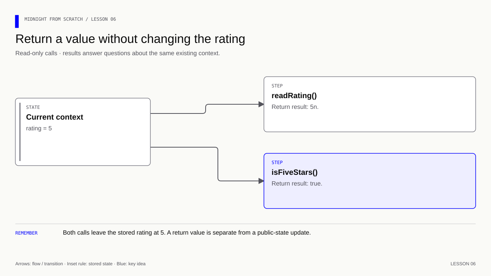
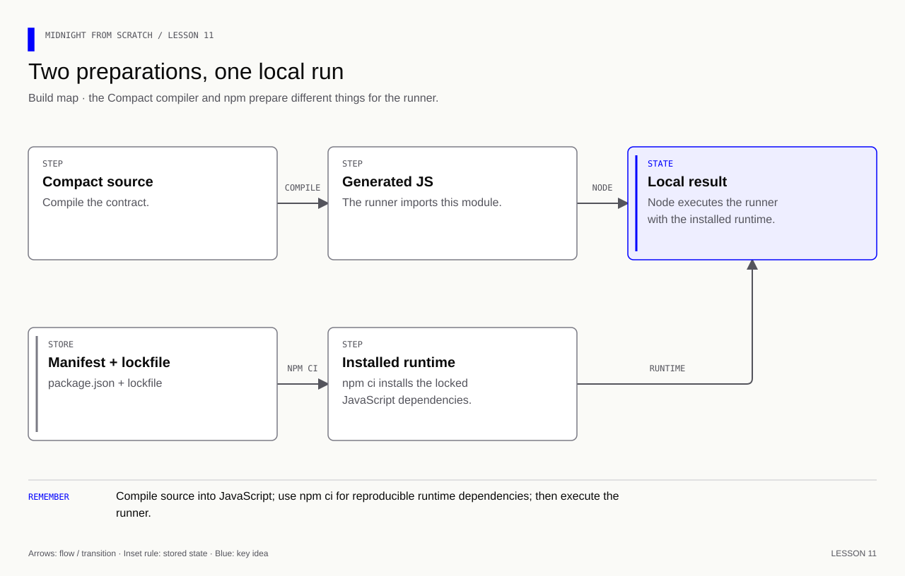
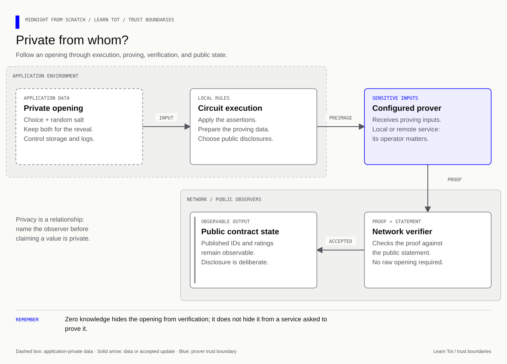

# Learn Tot — Midnight from start to finish

A single reading path through **lessons 0–22**: build a public contract, understand private inputs, seal and reveal a choice, support multiple participants, connect network services, finish with a tested sealed-bidding project, and evaluate an agent-built project.

The running problem is simple: **collect feedback without publishing each rating before the collection period ends**. That gives every new concept a job. The final auction reuses the same ideas in a different problem.

You need basic terminal and JavaScript familiarity. You do not need prior blockchain or cryptography knowledge. When a step feels unclear, ask about that specific step before adding another moving part.

## How to use this guide

Read each concept, trace its diagram, predict the example, then try the corresponding exercise. The answer sits immediately below each recall question. Close the answer and explain the idea again later: recognizing an explanation is easier than retrieving it yourself.

**Snippet convention:** a block marked **complete file** can stand alone at the stated path. An **addition**, **replacement**, or **excerpt** needs the surrounding declarations described beside it. Do not concatenate every snippet into one contract: the course intentionally changes designs between lessons. The long wallet and provider examples are explained through small excerpts, with links to their complete implementations.

**Command convention:** commands run from the repository root unless a block explicitly changes directory. Edit `Lessons/Lesson NN/Exercise/`; use the neighboring `Solution/` as the completed reference. Running a reference does not complete your exercise.

```bash
# List the checkpoints for lesson 10 before choosing a stage.
npm run check -- 10
# Check your implementation of one stage.
npm run check -- 10A
# See which source revisions have passed.
npm run progress
# Compile and run the completed lesson 9 reference.
npm run lesson9
```

A failed check identifies a missing requirement. A successful check records the revision it checked. `PASSED EARLIER` means a previous revision passed; it does not silently certify your subsequent edits. The progress history is local.

[](assets/diagrams/exercise-feedback-loop.html)

### Knowledge and version baseline

Reviewed **27 October 2026**, using the **Midnight expert** ecosystem's Compact, SDK, privacy, and verification workflows. The checked upstream revision was [`7853915`](https://github.com/midnightntwrk/midnight-expert/commit/7853915a82a605e3b74dd3b7ab7a241de8a9d136). The plugin's [network-supported compiler advisory][expert-compiler] still names `0.31.1` at that revision.

| Layer | Version used by this course | Why it has its own number |
|---|---|---|
| Node.js | `22.23.2` | Executes the JavaScript/TypeScript application |
| Compact compiler | `0.31.1` | Compiles the contract |
| Compact language | `0.23` | Selects the source-language rules |
| Compact runtime | `0.16.0` | Executes the generated JavaScript interface |
| Midnight.js | `4.1.1` | Supplies the network/application APIs |
| Wallet SDK | `1.2.0` | Supplies the wallet used by the network example |

These are compatible **course pins**, not a claim that every package is the newest registry release. The current expert guidance was cross-checked against compilation, local execution, installed SDK declarations/source, and relevant public implementation source. The [verification record](#verification-record) states what was actually checked and what was not.

### The four environments: where this course is taking you

| Stage | Network ID | Purpose for the ratings app |
|---|---|---|
| Local | `undeployed` | Fast logic tests, followed by actual transactions against the supplied Docker stack |
| Preview | `preview` | Public experiments with another person on one shared contract |
| Testnet rehearsal | `preprod` | Rehearse deployment, hosting, recovery, and release tests before launch |
| Production | `mainnet` | Publish the reviewed application with real funding and operations |

Preview and preprod are both public test networks. A frontend build command named
`preview` is separate from Midnight Preview. A production frontend build does not
select mainnet or deploy a contract. First learn the rules locally; chapters
12–14 then walk through the complete environment, sharing, and release path.

[](assets/diagrams/course-four-environments.html)

## Contents

| Step | The question you will answer |
|---|---|
| [0. Orientation](#lesson-00) | Which program does which job? |
| [1. The manifest](#lesson-01) | What describes this project? |
| [2. A public message](#lesson-02) | When does a private input become public? |
| [3. Local execution](#lesson-03) | How does JavaScript call a Compact circuit? |
| [4. State across calls](#lesson-04) | Where does the next call get its state? |
| [5. Validation](#lesson-05) | Why is a numeric type not enough? |
| [6. Return values](#lesson-06) | How is a result different from a state change? |
| [7. Witnesses](#lesson-07) | How does a circuit obtain local private data? |
| [8. Trust boundaries](#lesson-08) | What does a proof actually establish? |
| [9. Commit and reveal](#lesson-09) | How do we bind a later reveal to an earlier choice? |
| [10. Multiple participants](#lesson-10) | How do we locate, authorize, and open separate records? |
| [11. Reproducibility](#lesson-11) | How can another machine run the same project? |
| [12. Network services](#lesson-12) | What are the node, indexer, and prover for? |
| [13. Wallet and providers](#lesson-13) | How does the application connect those services? |
| [14. Deployment](#lesson-14) | When is a transaction actually confirmed? |
| [15. Feedback round](#lesson-15) | How do admission and phases coordinate a project? |
| [16. Adversarial tests](#lesson-16) | Can our tests detect broken rules? |
| [17. Opening recovery](#lesson-17) | How can tomorrow's process reveal today's commitment? |
| [18. Interface](#lesson-18) | How does the UI represent pending and confirmed state honestly? |
| [19. Privacy review](#lesson-19) | What can other people infer from the application? |
| [20. Capstone](#lesson-20) | Can you transfer these ideas to sealed bidding? |
| [21. AI-enabled development](#lesson-21) | How do I use Midnight expert and verify the result? |
| [22. Agentic project bootstrap](#lesson-22) | How do I start a new project and evaluate the agent workflow? |
| [Final review](#final-review) | What should you now be able to explain and build? |
| [Glossary](#glossary) | What do the recurring terms mean? |
| [Verification record](#verification-record) | Which statements and examples were checked? |

[](assets/diagrams/course-learning-path.html)

<a id="lesson-00"></a>
## 0. Orientation — the program, the rules, and the shared record

### 0A. Start with three responsibilities

A blockchain maintains shared accepted state. A smart contract specifies permitted changes to part of that state. Your application prepares inputs and requests changes; it cannot make an invalid change valid simply by displaying a success message.

In this course:

| Component | Responsibility | Analogy |
|---|---|---|
| Compact contract | Express state and enforce rules | The rules of a board game |
| JavaScript/TypeScript app | Collect inputs, obtain private data, call the contract, show results | The player handling pieces |
| Network | Validate transactions and maintain accepted state | The shared record everyone agrees to use |

The analogy has a limit: a network does not discover whether an unstated real-world claim is truthful. It checks what the protocol and contract actually enforce.

Midnight lets a computation use private inputs while exposing a public statement and the public effects the application chooses. Private input, public state, and proof are different things. We will repeatedly ask **“private from whom?”**, because a local file, an application process, and a remote proof service are different observers. See the expert's [contract/privacy guidance][expert-privacy].

### 0B. Learn the tool names

[](assets/diagrams/lesson-00-tools.html)

- **`compact`** selects and runs the compiler. A `.compact` file is not JavaScript.
- **Node.js** executes the generated JavaScript and your runner.
- **npm** installs JavaScript dependencies and runs named commands from `package.json`.
- **The Compact standard library** comes with the compiler; importing it is different from installing an npm package.

With the Compact manager already installed using the [official installation guide](https://docs.midnight.network/getting-started/installation):

```bash
# Select the Node version expected by the repository, when using nvm.
nvm use 22.23.2
# Install the selected Compact compiler if it is not already present.
compact update 0.31.1
# Install the dependencies recorded by the root lockfile.
npm ci
# Check that the first exercise's package settings are ready.
npm run check -- 1A
```

First install Node `22.23.2` with `nvm install 22.23.2` if necessary. An equivalent Node installation is also fine.

**Recall:** Does compiling the contract submit a transaction?

<details><summary>Answer</summary>

No. Compilation produces artifacts. Local execution calls the generated JavaScript in memory. Deployment and network transactions arrive later, with providers, proving, wallet operations, submission, and confirmation.

</details>

**Memory cue:** **Compact builds; Node runs; npm prepares.**

[Workspace and tool orientation](Lessons/Lesson%2000/Exercise/README.md).

<a id="lesson-01"></a>
## 1. The manifest — describe the project before adding behavior

**Goal:** understand the smallest configuration before introducing contract code.

In `Lessons/Lesson 01/Exercise/package.json`, the core settings are:

```json
{
  "name": "midnight-from-scratch",
  "private": true
}
```

`name` labels the npm package. `private: true` tells npm not to publish it. JSON does not allow comments, so the explanation belongs beside the snippet.

[](assets/diagrams/lesson-01-manifest.html)

**Analogy:** this is a label on a box, not the machinery inside it. Marking the box “do not publish” does not encrypt its contents or make a blockchain private.

**Try:** inspect the file, then run `npm run check -- 1A`.

**Recall:** Does `private: true` hide future ledger values?

<details><summary>Answer</summary>

No. It controls npm publication. Contract privacy is determined by inputs, circuit rules, disclosure, public state, and the surrounding application.

</details>

**Memory cue:** **Package privacy is a publishing setting.**

[Exercise](Lessons/Lesson%2001/Exercise/README.md) · [Reference](Lessons/Lesson%2001/Solution/manifest.json).

<a id="lesson-02"></a>
## 2. A public message — identify the disclosure boundary

**Goal:** create one field and one operation before adding counters or cryptography.

### 2A. Declare the state

**Complete file:** the small message contract for `Lessons/Lesson 02/Exercise/hello.compact`.

```compact
// Select the language supported by the course compiler.
pragma language_version 0.23;
// Bring the standard ledger and utility definitions into scope.
import CompactStandardLibrary;

// Keep the current message in publicly readable contract state.
export ledger message: Opaque<"string">;

// Expose a callable operation; [] means no application return value.
export circuit storeMessage(newMessage: Opaque<"string">): [] {
    // Deliberately permit the input to become public state.
    message = disclose(newMessage);
}
```

Read it in order:

1. `pragma` selects source-language rules; it is not the compiler's version number.
2. `export ledger` declares public contract state.
3. `Opaque<"string">` is the string representation used here. “Opaque” is not a promise that a ledger field stays secret.
4. `export circuit` exposes an operation.
5. Circuit parameters are private inputs by default. Assigning this input to public state needs an explicit disclosure boundary.
6. `[]` is the empty tuple/unit return type. The call can still update state.

The current expert documentation and the compiler's disclosure checks agree on this distinction. [Language reference][expert-language] · [Disclosure rules][expert-privacy].

### 2B. Compile the file

```bash
# Work in this lesson's own editable folder.
cd 'Lessons/Lesson 02/Exercise'
# Generate the local JavaScript interface without generating proving/verifying keys.
compact compile +0.31.1 --skip-zk hello.compact managed/hello
# Return to the root before using the course check command.
cd ../..
# Check the completed message operation.
npm run check -- 2B
```

**Important detail:** `--skip-zk` still emits ZKIR in this toolchain. It skips key generation; it does not mean “there is no circuit representation.” This mode is useful for local learning, not a full proving setup.

[](assets/diagrams/lesson-02-disclosure.html)

**Analogy:** write a private note, then pin it to a public noticeboard. `disclose` marks the deliberate publication. It neither validates the note nor encrypts it.

**Recall:** What happens if you write `message = newMessage;` instead?

<details><summary>Answer</summary>

For this private parameter, compiler `0.31.1` rejects the undeclared witness-value disclosure. Adding `disclose` acknowledges the information flow; it does not add an application rule about acceptable messages.

</details>

**Memory cue:** **Private input → explicit disclosure → public field.**

Stages: **2A** declaration/compilation; **2B** operation. [Exercise](Lessons/Lesson%2002/Exercise/README.md) · [Reference](Lessons/Lesson%2002/Solution/lesson.compact).

<a id="lesson-03"></a>
## 3. Local execution — give the call an environment

**Goal:** understand the context rather than memorize a long constructor expression.

### 3A. Import the two halves

The generated `Contract` class knows how to execute the compiled circuits. The runtime supplies the surrounding contexts. The generated `ledger` function decodes public state into usable JavaScript values.

Prepare lesson 3's package before adding the runner. Start from the root; put the message contract from lesson 2 in this lesson's `hello.compact`.

```bash
# Work inside the new lesson so its manifest owns its dependency.
cd 'Lessons/Lesson 03/Exercise'
# Enable import/export syntax in this package's .js files.
npm pkg set type=module
# Install the runtime version expected by the generated interface.
npm install --save-exact @midnight-ntwrk/compact-runtime@0.16.0
# Generate the local interface from this lesson's contract.
compact compile +0.31.1 --skip-zk hello.compact managed/hello
# Return to the root before continuing with the guide.
cd ../..
```

### 3B. Create initial state and a call context

**Complete runner for the simple message contract**, using the exercise's `managed/hello` output. Save it as `run.js` in that lesson folder after compiling the lesson's message contract. The setup below enables ES modules (`"type": "module"`).

```javascript
// Supply context-building functions for the generated contract.
import * as runtime from '@midnight-ntwrk/compact-runtime';
// Load the interface generated from this lesson's Compact source.
import { Contract, ledger } from './managed/hello/contract/index.js';

// No witness callbacks are declared by the message-only contract.
const contract = new Contract({});
// Begin with an empty local private-state object.
const privateState = {};
// This identity is a local simulator placeholder, not a funded wallet.
const coinPublicKey = '0'.repeat(64);
// Construct a fresh in-memory instance of the initial contract state.
const initial = contract.initialState(
  runtime.createConstructorContext(privateState, coinPublicKey),
);
// Choose one local address for this simulated contract instance.
const address = runtime.sampleContractAddress();
// Package the address, caller identity, public state, and private state for a call.
const context = runtime.createCircuitContext(
  address,
  coinPublicKey,
  initial.currentContractState,
  privateState,
);

// Decode the initial public state before making a change.
console.log('Before:', ledger(context.currentQueryContext.state).message);
// Execute the circuit using the context and its application argument.
const saved = contract.circuits.storeMessage(context, 'Hello Midnight');
// Decode the returned context, which contains the changed state.
console.log('After:', ledger(saved.context.currentQueryContext.state).message);
```

Run the saved runner from the root:

```bash
# Execute the generated interface through your application.
node 'Lessons/Lesson 03/Exercise/run.js'
```

**Separate the nested concepts:**

| Object | Question it answers |
|---|---|
| `Contract({ ...witnesses })` | Which generated contract and callbacks will execute? |
| Constructor context | What local environment does initialization need? |
| `initial.currentContractState` | What public state did initialization produce? |
| Circuit context | What environment and current state does this particular call use? |
| `saved.result` | What application value did the circuit return? |
| `saved.context` | What context resulted from that execution? |
| `ledger(...)` | How do I decode its public state? |

The generated declarations are the exact interface for your compiler output. [Expert runtime/witness guidance][expert-witness].

### 3C–3D. Call, inspect, restart

[](assets/diagrams/lesson-03-initial-context.html)

The message starts as an empty string. After the call it is `Hello Midnight`. Restarting this runner constructs a new initial state. Nothing in this example has deployed a persistent network contract.

**Analogy:** the context is the current board position plus the information needed to make a move. A fresh game does not inherit yesterday's position unless you deliberately restore it.

**Recall:** Why inspect `saved.context` rather than keep reading `context`?

<details><summary>Answer</summary>

The execution result carries the new context. Reading the earlier context asks about the earlier state. The empty `saved.result` is normal for a circuit returning `[]`; its state change is elsewhere.

</details>

**Memory cue:** **Initialize → package context → call → inspect returned context.**

Stages: **3A** imports; **3B** context; **3C** call; **3D** fresh-state explanation. [Exercise](Lessons/Lesson%2003/Exercise/README.md) · [Reference runner](Lessons/Lesson%2003/Solution/test.js).

<a id="lesson-04"></a>
## 4. State across calls — carry the new position forward

**Goal:** observe two successive updates, not two unrelated calls from the same initial state.

### 4A–4B. Add a counter

**Addition:** declare this beside `message`:

```compact
// Count successful calls independently of the message text.
export ledger edits: Counter;
```

**Replacement:** extend `storeMessage`:

```compact
// Publish a message and count this accepted operation.
export circuit storeMessage(newMessage: Opaque<"string">): [] {
    // Acknowledge that the message is becoming public.
    message = disclose(newMessage);
    // Increment through the ledger counter's operation.
    edits.increment(1);
}
```

### 4C. Pass the result forward

**Runner excerpt**, after constructing `contract` and `context` as in lesson 3:

```javascript
// Make the first change from initial state.
const first = contract.circuits.storeMessage(context, 'One');
// Continue from the state returned by the first call.
const second = contract.circuits.storeMessage(first.context, 'Two');
// Decode the second result: the counter is now 2n.
console.log(ledger(second.context.currentQueryContext.state).edits);
```

[](assets/diagrams/lesson-04-context-chain.html)

`Counter` is a ledger abstraction in Compact. In the decoded JavaScript ledger used here, its value is a `bigint`. Do not confuse the Compact operation `edits.increment(1)` with the already decoded JavaScript value.

### 4D. Give compile and run commands names

A package script can run compilation and then the runner using `&&`. The second command should run only after successful compilation. Otherwise an old generated module might make broken source appear to work.

**Recall:** If the same message is stored twice, should `edits` be one or two?

<details><summary>Answer</summary>

Two. This contract counts successful calls, not distinct strings. The rule is the code you wrote, not an assumption based on the field's name.

</details>

**Memory cue:** **0 → returned context 1 → returned context 2.**

[Exercise, 4A–4D](Lessons/Lesson%2004/Exercise/README.md) · [Reference](Lessons/Lesson%2004/Solution/lesson.compact).

<a id="lesson-05"></a>
## 5. Validation — distinguish representation from permission

**Goal:** admit ratings 1–5 even though the numeric type can represent more values.

### 5A–5B. Declare a value and enforce the rule

**Addition** to the message/counter contract:

```compact
// Reserve a public 8-bit field; its initial zero means not rated yet.
export ledger rating: Uint<8>;

// Accept a candidate rating without publishing it immediately.
export circuit setRating(newRating: Uint<8>): [] {
    // Enforce the application's smaller range before changing public state.
    assert(newRating >= 1 && newRating <= 5, "Rating must be 1 to 5");
    // Publish only after the rule has passed.
    rating = disclose(newRating);
}
```

`Uint<8>` permits integers from 0 to 255. The contract permits ratings from 1 to 5. Both requirements matter. The JavaScript representation of a Compact unsigned integer is `bigint`, so use `4n`, not `4`, when calling this generated interface. [Type mapping][expert-witness].

[](assets/diagrams/lesson-05-validation.html)

| Input | Fits `Uint<8>`? | Valid rating? | Result |
|---|---|---|---|
| `4n` | Yes | Yes | Store 4 |
| `0n` | Yes | No | Reject |
| `6n` | Yes | No | Reject |
| `256n` | No | No | Reject at the numeric boundary |

### 5C–5D. Check both acceptance and rejection

**Runner excerpt**, using the existing context:

```javascript
// Stop the runner if an expected behavior is not observed.
import assert from 'node:assert/strict';
// First obtain a known valid state.
const accepted = contract.circuits.setRating(context, 4n);
// Confirm the resulting public rating.
assert.equal(ledger(accepted.context.currentQueryContext.state).rating, 4n);
// Confirm that an in-type but out-of-rule value is rejected.
assert.throws(() => contract.circuits.setRating(accepted.context, 6n));
// Keep using the last successfully returned context.
assert.equal(ledger(accepted.context.currentQueryContext.state).rating, 4n);
```

**Analogy:** a parking space may physically fit a car, but that does not grant permission to park. The type checks representation; the assertion checks the application's permission rule.

**Recall:** Does `disclose(6)` fix an invalid rating?

<details><summary>Answer</summary>

No. Disclosure governs information flow. It does not replace `assert` or make an invalid application value acceptable.

</details>

**Memory cue:** **Fits the type ≠ satisfies the rule.**

[Exercise, 5A–5D](Lessons/Lesson%2005/Exercise/README.md) · [Reference](Lessons/Lesson%2005/Solution/lesson.compact).

<a id="lesson-06"></a>
## 6. Return values — an answer is not a state update

**Goal:** read existing state and return a useful answer without assigning to the ledger.

**Additions** to the contract containing `rating`:

```compact
// Return the already-public rating without updating it.
export circuit readRating(): Uint<8> {
    // The stored value is the application's answer.
    return rating;
}

// Ask a Boolean question about the same stored value.
export circuit isFiveStars(): Boolean {
    // Compare the value; do not assign a different rating.
    return rating == 5;
}
```

The correct Compact type is **`Boolean`**, not `Bool`. The `()` belongs to the circuit signature even when there are no parameters. The earlier toolset observation about malformed/missing-parenthesis code remains an investigation reminder in the original lesson; apparent acceptance of malformed code is not a language feature to depend on.

**Runner excerpt**, with `context` holding a rating:

```javascript
// The circuit's application answer is in .result.
const answer = contract.circuits.isFiveStars(context).result;
// Boolean results arrive as JavaScript booleans, not bigints.
console.log(answer);
```

[](assets/diagrams/lesson-06-read-only.html)

**Analogy:** reading a thermometer does not change the temperature. Likewise, these circuits inspect a public value without writing to it. This observation about the shown local calls is not a blanket promise about transaction fees for every network API.

**Recall:** With `rating = 5`, what are the two results and the final rating?

<details><summary>Answer</summary>

`readRating()` returns `5n`; `isFiveStars()` returns `true`; the stored rating stays `5n`. With rating 4, the Boolean result becomes false.

</details>

**Memory cue:** **`.result` answers; `.context` carries state.**

[Exercise, 6A–6C](Lessons/Lesson%2006/Exercise/README.md) · [Reference](Lessons/Lesson%2006/Solution/lesson.compact).

<a id="lesson-07"></a>
## 7. Witnesses — ask the application for a private value

**Goal:** get a value through a callback instead of an explicit rating argument.

### 7A–7B. Declare the callback and constrain its result

**Addition** to the contract containing `rating`:

```compact
// Declare a callback; its implementation lives in JavaScript or TypeScript.
witness preferredRating(): Uint<8>;

// The application supplies the rating through the witness during execution.
export circuit applyPreferredRating(): [] {
    // Receive the caller-controlled witness value.
    const choice = preferredRating();
    // Enforce the rule inside the circuit, regardless of the callback code.
    assert(choice >= 1 && choice <= 5, "Rating must be 1 to 5");
    // Deliberately make this particular witness-derived value public.
    rating = disclose(choice);
}
```

A witness declaration ends with `;`. It does not contain a Compact function body.

### 7C–7D. Register the callback

**Runner replacement:** use this state and contract construction instead of lesson 3's empty versions. The rest of the initialization must receive this same private state.

```javascript
// Keep an application preference in local private memory.
const privateState = { preferredRating: 4n };
// Match the callback object's key to the Compact witness name exactly.
const contract = new Contract({
  // Return updated private state first, then the value requested by Compact.
  preferredRating: ({ privateState }) => [privateState, privateState.preferredRating],
});
```

The tuple is **`[newPrivateState, witnessValue]`**. Returning the same state means no notebook change. It is not `[value, state]`, and it is not just the numeric value. [Current witness interface guidance][expert-witness].

[](assets/diagrams/lesson-07-witness-sequence.html)

**Analogy:** the circuit asks an assistant to consult a notebook. The assistant supplies an answer; the circuit still has to enforce the rules governing that answer.

**Recall:** Is the final rating 4 private because it came from `privateState`?

<details><summary>Answer</summary>

No. Its source was local private state, but this circuit deliberately discloses it and stores it publicly. Privacy depends on the entire path, not just the source variable's name.

</details>

**Memory cue:** **Witness supplies; circuit checks; disclosure publishes.**

[Exercise, 7A–7D](Lessons/Lesson%2007/Exercise/README.md) · [Reference callback](Lessons/Lesson%2007/Solution/test.js).

<a id="lesson-08"></a>
## 8. Trust boundaries — a proof checks rules, not a person's honesty

**Goal:** stop confusing “private input” with “trusted fact.”

### 8A–8B. Change what the callback supplies

**Deliberate experiment:** keep the notebook value at `4n`, but replace the callback:

```javascript
// Preserve the notebook while deliberately supplying a different valid value.
preferredRating: ({ privateState }) => [privateState, 2n]
```

This line is an object-property excerpt, not a standalone program. It belongs inside the witness object passed to `new Contract(...)`.

The circuit checks `1 <= choice <= 5`. Two satisfies that rule, so the public rating becomes 2 while the notebook still contains 4. The circuit has no independent commitment or trusted evidence binding the callback to the alleged saved preference.

### 8C–8D. Test the actual boundary

Supply `6n` through the same callback. That must fail, because the circuit enforces the range. Restore the notebook-reading callback after the experiment.

[](assets/diagrams/lesson-08-constraint-boundary.html)

A proof is evidence that a statement satisfies the implemented relation, under the proof system's assumptions. It does not attest that the caller ran your preferred JavaScript source or honestly reported an unstated real-world fact. A verifier receives the proof and public statement, not an independently authenticated history of the user's notebook. [Verifier implementation][ledger-verifier] · [Witness guidance][expert-witness].

**Analogy:** a form that checks “age is at least 18” cannot establish a real birth date merely because someone typed 25. Stronger claims need stronger evidence and rules.

**Recall:** How could we establish that a later rating was the one fixed earlier?

<details><summary>Answer</summary>

Store a commitment before the reveal, then require the later opening to reproduce it. That establishes consistency with the earlier commitment; it still does not prove that the subjective opinion was sincere.

</details>

**Memory cue:** **The proof proves the implemented statement.**

[Exercise, 8A–8D](Lessons/Lesson%2008/Exercise/README.md) · [Reference experiment](Lessons/Lesson%2008/Solution/test.js).

<a id="lesson-09"></a>
## 9. Commit and reveal — make changing your mind detectable

**Goal:** seal a valid choice now and prove that a later published choice opens the same seal.

### 9A. Separate the choice, the salt, and the commitment

| Item | Example | Purpose | Visibility in this design |
|---|---|---|---|
| Choice | `3n` | The rating being committed | Private until revealed |
| Salt | 32 random bytes | Makes a small choice space hard to guess from its commitment | Not published; retained locally and supplied to the configured prover |
| Commitment | 32 bytes | Public value binding the opening to the earlier submission | Public at commit |
| Opening | Choice + salt | Data needed to reproduce the commitment | Supplied privately to execution/proving |

A commitment is **not encryption**. There is no decryption operation that recovers a lost opening. Its useful properties are computational **hiding** and **binding**, under the construction's assumptions and appropriate secret randomness. [Expert commitment guidance][expert-privacy] · [Commitment implementation][ledger-commitment].

**Analogy:** put a prediction in a sealed envelope before the event. Later, open that envelope rather than present a replacement prediction. The analogy stops at physical tamper evidence: the code checks a cryptographic relation.

### 9B. Commit only once

**Additions** to the existing lesson 9 contract:

```compact
// Store the public fingerprint of the private opening.
export ledger ratingCommitment: Bytes<32>;
// Distinguish an unused slot from an occupied one.
export ledger hasCommitment: Boolean;
// Prevent a second successful reveal of the same slot.
export ledger hasRevealed: Boolean;
// Keep a placeholder before revealing the actual rating.
export ledger revealedRating: Uint<8>;

// Bind an allowed rating to a secret salt without publishing the rating.
export circuit commitRating(choice: Uint<8>, salt: Bytes<32>): [] {
    // Replacing the commitment would defeat the earlier-choice guarantee.
    assert(!hasCommitment, "Rating already committed");
    // The sealed choice must already satisfy the application's rule.
    assert(choice >= 1 && choice <= 5, "Rating must be 1 to 5");
    // Commitments can be stored here without disclosing the underlying opening.
    ratingCommitment = persistentCommit<Uint<8>>(choice, salt);
    // Mark the slot occupied after all checks succeed.
    hasCommitment = true;
}
```

The compiler treats the commitment construction differently from a raw witness-derived value. This assignment compiles without wrapping the commitment in `disclose`. That does **not** mean the stored commitment is secret: ledger state is public. The protected data is its opening. A plain hash has different disclosure handling; do not generalize this exemption to `persistentHash`.

### 9C. Check the opening before publishing

```compact
// Open only an existing, not-yet-revealed commitment.
export circuit revealRating(choice: Uint<8>, salt: Bytes<32>): [] {
    // A fresh empty slot has nothing to open.
    assert(hasCommitment, "No rating committed");
    // Replay must not create a second accepted reveal.
    assert(!hasRevealed, "Rating already revealed");
    // Tie this candidate opening to the earlier stored fingerprint.
    assert(persistentCommit<Uint<8>>(choice, salt) == ratingCommitment,
           "Opening does not match commitment");
    // Publish the rating only after verifying the binding.
    revealedRating = disclose(choice);
    // Record that the one-time operation has happened.
    hasRevealed = true;
}
```

**Why pass `choice` again?** The contract needs the candidate opening to check it. Supplying an input does not mean the contract trusts it. If you committed 3 with salt S and later supply 5 with S, recomputation fails the equality check. Finding a different opening that matches is assumed computationally infeasible; the guarantee is not a claim that mathematical collisions cannot exist.

### 9D. Keep one opening in the runner

**Runner excerpt**, after constructing the lesson 9 contract and initial context:

```javascript
// Use cryptographically suitable randomness for the secret salt.
import { randomBytes } from 'node:crypto';
// Retain the exact same choice and bytes for the later opening.
const opening = { choice: 3n, salt: new Uint8Array(randomBytes(32)) };
// Save the returned context containing the public commitment.
const committed = contract.circuits.commitRating(context, opening.choice, opening.salt);
// Try to change the rating while keeping the original salt: this must fail.
assert.throws(() => contract.circuits.revealRating(committed.context, 5n, opening.salt));
// Reuse the original opening against the committed context.
const revealed = contract.circuits.revealRating(committed.context, opening.choice, opening.salt);
// Inspect the now-public rating after successful verification.
assert.equal(ledger(revealed.context.currentQueryContext.state).revealedRating, 3n);
```

This excerpt uses `assert`, `ledger`, `contract`, and `context` established in the earlier runner pattern. Production persistence arrives in lesson 17; an in-memory object alone does not survive a process restart.

### 9E–9F. Read the two states and test the boundaries

[](assets/diagrams/lesson-09-commit-reveal.html)

| Moment | `hasCommitment` | `hasRevealed` | `revealedRating` |
|---|---:|---:|---:|
| Fresh | false | false | 0 |
| Committed | true | false | 0 |
| Correctly revealed | true | true | 3 |

Zero is a placeholder, not an exposed secret rating. Test reveal-before-commit, commit-twice, wrong choice, wrong salt, and reveal-twice. A rejected attempt must not advance the accepted state.

**Recall:** Can a new random salt recover a lost original salt?

<details><summary>Answer</summary>

No. It creates a different candidate opening. Keep the original salt and choice; otherwise the application cannot reconstruct the opening needed for its commitment.

</details>

**Memory cue:** **Commit fixes; compare checks; disclose opens.**

[Exercise, 9A–9F](Lessons/Lesson%2009/Exercise/README.md) · [Complete contract](Lessons/Lesson%2009/Solution/lesson.compact) · [Runnable tests](Lessons/Lesson%2009/Solution/test.js).

<a id="lesson-10"></a>
## 10. Multiple participants — build the record in six small steps

**Goal:** progress from one public slot to independently authorized sealed records. Keep three questions separate: **which record, whose record, and which earlier choice?**

[](assets/diagrams/lesson-10-three-questions.html)

### 10A. Begin with a public map

**Initial declarations/operation**, inside the new `feedback.compact` with the same pragma and standard-library import:

```compact
// Give each public numeric label a separate value slot.
export ledger submissions: Map<Uint<8>, Uint<8>>;

// Store the label and rating supplied by the caller.
export circuit storeRating(owner: Uint<8>, choice: Uint<8>): [] {
    // Both the key and value become public in this warm-up.
    submissions.insert(disclose(owner), disclose(choice));
}
```

Alice's label 1 can point to 3, while Bob's label 2 points to 5. This warm-up allows replacement and does not yet validate the rating or establish ownership. Calling a parameter `owner` does not make it authenticated.

**Analogy:** a map is a cabinet of labeled drawers. A label tells you which drawer to open; it is not a lock.

### 10B. Derive an ID from a secret

Replace public numeric labels with `Bytes<32>` identifiers. The initial idea is a public hash-derived ID; the final scoped derivation appears in 10F. The secret is an application authorization secret, not automatically a wallet key.

The hash-derived ID can be public while the secret stays local. But the circuit must actually enforce knowledge of the right secret when protecting a specific record. Hashing alone is not an authorization policy.

### 10C. Replace the scalar with a record

**Replacement schema** for the final map:

```compact
// Group the sealed choice and its reveal status under one identifier.
export struct Submission {
    // Bind the record to an earlier private opening.
    commitment: Bytes<32>;
    // Stop repeated successful reveals.
    revealed: Boolean;
    // Hold zero before opening, then the public rating.
    value: Uint<8>;
}
// Map each participant ID to the complete submission record.
export ledger submissions: Map<Bytes<32>, Submission>;
```

The insertion below is an **excerpt inside `commitFor`**, after deriving/disclosing `owner` and validating `choice`:

```compact
// Refuse to replace a record that already exists.
assert(!submissions.member(owner), "Already submitted");
// Store a sealed record, not the plaintext rating.
submissions.insert(owner, Submission {
    // Preserve the commitment to the supplied opening.
    commitment: persistentCommit<Uint<8>>(choice, salt),
    // The record has not yet been opened.
    revealed: false,
    // A placeholder reveals no chosen rating here.
    value: 0
});
```

Check existence with `member` before `lookup`. A missing record and an existing record containing a placeholder are different states.

### 10D. Require ownership and the original opening

**Complete reveal operation** in the final `feedback.compact`; it uses the `Submission` schema, `submissions`, and `keyFor` defined in 10F:

```compact
// Reveal a particular record only when both authorization and opening match.
export circuit revealFor(owner: Bytes<32>, secret: Bytes<32>, choice: Uint<8>, salt: Bytes<32>): [] {
    // Prove knowledge of the secret corresponding to the selected record ID.
    assert(owner == keyFor(secret), "Not the owner");
    // A map access uses the deliberately public key.
    const publicOwner = disclose(owner);
    // Avoid looking up a record that does not exist.
    assert(submissions.member(publicOwner), "No submission");
    // Read the commitment and reveal flag of the selected record.
    const previous = submissions.lookup(publicOwner);
    // Refuse a second accepted reveal.
    assert(!previous.revealed, "Already revealed");
    // Check that this choice and salt open the record's original commitment.
    assert(previous.commitment == persistentCommit<Uint<8>>(choice, salt), "Wrong opening");
    // Replace the record only after all guards pass.
    submissions.insert(publicOwner, Submission {
        // Retain the same commitment for later inspection.
        commitment: previous.commitment,
        // Mark the opening as used.
        revealed: true,
        // Publish the now-verified rating.
        value: disclose(choice)
    });
}
```

**Separate failures:** Alice's secret with Bob's ID fails ownership. Bob's secret with a changed choice fails opening verification. Correct ownership does not authorize rewriting the earlier choice.

### 10E. Introduce Bob without rewriting Alice

[](assets/diagrams/lesson-10e-two-participants.html)

Create independent random secrets and salts for Alice and Bob. Commit 3 for Alice and 5 for Bob. Reveal Alice first and inspect both records: Alice is revealed; Bob is still sealed. Then exercise a wrong-secret attempt and Bob's valid reveal.

Using one shared local execution context for a demonstration does not mean both participants share secrets in a real application. The runner is simulating separate participants.

### 10F. Bind the identifier to its purpose and contract

**Final ID derivation and public helper:**

```compact
// Keep participant IDs specific to this application purpose and deployment.
circuit keyFor(secret: Bytes<32>): Bytes<32> {
    // Hash the three fixed-size inputs with a stable typed representation.
    return persistentHash<Vector<3, Bytes<32>>>([
        // Distinguish this use from other application protocols.
        pad(32, "feedback:user:v1"),
        // Distinguish this particular contract instance.
        kernel.self().bytes,
        // Require the participant's private application secret.
        secret
    ]);
}

// Let callers obtain the same public ID used by the contract.
export circuit participantId(secret: Bytes<32>): Bytes<32> {
    // Disclose the derived ID, not the underlying secret.
    return disclose(keyFor(secret));
}
```

`pad(32, ...)` creates a fixed-size domain label. `Vector<3, Bytes<32>>` is a typed collection of three 32-byte values. `kernel.self().bytes` supplies this contract's address. The same secret gives the same ID within the same contract; a different contract address changes the derivation.

This formula does **not** include a network ID or independent round ID. Say “purpose- and contract-scoped,” not “automatically scoped to every possible account/network/round.” It is also not a proof of a unique human. Anyone possessing the secret can satisfy that authorization condition, and one person can generate several secrets.

The completed commit operation is:

```compact
// Commit one valid opening under the record derived from this secret.
export circuit commitFor(secret: Bytes<32>, choice: Uint<8>, salt: Bytes<32>): [] {
    // Publish the lookup ID while retaining the secret privately.
    const owner = disclose(keyFor(secret));
    // Stop replacing an earlier submission.
    assert(!submissions.member(owner), "Already submitted");
    // Keep the same rating rule as the one-participant contract.
    assert(choice >= 1 && choice <= 5, "Rating must be 1 to 5");
    // Store the sealed opening and initial reveal status.
    submissions.insert(owner, Submission {
        // Bind this record to the private rating and salt.
        commitment: persistentCommit<Uint<8>>(choice, salt),
        // No successful opening has occurred.
        revealed: false,
        // Do not store the private rating before reveal.
        value: 0
    });
}
```

Together, the pragma/import, schema, map, `keyFor`, `participantId`, `commitFor`, and `revealFor` form the final lesson 10 contract. Remove both the temporary numeric `submissions` map and the warm-up `storeRating` circuit: the final map stores `Submission` records under byte identifiers, so the old numeric insert no longer fits. [Complete assembled contract](Lessons/Lesson%2010/Solution/feedback.compact).

**Recall:** Which part hides the rating before reveal: the participant ID or the salted commitment?

<details><summary>Answer</summary>

The salted commitment hides the choice under the construction's assumptions. The ID locates and helps authorize a public record. It can link that record's commit and reveal; it does not make those actions anonymous.

</details>

**Memory cue:** **ID finds; secret authorizes; opening matches.**

[Exercise, 10A–10F](Lessons/Lesson%2010/Exercise/README.md) · [Complete runner](Lessons/Lesson%2010/Solution/run-feedback.js) · [Expert disclosure guidance][expert-privacy].

<a id="lesson-11"></a>
## 11. Reproducibility — preserve the recipe, not just the generated meal

**Goal:** make the project understandable and repeatable on another machine.

### 11A. Distinguish source, generated output, and runtime

| Item | Keep in version control? | Job |
|---|---|---|
| `.compact`, runner, tests | Yes | Describe the contract and its use |
| `package.json` | Yes | Declare dependencies and commands |
| `package-lock.json` | Yes, where the workspace uses one | Record the resolved dependency graph |
| `node_modules/` | No | Installed packages, recreated from the manifest/lockfile |
| `managed/`, `build/` | No in this repository | Generated artifacts, recreated by the toolchain |
| Secret openings and local private stores | No | Local recovery/authorization material |

An ignored secret is not automatically backed up. Git exclusion and reliable private recovery solve different problems.

### 11B. Name the operations explicitly

**Package fragment** for a lesson using `hello.compact` and `run.js`:

```json
{
  "type": "module",
  "scripts": {
    "compile": "compact compile +0.31.1 --skip-zk hello.compact managed/hello",
    "start": "node run.js",
    "check-local": "npm run compile && npm run start"
  },
  "dependencies": {
    "@midnight-ntwrk/compact-runtime": "0.16.0"
  }
}
```

This is a fragment to understand, not an instruction to replace the root manifest or rename the existing course scripts. `type: module` enables ES-module interpretation. `&&` stops the run if compilation fails. The compiler, language, and runtime versions must agree, despite having different version numbers.

### 11C. Repeat from a clean environment

`npm ci` uses an existing lockfile; it fails when the manifest and lockfile disagree instead of silently resolving a new graph. A workspace without a lockfile needs an intentional installation step to create one first. The course root and the completed network workspace already provide lockfiles.

[](assets/diagrams/lesson-11-reproducible-build.html)

**Analogy:** source and version pins are a recipe with specified ingredients. Generated JavaScript is a prepared intermediate. Reusing an old intermediate after changing the recipe can hide a mistake.

**Recall:** Why is a successful run against stale `managed/` output weak evidence?

<details><summary>Answer</summary>

It may exercise yesterday's compiled contract rather than today's source. Compile before running, and stop immediately on a compilation failure.

</details>

**Memory cue:** **Pin → install → compile → run → inspect.**

[Exercise, 11A–11C](Lessons/Lesson%2011/Exercise/README.md) · [Course runner](scripts/run-lesson.mjs).

<a id="lesson-12"></a>
## 12. Network services — start the supplied Midnight bundle

**Goal:** start one maintained stack, then identify what each service establishes.
You do not need to assemble another node/indexer configuration. The course
vendors the upstream example's exact service definitions with its license and
[provenance](network/README.md).

[](assets/diagrams/lesson-12-services.html)

### 12A. Read the bundle

| Service | Job | Host endpoint |
|---|---|---|
| Node | Accept transactions; report chain progress | `http://127.0.0.1:9944` / `ws://127.0.0.1:9944` |
| Indexer | Query and subscribe to indexed public state | `http://127.0.0.1:8088/api/v4/graphql` |
| Prover | Construct transaction proofs from proving inputs | `http://127.0.0.1:6300` |

The indexer WS endpoint is `ws://127.0.0.1:8088/api/v4/graphql/ws`. The network ID
is `undeployed`. The supplied local image set is node 1.0.0, indexer 4.3.3,
prover 8.1.0. Its local configuration is distinct from the public-network service
matrix. There is no explorer container in this three-service bundle. Query the
local indexer; use a public explorer for the selected public network later.

The maintained source is `midnight-examples`; the older `midnight-local-dev`
repository is archived and redirects there. The course's one-command wrapper
reuses the provided bundle rather than teaching you to write those service files.

### 12B. Start once, observe separately

With Docker Desktop running, from the repository root:

```bash
# Validate without creating containers.
npm run network:check
# Start all three supplied services; first use may download images.
npm run network:up
# Probe the node, indexer, and prover independently.
npm run network:status
```

Expect a node block beyond genesis, an answered GraphQL query, and prover health.
A service health check is a prerequisite, not proof that your contract can be
proved or deployed. Chapter 14 performs the real transaction exercise.

### 12C. Diagnose and preserve the experiment

```bash
# See which service is failing before retrying a transaction.
npm run network:logs
# Preserve the existing containers while stopping their processes.
npm run network:stop
# Resume the same stack when needed.
npm run network:up
```

Removing/recreating this disposable chain may require a fresh deployment. A saved
address is useful only on the network and chain state that actually contains it.
Preserve openings and encrypted private stores independently of generated code.

The configured proving service sees the proving inputs it receives. Public
observers verify a proof/public statement; a remote prover can have a different
view. The course keeps proving local. [Provider source][sdk-proving] ·
[Proof preimage][ledger-preimage].

[](assets/diagrams/learn-tot-privacy-boundaries.html)

**Recall:** Does a healthy prover mean a contract is deployed?

<details><summary>Answer</summary>

No. Prepare matching artifacts, wallet/providers and fee resources, then submit,
wait for confirmation, and query the accepted state. Each step establishes a
different fact.

</details>

**Memory cue:** **Prover proves; node accepts; indexer explains accepted state.**

[Exercise, 12A–12C](Lessons/Lesson%2012/Exercise/README.md) · [Full deployment walkthrough](docs/deployment.md).

<a id="lesson-13"></a>
## 13. Wallet and providers — connect capabilities instead of mixing responsibilities

**Goal:** understand the parts of the wallet/provider setup without memorizing a large file.

### 13A. Separate four kinds of secret

| Secret/material | What it is for | What it does not establish |
|---|---|---|
| Wallet seed and derived role keys | Wallet operations, authorization, balancing/signing, fee resources | That a rating is truthful |
| Participant application secret | Authorization for the feedback record derived from it | A unique human identity |
| Commitment salt | Hiding/binding a particular opening with the choice | Wallet ownership |
| Deployment maintenance keys/private-store password | The SDK's deployment/private-storage responsibilities | The original rating opening by itself |

The reference wallet uses a **public local genesis fixture seed**. Everyone can know it; it belongs only to the local learning setup and must not control real funds.

The SDK workspace is separate because its dependency graph is larger than the early local runtime. Keep the package versions, generated declarations, and TypeScript configuration aligned. [Pinned package manifest](Lessons/Lesson%2013/Solution/network/package.json) · [Current expert SDK guidance][expert-sdk].

The introductory exercise uses a fixed local profile. The completed reference's
`config.ts` also supports `preview`, `preprod`, and `mainnet` through
`MIDNIGHT_NETWORK`; public sessions require their own private wallet seed. Keep
`openLocalWallet` restricted to the local fixture. Chapter 14 uses the separate
session entry point to make network selection explicit.

### 13B. Derive key roles, then adapt the wallet

The reference `config.ts` calls `setNetworkId('undeployed')` before constructing network-dependent SDK objects. Keep that SDK network selection consistent with the local services; setting an indexer environment variable alone does not configure the application SDK.

**Excerpt from `openLocalWallet`**, after validating `HDWallet.fromSeed(seed)`:

```typescript
// Derive separate key roles from the selected local wallet account.
const derived = hd.hdWallet.selectAccount(0)
  .selectRoles([Roles.Zswap, Roles.NightExternal, Roles.Dust])
  .deriveKeysAt(0);
// Check the tagged result before trying to use its key data.
if (derived.type !== 'keysDerived') throw new Error('Could not derive local keys');
```

The reference then creates the shielded, unshielded, and DUST sub-wallets through `WalletFacade.init`, starts synchronization, and constructs a bridge implementing the SDK's wallet/submission interfaces. The [complete wallet implementation](Lessons/Lesson%2013/Solution/network/src/wallet.ts) shows the imports, result checks, lifecycle, signing, and cleanup; do not omit those surrounding steps when assembling the exercise.

**Read the bridge as a set of jobs:**

- `getCoinPublicKey` / `getEncryptionPublicKey`: provide the needed public identities.
- `balanceTx`: let the wallet add the transaction's required balancing/fee material, sign the recipe where required, and finalize it.
- `submitTx`: submit the finalized transaction through the wallet's network connection.

Knowing a participant secret and having a ready wallet are separate prerequisites. A wallet can pay for a transaction that still fails a contract's ownership or phase rule.

### 13C. Wait for synchronization and DUST readiness

The wallet first needs an up-to-date view of its state. The example then checks a DUST threshold appropriate to the demonstration, with a bounded timeout.

**DUST mental model:** NIGHT and DUST have different jobs. NIGHT backs the generation of DUST resources; DUST is used for transaction fees according to protocol parameters. This separates using transaction resources from directly spending the backing NIGHT for each operation. It does not promise unlimited capacity or universally free transactions. [Generation/capacity implementation][ledger-dust-generation].

A course threshold such as `1_000_000_000_000_000n` in the runtime's resource units is a readiness check, not proof that every possible transaction is affordable. Avoid interpreting the literal as a general human-denominated fee.

### 13D. Assemble the provider bundle

[](assets/diagrams/lesson-13-provider-routing.html)

**Excerpt from `providersFor`**, after constructing `privateStateProvider`, `zkConfigProvider`, and the wallet `bridge`:

```typescript
// Give the SDK one provider for each responsibility.
return {
  // Retain local application state and deployment signing material.
  privateStateProvider,
  // Read and observe chain data through the indexer.
  publicDataProvider: indexerPublicDataProvider(endpoints.indexer, endpoints.indexerWS),
  // Load the matching circuit and proving/verifying artifacts.
  zkConfigProvider,
  // Ask the configured proving service to construct proofs.
  proofProvider: httpClientProofProvider(endpoints.proof, zkConfigProvider),
  // Supply public-key access and transaction balancing.
  walletProvider: bridge,
  // Submit finalized transactions through the bridge.
  midnightProvider: bridge,
};
```

The complete [provider module](Lessons/Lesson%2013/Solution/network/src/providers.ts) checks the private-store password and configures account-separated local storage. That provider is different from lesson 17's deliberately simple plaintext opening notebook. Do not transfer an “encrypted storage” description from one to the other.

**Analogy:** providers are adapters on a workbench. A power adapter, network adapter, and storage adapter all connect something, but they are not interchangeable.

**Recall:** Is a synchronized wallet sufficient to reveal Bob's record using Alice's application secret?

<details><summary>Answer</summary>

No. Wallet readiness concerns transaction preparation and resources. The contract still requires the secret for the selected record and the matching opening, at the permitted phase.

</details>

**Memory cue:** **Wallet gets the transaction ready; the contract decides whether the action is allowed.**

[Exercise, 13A–13D](Lessons/Lesson%2013/Exercise/README.md) · [Wallet source](Lessons/Lesson%2013/Solution/network/src/wallet.ts) · [Provider source](Lessons/Lesson%2013/Solution/network/src/providers.ts).

<a id="lesson-14"></a>
## 14. Deployment — local, preview, preprod, production, and sharing

**Goal:** take the same reviewed ratings source to an actual network, invite a
second tester, and distinguish contract deployment from website publishing.
These steps use the completed SDK workspace, while your graded implementations
remain in the exercise folders. Network operations below are deliberately
requested commands; running a concept checkpoint never submits them for you.

[](assets/diagrams/lesson-14-deployment.html)

### 14A. Prepare the ratings build once

```bash
# Install the separate, pinned network dependency graph.
npm ci --prefix 'Lessons/Lesson 13/Solution/network'
# Generate the feedback/round interfaces and type-check the network application.
npm run lesson13
# Generate the feedback contract's actual proving and verifying keys.
npm --prefix 'Lessons/Lesson 13/Solution/network' run compile
# Build the session CLI after full contract compilation.
npm --prefix 'Lessons/Lesson 13/Solution/network' run build
```

`--skip-zk` emits JavaScript and ZKIR but skips key generation. The full compile
above is required for network proving. A change to the contract requires a fresh
compile and a build that uses those matching artifacts.

This course uses compiler `0.31.1`, language `0.23`, runtime `0.16.0`,
Midnight.js `4.1.1`, and Wallet SDK `1.2.0`. The checked public support matrix
also pairs those compiler/runtime/SDK versions. Treat the dependency graph as a
set: newer compiler/runtime releases may target a different ledger. A bare
upgrade is not a deployment strategy. See the [verification record](docs/knowledge-audit.md).

### 14B. Try a complete local session

```bash
# Create a local participant configuration; refuses to replace an existing file.
npm run session:init -- undeployed alice
# Print the local fixture address and current fee resources without deploying.
npm run session -- undeployed alice info
# If this wallet has no DUST yet, register its funded NIGHT and wait for accrual.
npm run session -- undeployed alice register-dust
npm run session -- undeployed alice info
# Deploy the ratings contract and retain its confirmed address.
npm run session -- undeployed alice deploy
# Confirm that the saved address resolves on the selected network.
npm run session -- undeployed alice read
# Persist an opening, commit rating 3, then open that original rating.
npm run session -- undeployed alice commit 3
npm run session -- undeployed alice reveal
npm run session -- undeployed alice read
```

If the wallet already has sufficient DUST, skip the registration command. If it
reports no unregistered NIGHT, inspect existing registrations and wait for accrual
rather than repeatedly registering. Starting Docker does not itself establish
wallet fee readiness. Registration estimates its fee and waits for the eligible
NIGHT to cover it before submitting.

Expected final observation: the participant's record is revealed and its public
rating is `3`. The CLI waits for the SDK's confirmed call result, and `read`
queries indexed state independently. Local `alice` uses the public genesis
fixture; public profiles require a fresh private seed.

Configuration files live at `Lessons/Lesson 13/Solution/network/.env.<network>.<participant>.local`.
They contain secrets and are ignored by Git. Session receipts/openings live in
`Lessons/Lesson 13/Solution/network/.course-sessions/<network>/<participant>/`; encrypted provider
stores live under `.private-state/`. Back these up privately. A plaintext
teaching opening file is not a production secret-storage system.

The session CLI demonstrates lesson 10's **commit/reveal** contract. The
organizer/admission/phase rules added in lesson 15 are a different contract; use
its round implementation when those policies are required. Sharing a lesson 10
address does not create a collection deadline or admission policy.

### 14C. Move the same experiment to preview

For preview, the node and indexer are public. Keep proving on your machine:

```bash
# Stop the local stack before another prover binds port 6300.
npm run network:stop
# Start only the local prover version listed by the checked public matrix.
npm run prover:up
# Create a distinct private preview wallet and private-store password.
npm run session:init -- preview alice
# Sync the wallet and display its public unshielded address.
npm run session -- preview alice info
```

Request test NIGHT for that address from the
[Preview faucet](https://midnight-tmnight-preview.nethermind.dev/). Then register
eligible NIGHT for DUST generation and wait for the wallet's indexed balance:

```bash
npm run session -- preview alice register-dust
npm run session -- preview alice info
# When DUST has accrued, deploy this build on preview.
npm run session -- preview alice deploy
npm run session -- preview alice read
```

Faucet delivery, synchronization, DUST registration, and DUST accrual are separate
steps. `info` can show a synchronized wallet with insufficient DUST. Registration
submits a transaction; its printed transaction ID alone is not a confirmation of
accrual. Recheck the indexed wallet state before deployment. A readiness threshold
does not guarantee that every possible transaction is affordable.

Preview configuration is built into [config.ts](Lessons/Lesson%2013/Solution/network/src/config.ts):
`preview`, the Preview node WebSocket, Preview indexer HTTP/WS, and your local
prover. The CLI rejects the well-known local genesis seed on public networks.
Do not copy that seed into a preview or production configuration.

<a id="sharing"></a>
### 14D. Invite Bob and test from a second session

Share **the network, confirmed contract address, and the exact source/build
revision**. Bob installs/builds the same source, creates his own configuration,
funds his own preview wallet, and supplies that public contract address:

```bash
# Bob runs these on his own machine with its local prover running.
npm run session:init -- preview bob
npm run session -- preview bob info
# After the faucet has funded Bob's displayed address:
npm run session -- preview bob register-dust
npm run session -- preview bob info
# Replace the example text with Alice's confirmed 64-hex-character address.
export CONTRACT_ADDRESS=PASTE_THE_CONFIRMED_ADDRESS_HERE
npm run session -- preview bob read
npm run session -- preview bob commit 5
npm run session -- preview bob reveal
npm run session -- preview bob read
```

Alice uses the same address and commits `3` in her own session. Each record is
owned by its own application secret. A new contract for every tester would test
separate databases rather than shared state. Each participant keeps the original
choice/salt/secret locally. Wallet seeds, passwords, opening files, and access
tokens are never part of the invitation.

For an additional independent observation, inspect the appropriate public
[Preview explorer](https://preview.midnightexplorer.com/) or query the indexer
with the contract address. Explorer support varies: an explorer's transaction
view does not necessarily decode this application's submission map. The CLI's
read-back uses this contract's actual generated ledger decoder.

**Test together:** Alice and Bob seal different values; check the pre-reveal
placeholder; reveal one record; confirm the other remains sealed; reject a
changed opening/repeated reveal; then reveal the other. Record transaction IDs,
block heights, expected public state, and failures at the tested source revision.
The existing local negative tests remain important; avoid spraying deliberate
invalid transactions across a public network when they can be rejected locally.

For a **local browser wallet**, the upstream examples also supply funding. In a
properly installed checkout of `midnight-examples`, with this local network
running, use the public addresses displayed by that browser wallet:

```bash
# Run in midnight-examples; substitute addresses belonging to the local network.
MIDNIGHT_NETWORK=local yarn fund:wallet YOUR_LOCAL_DUST_ADDRESS YOUR_LOCAL_NIGHT_ADDRESS
```

That helper is local-only. It uses sponsorship to direct generated DUST to the
browser wallet; DUST is not transferred as an ordinary token.

### 14E. Rehearse on preprod

Preprod is the public test environment closest to the production release. Get a
**Midnight Preprod** Blockfrost project token, create a new participant profile,
and add the token to its private environment file:

```bash
npm run session:init -- preprod alice
# Edit Lessons/Lesson 13/Solution/network/.env.preprod.alice.local privately:
# BLOCKFROST_PROJECT_ID=<your Midnight Preprod project token>
npm run session -- preprod alice info
```

Use the [Preprod faucet](https://midnight-tmnight-preprod.nethermind.dev/), register
DUST, and repeat the deploy/read/commit/reveal/read workflow with `preprod` in
every command. Repeat Bob's join test on this new deployment. Keep the preview
address and opening records under preview; they do not migrate to preprod.

The checked configuration uses Blockfrost's `midnight-preprod` node and indexer
endpoints with a `project_id` query parameter. The old Midnight-hosted preprod
endpoints were retired. A missing/wrong-network token, HTTP 403, and an indexer
that has not caught up are different failures; investigate before resubmission.
The session CLI redacts token-bearing error URLs. Do not publish private URLs in
screenshots or browser configuration.

**Rehearsal deliverable:** a release note with network/build/contract address,
two-participant results, recovery after restarting a process, deployment/private
store backup verification, and a precise list of public disclosures. A stage quiz
can check your understanding; it cannot manufacture this evidence.

### 14F. Build and share a browser app

[](assets/diagrams/course-share-ratings.html)

The lesson 18 interface currently has a **simulation adapter**. Hosting its HTML
does not connect it to a chain. To turn it into a network app, keep the view and
replace the adapter with these responsibilities:

| Adapter operation | Real implementation |
|---|---|
| Connect | Discover/select the user's browser wallet; request the chosen network |
| Configure | Read node/indexer configuration from the connected wallet; reject a network mismatch |
| Join | `findDeployedContract` using the shared address and matching compiled interface |
| Commit | Preserve the original opening privately, call `commitFor`, wait, then read back |
| Reveal | Restore that opening, call `revealFor`, wait, then read back |
| Display | Derive pending/confirmed/error state from actual operations and indexed state |

Use the maintained
[Hello World browser reference](https://github.com/midnightntwrk/midnight-examples/blob/f0ae51ee42f5fd2be500fbc9e4cfe614bb91f820/examples/hello-world/ui/README.md)
and [browser DApp guide](https://docs.midnight.network/guides/browser-dapp) for
wallet discovery, connector APIs, WASM bundling, and artifact loading. They solve
the browser integration; the course's ratings rules provide the application.
In the upstream checkout the known working reference is:

```bash
# Compile its own demonstration contract before launching the browser example.
yarn workspace @midnight-ntwrk/example-hello-world run compile
cd examples/hello-world/ui
yarn dev
# After making and checking your ratings adaptation, create its distributable files.
yarn build
# Serve this dist/ folder through your chosen HTTPS static host.
```

Those commands launch/build **Hello World** until you adapt the generated
contract import, circuit types, and API methods to feedback. They do not
magically convert its `storeMessage` method into a ratings app. Keep the course
CLI as your working shared-network reference while building the browser adapter.
Copy the matching generated `keys/` and `zkir/` into the browser's public artifact
path during the build, as the upstream `copy:zk` script does. These proving
artifacts are distributable; wallet seeds and saved openings are not.

Share the HTTPS app URL plus its selected network and contract address. Each
visitor connects their own wallet on that network. Prefer wallet-provided
proving; if using the local HTTP prover, test the actual HTTPS-to-localhost,
CORS, and browser permissions behavior. Test the published origin in a second
browser profile; a development server's behavior alone does not establish that
hosting works. Configure Blockfrost access on a backend or use wallet-provided
endpoints; frontend environment variables are visible in built JavaScript.

**Two separate releases:** deploying a contract creates a chain address;
publishing a frontend creates a website URL. Both must refer to the same network
and compatible artifacts. A production frontend build can still target preview.

### 14G. Release deliberately on mainnet

Mainnet is the production network and has no faucet. Use a production-owned
wallet funded with real NIGHT/DUST, a Midnight Mainnet Blockfrost token, and the
reviewed version set. Do not use repository test seeds. Keep the local prover or
the user's wallet-based proving arrangement under the intended trust model.

Before the first production transaction, complete the preprod rehearsal, review
privacy and authorization, test backups/recovery, review the deployed code/build,
and arrange monitoring/support for failed or uncertain calls. The course's
plaintext opening notebook and demonstration key handling require an explicit
production storage design.

```bash
# Prepare a distinct production profile; this creates secrets but sends no transaction.
npm run session:init -- mainnet production
# Add the correct production Blockfrost project token privately.
npm run session -- mainnet production info
# Only when the release and funding are ready, explicitly enable submission.
MAINNET_TRANSACTIONS=enabled npm run session -- mainnet production deploy
npm run session -- mainnet production read
```

The opt-in guards the course CLI; it is not a security audit or external approval
requirement. Record the confirmed production address and source/build revision;
publish only public configuration to users. Subsequent `commit`, `reveal`, and
`register-dust` commands also require the explicit production opt-in. This guide
prepares the workflow; no mainnet transaction was sent while writing it.

### 14H. When a result is uncertain

A timeout or closed terminal does not cancel an already submitted transaction.
Preserve the original opening. Check the saved network/address, transaction ID,
and indexed state before deciding whether a retry is needed. The CLI refuses to
overwrite an opening or deployment receipt. If it saved an opening but never
submitted, inspect the state and recover that exact opening; do not generate a
new salt while trying to open an earlier commitment. Automatic retry/resume of
an uncertain commit is intentionally outside this short teaching CLI.

| Evidence | What it establishes |
|---|---|
| Compile success | Valid source for that compiler; generated artifacts |
| Type-check success | Compatibility of the checked TypeScript interfaces |
| Local execution/negative tests | Behavior observed in the local runtime |
| Prover health | Service availability |
| Real proof + accepted transaction | That proving/submission path worked for this operation |
| Confirmed call + indexed read-back | The accepted public state observed on this network |
| Two independent testers | Shared state works for the tested participants/build |
| Preprod rehearsal | Evidence for that rehearsal; mainnet still needs its own observation |

**Recall:** Bob's UI loads, but Alice cannot see Bob's rating. Name three checks.

<details><summary>Answer</summary>

Check that both clients selected the same network, joined the same contract
address, and observed the confirmed reveal through their configured indexers.
Then check the participant record and actual adapter: a simulated UI or an
unsubmitted/pending call cannot establish shared chain state.

</details>

**Memory cue:** **Same source, same network, same address; separate wallets and openings.**


[Exercise, 14A–14G](Lessons/Lesson%2014/Exercise/README.md) · [Standalone deployment guide](docs/deployment.md) · [Session implementation](Lessons/Lesson%2013/Solution/network/src/session.ts).

<a id="lesson-15"></a>
## 15. Mini-project — a complete sealed-feedback round

**Problem:** an organizer wants eligible participants to fix their ratings before anyone begins publishing them.

**Goal:** combine admission, one submission per record, phase restrictions, verified reveals, and public totals.

### 15A. Write the rules before adding code

| Phase | Organizer may | Participant may | Must reject |
|---|---|---|---|
| `0`: submission | Admit IDs; open reveal | Commit once if admitted | Early reveal, duplicate submission, non-member |
| `1`: reveal | Close the round | Reveal their matching opening once | Late submission, wrong owner/opening, replay |
| `2`: closed | No further phase advance in this design | No further reveal | Further reveals and invalid transitions |

Admission means the organizer allowed an ID. It does not itself establish one account per human. The organizer controls timing in this design; there is no automatic deadline or guarantee that every participant will eventually reveal.

### 15B. Store the authority and lifecycle

**State/constructor excerpt** from `round.compact`:

```compact
// Store the organizer's public hash, not the organizer secret.
export ledger organizer: Bytes<32>;
// Represent submit, reveal, and closed with 0, 1, and 2.
export ledger phase: Uint<8>;
// Record eligible participant IDs in public state.
export ledger allowed: Map<Bytes<32>, Boolean>;
// Count only successfully revealed ratings.
export ledger revealedCount: Counter;
// Sum those successfully revealed ratings.
export ledger total: Counter;

// Establish the public organizer identifier when creating this round.
constructor(organizerId: Bytes<32>) {
    // Acknowledge the public authority field's initialization.
    organizer = disclose(organizerId);
}
```

The complete contract also defines `Entry { commitment, revealed, value }` and `entries: Map<Bytes<32>, Entry>`. It follows lesson 10's pattern with a round-specific purpose label and this deployment's address. The default phase is zero.

### 15C. Guard admission and submission

**Authorization and phase-change operations:**

```compact
// Centralize the organizer authorization condition.
circuit requireOrganizer(secret: Bytes<32>): [] {
    // The supplied secret must hash to the authority recorded at construction.
    assert(persistentHash<Bytes<32>>(secret) == organizer, "Not organizer");
}

// Advance from submission to reveal only under organizer authority.
export circuit startReveal(adminSecret: Bytes<32>): [] {
    // Prove the caller knows the organizer's secret.
    requireOrganizer(adminSecret);
    // Refuse repeated or out-of-order transitions.
    assert(phase == 0, "Wrong phase");
    // Make the new phase public after the guards pass.
    phase = 1;
}
```

During `admit`, also require phase zero and reject duplicate admission. During `submit`, check phase zero, derive/disclose the participant ID, require membership in `allowed`, reject an existing entry, validate 1–5, and store the commitment. The order makes the guarded transition readable.

### 15D. Reveal once and update aggregates

[](assets/diagrams/lesson-15-round-phases.html)

The reveal operation checks phase one, ownership, existence, no earlier reveal, and the matching commitment. Only then does it replace the entry with a public value and update totals:

```compact
// After successful ownership/opening checks, add the disclosed rating to the sum.
total.increment(disclose(choice));
// Count this accepted reveal exactly once.
revealedCount.increment(1);
```

This is an excerpt, not a safe reveal implementation by itself. The replay guard is what prevents counting the same person-record twice. The application computes an average from the decoded totals. Compact has no ordinary division operator for this calculation in the taught language version; do the display calculation in JavaScript.

```javascript
// Avoid presenting division by zero as an average.
const average = state.revealedCount === 0n
  ? null
  : Number(state.total) / Number(state.revealedCount);
```

This display expression is suitable for the tiny example totals; large arbitrary bigints require deliberate precision handling. Unrevealed entries do not contribute to either the sum or count. Public individual reveals remain public even if the UI emphasizes their average.

### 15E. Demonstrate the project

Run the completed local reference with `npm run lesson15`. Alice reveals 3; Bob reveals 5. After closure, phase is 2, total is 8, revealed count is 2, and the displayed average is 4. Test a stranger, wrong secret, wrong opening, late submission, replay, and reveal after closure.

**Analogy:** a ballot desk admits eligible envelopes, closes collection, then opens them. Here opening publishes each rating; this is not an aggregate-only private tally.

**Recall:** Does “one admitted ID, one submission” prove “one human, one vote”?

<details><summary>Answer</summary>

No. That stronger policy needs an identity/admission system that actually enforces personhood or eligibility. The contract shown enforces rules about public IDs and knowledge of secrets.

</details>

**Memory cue:** **Who may act + when they may act + what must match.**

[Exercise, 15A–15E](Lessons/Lesson%2015/Exercise/README.md) · [Complete contract](Lessons/Lesson%2015/Solution/round.compact) · [Local demonstration](Lessons/Lesson%2015/Solution/run-round.js).

<a id="lesson-16"></a>
## 16. Test the tests — make broken behavior observable

**Goal:** verify the contract's intended guarantees, including that tests notice when a guarantee is removed.

### 16A. Begin with a known-good lifecycle

The exercise provides a fixture interface: `makeRound()` returns `call`, `state`, `admin`, `alice`, and `bob`. `call` advances the fixture using successful returned contexts; `state()` decodes its current state. Test the entire valid lifecycle and assert phase, total, count, and record values.

### 16B. Change the choice and salt separately

**Test-function excerpt**, using that fixture:

```javascript
// Obtain a fresh admitted-participant fixture for this test.
const { call, state, admin, alice } = makeRound();
// Establish a commitment before attempting to open it.
call('submit', alice.secret, alice.choice, alice.salt);
// Move to the phase where a valid reveal would be accepted.
call('startReveal', admin);
// Copy the salt so the original remains available for a later valid reveal.
const wrongSalt = new Uint8Array(alice.salt);
// Flip one byte to create a different opening.
wrongSalt[0] ^= 1;
// Check a changed value and changed salt as distinct rejection cases.
assert.throws(() => call('reveal', alice.id, alice.secret, 5n, alice.salt));
assert.throws(() => call('reveal', alice.id, alice.secret, alice.choice, wrongSalt));
// Rejection must not publish or count the rating.
assert.equal(state().entries.lookup(alice.id).revealed, false);
assert.equal(state().total, 0n);
```

Here Alice's fixture choice is 3. Import `assert` from `node:assert/strict` in the test module.

### 16C. Check replay and retained state

After one valid reveal, repeating it must fail while total and count remain unchanged. Also attempt an early reveal and inspect the record afterward.

[](assets/diagrams/lesson-16-test-the-test.html)

The stage checker runs your test against correct and intentionally broken fixtures. A test that always passes has not demonstrated sensitivity to the bug. A test that always throws has not demonstrated that valid behavior is accepted. Both outcomes matter.

**Analogy:** test a smoke alarm with smoke and with clean air. An alarm that always sounds is not a useful detector.

**Recall:** Why is `assert.throws(...)` alone sometimes too weak?

<details><summary>Answer</summary>

It may catch an unrelated failure, or omit a required state guarantee. Prepare a valid precondition, exercise the specific invalid action, inspect state, and where useful finish with a valid action to show the fixture remains meaningful.

</details>

**Memory cue:** **Correct must pass; broken must fail; state must agree.**

[Exercise, 16A–16C](Lessons/Lesson%2016/Exercise/README.md) · [Reference tests](Lessons/Lesson%2016/Solution/tests.mjs).

<a id="lesson-17"></a>
## 17. Opening recovery — make the second session possible

**Problem:** a correct commitment is useless to your reveal workflow if the original opening disappears when Node exits.

**Goal:** save before committing, preserve exact bytes, and refuse to load an opening for the wrong context.

### 17A. Serialize without changing the data

A JSON record needs explicit representations for bigints and byte arrays. **Excerpt from the validated `saveOpening` function:**

```javascript
// Preserve the original values in JSON-compatible representations.
const record = {
  version: 1,
  scope,
  opening: {
    secret: [...opening.secret],
    salt: [...opening.salt],
    choice: opening.choice.toString(),
  },
};
// Refuse accidental overwrite and request owner-only file permissions.
await writeFile(file, JSON.stringify(record), { flag: 'wx', mode: 0o600 });
```

The surrounding function validates that the secret and salt are 32-byte `Uint8Array` values and the choice is a bigint from 1 to 5. The file is **plaintext**. Permissions `0600` restrict local file access on systems supporting that mode; they do not encrypt it. The guide's simple notebook is a teaching persistence format, separate from the SDK private-state provider.

### 17B. Restore the same opening in a new process

[](assets/diagrams/lesson-17-opening-recovery.html)

The notebook's `scope` contains nonempty `account`, `network`, `contract`, and `round` strings. Compare all four before reconstructing the opening. Validate raw byte arrays **before** passing them to `Uint8Array`, because its conversion can coerce invalid numbers.

**Restoration excerpt**, after the reference's raw-record and scope checks:

```javascript
// Reconstruct the exact representations expected by the generated circuit interface.
const opening = {
  secret: new Uint8Array(record.opening.secret),
  salt: new Uint8Array(record.opening.salt),
  choice: BigInt(record.opening.choice),
};
```

Use this ordering in the application: generate → validate → persist → commit → exit → load matching scope → reveal. These filesystem metadata checks prevent recovery mix-ups; they are not automatically added to the contract's cryptographic ID derivation.

### 17C. Reject recovery that cannot be trusted

Test missing files, malformed JSON, wrong version, invalid byte values, wrong account/network/contract/round, and accidental overwrite. Preserve the original record when a save fails. Never silently generate a replacement salt and claim it recovered the old commitment.

**Analogy:** a claim ticket only works for the parcel and desk it belongs to. Putting a different number on a new ticket does not recover the old parcel.

**Recall:** If the contract address changes, should the application reuse a notebook entry merely because the account name matches?

<details><summary>Answer</summary>

No. It must match the full expected scope. A new deployment can have different IDs and state, even when the same person uses the app.

</details>

**Memory cue:** **Save once; restore exactly; match the scope.**

[Exercise, 17A–17C](Lessons/Lesson%2017/Exercise/README.md) · [Complete validated notebook](Lessons/Lesson%2017/Solution/notebook.mjs).

<a id="lesson-18"></a>
## 18. Interface — show the state the system actually reached

**Goal:** separate available actions, pending work, confirmed state, and controlled errors.

The lesson's browser application is explicitly a **local simulation**, not a connected wallet/network demonstration. Its adapter lets you learn asynchronous UI behavior before wiring real providers.

### 18A. Derive button availability

**Excerpt from `viewModel(state)`:**

```javascript
// Avoid starting another operation while one is unresolved.
const ready = state.connected && !state.pending;
// Permit a first commit only during the submission phase.
const canCommit = ready && state.phase === 'submit' && !state.committed;
// Require a retained opening and an unrevealed record during the reveal phase.
const canReveal = ready && state.phase === 'reveal'
  && state.committed && state.hasOpening && !state.revealed;
```

UI guards help users, but they do not authorize the contract. A caller can bypass a button and invoke application or contract code directly. The circuit must still enforce every important rule.

### 18B. Model the asynchronous transition

[](assets/diagrams/lesson-18-ui-states.html)

**Excerpt from the guarded action handler**, after checking that `action` is available:

```javascript
// Show pending immediately, before the awaited work begins.
state.pending = true;
// Clear the previously displayed error for this new attempt.
state.error = '';
// Notify the renderer using only its safe view model.
notify(viewModel(state));
try {
  // This adapter's contract is to resolve after confirmation, not mere submission.
  await client[action]();
  // Read the public workflow state after the operation resolves.
  const confirmed = await client.readState();
  // Copy only the expected public fields into UI state.
  state.committed = confirmed.committed;
  state.revealed = confirmed.revealed;
  state.phase = confirmed.phase;
} catch {
  // Avoid displaying raw errors that could contain private input material.
  state.error = 'Operation failed. Check confirmed state before retrying.';
} finally {
  // Re-enable normal interaction only after the pending attempt ends.
  state.pending = false;
  // Render the resulting status or controlled error.
  notify(viewModel(state));
}
```

For a real adapter, define precisely what resolves the promise and how reconciliation works after uncertain submission. A successful local simulation does not prove that the real wallet adapter performs that lifecycle.

### 18C. Render accessible public status

**DOM excerpt**, inside the app's main element:

```html
<!-- Announce asynchronous status without moving keyboard focus. -->
<p id="status" role="status" aria-live="polite"></p>
<!-- Keep real buttons for keyboard and assistive-technology activation. -->
<button id="commit" type="button">Commit sample rating</button>
<button id="reveal" type="button">Reveal sample rating</button>
<!-- Keep a controlled error separate from the success status. -->
<p id="error" role="alert"></p>
```

The renderer assigns `disabled` from the view model and uses `textContent` for text. Do not put a secret or salt into DOM text, hidden inputs, attributes, URLs, or debug panels merely because the main page does not visibly show it.

After implementing the exercise:

```bash
# Serve the local browser exercise from its own folder.
cd 'Lessons/Lesson 18/Exercise'
# Open the printed localhost URL in a browser; stop the server with Ctrl-C afterward.
python3 -m http.server 8000 --bind 127.0.0.1
# After stopping the server with Ctrl-C, return to the repository root.
cd ../..
```

**Analogy:** an elevator's requested floor is not its current floor. “Pending” communicates movement; “confirmed” communicates arrival.

**Recall:** Why must the UI read public state after a resolved operation instead of setting `revealed = true` immediately on click?

<details><summary>Answer</summary>

The operation may fail, remain pending, or produce a different accepted state. The displayed result should follow the adapter's confirmed outcome and state readback, not the user's intention.

</details>

**Memory cue:** **Click expresses intent; confirmation plus readback establishes the result.**

[Exercise, 18A–18C](Lessons/Lesson%2018/Exercise/README.md) · [Workflow reference](Lessons/Lesson%2018/Solution/workflow.mjs) · [Renderer reference](Lessons/Lesson%2018/Solution/view.mjs).

<a id="lesson-19"></a>
## 19. Privacy review — inspect every observer and every output

**Goal:** make a privacy claim that matches the implementation rather than the project's name.

### 19A. Inventory what each observer can see

| Observer/surface | Relevant visibility in this course |
|---|---|
| Local application process | Choice, salt, participant secret, private-state objects it uses |
| Saved opening notebook | Plaintext serialized opening and scope |
| Configured prover | Sensitive execution/proving inputs sent to it |
| Public contract observers | Commitments, IDs/map keys, phases, reveal flags, published ratings/bids, totals/winner |
| UI, logs, telemetry, exported receipts | Whatever the application puts there, intentionally or accidentally |
| Network/infrastructure observers | Potential activity/timing/context observations beyond the contract's value-hiding property |

A secret-derived ID is not automatically a wallet address. A public rating under that ID is still linkable to the ID's other actions. Wallet identity can become associated through application logs, admission records, explicit address fields, network observations, or other outside information. The exact linkage depends on the application and observer; neither “everyone always sees the wallet” nor “nobody can ever identify it” is a sound blanket claim.

### 19B. Export an allowlisted public receipt

**Complete helper** from the lesson 19 reference:

```javascript
// Construct only the intended public fields rather than spreading private input data.
export function publicReceipt(record) {
  // Preserve the public identifier, commitment, and reveal status.
  const result = { id: record.id, commitment: record.commitment, revealed: record.revealed };
  // Include the value only when this record has actually been revealed.
  if (record.revealed) result.value = record.value;
  // Return the intentionally small public object.
  return result;
}
```

[](assets/diagrams/lesson-19-public-receipt.html)

Avoid `{ ...record }` as a public receipt when `record` also contains private fields. Removing a few known secret fields is fragile: a new sensitive property can be added later. Construct the public object from the fields you have explicitly approved. The input record must come from trustworthy confirmed-state handling; this helper does not independently prove that a caller-supplied `revealed: true` is accurate.

### 19C. Explain what DUST does—and what remains visible

DUST supplies fee resources with its own privacy-oriented protocol machinery. It does not delete application disclosures. The ledger's DUST-spend representation includes a fee value, nullifier, commitment, and proof; contract actions are represented separately from DUST actions. Thus “DUST hides every transaction detail and all wallet activity” is too broad. [DUST fields][ledger-dust-spend] · [Separate application/DUST actions][ledger-intent].

For the sealed-feedback project, a defensible claim is:

> Before reveal, the public contract stores a salted commitment rather than the rating. A valid reveal publishes the rating under a public participant ID. The local opening remains private to the application and any services or storage that receive it. The design is pseudonymous; it does not guarantee unlinkability or one-person-one-vote.

The assurance depends on fresh unpredictable secret salt, correct constraints, retained secrets, and the surrounding application. A poorly chosen salt or a logging mistake can undermine the intended privacy even when the contract compiles.

**Analogy:** sealing an envelope hides its contents; it does not make the envelope's label, delivery time, or recipient invisible. Separating the postage mechanism does not erase the letter you later pin to a noticeboard.

**Recall:** If a UI shows only the average, are individual ratings hidden when the contract stores each revealed rating publicly?

<details><summary>Answer</summary>

No. UI presentation cannot make public contract data private. Aggregate-only privacy requires a different protocol that avoids publicly storing the individual revealed values, with its own verification and inference considerations.

</details>

**Memory cue:** **Track the data, the observer, and the linkage—not just the word “private.”**

[Exercise, 19A–19C](Lessons/Lesson%2019/Exercise/README.md) · [Receipt helper](Lessons/Lesson%2019/Solution/receipt.mjs) · [Reference privacy review](Lessons/Lesson%2019/Solution/REVIEW.md).

<a id="lesson-20"></a>
## 20. Capstone — sealed bidding from a specification

**Problem:** bidders should commit before seeing competitors' opened bids, then the contract should select the greatest valid revealed bid.

**Goal:** rebuild the familiar pattern for a new domain and explain every rule yourself.

### 20A. Specify bounded bids and commit once

This teaching auction accepts integer bids **1–1000** and uses `Uint<16>`. That type can represent values beyond 1000, so the business-range assertion remains necessary.

The contract contains `Bid { commitment, revealed, value }`, a map `bids`, public `phase`, `highest`, `winner`, and `revealedCount`, plus organizer authorization. A participant ID is derived from `"auction:user:v1"`, the contract address, and the participant's application secret.

**Commit excerpt**, after checking submission phase and deriving/disclosing `id`:

```compact
// Enforce the auction's range rather than relying on the wider Uint<16> type.
assert(bid >= 1 && bid <= 1000, "Bid must be 1 to 1000");
// Prevent replacing the first sealed bid for this ID.
assert(!bids.member(id), "Already submitted");
// Bind the original bid and salt while keeping the bid unpublished.
bids.insert(id, Bid {
    // Use the bid's actual Compact type in the commitment.
    commitment: persistentCommit<Uint<16>>(bid, salt),
    // The bid has not been successfully opened.
    revealed: false,
    // Hold a placeholder until opening is verified.
    value: 0
});
```

Changing the value type changes what the typed commitment represents. Use the same `Uint<16>` commitment on both commit and reveal paths.

### 20B. Authorize forward-only phase changes

[](assets/diagrams/lesson-20-auction-phases.html)

Only the organizer may move from submit to reveal, then reveal to closed. Closing freezes further reveals. Knowledge of a bidder secret does not grant organizer authority, and a valid opening does not override the current phase.

This capstone has no admission map. It enforces one record per derived ID, not one bid per human. Unlike the feedback round, it does not add organizer admission of individual bidder IDs.

### 20C. Verify the opening before comparing bids

The reveal flow is: require reveal phase → derive the caller's ID → require an existing bid → reject replay → recompute the commitment → publish the bid → update the record/count → compare against the current maximum.

**Selected reveal-tail excerpt**, starting after the opening checks. The intervening record replacement is omitted here; this is a reading excerpt, not an additional block to paste after the complete function:

```compact
// Deliberately make the verified bid public.
const value = disclose(bid);
// The complete function replaces the bid record here (omitted in this excerpt).
// Count every valid reveal once, including non-winning bids.
revealedCount.increment(1);
// A strictly greater bid replaces the leader; an equal bid does not.
if (value > highest) {
    // Keep the new maximum in public state.
    highest = value;
    // Associate that maximum with the ID that revealed it.
    winner = id;
}
```

This excerpt assumes the record has also been marked revealed, as shown in the [complete contract](Lessons/Lesson%2020/Solution/auction.compact). Omitting that update would allow replay despite counting logic.

[](assets/diagrams/lesson-20-tie-trace.html)

| Reveal order | Comparison | Result |
|---|---|---|
| Alice opens 70 | 70 > 0 | Highest 70, Alice leads |
| Bob opens 90 | 90 > 70 | Highest 90, Bob leads |
| Carol opens 90 | 90 is not greater than 90 | Bob remains the winner |

“First” means first **successfully revealed in the accepted order**, not first button click, first commitment, or highest advertised intention. If nobody reveals, `revealedCount` remains zero and there is no winning revealed bid; do not treat the default winner bytes as a real winner.

### 20D. Demonstrate and submit for evaluation

Run `npm run lesson20` to inspect the completed reference behavior. Implement your exercise independently, then run stages 20A–20D.

Your design note should state:

1. **Problem and scope:** bounded sealed bids and a published winner; no asset transfers or escrow.
2. **Authority:** who controls phases and how that authority is checked.
3. **Privacy:** what is hidden before reveal, what becomes public afterward, and who handles the opening.
4. **Integrity:** why a bid cannot change after commitment and why replay cannot count twice.
5. **Selection:** highest revealed bid wins; equal bids preserve the earlier accepted reveal.
6. **Recovery and limitations:** preserve openings; handle no reveals; identify organizer control, unrevealed bids, and the absence of payment settlement.
7. **Evidence:** valid lifecycle, bounds, repeated commitment, wrong secret/opening, invalid phase, replay, ties, and closed-state behavior.

This solves the limited problem of binding bids before opening and selecting from the valid reveals. It is not yet a complete marketplace auction. Deposits, settlement, penalties for non-reveal, deadlines, identity policy, and network operational behavior would require additional specifications and implementation.

**Recall:** What breaks if the winner update changes `>` to `>=`?

<details><summary>Answer</summary>

The tie policy changes: a later equal bid replaces the earlier winner. The code could still compile, so the tie test is what detects the semantic mistake.

</details>

**Memory cue:** **Reuse the pattern; redefine and test the policy.**

[Exercise, 20A–20D](Lessons/Lesson%2020/Exercise/README.md) · [Complete auction](Lessons/Lesson%2020/Solution/auction.compact) · [Runner](Lessons/Lesson%2020/Solution/run-auction.mjs) · [Design reference](Lessons/Lesson%2020/Solution/DESIGN.md).

<a id="lesson-21"></a>
## 21. Bonus — AI-enabled development with Midnight expert

**Goal:** turn a ratings requirement into a bounded AI request, then distinguish
suggested code from verified behavior. You remain responsible for the requirement,
review, and interpretation of evidence. Midnight expert supplies domain workflows
and knowledge; its verification tools test claims rather than making them true.

**Memory cue:** **Specify → ask with context → inspect → test → record evidence.**

[](assets/diagrams/exercise-feedback-loop.html)

Edit `Lessons/Lesson 21/Exercise/review.json`. It is a worksheet, not an agent configuration
that runs commands automatically. Run all stage commands from the repository root:

| Stage | Deliverable | Check |
|---|---|---|
| 21A | A precise feature and disclosure specification | `npm run check -- 21A` |
| 21B | A grounded request with version and source context | `npm run check -- 21B` |
| 21C | A verification plan, honest observations, and limits | `npm run check -- 21C` |

A green result checks the named fields and known concepts. It does not assess all
free-form prose, prove that claimed tests ran, or certify security. Ask for a
human/code review of the actual changes and outputs after completing the stages.

### 21A — Specify before asking for code

Use the sealed-feedback round from lesson 15. Your request is to **review and
preserve the 1–5 rating rule and the opening/owner/phase checks**, not rewrite the
whole application without a reason. A precise invariant is easier to verify than
“make it secure.”

```compact
// A numeric representation permits more values than the feedback policy.
assert(choice >= 1 && choice <= 5, "Rating must be 1 to 5");
```

This is an excerpt from inside a circuit, not a complete contract. Keeping the
range assertion alone does not authenticate the owner or verify a commitment.

Fill `feature.goal`, `ratingMin`, `ratingMax`, `publicAtCommit`, `publicAtReveal`,
and `private`. Think from the perspective of a public observer; a configured
prover still receives the inputs needed for its work.

<details><summary>Answer — 21A</summary>

```json
"feature": {
  "goal": "Review bounded sealed ratings while preserving owner, phase, and opening checks.",
  "ratingMin": 1,
  "ratingMax": 5,
  "publicAtCommit": ["participantId", "commitment"],
  "publicAtReveal": ["rating"],
  "private": ["secret", "salt"]
}
```

Other public state, including phase and aggregate counters, also exists in the
round. This small worksheet tracks the fields relevant to the requested feature.

</details>

### 21B — Give the AI the right context

A useful request contains a small goal, editable paths, pinned versions, relevant
source, expected tests, and the source of domain guidance. Do not paste wallet
seeds, private-store passwords, access tokens, or real opening files into a prompt.

Example prompt:

> Use Midnight expert to review the 1–5 rating rule in
> `Lessons/Lesson 15/Exercise/round.compact`. Preserve the owner, admission, phase,
> commitment, and replay checks. This course uses compiler 0.31.1, language 0.23,
> runtime 0.16.0, and Midnight.js 4.1.1. Read the completed round and adversarial
> test interfaces for context. Explain any proposed change before making it.
> Make the smallest necessary edit, run relevant positive and negative local
> tests, and report tested results separately from source interpretation and
> untested network behavior. Do not reset other exercise files or expose secrets.

Record that context under `request`: the four version fields, editable `target`,
`prompt`, `sourceFiles`, and `expertSkills`. Use the Compact review and verification
skill identifiers below when those plugins are installed. A host may expose them
through different command syntax; skill names in this worksheet are references,
not a claim that every editor accepts a particular slash command.

<details><summary>Answer — 21B fields</summary>

```json
"compiler": "0.31.1",
"language": "0.23",
"runtime": "0.16.0",
"sdk": "4.1.1",
"target": "Lessons/Lesson 15/Exercise/round.compact",
"expertSkills": ["compact-core:compact-review", "midnight-verify:verify-compact"],
"sourceFiles": ["Lessons/Lesson 15/Solution/round.compact", "Lessons/Lesson 16/Solution/tests.mjs"]
```

These properties belong inside `request` alongside your full `prompt`. If a skill
is unavailable, the AI should say so and use the installed source/verification
workflow; it should not pretend to have called a missing tool.

</details>

**Try:** compare “make ratings private” with the bounded prompt above. Which one
lets you decide whether the proposed diff is relevant? Review the actual diff
before accepting a claim such as “the contract is now anonymous.”

### 21C — Verify the claim and record its limits

List these seven cases in `verification.cases`:

| ID | Expected observation |
|---|---|
| `valid-opening` | Original choice/salt opens once during reveal phase |
| `wrong-rating` | A different valid rating cannot open the commitment |
| `wrong-salt` | A changed salt is rejected |
| `unauthorized-owner` | A different participant secret is rejected |
| `replay` | A second reveal is rejected without counting twice |
| `phase` | Submit/reveal calls outside their permitted phases are rejected |
| `unchanged-state` | A failed call does not alter the previously accepted result |

For each case fill `expected`, `evidenceStatus`, and `evidence`. Until you have run
it, use `not-run` and explain what remains. After running it, record the command,
source revision, and observed result; use `failed` when it failed. A reference
worksheet with `not-run` entries is a valid **plan**, not completed test evidence.

Start with the existing tests rather than inventing a duplicate suite:

```bash
# Exercise checks test your implementation at the relevant stage.
npm run check -- 15C
npm run check -- 15D
# Compare with the independently completed round/adversarial-test references.
npm run lesson15
npm run lesson16
```

For a network claim, follow the [deployment walkthrough](docs/deployment.md)
and collect that network's confirmed transaction and indexed state. Compile
success, a type check, and a local exception do not demonstrate mainnet behavior.

Fill `verification.privacy`, `limitations`, and `humanReview`. Keep human review
`pending` until an actual review takes place. The checker validates the label;
it cannot independently verify that a person reviewed the code.

<details><summary>Answer — 21C privacy boundaries</summary>

```json
"privacy": {
  "noSecretInPublicReceipt": true,
  "stableIdCanLinkActions": true,
  "localTestsProveNetworkDeployment": false
}
```

A stable public identifier can link actions within the contract. A correct
commitment prevents a different opening under the construction's assumptions;
it does not establish an honest opinion, a unique person, or complete anonymity.
Describe any untested proof/network path under `limitations`.

</details>

**Practical deliverable:** your review worksheet, the relevant code diff, actual
redacted test outputs, and one paragraph explaining why the evidence supports the
claim. Ask the AI to identify what remains inconclusive. Then explain the changed
rule yourself without reading its answer.

The [reference worksheet](Lessons/Lesson%2021/Solution/review.json) shows a completed
plan. Run `npm run lesson21` to validate its structure; this command makes no AI
request, sends no work externally, and submits no network transaction.

Sources: [Midnight expert Compact review](https://github.com/midnightntwrk/midnight-expert/blob/7853915a82a605e3b74dd3b7ab7a241de8a9d136/plugins/compact-core/skills/compact-review/SKILL.md),
[verification hub](https://github.com/midnightntwrk/midnight-expert/blob/7853915a82a605e3b74dd3b7ab7a241de8a9d136/plugins/midnight-verify/skills/verify-correctness/SKILL.md), and
[course knowledge audit](docs/knowledge-audit.md).

<a id="lesson-22"></a>
## 22. Agentic project bootstrap — build evidence, not just code

**Goal:** create a separate Midnight project, bound an agent's task, verify its
claims, and turn its failure modes into concrete developer-experience input.

**Memory cue:** **Frame → scaffold → ground → change → verify → learn.**

[](assets/diagrams/lesson-22-agentic-loop.html)

Start with one observable slice: commit a 1–5 rating privately, then reveal the
original opening once. State which fields are private before reveal and which
become public. Next create a new project beside this course:

```bash
cd ..
npx create-mn-app@latest sealed-feedback-lab --template hello-world
cd sealed-feedback-lab
npm run setup
```

The generator supplies the local starting architecture. The lockfile, generated
README, dependency versions, network selection, and scripts remain review inputs;
“generated” does not mean “trusted without inspection.”

For Claude Code on macOS or Linux, install Midnight Expert with its current public
installer, restart if needed, and check the installation:

```bash
curl -fsSL midnightntwrk.expert/install.sh | bash
```

```text
/midnight-expert:doctor
```

Then give the agent a small `PROJECT_SPEC.md`, repository instructions such as
`AGENTS.md`, exact editable paths, relevant source/tests, pinned versions, and a
ban on secrets in prompts or logs. Ask for the smallest diff and require observed
evidence to be separated from source interpretation and untested assumptions.

The exit condition is a harness, not an eloquent response:

1. Inspect the diff and disclosure boundary.
2. Compile the Compact contract.
3. Run the happy path.
4. Reject a wrong opening, unauthorized caller, and replay.
5. Confirm failed calls retain the accepted state.
6. Add human review for security/privacy claims.
7. For a network claim, record network ID, confirmation, and indexed read-back.

Finally, log the category, symptom, evidence, and proposed improvement for each
agent failure. Track task success, compilation, tests, and unsupported claims.
That record converts one coding session into useful input for documentation,
tooling, retrieval, APIs, and verification workflows.

**Recall:** An agent compiled the contract and said “deployed successfully.” What
evidence is still missing?

<details><summary>Answer</summary>

Compilation proves only that the source compiled. A deployment claim needs the
selected network, deployed contract address, confirmed transaction, and an
independent read-back of indexed contract state. Security and privacy conclusions
also need review of the implemented disclosures and assumptions.

</details>

[Exercise, 22A–22E](Lessons/Lesson%2022/Exercise/README.md) · [Reference plan](Lessons/Lesson%2022/Solution/project-plan.json) · [Midnight Expert](https://github.com/midnightntwrk/midnight-expert) · [create-mn-app](https://github.com/midnightntwrk/create-mn-app).

<a id="final-review"></a>
## Final review — explain it, rebuild it, test it

You have followed one idea through several forms: a value becomes validated input, then a sealed commitment, then a participant record, then a coordinated round, and finally a different application with its own winner policy.

By the end, you should be able to:

- Explain Compact, generated JavaScript, private application state, public ledger state, witnesses, proofs, and providers without treating them as the same layer.
- Write a small contract with meaningful types, explicit disclosure, assertions, state updates, and return values.
- Explain why a witness is not an oracle of truth and why a commitment binds a later opening under cryptographic assumptions.
- Design participant identifiers, authorization checks, phase transitions, and replay protection for a specific application.
- Compile and execute local references; investigate failures; distinguish those results from real proof generation and network confirmation.
- Connect the course's pinned wallet and providers, explain the deployment flow, and reconcile uncertain transaction outcomes before retrying.
- Preserve an opening across sessions, present useful UI states, and describe privacy in terms of particular observers and public outputs.
- Build and defend a small sealed-feedback or sealed-bidding design, including its limits.
- Bootstrap a separate project, bound an agent task, verify its claims, and turn
  observed failures into reproducible developer-experience feedback.

### A practical evaluation path

| Project | Build independently | Evidence to bring for review |
|---|---|---|
| Public feedback, lessons 2–6 | Store a bounded rating, count submissions, read a result | One successful trace and tests for both invalid bounds |
| Sealed feedback, lessons 9–10 | Commit, preserve the opening, reveal into the correct participant record | Wrong choice, wrong salt, wrong identity, duplicate commit, and repeated reveal tests |
| Coordinated feedback, lesson 15 | Add organizer authority, admission, phases, and aggregate results | A round with two participants; unauthorized and out-of-phase calls rejected |
| Usable local application, lessons 16–19 | Add meaningful tests, recovery, an interface, and a privacy review | Tests that detect a deliberately broken rule; reopen after restart; accurate pending/error states; an observer inventory |
| Sealed-bidding capstone, lesson 20 | Translate the pattern into a new specification | Contract, runner, passing stage checks, tie/no-reveal cases, and a short design justification |
| Agentic project, lesson 22 | Scaffold one product slice and evaluate the AI-assisted workflow | Bounded prompt, reviewed diff, compile/tests, honest network limits, and a friction record |

To request an evaluation, provide the exercise folder, the commands and outputs you ran, and your design note. A review should assess **correctness, adversarial behavior, clarity, recovery, and the precision of privacy claims**. Passing a local exercise is evidence for its tested requirements, not a production deployment certificate.

### Keep the ideas available in memory

Use this as a practical review schedule, adjusting it to your pace:

| When | Retrieval task |
|---|---|
| At the end of a session | Close the guide and draw the path from private input to public state. Name each boundary. |
| The next day | Explain why revealing a different rating fails. Then check the commitment code. |
| About a week later | Rebuild one commit/reveal flow from a blank file and write its negative tests. |
| Before the capstone | Explain the difference between identity, authorization, admission, and proof verification. |
| Before a network deployment | Walk through artifacts, providers, proving, submission, confirmation, and recovery. Mark what you have actually tested. |

**Final recall:** A polished UI says “anonymous feedback,” the contract stores participant IDs and revealed ratings, and a remote prover receives the opening. What would you change first?

<details><summary>Answer</summary>

Start with an accurate observer-specific claim. Public records can associate a rating with its participant ID; external information may link that ID to a person. A remote prover can see the proving inputs it receives. Decide whether those exposures fit the requirements. If they do not, change the disclosure and trust design, rather than merely hiding fields in the UI. Then test the implemented behavior and update the explanation.

</details>

**Memory cue:** **Specify → constrain → test → observe → explain.**

<a id="glossary"></a>
## Glossary — keep the layers separate

| Term | Meaning in this course |
|---|---|
| Compact | The contract language used to express state and circuit rules |
| Circuit | Computation and constraints used to establish permitted behavior |
| Ledger state | Contract data maintained through accepted transactions; exported public fields are observable |
| Private state | Application-maintained data used locally; its storage and sharing still need deliberate design |
| Witness | An application callback supplying a value to circuit execution; the circuit must constrain what matters |
| `disclose` | An explicit source-level acknowledgment that a private-derived value enters a public context |
| Assertion | A condition required for successful execution; useful rules come from the application specification |
| Commitment | A value that binds an opening while hiding the committed choice under the scheme's assumptions |
| Opening | The committed value and the salt needed to reproduce its commitment |
| Salt | Fresh randomness that prevents a small choice space from making a commitment easy to guess |
| Participant ID | A public identifier derived here from a secret and domain inputs; not automatically a wallet address or unique person |
| Domain separation | Distinguishing uses or contexts in a derivation so one identifier is not casually reused everywhere |
| Authorization | A rule establishing that this caller/input may perform this operation |
| Admission | A policy deciding which identifiers may participate |
| Replay protection | State and checks preventing an operation from being counted or accepted again |
| Phase | A lifecycle state restricting which actions are currently permitted |
| Provider | An adapter supplying a capability such as proving, private storage, wallet operations, or chain queries |
| Prover | The component producing a proof; a proving service can receive sensitive inputs |
| Verifier | The component checking a proof against its public statement |
| Indexer | A service organizing chain data for queries and transaction observation |
| DUST | The network resource used for fees; it does not erase application disclosures or all transaction metadata |
| Local execution | Running generated code against an in-memory context, without demonstrating network acceptance |
| Confirmation | An observed network outcome at the level promised by the API; different from merely sending a request |
| Invariant | A property that should remain true across every permitted operation |
| Adversarial test | A test attempting an invalid or hostile action and checking the resulting behavior |

<a id="verification-record"></a>
## Verification record and sources

This guide uses **Midnight expert as the technical verification workflow**, including its rule that skills guide the investigation while compiler results and concrete implementation evidence establish claims. Where cached wording conflicted with current source or tested behavior, this guide follows the evidence and records the scope.

The course-wide deployment and knowledge refresh is recorded in
[the current audit](docs/knowledge-audit.md), including source discrepancies,
network naming, endpoint changes, and the new session CLI's verification scope.

### What was checked for this guide

| Check | Result and scope |
|---|---|
| Current expert guidance | Reviewed the upstream expert revision `7853915a82a605e3b74dd3b7ab7a241de8a9d136`, its compiler advisory, and current Compact language, disclosure, witness, structure, and SDK guidance on 26 October 2026 |
| Local completed references | `npm run solutions:check` passed for lessons 1–11 and 15–22 using the available Node runtime and the pinned compiler/runtime; lesson 22 validates a plan, not an AI execution |
| Guide snippets | Assembled and compiled the guide’s lesson 3, 9, and 10 examples; executed the message runner and commitment/participant negative tests successfully |
| Focused Compact probes | Confirmed `Bool` rejection, `Boolean` behavior, rejection of an undeclared disclosure, and the relevant commitment, ownership, replay, phase, and auction behaviors in isolated/local checks |
| Network TypeScript | The complete reference network source passed an isolated strict `tsc --noEmit` check against the installed course dependencies and real generated interfaces; library declaration checking used the project's `skipLibCheck` setting |
| SDK and ledger evidence | Inspected concrete API/source behavior for proving payloads, transaction observation, public call data, commitments, and DUST fields |
| Documentation and diagrams | Resolved local destinations across 59 Markdown files; checked diagram accessibility and regenerated SVG exports from the HTML sources |

**Not performed for this guide:** live network deployment, real transaction submission, ZK proof generation/verification, or a production security audit. The `--skip-zk` local checks do not establish those outcomes. The network chapters explain and link the implementation; the TypeScript check establishes compatibility of the checked program's types, not operational success of the network stack.

The source links below pin the evidence that was reviewed. The Midnight.js and ledger source snapshots are implementation evidence, not a claim that a particular deployed network or every pinned package contains exactly those commits. Recheck compatibility and behavior when changing versions.

### Read further at the point of need

- **Language and types:** [Midnight expert Compact language reference][expert-language].
- **Disclosure and witness handling:** [privacy/disclosure guidance][expert-privacy] and [witness implementation guidance][expert-witness].
- **Compiler compatibility:** [network-supported compiler advisory][expert-compiler].
- **Application integration:** [Midnight expert SDK guidance][expert-sdk], read alongside the course's installed declarations and complete [network source](Lessons/Lesson%2013/Solution/network/src/).
- **Commitment construction:** [ledger commitment implementation][ledger-commitment].
- **Proof boundaries:** [HTTP proving provider][sdk-proving], [proof preimage fields][ledger-preimage], and [verification inputs][ledger-verifier].
- **Transaction visibility and fees:** [contract call structure][ledger-contract-call], [transaction intent structure][ledger-intent], [DUST generation accounting][ledger-dust-generation], and [DUST spend structure][ledger-dust-spend].

For teaching, this guide applies the **teach** skill's progressive steps, concrete examples, retrieval questions, and immediate answers. The visuals use **diagram-design** and the repository's established [Midnight brand style](assets/diagrams/style-guide.md). Click a diagram to open its full-size HTML version. SVG font rendering may fall back to system fonts where external fonts are unavailable.

[expert-compiler]: https://github.com/midnightntwrk/midnight-expert/blob/7853915a82a605e3b74dd3b7ab7a241de8a9d136/plugins/midnight-tooling/network-supported-compiler.txt
[expert-language]: https://github.com/midnightntwrk/midnight-expert/blob/7853915a82a605e3b74dd3b7ab7a241de8a9d136/plugins/compact-core/skills/compact-language-ref/SKILL.md
[expert-privacy]: https://github.com/midnightntwrk/midnight-expert/blob/7853915a82a605e3b74dd3b7ab7a241de8a9d136/plugins/compact-core/skills/compact-privacy-disclosure/SKILL.md
[expert-witness]: https://github.com/midnightntwrk/midnight-expert/blob/7853915a82a605e3b74dd3b7ab7a241de8a9d136/plugins/compact-core/skills/compact-witness-ts/SKILL.md
[expert-sdk]: https://github.com/midnightntwrk/midnight-expert/blob/7853915a82a605e3b74dd3b7ab7a241de8a9d136/plugins/midnight-dapp-dev/skills/midnight-sdk/SKILL.md
[ledger-commitment]: https://github.com/midnightntwrk/midnight-ledger/blob/730dba0875e75bb317e3ac81200326ef634249be/base-crypto/src/hash.rs#L102
[sdk-proving]: https://github.com/midnightntwrk/midnight-js/blob/a093626d378d6fa8f5fa33470af12d59f5a1b891/packages/http-client-proof-provider/src/http-client-proving-provider.ts#L177
[ledger-preimage]: https://github.com/midnightntwrk/midnight-ledger/blob/730dba0875e75bb317e3ac81200326ef634249be/transient-crypto/src/proofs.rs#L726
[ledger-verifier]: https://github.com/midnightntwrk/midnight-ledger/blob/730dba0875e75bb317e3ac81200326ef634249be/transient-crypto/src/proofs.rs#L565
[ledger-contract-call]: https://github.com/midnightntwrk/midnight-ledger/blob/730dba0875e75bb317e3ac81200326ef634249be/ledger/src/structure.rs#L2406
[ledger-intent]: https://github.com/midnightntwrk/midnight-ledger/blob/730dba0875e75bb317e3ac81200326ef634249be/ledger/src/structure.rs#L844
[ledger-dust-generation]: https://github.com/midnightntwrk/midnight-ledger/blob/730dba0875e75bb317e3ac81200326ef634249be/ledger/src/dust.rs#L280
[ledger-dust-spend]: https://github.com/midnightntwrk/midnight-ledger/blob/730dba0875e75bb317e3ac81200326ef634249be/ledger/src/dust.rs#L463
