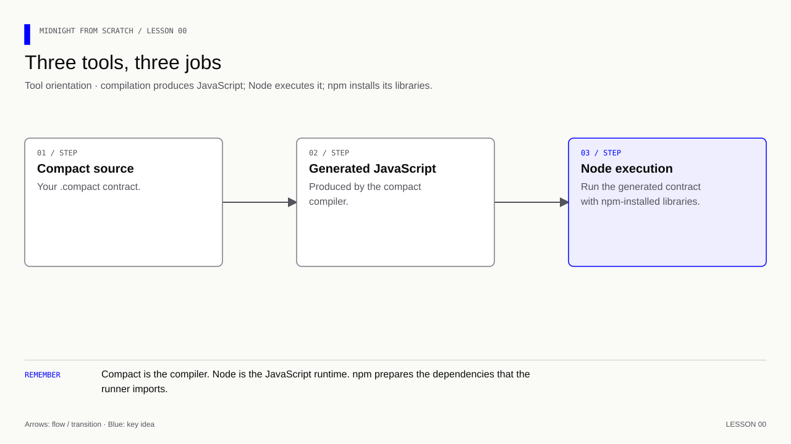

# Lesson 0 — Know which tool does what

[Course overview](../../../README.md#course-map) · [Next](../../Lesson%2001/Exercise/README.md)
## The route from a local call to a released app

**Learning goal:** identify which tool is responsible when a command fails, and
separate a local contract experiment from an accepted network transaction.

We keep the same ratings project as we move through four environments. Moving
forward adds evidence; it does not mean the earlier environment's data moves too.

| Stage | What you do with the ratings app | Evidence before moving on |
|---|---|---|
| Local (`undeployed`) | First run generated JS in memory; later run the local node, indexer and proof service | Rating rules pass, then a real local transaction is confirmed |
| Preview (`preview`) | Deploy the same reviewed source with the currently supported Preview configuration | Record the deployment address and a confirmed commit/reveal transaction |
| Testnet rehearsal (`preprod`) | Rebuild against the supported Preprod stack and repeat the scenario | Confirm wallet, compiler, SDK, ledger and services agree on this environment |
| Production (`mainnet`) | Prepare a reviewed release with the supported production stack | Complete security, recovery and operational checks before publishing |

These are the course's promotion stages, **not a claim that every network is
currently open or compatible with this checkout**. Check current official
availability and compatibility at each step in the [deployment guide](../../../docs/deployment.md).
A compiler working locally does not establish that a network accepts its proofs.
Never reuse a network address or private-state directory merely because the
contract source is the same.

Start with the version commands below. Expect Node `v22.23.2` and compiler
`0.31.1`; npm reports its own version. If `compact` is missing, installing an npm
runtime will not repair the missing machine tool. If an import fails later,
changing the compiler alone will not install the required npm dependency.

**Memory cue:** Tools have separate jobs.

[](../../../assets/diagrams/lesson-00-tools.html)

| Tool | Job | Installed where? |
|---|---|---|
| Node.js | Executes JavaScript | On your machine, selected through nvm |
| npm | Installs packages and runs named package.json scripts | Alongside Node |
| compact | Selects a Compact compiler and compiles .compact source | Separate machine-level tool |
| @midnight-ntwrk/compact-runtime | Library used by generated contract JavaScript | Later, inside this project's node_modules |
| Docker | Runs the local chain and proof services | Later network lessons |

Install the tools from [Start here](../../../README.md#start-here) if needed. Machine tools can be reused
across project folders. With nvm, select Node in each new terminal for now;
.nvmrc is a later convenience for recording that choice.

```bash
cd midnight-from-scratch
nvm use 22.23.2
node --version
npm --version
compact compile +0.31.1 --version
```

- `cd` selects the working directory for relative file paths.
- `nvm use` selects an installed Node version for this terminal session.
- `node --version` should show `v22.23.2`.
- `npm --version` identifies the package manager; its version is not Node's.
- `compact compile +0.31.1 --version` selects and reports compiler `0.31.1`.

If this exact compiler is missing, `compact update 0.31.1` installs it. Installing
the `compact` tool itself is a separate procedure in the installation docs, not
an npm package installation.

Checkpoint: which command compiles Compact, and which program executes JS?

<details>
<summary>Answer</summary>

`compact compile` compiles Compact source. `node run.js` executes JavaScript.
`npm` installs dependencies or invokes scripts; it is neither the compiler nor
the blockchain.

</details>

**Verification:** see the [toolchain and verification guide](../../../docs/knowledge-audit.md) for supported checks and their scope.
