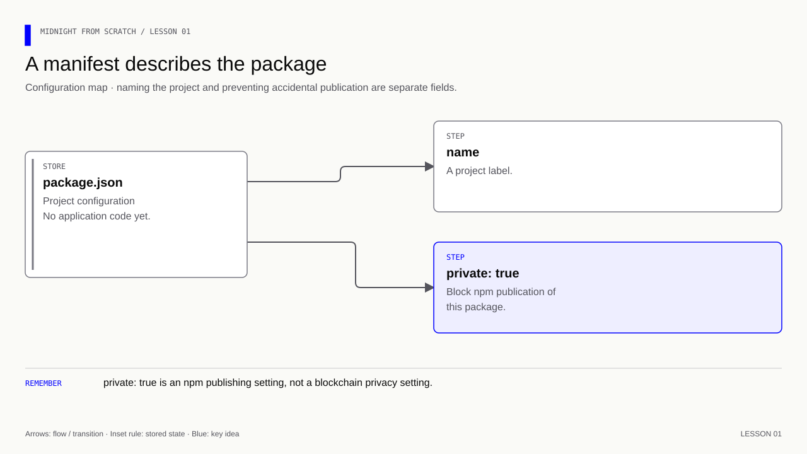

# Lesson 1 — Understand the entire initial package.json

[Course overview](../../../README.md) · [Exercise index](../../README.md) · [Next](../../Lesson%2002/Exercise/README.md)

## What you should be able to explain

**Learning goal:** create the smallest manifest and distinguish package settings
from application behavior. Treat `package.json` as the label on a project box:
it describes what is inside and how tools should handle it; it is not the engine.

1. Open this folder's starter `package.json`.
2. Add the two properties shown below and save valid JSON.
3. Run `npm run check -- 1A` from the repository root.

Expect a passing manifest check, with no contract execution. The check catches an
empty name or missing `private: true`; it cannot establish blockchain privacy.
You will add executable code and dependencies in separate lessons so each has a
visible purpose.

## Your exercise workspace

Edit the starter files **in this folder**. They already contain the previous
lesson's prerequisite concepts; TODO comments identify the new work. Keep building
these same files through the lettered stages. The [reference answer](../../Lesson%2001/Solution/README.md)
is separate and is not used as your submitted implementation.

Run grading commands below **from the repository root**, or run `node check.mjs A`
inside this folder to check stage 1A. With no letter, `node check.mjs` lists the
stages. The guide's ordinary file/compile/run commands use this folder as their
working directory; a mention of the project root in the original walkthrough
means this exercise's working folder. Keep your implementation in this folder.

| Stage | Work checked | Command from repository root |
|---|---|---|
| 1A | Name the project and prevent publication | `npm run check -- 1A` |

A failed check reports the first unmet requirement. Fix it and rerun the same
stage. A pass records the checked revision and suggests the next stage.
`npm run progress` distinguishes current passes from stages passed before later
edits. This history is local and ignored by Git; nothing is uploaded or submitted
to an external service.

---

[Course overview](../../../README.md#course-map) · [Previous](../../Lesson%2000/Exercise/README.md) · [Next](../../Lesson%2002/Exercise/README.md)


The starter manifest belongs to this exercise. Update it at the steps below.
The separate root manifest holds the grading and reference commands.

**Memory cue:** A manifest describes a project.

[](../../../assets/diagrams/lesson-01-manifest.html)

At this lesson, create package.json with exactly this:

```json
{
  "name": "midnight-from-scratch",
  "private": true
}
```

- `{ ... }`: a JSON object containing configuration properties.
- `name`: the project's npm package name.
- `private: true`: prevents accidental publication using npm publish.
  It does not encrypt files or make blockchain state private.

There is no `main`: we have no application entry point. There are no
`dependencies`, because compiling a Compact file requires no npm packages.
There are no `scripts`: we will type the actual commands first.

`npm init -y` could generate a larger manifest with defaults. It is not a
Midnight scaffolder, but we wrote the smaller manifest directly so every
field has an explained purpose. Do not run it over this file.

Exercise: explain why package.json alone cannot start a server or blockchain.

<details>
<summary>Answer</summary>

The manifest is configuration data. Its name and private flag contain no
application code or network services. `private: true` prevents npm publication;
it does not make a repository or ledger private.

</details>

**Verification:** see the [toolchain and verification guide](../../../docs/knowledge-audit.md) for supported checks and their scope.
