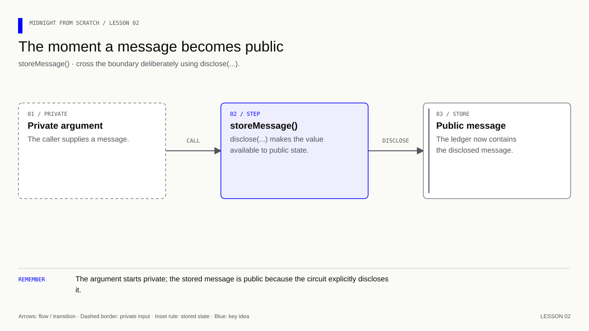

# Lesson 2 — Write your first contract

[Course overview](../../../README.md) · [Exercise index](../../README.md) · [Previous](../../Lesson%2001/Exercise/README.md) · [Next](../../Lesson%2003/Exercise/README.md)

## The one change to watch

**Learning goal:** declare one public state field, then identify the exact line
where a private argument is permitted to reach it.

Work in two passes: first add the pragma, import and ledger declaration for 2A;
then add `storeMessage` for 2B. The complete block below is the assembled result,
not a request to skip the first checkpoint. After each pass, compile and inspect
the generated interface before running that stage's check.

Expect a `message` field and, after 2B, a `storeMessage` operation in the bindings.
Compilation alone never changes a stored message. The behavioral check invokes
the operation; your temporary removal of `disclose` tests the compiler's separate
private-to-public boundary rule. Both observations matter: valid syntax and
intended behavior are different claims.

## Your exercise workspace

Edit the starter files **in this folder**. They already contain the previous
lesson's prerequisite concepts; TODO comments identify the new work. Keep building
these same files through the lettered stages. The [reference answer](../../Lesson%2002/Solution/README.md)
is separate and is not used as your submitted implementation.

Run grading commands below **from the repository root**, or run `node check.mjs A`
inside this folder to check stage 2A. With no letter, `node check.mjs` lists the
stages. The guide's ordinary file/compile/run commands use this folder as their
working directory; a mention of the project root in the original walkthrough
means this exercise's working folder. Keep your implementation in this folder.

| Stage | Work checked | Command from repository root |
|---|---|---|
| 2A | Declare and compile the public message | `npm run check -- 2A` |
| 2B | Implement and exercise storeMessage | `npm run check -- 2B` |

A failed check reports the first unmet requirement. Fix it and rerun the same
stage. A pass records the checked revision and suggests the next stage.
`npm run progress` distinguishes current passes from stages passed before later
edits. This history is local and ignored by Git; nothing is uploaded or submitted
to an external service.

---

[Course overview](../../../README.md#course-map) · [Previous](../../Lesson%2001/Exercise/README.md) · [Next](../../Lesson%2003/Exercise/README.md)


The starter manifest belongs to this exercise. Update it at the steps below.
The separate root manifest holds the grading and reference commands.

**Memory cue:** Declare state; call a circuit to change it.

[](../../../assets/diagrams/lesson-02-disclosure.html)

Create `hello.compact` beside package.json. Type this yourself:

```compact
// Pin the language understood by the course's compiler version.
pragma language_version 0.23;

// Use the compiler's standard library without adding an npm dependency.
import CompactStandardLibrary;

// Make the stored message readable through the public ledger.
export ledger message: Opaque<"string">;

// Accept a message through the public entry point; the body decides what to publish.
export circuit storeMessage(text: Opaque<"string">): [] {
    // Permit this value to become public at this deliberate disclosure point.
    message = disclose(text);
}
```

Line by line:

1. `pragma language_version 0.23;` chooses the source language version.
   Language 0.23 and compiler release 0.31.1 are different version numbers.
2. `import CompactStandardLibrary;` makes the compiler's standard library
   available. This is not an npm dependency and needs no npm install.
3. `export ledger message: Opaque<"string">;` declares one public state field.
   `message` is its name; the type is a string the circuit can carry without
   inspecting its characters. `export` exposes it through generated bindings.
4. `export circuit storeMessage(...)` declares a callable operation. `text`
   is its input, not an automatically supplied value. `: []` means no returned
   values. The opening brace starts its body.
5. `message = disclose(text);` declares that the private input may be exposed
   and assigns it to public state. It proposes this change during execution;
   an on-chain change requires a later accepted transaction.
6. `}` closes the operation. Merely declaring the circuit does not call it.

Compile it directly, without an npm script:

```bash
compact compile +0.31.1 --skip-zk hello.compact managed/hello
```

- `compact`: the executable on your PATH.
- `compile`: its compilation command.
- `+0.31.1`: explicitly select the compiler for this project.
- `--skip-zk`: skip proving-key generation for early local exercises.
- `hello.compact`: the input source file.
- `managed/hello`: the generated output directory.

Compilation may finish without printing anything. Inspect
`managed/hello/contract/index.js` and `index.d.ts`: generated JavaScript and its
TypeScript interface. Do not edit generated files; recompile the source.

This command does not read package.json to install dependencies, start Docker,
execute storeMessage, generate a transaction proof, or deploy a contract.

Exercise:

1. Compile the unchanged example.
2. Rename `text` to `newMessage` in both places and compile again.
3. Temporarily remove `disclose(...)` while keeping its argument. Compile and
   explain the error. Restore disclosure and compile successfully.
4. Explain where the input "Hello Midnight" will enter when we call the circuit.

<details>
<summary>Answers — lesson 2</summary>

1. A successful compilation produces the files under `managed/hello`.
2. The signature becomes `storeMessage(newMessage: Opaque<"string">): []` and
   the assignment becomes `message = disclose(newMessage);`.
3. Without disclosure the compiler rejects the private-to-public flow. Restore
   `disclose(newMessage)` to explicitly permit publication.
4. The JS caller supplies the string as the argument after the context:
   `contract.impureCircuits.storeMessage(context, 'Hello Midnight')`.

</details>

**Verification:** see the [toolchain and verification guide](../../../docs/knowledge-audit.md) for supported checks and their scope.
