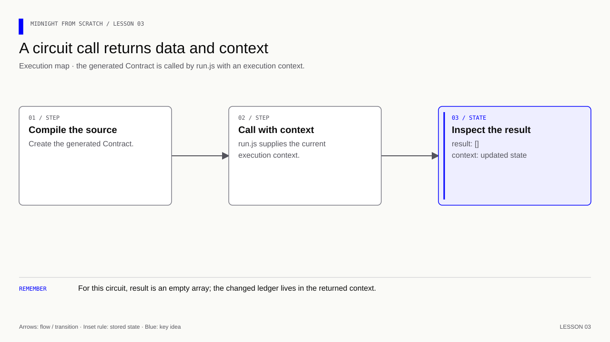
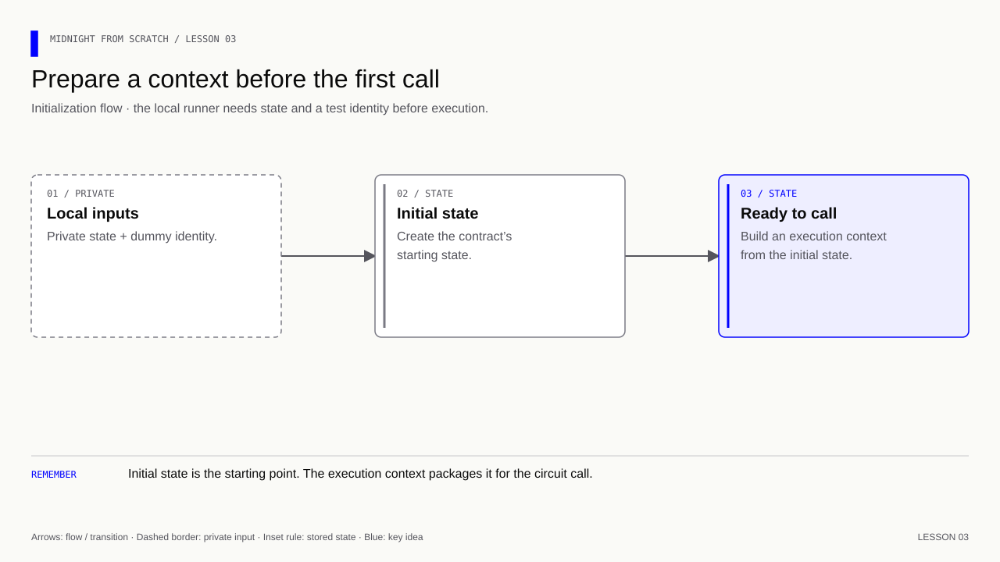
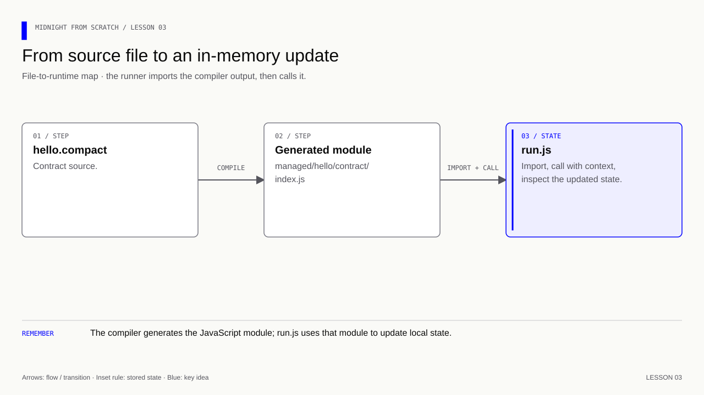

# Lesson 3 — Install one dependency and execute your contract locally

[Course overview](../../../README.md) · [Exercise index](../../README.md) · [Previous](../../Lesson%2002/Exercise/README.md) · [Next](../../Lesson%2004/Exercise/README.md)

## Observe one complete round trip

**Learning goal:** follow source → generated module → context → call → returned
context. The context is the workbench holding this run's state; the returned
context is the workbench after the operation.

Pause after each stage: 3A makes imports possible, 3B constructs initial state,
3C makes the first call, and 3D explains a fresh run. Expect `Before: ""` and
`After: "Hello Midnight"`. A successful import alone would miss a wrong argument
or reading the old context; the call and restart checks reveal those mistakes.
No network confirmation is produced by this experiment.

## Your exercise workspace

Edit the starter files **in this folder**. They already contain the previous
lesson's prerequisite concepts; TODO comments identify the new work. Keep building
these same files through the lettered stages. The [reference answer](../../Lesson%2003/Solution/README.md)
is separate and is not used as your submitted implementation.

Run grading commands below **from the repository root**, or run `node check.mjs A`
inside this folder to check stage 3A. With no letter, `node check.mjs` lists the
stages. The guide's ordinary file/compile/run commands use this folder as their
working directory; a mention of the project root in the original walkthrough
means this exercise's working folder. Keep your implementation in this folder.

| Stage | Work checked | Command from repository root |
|---|---|---|
| 3A | Prepare the runtime and module format | `npm run check -- 3A` |
| 3B | Build the execution context | `npm run check -- 3B` |
| 3C | Call storeMessage | `npm run check -- 3C` |
| 3D | Explain and verify fresh state | `npm run check -- 3D` |

A failed check reports the first unmet requirement. Fix it and rerun the same
stage. A pass records the checked revision and suggests the next stage.
`npm run progress` distinguishes current passes from stages passed before later
edits. This history is local and ignored by Git; nothing is uploaded or submitted
to an external service.

### Short concept checks

Fill the named fields in `answers.json` when you reach that stage. Use JSON
booleans/numbers where appropriate; `null` means unanswered. These checks grade
the specific questions below, not arbitrary prose.

**3D:**

- `restartMessage`: What is the initial message after restarting this local runner?
- `circuitReturn`: Which result property holds the application return value: result or context?

<details>
<summary>Check these concept answers after trying them</summary>

```json
{
  "restartMessage": "",
  "circuitReturn": "result"
}
```

</details>


---

[Course overview](../../../README.md#course-map) · [Previous](../../Lesson%2002/Exercise/README.md) · [Next](../../Lesson%2004/Exercise/README.md)


The starter manifest belongs to this exercise. Update it at the steps below.
The separate root manifest holds the grading and reference commands.

Work through one stage at a time. Append or replace only the code named in that step.

| Stage | Focus | Stop when you can explain |
|---|---|---|
| [3A](#3a--prepare-the-runtime) | Runtime installed | Node can import the runtime |
| [3B](#3b--build-the-local-execution-context) | Context assembled | No circuit has run yet |
| [3C](#3c--append-one-call-and-inspect-its-result) | Message stored | Returned context contains the new message |
| [3D](#3d--run-predict-and-check) | Fresh run explained | Restart begins with an empty message |

**Memory cue:** Compile first, then call locally.

[](../../../assets/diagrams/lesson-03-call-result.html)

Goal: observe an empty message becoming "Hello Midnight" by calling the
generated JavaScript. This is local execution in memory, with no proof,
transaction, wallet or blockchain connection.

## 3A — Prepare the runtime

### A1. Install the first dependency yourself

Run from this folder:

```bash
nvm use 22.23.2
npm install --save-exact @midnight-ntwrk/compact-runtime@0.16.0
```

- `npm install` downloads a package and the packages it depends on.
- `--save-exact` saves `0.16.0`, rather than a range such as `^0.16.0`.
- `@midnight-ntwrk/compact-runtime` is the runtime library imported by your
  generated contract JavaScript. It is not the Compact compiler.
- `@0.16.0` selects the runtime version matching compiler 0.31.1.

Inspect what changed before continuing:

- `package.json` now has a `dependencies` entry.
- `package-lock.json` records the resolved dependency tree and integrity hashes.
- `node_modules/` contains the installed code, including transitive dependencies.

The compiler did not need this package to generate JavaScript. Node needs it
when executing that generated JavaScript.

### A2. Declare your JavaScript module format

Add `"type": "module"` to package.json. The whole file should now read:

```json
{
  "name": "midnight-from-scratch",
  "private": true,
  "type": "module",
  "dependencies": {
    "@midnight-ntwrk/compact-runtime": "0.16.0"
  }
}
```

`type: module` explicitly tells Node to interpret this package's .js files as
ES modules, which use `import` and `export`. It does not run anything or install
another dependency. We still have no scripts, main application or TypeScript.

## 3B — Build the local execution context

Create `run.js` next to `hello.compact`. Add this first block:

```js
// General execution helpers from the package you just installed.
import * as runtime from '@midnight-ntwrk/compact-runtime';

// Your own contract, translated into JavaScript by the compiler.
import { Contract, ledger } from './managed/hello/contract/index.js';

// {} means there are no witness functions to supply for this contract.
const contract = new Contract({});

// {} is empty private state. Our message is a public ledger field.
const privateState = {};

// Dummy identity for local execution; this is not a real wallet or secret key.
const coinPublicKey = '0'.repeat(64);

// Construct the initial contract state in memory; this does not deploy it.
const initial = contract.initialState(
  runtime.createConstructorContext(privateState, coinPublicKey),
);

// Assemble the environment that the compiled circuit expects.
const context = runtime.createCircuitContext(
  runtime.sampleContractAddress(), // Dummy address, not a deployed contract.
  coinPublicKey,
  initial.currentContractState,
  privateState,
);
```

**Checkpoint:** the contract and `context` now exist, but no circuit has run.

[](../../../assets/diagrams/lesson-03-initial-context.html)

## 3C — Append one call and inspect its result

Append this block to the same `run.js`; keep the setup above it:

```js
// ledger() translates the runtime's state representation into readable fields.
console.log('Before:', JSON.stringify(ledger(context.currentQueryContext.state).message));

// This is where "Hello Midnight" becomes the Compact newMessage argument.
const result = contract.impureCircuits.storeMessage(context, 'Hello Midnight');

// Inspect the updated state returned from execution.
console.log('After:', JSON.stringify(ledger(result.context.currentQueryContext.state).message));
```

Why the context? A circuit needs both its explicit arguments and an environment
containing state, identity and other execution information. The runtime helpers
build that environment. The dummy address and identity satisfy this interface
for local learning; they do not connect you to a network.

Why `impureCircuits`? Here, impure means the operation accesses or changes
contract state; it is not a comment on trustworthiness or security.

Why `JSON.stringify`? It prints quotes around a string, so an empty message
appears as `""` instead of an invisible blank.

## 3D — Run, predict and check

```bash
node run.js
```

Expected output:

```text
Before: ""
After: "Hello Midnight"
```

Trace the flow:

[](../../../assets/diagrams/lesson-03-build-import-call.html)

Changing the string in run.js requires rerunning Node, not recompiling Compact.
Changing hello.compact requires recompilation before running the new behavior.
Starting run.js again constructs fresh state; nothing here saves it to disk.

### Exercise — follow the call and its result

1. Run the example and explain the two printed messages.
2. Change the supplied string to "I called my own contract" and rerun it.
3. Predict what `Before` will show if you run the file once more. Check it.
4. Explain why an operation with Compact return type `[]` still gives the JS
   caller a `result` object. Hint: circuit return values and execution metadata
   are different things; inspect `result.context`.

<details>
<summary>Answers — lesson 3</summary>

1. Initial message is `""`; the call returns state containing `"Hello Midnight"`.
2. Replace the string argument in the call with `'I called my own contract'`.
   Only JavaScript changed, so run `node run.js` again without recompiling.
3. `Before` is still `""`: each invocation calls `initialState` afresh.
4. Compact `[]` means no application return value. The JS wrapper still returns
   execution information: `.result` is `[]`, and `.context` carries state.

</details>

Before adding Midnight.js in a later lesson, check compatible versions and
inspect npm's dependency tree, including shared runtime dependencies.

Reference: [Official local-execution example](https://docs.midnight.network/guides/private-state-witnesses).

**Verification:** see the [toolchain and verification guide](../../../docs/knowledge-audit.md) for supported checks and their scope.
