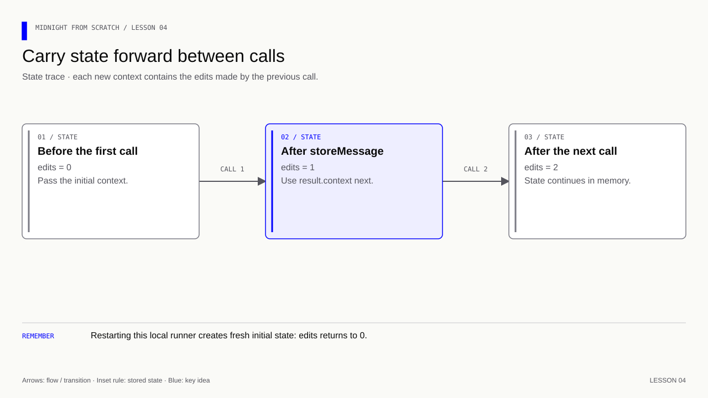

# Lesson 4 — Add a counter and follow state across calls

[Course overview](../../../README.md) · [Exercise index](../../README.md) · [Previous](../../Lesson%2003/Exercise/README.md) · [Next](../../Lesson%2005/Exercise/README.md)

## Count operations, then trace the state

**Learning goal:** carry the first call's returned context into the second call
and explain why the counter reaches two.

Predict the counter before running: declaration gives 0; one successful store
gives 1; a second store using the returned context gives 2. Now repeat the same
text twice. The count should still reach 2 because the contract counts calls,
not unique messages or participants. The two-call test detects accidental reuse
of initial state that a one-call example would hide.

## Your exercise workspace

Edit the starter files **in this folder**. They already contain the previous
lesson's prerequisite concepts; TODO comments identify the new work. Keep building
these same files through the lettered stages. The [reference answer](../../Lesson%2004/Solution/README.md)
is separate and is not used as your submitted implementation.

Run grading commands below **from the repository root**, or run `node check.mjs A`
inside this folder to check stage 4A. With no letter, `node check.mjs` lists the
stages. The guide's ordinary file/compile/run commands use this folder as their
working directory; a mention of the project root in the original walkthrough
means this exercise's working folder. Keep your implementation in this folder.

| Stage | Work checked | Command from repository root |
|---|---|---|
| 4A | Declare the counter | `npm run check -- 4A` |
| 4B | Count each successful call | `npm run check -- 4B` |
| 4C | Carry state through two calls | `npm run check -- 4C` |
| 4D | Name compile and run commands | `npm run check -- 4D` |

A failed check reports the first unmet requirement. Fix it and rerun the same
stage. A pass records the checked revision and suggests the next stage.
`npm run progress` distinguishes current passes from stages passed before later
edits. This history is local and ignored by Git; nothing is uploaded or submitted
to an external service.

---

[Course overview](../../../README.md#course-map) · [Previous](../../Lesson%2003/Exercise/README.md) · [Next](../../Lesson%2005/Exercise/README.md)


The starter manifest belongs to this exercise. Update it at the steps below.
The separate root manifest holds the grading and reference commands.

Work through one stage at a time. Append or replace only the code named in that step.

| Stage | Focus | Stop when you can explain |
|---|---|---|
| [4A](#4a--add-the-counter) | Counter declared | Generated ledger exposes edits |
| [4B](#4b--count-a-successful-call) | Call counted | One successful call increments once |
| [4C](#4c--follow-state-across-two-calls) | State passed forward | Two calls produce 0 → 1 → 2 |
| [4D](#4d--name-the-commands) | Commands named | Know which command compiles and which runs |

**Memory cue:** Carry state forward; count calls.

[](../../../assets/diagrams/lesson-04-context-chain.html)

Goal: keep a message and count how many successful storeMessage calls have
occurred. Continue with the same files, runtime dependency and local runner.
You do not need any new packages or services.

## 4A — Add the counter

Add this beside `message`, outside the circuit's braces:

```compact
// Track a public total using the ledger's counter operations.
export ledger edits: Counter;
```

- `export ledger`: expose a public state field through the generated interface.
- `edits`: the field's name; it is separate from `message`.
- `Counter`: a ledger type from the standard library with operations such as
  `increment`. Its initial value is zero.

Declare ledger fields at the top level. Put operations that change those
fields inside the circuit body. This distinction matters: declarations describe
what state exists; the circuit describes when that state changes.

## 4B — Count a successful call

Inside storeMessage, immediately after the message assignment, add:

```compact
// Update the public counter only after the preceding operation has succeeded.
edits.increment(1);
```

This adds one to the current counter on each successful call. The increment
is a fixed constant, so it does not need `disclose()`. The message argument
still needs disclosure because it flows from a private input into public state.

This counts calls, not distinct messages or users. Storing the same text twice
also increments twice. In a real deployment, the counter and its changes are
public; in this lesson we inspect the corresponding state only in memory.

### Recompile the changed contract

```bash
compact compile +0.31.1 --skip-zk hello.compact managed/hello
```

Inspect `managed/hello/contract/index.d.ts` without editing it. Under `Ledger`
you should now see `readonly edits: bigint`. The compiler generated that
JavaScript-facing type from your Compact Counter declaration.

## 4C — Follow state across two calls

Add this line before your existing storeMessage call:

```js
// Display the observed value at this stage of the example.
console.log('Edits before:', ledger(context.currentQueryContext.state).edits.toString());
```

Add this line after that call:

```js
// Display the observed value at this stage of the example.
console.log('Edits after:', ledger(result.context.currentQueryContext.state).edits.toString());
```

The path means: execution context → current public-state representation →
decode it with ledger() → access edits → format the bigint as a string.
`bigint` represents integers without JavaScript Number's safe-integer limit.
For example, `1n` is a bigint literal; `1` is a Number literal. `.toString()`
is only for display and does not change the stored value.

```bash
node run.js
```

In addition to your message output, expect:

```text
Edits before: 0
Edits after: 1
```

### Exercise — add the second call

1. Add a second storeMessage call in run.js and print its resulting counter.
2. Give it the execution context returned by the first call: `result.context`.
   Read the second call's result when displaying its final state.
3. Expect the sequence 0 → 1 → 2 during a single run.
4. Repeat the same message on both calls. Does the counter still reach 2? Why?
5. Run the whole file again. Why does it start from 0 rather than 2?

Hint: do not call initialState again between the two operations. That constructs
fresh contract state. Explicitly passing each returned context into the next call
makes the state flow visible and is the pattern we will keep using.

The circuit still has return type `[]`: it returns no application value, but
its execution result contains updated state. Printing `edits` reads that state;
it is not a new Compact return value.

<details>
<summary>Answers — lesson 4</summary>

```js
// Keep the call's answer and returned context for the next observation or operation.
const result2 = contract.impureCircuits.storeMessage(result.context, 'Hello Midnight');
// Display the observed value at this stage of the example.
console.log('Edits after second call:', ledger(result2.context.currentQueryContext.state).edits.toString());
```

Pass `result.context` so the second call starts after the first: 0 → 1 → 2.
The counter counts successful calls, including repeated messages. Starting the
whole runner again constructs new state, so the count starts at 0.

</details>

## 4D — Name the commands

Keep the existing manifest fields and add:

```json
"scripts": {
  "start": "node run.js",
  "compile-compact": "compact compile +0.31.1 --skip-zk hello.compact managed/hello"
}
```

Add a comma after the preceding property to keep the JSON valid. Now use
`npm run compile-compact` after Compact changes, then `npm start`. These are
shortcuts for commands already used; starting does not compile automatically.

**Verification:** see the [toolchain and verification guide](../../../docs/knowledge-audit.md) for supported checks and their scope.
