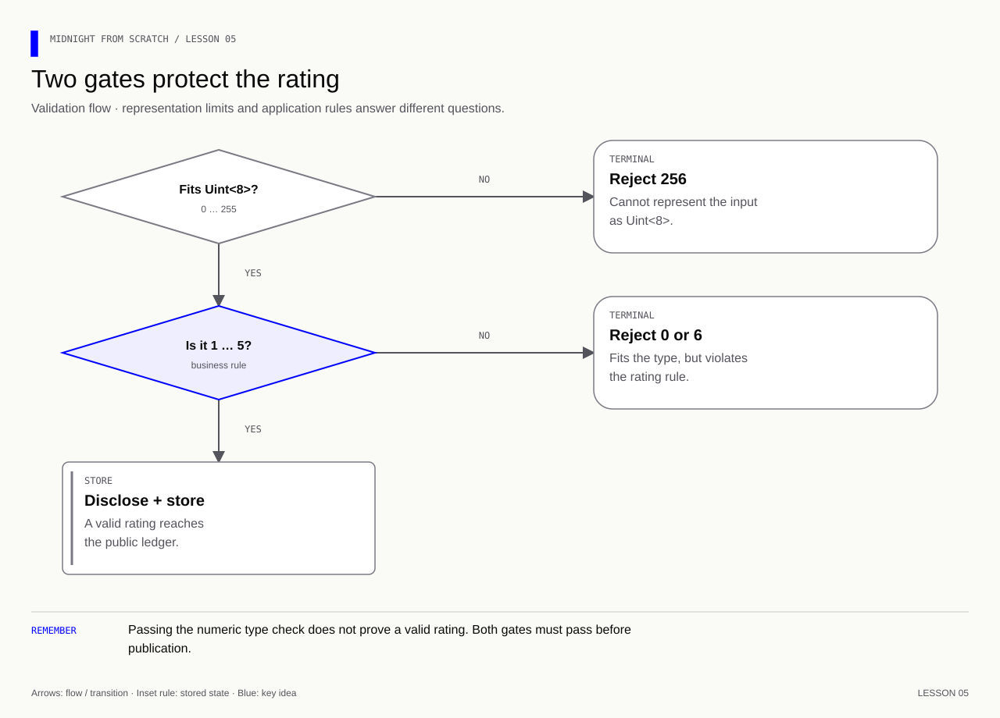
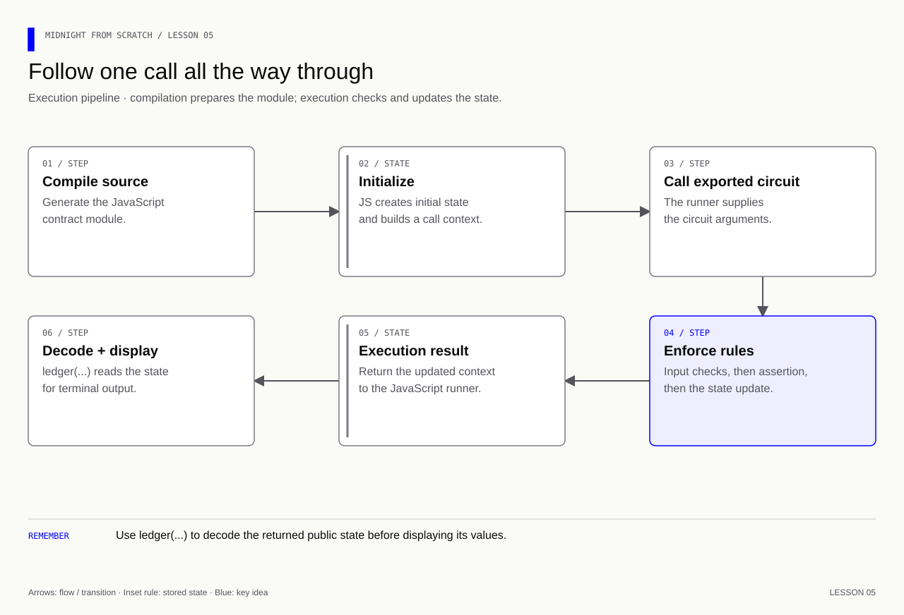

# Lesson 5 — A numeric input and a rule

[Course overview](../../../README.md) · [Exercise index](../../README.md) · [Previous](../../Lesson%2004/Exercise/README.md) · [Next](../../Lesson%2006/Exercise/README.md)

## Two questions for every input

**Learning goal:** distinguish “can this type represent it?” from “does this app
allow it?” A type is a container's capacity; an assertion is the admission rule.

First store 4. Then try 0, 6 and 256 separately, always starting from the last
successful context. Expect 0 and 6 to fail the rating assertion, while 256 fails
the generated `Uint<8>` boundary. Finally read the retained 4. Testing only a
valid rating would not detect a missing range assertion; testing only rejection
would not show that a legitimate rating can still be stored.

## Your exercise workspace

Edit the starter files **in this folder**. They already contain the previous
lesson's prerequisite concepts; TODO comments identify the new work. Keep building
these same files through the lettered stages. The [reference answer](../../Lesson%2005/Solution/README.md)
is separate and is not used as your submitted implementation.

Run grading commands below **from the repository root**, or run `node check.mjs A`
inside this folder to check stage 5A. With no letter, `node check.mjs` lists the
stages. The guide's ordinary file/compile/run commands use this folder as their
working directory; a mention of the project root in the original walkthrough
means this exercise's working folder. Keep your implementation in this folder.

| Stage | Work checked | Command from repository root |
|---|---|---|
| 5A | Declare the rating field | `npm run check -- 5A` |
| 5B | Enforce the 1–5 rule | `npm run check -- 5B` |
| 5C | Call with a valid rating | `npm run check -- 5C` |
| 5D | Reject invalid inputs and retain state | `npm run check -- 5D` |

A failed check reports the first unmet requirement. Fix it and rerun the same
stage. A pass records the checked revision and suggests the next stage.
`npm run progress` distinguishes current passes from stages passed before later
edits. This history is local and ignored by Git; nothing is uploaded or submitted
to an external service.

---

[Course overview](../../../README.md#course-map) · [Previous](../../Lesson%2004/Exercise/README.md) · [Next](../../Lesson%2006/Exercise/README.md)


The starter manifest belongs to this exercise. Update it at the steps below.
The separate root manifest holds the grading and reference commands.

Work through one stage at a time. Append or replace only the code named in that step.

| Stage | Focus | Stop when you can explain |
|---|---|---|
| [5A](#5a--separate-a-type-from-a-rule) | Type versus rule | 6 fits Uint<8> but is not a valid rating |
| [5B](#5b--enforce-the-rating-rule) | Assertion added | Only ratings 1–5 reach the write |
| [5C](#5c--call-with-a-valid-rating) | Valid call | 4n is stored |
| [5D](#5d--reject-and-explain-invalid-inputs) | Invalid calls | 0, 6 and 256 fail for explained reasons |

**Memory cue:** Types and application rules are two gates.

[](../../../assets/diagrams/lesson-05-validation.html)

Goal: add a separate operation that stores a rating from 1 to 5. Keep
storeMessage and its counter working. No new dependencies are needed.

## 5A — Separate a type from a rule

| Syntax | Meaning |
|---|---|
| `Uint<8>` | Unsigned 8-bit integer: 0 through 255 |
| `Boolean` | true or false; comparisons produce this type |
| `>=`, `<=` | Compare values |
| `&&` | Both conditions must hold |
| `assert(condition, "reason")` | Stop execution if the condition is false |
| `: []` | No application return values |

Uint<8> allows 0 and 6. Our app must explicitly reject them because its rating
rule is narrower than the type's range. The generated JavaScript interface uses
bigint, so the caller supplies `4n`, not the Number `4` or string "4".

### Add a field at the top level

```compact
// Reserve a public numeric rating whose initial zero means not rated yet.
export ledger rating: Uint<8>;
```

The initial value is 0, which we interpret as "not rated yet". Only values
written by setRating must satisfy its 1-to-5 rule. A plain Uint field is assigned
with `=`; Counter is a different ledger type with methods such as increment.

## 5B — Enforce the rating rule

```compact
// Keep rating validation separate from message updates.
export circuit setRating(newRating: Uint<8>): [] {
    // Reject values that fit the numeric type but violate the application rule.
    assert(newRating >= 1 && newRating <= 5, "Rating must be 1 to 5");
    // Permit this value to become public at this deliberate disclosure point.
    rating = disclose(newRating);
}
```

Read the signature as: an external entry point named setRating, with one
unsigned-integer input and no returned application values. An exported circuit
does not run automatically. JavaScript chooses which operation to call.

The assertion is deliberately before the write. newRating is a private circuit
argument; the assignment publishes it as public state, so disclosure is explicit.
This circuit does not increment edits; that action belongs to storeMessage.

## 5C — Call with a valid rating

Recompile first:

```bash
npm run compile-compact
```

Inspect the generated index.d.ts. You should now find a setRating entry and a
rating field. In run.js, after your second message call:

```js
// result2.context carries the state after your second message call.
const rated = contract.impureCircuits.setRating(result2.context, 4n);
// Display the observed value at this stage of the example.
console.log('Rating:', ledger(rated.context.currentQueryContext.state).rating.toString());
```

Run `npm start`. The rating should print 4. The message-call count remains 2.

An entry point is a named operation callers can invoke. The Compact circuit
defines its rules; the JS runner controls when it is invoked. `initialState`
constructs starting state; `ledger` reads state; neither is your setRating
entry point. There is no automatic Compact main function calling your circuits.

## 5D — Reject and explain invalid inputs

After the accepted call, try 0n and 6n in separate calls. Catch each error so
the rest of the runner can continue. Start each attempt from `rated.context`.
Write the call yourself using this JavaScript pattern:

```js
// Keep cleanup or expected-error handling active if the operation throws.
try {
  // Your call with an invalid rating goes here.
} catch (error) {
  // Display the observed value at this stage of the example.
  console.log('Rejected:', error.message);
}
```

Then read `rating` from the last successful context. It should still be 4.
A rejected call does not return a usable new result; keep the last successful
state. In this exercise, the assert runs before any write. Do not assume every
local runtime operation provides database-style rollback of arbitrary mutations.

Try 256n too. Predict whether it fails the 1-to-5 assertion or the generated
argument type/range check. The supplied value is outside Uint<8>, so the
generated binding rejects it before the body can carry out the rating rule.

<details>
<summary>Answers — lesson 5</summary>

```js
// Exercise each listed case independently through the same validation path.
for (const invalidRating of [0n, 6n, 256n]) {
  let rejected = false;
  // Keep cleanup or expected-error handling active if the operation throws.
  try {
    // Invoke the circuit under test using the arguments of this experiment.
    contract.impureCircuits.setRating(rated.context, invalidRating);
  } catch (error) {
    rejected = true;
    // Display the observed value at this stage of the example.
    console.log(`Rejected ${invalidRating}:`, error.message);
  }
  if (!rejected) throw new Error(`Unexpected acceptance: ${invalidRating}`);
}
// Display the observed value at this stage of the example.
console.log('Retained rating:', ledger(rated.context.currentQueryContext.state).rating.toString());
```

0 and 6 fit Uint<8> but fail the 1–5 assertion. 256 fails the generated argument
range check before the body. The retained rating is 4 in this lesson's example;
the repository runner uses 5. Rejections cannot supply a new result to chain.

</details>

### Follow state after the call

[](../../../assets/diagrams/lesson-05-execution-pipeline.html)

`result.context` holds execution context, including updated state.
`result.result` holds the circuit's application return value: currently `[]`.
These are separate. We will add an explicit returned value in Lesson 6, before
moving to witnesses. The network lifecycle later adds proof generation,
transaction balancing/signing, submission, verification and confirmation.

Checkpoint: why can 6n fit the input type and still be rejected? Which
operation changes edits? What is the difference between result.context and
result.result?

<details>
<summary>Checkpoint answers</summary>

6 is within 0–255 but outside 1–5. Only `storeMessage` increments edits.
`.context` carries execution state; `.result` is the circuit's application
return value, here `[]`.

</details>

**Verification:** see the [toolchain and verification guide](../../../docs/knowledge-audit.md) for supported checks and their scope.
