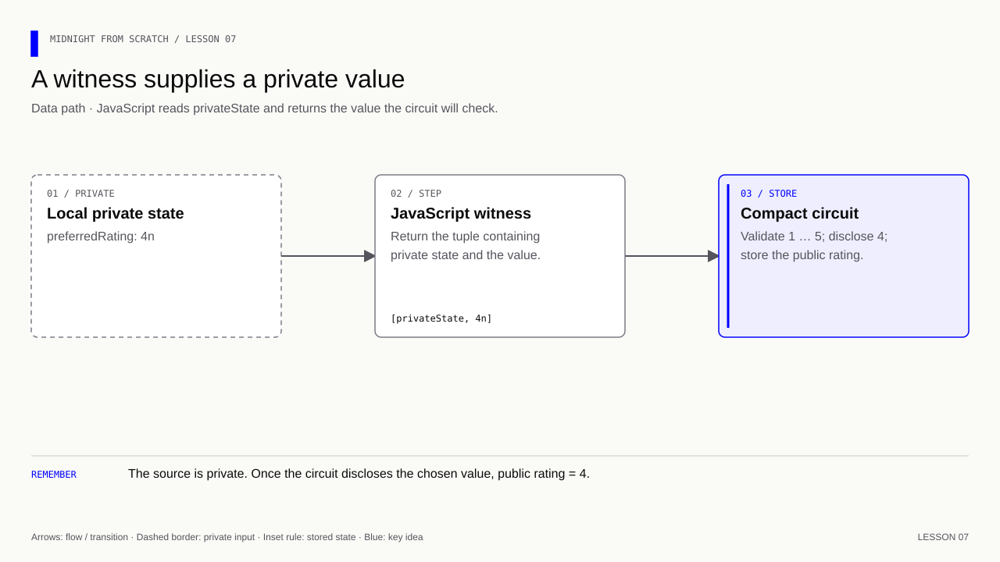
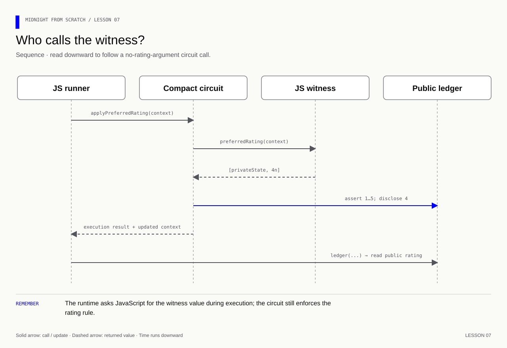

# Lesson 7 — Read from private state through a witness

[Course overview](../../../README.md) · [Exercise index](../../README.md) · [Previous](../../Lesson%2006/Exercise/README.md) · [Next](../../Lesson%2008/Exercise/README.md)

## Give the circuit a value from the local notebook

**Learning goal:** trace a witness callback's two outputs: the private state to
carry forward and the separate value supplied to Compact.

Build one connection at a time: declare the witness, constrain its value in the
circuit, register the JS callback, then invoke the circuit. Expect saved
preference 4 and public rating 4. Change the preference to 2 and expect both to
be 2. Rejecting 6 confirms that the circuit's range rule still applies to witness
values. The callback's name and return type alone do not establish that rule.
Lesson 8 then deliberately separates the saved value from the supplied value.

## Your exercise workspace

Edit the starter files **in this folder**. They already contain the previous
lesson's prerequisite concepts; TODO comments identify the new work. Keep building
these same files through the lettered stages. The [reference answer](../../Lesson%2007/Solution/README.md)
is separate and is not used as your submitted implementation.

Run grading commands below **from the repository root**, or run `node check.mjs A`
inside this folder to check stage 7A. With no letter, `node check.mjs` lists the
stages. The guide's ordinary file/compile/run commands use this folder as their
working directory; a mention of the project root in the original walkthrough
means this exercise's working folder. Keep your implementation in this folder.

| Stage | Work checked | Command from repository root |
|---|---|---|
| 7A | Declare the witness | `npm run check -- 7A` |
| 7B | Constrain the supplied value | `npm run check -- 7B` |
| 7C | Register the notebook callback | `npm run check -- 7C` |
| 7D | Apply and inspect the preference | `npm run check -- 7D` |

A failed check reports the first unmet requirement. Fix it and rerun the same
stage. A pass records the checked revision and suggests the next stage.
`npm run progress` distinguishes current passes from stages passed before later
edits. This history is local and ignored by Git; nothing is uploaded or submitted
to an external service.

---

[Course overview](../../../README.md#course-map) · [Previous](../../Lesson%2006/Exercise/README.md) · [Next](../../Lesson%2008/Exercise/README.md)


The starter manifest belongs to this exercise. Update it at the steps below.
The separate root manifest holds the grading and reference commands.

Work through one stage at a time. Append or replace only the code named in that step.

| Stage | Focus | Stop when you can explain |
|---|---|---|
| [7A](#7a--declare-the-requested-value) | Witness declared | The JS callback name must match |
| [7B](#7b--check-what-the-witness-supplies) | Circuit constrained | Range check precedes disclosure |
| [7C](#7c--connect-the-notebook-to-the-callback) | Callback registered | Return [privateState, value] |
| [7D](#7d--call-and-inspect-both-states) | Call observed | Witness supplies 4; ledger stores 4 |

**Memory cue:** A witness supplies data; the circuit checks it.

[](../../../assets/diagrams/lesson-07-witness-value.html)

Goal: store a preferred rating in the local private-state object and let a
circuit request it through a JavaScript callback. Keep the same runtime and
runner. No wallet, network, new dependency or extra source file is needed.

In the guide's analogy, ledger state is the notice board; private state is your
pocket notebook; a witness reads a requested entry from that notebook. Here we
deliberately copy the preference to the public rating field. This demonstrates
the data path, not a claim that the resulting rating remains secret.

## 7A — Declare the requested value

Add this at the top level, near the ledger declarations:

```compact
// Declare the private-value callback that JavaScript must implement.
witness preferredRating(): Uint<8>;
```

- `witness`: declare a function whose implementation lives in the caller's JS.
- `preferredRating`: the name the JS implementation must match exactly.
- `()`: the Compact call supplies no explicit arguments to this witness.
- `: Uint<8>`: the circuit expects an unsigned 8-bit integer back.
- `;`: a declaration only; there is no Compact function body here.

This declaration neither creates private state nor reads a wallet. We supply
both the private object and the callback in JavaScript.

## 7B — Check what the witness supplies

At the top level, outside your other circuits, add:

```compact
// Obtain the preference through a witness and enforce its rule in Compact.
export circuit applyPreferredRating(): [] {
    // Keep the witness-supplied value local until validation permits publication.
    const choice = preferredRating();
    // Reject values that fit the numeric type but violate the application rule.
    assert(choice >= 1 && choice <= 5, "Rating must be 1 to 5");
    // Permit this value to become public at this deliberate disclosure point.
    rating = disclose(choice);
}
```

`const` binds a local value for this execution. The compiler infers choice's
type from the witness declaration. The name is not a new ledger field.
Calling preferredRating() invokes the registered JS callback during local
execution. The assertion validates the returned value; disclosure deliberately
allows it to be written to the public rating. The circuit returns [].

Recompile with `npm run compile-compact`. The generated Witnesses type now
lists preferredRating, and Contract requires its implementation. Update the JS
before running it; the old `new Contract({})` cannot satisfy this declaration.

## 7C — Connect the notebook to the callback

Replace the old `new Contract({})` and empty privateState declarations with
the following three blocks, in order after the imports and before coinPublicKey:

```js
// Starting contents of this user's local pocket notebook.
const privateState = { preferredRating: 4n };
```

Now add the callback that reads that notebook:

```js
// Implement the function declared by the Compact witness.
const witnesses = {
  // Supply the local preference through the witness protocol.
  preferredRating: ({ privateState }) => {
    // First item: private state to keep. Second item: value given to Compact.
    return [privateState, privateState.preferredRating];
  },
};
```

Finally, register the callback under the name declared in Compact:

```js
// Register callbacks. This line does not call the witness yet.
const contract = new Contract(witnesses);
```

The arrow function receives an automatically supplied WitnessContext.
`({ privateState })` extracts that context's privateState property. It reads
the private state for the current execution, rather than relying on a captured
global preference. Returning the same object keeps its contents unchanged.

Do not confuse the witness tuple `[privateState, value]` with a circuit's
application return value. This tuple is the callback protocol used by the
runtime. The circuit applyPreferredRating still returns [], while its JS
execution wrapper has both .result and .context.

Your existing createConstructorContext and createCircuitContext calls already
receive privateState, so their code stays the same. This plain object is in
memory; it is not automatically encrypted or saved to disk. Storage providers
come later. A hard-coded example preference is visible in the source file.

## 7D — Call and inspect both states

At the end of run.js, after the existing readRating call:

```js
// read.context is the state after the last successful call in your runner.
const applied = contract.impureCircuits.applyPreferredRating(read.context);

// Display the observed value at this stage of the example.
console.log('Applied rating:', ledger(applied.context.currentQueryContext.state).rating.toString());
// Display the observed value at this stage of the example.
console.log('Preference in private state:', applied.context.currentPrivateState.preferredRating.toString());
```

Run `npm start`. Both new output values should be 4; edits remains 2.
The last print is a local learning aid, not a public ledger write. Real apps
should avoid logging sensitive private-state values.

[](../../../assets/diagrams/lesson-07-witness-sequence.html)

Compare the two ways data enters:

| Circuit | Where its rating comes from |
|---|---|
| setRating(context, 5n) | Explicit circuit argument provided on this call |
| applyPreferredRating(context) | Witness callback reads the execution's private state |

Neither path makes the supplied value trustworthy by itself. Both remain
caller-controlled; the rule is enforced by assert. Lesson 8 examines the
difference between a caller's preference and an authenticated real-world fact.

### Exercise — vary the preference

1. Set the starting preference to 2n and rerun; predict the public rating.
2. Set it to 6n. Catch the failure using Lesson 5's pattern, and read the rating
   from the last successful context. Explain why the witness declaration alone
   did not enforce the 1-to-5 rule.
3. Restore a valid preference. Temporarily remove disclose around choice,
   compile, read the error, then restore it.
4. Explain why applyPreferredRating takes no explicit rating argument, but
   the JS callback still receives a private-state context.

<details>
<summary>Answers — lesson 7</summary>

1. With `preferredRating: 2n`, the witness supplies 2 and the public rating becomes 2.
2. 6 fits Uint<8>, but fails the circuit's application rule. For this attempt,
   replace the final `applied` call and its prints with:

   ```js
   // Keep cleanup or expected-error handling active if the operation throws.
   try {
     // Invoke the circuit under test using the arguments of this experiment.
     contract.impureCircuits.applyPreferredRating(read.context);
   } catch (error) {
     // Display the observed value at this stage of the example.
     console.log('Rejected preference:', error.message);
   }
   // Display the observed value at this stage of the example.
   console.log('Retained rating:', ledger(read.context.currentQueryContext.state).rating.toString());
   ```

   In the repository runner the retained rating is 5. The assertion runs before
   writing rating. The witness type limits the range to 0–255, not to 1–5.
3. The compiler rejects an undisclosed private-to-public flow. Restore
   `rating = disclose(choice);`, compile again and restore preference 4n.
4. Compact requests `preferredRating()` internally. The runtime supplies the
   callback's context; it is not an explicit Compact argument. The callback
   returns `[privateState, value]`, while the circuit returns `[]`.

</details>

Reference: [Midnight's witness and private-state guide](https://docs.midnight.network/guides/private-state-witnesses).

**Verification:** see the [toolchain and verification guide](../../../docs/knowledge-audit.md) for supported checks and their scope.
