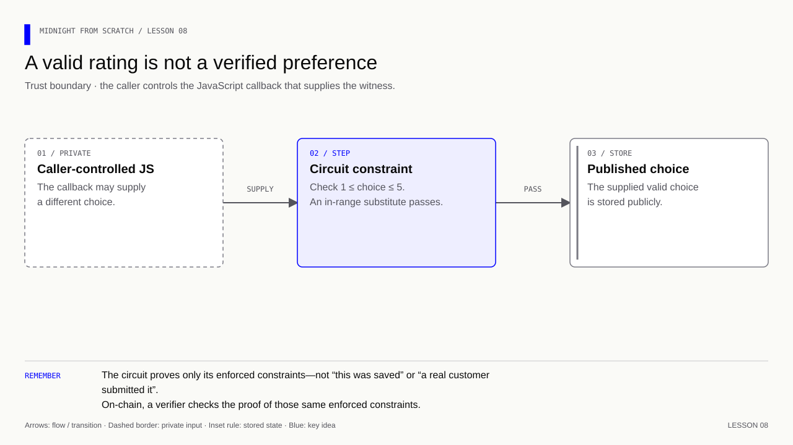

# Lesson 8 — What does a witness actually prove?

[Course overview](../../../README.md) · [Exercise index](../../README.md) · [Previous](../../Lesson%2007/Exercise/README.md) · [Next](../../Lesson%2009/Exercise/README.md)

## A controlled attempt to fool our assumption

**Learning goal:** identify exactly what the circuit constrains, without assuming
that a callback tells the truth about where its value came from.

Write your prediction before changing the callback. Keep saved preference 4,
supply 2, and observe acceptance. Then supply 6 and observe rejection. The first
experiment exposes a claim the contract never checked; the second confirms a
claim it did check. Restore the normal callback only after you can explain both.
A witness is a delivery mechanism for input, like a courier; the circuit still
needs evidence if it must authenticate the package's origin.

## Your exercise workspace

Edit the starter files **in this folder**. They already contain the previous
lesson's prerequisite concepts; TODO comments identify the new work. Keep building
these same files through the lettered stages. The [reference answer](../../Lesson%2008/Solution/README.md)
is separate and is not used as your submitted implementation.

Run grading commands below **from the repository root**, or run `node check.mjs A`
inside this folder to check stage 8A. With no letter, `node check.mjs` lists the
stages. The guide's ordinary file/compile/run commands use this folder as their
working directory; a mention of the project root in the original walkthrough
means this exercise's working folder. Keep your implementation in this folder.

| Stage | Work checked | Command from repository root |
|---|---|---|
| 8A | Predict the caller-controlled input | `npm run check -- 8A` |
| 8B | Supply a different valid preference | `npm run check -- 8B` |
| 8C | Reject an invalid preference | `npm run check -- 8C` |
| 8D | Restore and explain the trust boundary | `npm run check -- 8D` |

A failed check reports the first unmet requirement. Fix it and rerun the same
stage. A pass records the checked revision and suggests the next stage.
`npm run progress` distinguishes current passes from stages passed before later
edits. This history is local and ignored by Git; nothing is uploaded or submitted
to an external service.

### Short concept checks

Fill the named fields in `answers.json` when you reach that stage. Use JSON
booleans/numbers where appropriate; `null` means unanswered. These checks grade
the specific questions below, not arbitrary prose.

**8A:**

- `savedPreference`: The notebook contains 4; what remains saved if the callback preserves it?
- `suppliedPreference`: The callback returns 2; which value enters Compact?
- `accepted`: Does 2 satisfy the circuit’s 1–5 range rule?

<details>
<summary>Check these concept answers after trying them</summary>

```json
{
  "savedPreference": 4,
  "suppliedPreference": 2,
  "accepted": true
}
```

</details>

**8D:**

- `authenticatesNotebook`: Does the range assertion prove that the callback read the notebook honestly?
- `rejectsSix`: Does the circuit reject a callback returning 6?

<details>
<summary>Check these concept answers after trying them</summary>

```json
{
  "authenticatesNotebook": false,
  "rejectsSix": true
}
```

</details>


---

[Course overview](../../../README.md#course-map) · [Previous](../../Lesson%2007/Exercise/README.md) · [Next](../../Lesson%2009/Exercise/README.md)


The starter manifest belongs to this exercise. Update it at the steps below.
The separate root manifest holds the grading and reference commands.

Work through one stage at a time. Append or replace only the code named in that step.

| Stage | Focus | Stop when you can explain |
|---|---|---|
| [8A](#8a--predict-what-the-circuit-can-know) | Prediction | Separate saved data from constrained facts |
| [8B](#8b--supply-a-different-valid-preference) | Valid substitute | Callback 2 can replace saved 4 |
| [8C](#8c--violate-a-rule-the-circuit-enforces) | Invalid substitute | Callback 6 fails the range check |
| [8D](#8d--explain-the-trust-boundary) | Boundary explained | Acceptance proves only the stated rules |

**Memory cue:** The circuit checks a supplied value; its origin needs separate evidence.

[](../../../assets/diagrams/lesson-08-constraint-boundary.html)

Goal: distinguish a valid input from an authenticated fact. Keep the current
contract, dependencies and local runner. This lesson is a controlled experiment
with the witness callback; it adds no network service.

## 8A — Predict what the circuit can know

The local private state currently stores `preferredRating: 4n`. The witness
returns that field, and `applyPreferredRating` checks its range before publishing
it. Nothing in the circuit compares the returned value with an independently
trusted record of the saved preference. JavaScript chooses what to supply.

A rating preference is normally a caller's choice, so supplying another valid
number need not be malicious. It becomes a problem if an application treats the
number as evidence of a purchase, a measurement, or another external fact.

## 8B — Supply a different valid preference

In run.js, temporarily replace only the witness callback:

```js
const witnesses = {
  // Supply the local preference through the witness protocol.
  preferredRating: ({ privateState }) => [privateState, 2n],
};
```

Keep `privateState.preferredRating` at 4n. Run `npm start`; Compact did not change,
so recompilation is unnecessary. Look at the two final lines:

```text
Applied rating: 2
Preference in private state: 4
```

The returned tuple preserves private state but supplies a different circuit
input. The range assertion accepts 2. The callback's JS body is not itself a
rule that the on-chain verifier enforces.

## 8C — Violate a rule the circuit enforces

Change the callback's returned value from 2n to 6n. Replace the final `applied`
call and its two prints with this block so the expected rejection is caught:

```js
// Keep cleanup or expected-error handling active if the operation throws.
try {
  // Invoke the circuit under test using the arguments of this experiment.
  contract.impureCircuits.applyPreferredRating(read.context);
} catch (error) {
  // Display the observed value at this stage of the example.
  console.log('Rejected witness:', error.message);
}
// Display the observed value at this stage of the example.
console.log('Retained rating:', ledger(read.context.currentQueryContext.state).rating.toString());
```

Run `npm start`. Expect an assertion failure and retained rating 5 from the last
successful call. A caller can replace JS checks; it cannot make a valid proof
of a false constraint under the proof system's security assumptions. This local
experiment only executes checks—it does not generate or verify that proof.

## 8D — Explain the trust boundary

| Question | What this example establishes |
|---|---|
| Does the input fit the type? | Uint<8> permits 0–255 |
| Does the input satisfy the application rule? | The circuit asserts 1–5 |
| Does the input represent a real-world fact? | No authenticated source is checked |

For external facts, a later design needs verifiable evidence bound to an accepted
source: for example, a signed statement whose signature and relevant fields are
checked against a trusted issuer key. The statement also needs scope and replay
rules appropriate to the application. A new witness named `isVerified` would
still be caller-controlled; its name supplies no authentication.

### Exercise

1. Predict the output when private state holds 4n but the callback returns 2n.
2. Return 6n instead. Which rule rejects it? Does the stored preference change?
3. Suppose the JS callback checks that a customer bought a product, but the
   circuit only checks the 1–5 range. Can another caller bypass the purchase check?
4. Does `disclose(choice)` authenticate the source of the choice?
5. Restore the original callback and the successful `applied` call/prints from
   lesson 7. Run the project and check the two final values.

<details>
<summary>Answers — lesson 8</summary>

1. Public rating becomes 2, while the private preference remains 4. The callback
   returns the same private-state object and supplies 2 as its separate value.
2. 6 fits Uint<8> but fails the circuit assertion. This callback does not modify
   private state. The assertion runs before the ledger assignment; the retained
   public rating from `read.context` is 5.
3. Yes. Callers control their JS and can replace that callback. The circuit needs
   to verify purchase evidence, including its source and binding to this action.
4. No. Disclosure permits publication; it adds no evidence of authenticity.
5. Restore `preferredRating: ({ privateState }) => [privateState, privateState.preferredRating]`.
   With the original lesson 7 call and prints restored, both values are 4.

</details>

The [official witness guide](https://docs.midnight.network/guides/private-state-witnesses)
explains the witness interface and the need to constrain its untrusted values.
The [Compact reference](https://docs.midnight.network/compact/reference/compact-reference)
describes the division between circuits, ledger state and local functions.
These live references may discuss newer language versions; this project keeps
its pinned compiler and runtime.

**Verification:** see the [toolchain and verification guide](../../../docs/knowledge-audit.md) for supported checks and their scope.
