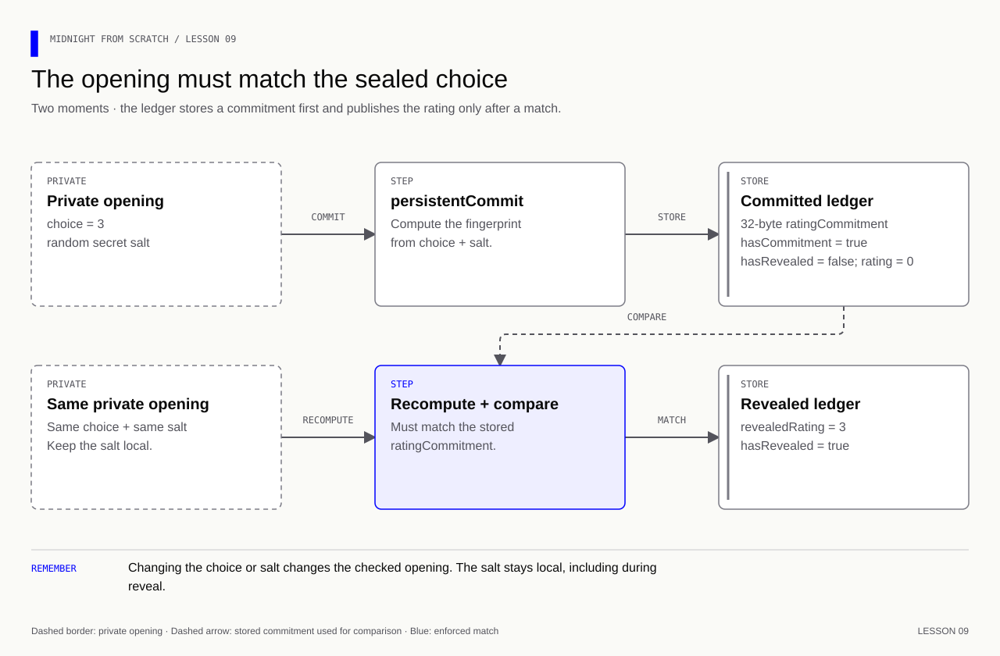
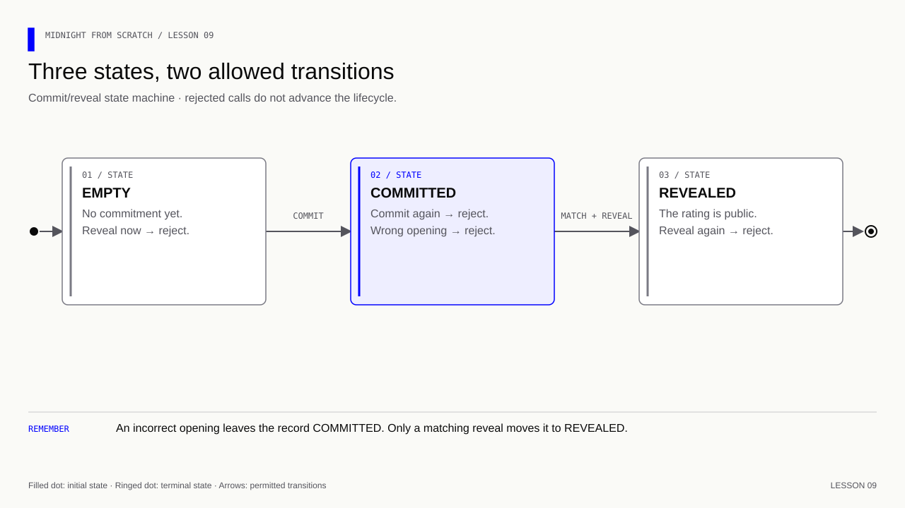
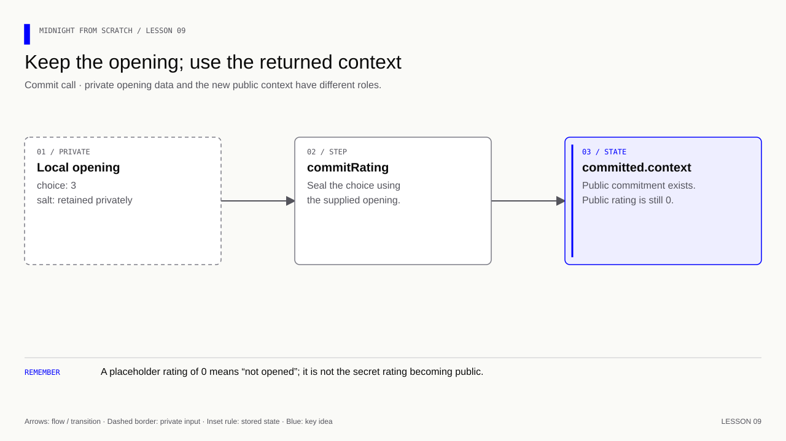

# Lesson 9 — Commit a rating now, reveal it later

[Course overview](../../../README.md) · [Exercise index](../../README.md) · [Previous](../../Lesson%2008/Exercise/README.md) · [Next](../../Lesson%2010/Exercise/README.md)

## Bind now, open later

**Learning goal:** explain why a caller cannot change a committed 3 into a revealed
5 just by editing JavaScript, and identify which check prevents it.

Keep one opening object containing the choice and random salt. Commit it, inspect
the placeholder 0, try the wrong choice, then reveal the original choice. Expect
3 only after the matching opening. Change one salt byte in a separate test;
then try a second reveal. The mismatch tests establish the opening rule; the
second-reveal test establishes a different rule, single use. Neither rule follows
from hiding the choice alone. The local tests exercise these constraints without
claiming that a cryptographic proof was generated or accepted on a network.

## Your exercise workspace

Edit the starter files **in this folder**. They already contain the previous
lesson's prerequisite concepts; TODO comments identify the new work. Keep building
these same files through the lettered stages. The [reference answer](../../Lesson%2009/Solution/README.md)
is separate and is not used as your submitted implementation.

Run grading commands below **from the repository root**, or run `node check.mjs A`
inside this folder to check stage 9A. With no letter, `node check.mjs` lists the
stages. The guide's ordinary file/compile/run commands use this folder as their
working directory; a mention of the project root in the original walkthrough
means this exercise's working folder. Keep your implementation in this folder.

| Stage | Work checked | Command from repository root |
|---|---|---|
| 9A | Explain and retain the opening | `npm run check -- 9A` |
| 9B | Commit once without publishing the rating | `npm run check -- 9B` |
| 9C | Check the opening before reveal | `npm run check -- 9C` |
| 9D | Assemble the commit/reveal caller | `npm run check -- 9D` |
| 9E | Inspect the two public states | `npm run check -- 9E` |
| 9F | Check boundaries and replay | `npm run check -- 9F` |

A failed check reports the first unmet requirement. Fix it and rerun the same
stage. A pass records the checked revision and suggests the next stage.
`npm run progress` distinguishes current passes from stages passed before later
edits. This history is local and ignored by Git; nothing is uploaded or submitted
to an external service.

### Short concept checks

Fill the named fields in `answers.json` when you reach that stage. Use JSON
booleans/numbers where appropriate; `null` means unanswered. These checks grade
the specific questions below, not arbitrary prose.

**9A:**

- `opening`: What must be retained: choice-only, new-salt, or choice-and-original-salt?
- `saltPublic`: Should the salt be public before reveal in this five-choice design?

<details>
<summary>Check these concept answers after trying them</summary>

```json
{
  "opening": "choice-and-original-salt",
  "saltPublic": false
}
```

</details>

**9E:**

- `beforeReveal`: Which public placeholder is stored before the opening?
- `afterReveal`: Which rating does the guide reveal?
- `newSaltRecovers`: Does generating a new salt recover a lost opening?

<details>
<summary>Check these concept answers after trying them</summary>

```json
{
  "beforeReveal": 0,
  "afterReveal": 3,
  "newSaltRecovers": false
}
```

</details>


---

[Course overview](../../../README.md#course-map) · [Previous](../../Lesson%2008/Exercise/README.md) · [Next](../../Lesson%2010/Exercise/README.md)


The starter manifest belongs to this exercise. Update it at the steps below.
The separate root manifest holds the grading and reference commands.

Work through one stage at a time. Append or replace only the code named in that step.

| Stage | Focus | Stop when you can explain |
|---|---|---|
| [9A](#9a--prepare-one-private-opening) | Opening understood | Choice + secret salt stays local |
| [9B](#9b--store-a-commitment-once) | Commitment stored | Public placeholder remains 0 |
| [9C](#9c--check-the-opening-before-publication) | Reveal constrained | Original choice and salt must match |
| [9D](#9d--assemble-the-caller-in-small-steps) | Caller assembled | Append one small block at a time |
| [9E](#9e--run-and-read-the-two-states) | States observed | Sealed 0 → revealed 3 |
| [9F](#9f--exercise-test-one-boundary-at-a-time) | Boundaries tested | Wrong and duplicate openings fail |

**Memory cue:** Store a fingerprint of a sealed envelope; later check the opening.

[](../../../assets/diagrams/lesson-09-commit-reveal.html)

Goal: commit to one valid rating without storing that rating publicly, then
reveal it only if the opening matches. Continue in `hello.compact` and `run.js`.
Keep compiler 0.31.1, language 0.23 and runtime 0.16.0. No new npm package,
wallet, Docker service or network is needed.

For the from-scratch path, add the code below yourself. The repository source
also contains the completed lesson 9 checkpoint. Compilation and local execution
verify the valid opening, wrong-choice and wrong-salt rejection, duplicate commit
and duplicate reveal, and retained state after rejected openings.

## 9A — Prepare one private opening

### A1. Restore the lesson 8 baseline

Restore the witness to reading `privateState.preferredRating`, and keep the
successful `applied` call and its prints from lesson 7. With preference 4n:

```js
const witnesses = {
  // Supply the local preference through the witness protocol.
  preferredRating: ({ privateState }) => [privateState, privateState.preferredRating],
};
```

Run the baseline:

```bash
npm run compile-compact
npm start
```

The final values should both be 4. Remove any experimental comment saying 6n
is accepted: the assertion rejects 6n. The restored callback returns 4n here.

We will use a **new choice, 3n**, for the sealed-rating example. The earlier
`rating` field already contains public data; hiding a commitment cannot make a
previously published rating secret again. Keep the old circuits for revision;
new fields will keep this exercise separate.

### A2. Understand the sealed envelope

Suppose we published only `persistentHash<Uint<8>>(3)`. An observer knows the
rating is one of five values and can hash each candidate to find the match.
A hash is deterministic: the same typed input produces the same output. It is
not encryption, and there is no decryption key.

For this exercise use `persistentCommit<Uint<8>>(choice, salt)` instead. The
salt is fresh, unpredictable secret randomness. The **opening** is the pair
of original choice and salt that we retain locally.

| Term | Meaning in this lesson |
|---|---|
| Commitment | Public 32-byte result that binds the opening |
| Hiding | Observing the commitment should not reveal the choice when the secret randomness is generated and protected correctly |
| Binding | Finding a different opening for the same commitment should be computationally infeasible |
| Salt | Secret random bytes; do not use a fixed constant or publish them before reveal |
| Opening | Original choice plus original salt, used to recompute and check |

This salt has a different secrecy requirement from a public password-hashing
salt. Publishing it would let observers test the five possible ratings. Generate
it with Node's cryptographic random generator, not `Math.random()`.

A commitment proves neither that a purchase occurred nor that a rating reflects
an honest opinion. Lesson 8 still applies: the circuit can enforce a range and
consistency with an earlier commitment, not an unstated real-world fact.

### A3. Read the new types

| Syntax | Read it as | JavaScript representation |
|---|---|---|
| `Bytes<32>` | Exactly 32 bytes, or 256 bits | `Uint8Array` of length 32 |
| `Uint<8>` | Integer from 0 through 255 | `bigint`, such as `3n` |
| `Boolean` | A true/false flag | `boolean` |
| `!hasCommitment` | Logical NOT: no commitment exists yet | Analogous to JS `!` |
| `persistentCommit<Uint<8>>(choice, salt)` | Commit a value whose type is Uint<8>, using these random bytes | Called inside Compact |

The angle brackets in `persistentCommit<Uint<8>>` select the input **type**.
The parentheses supply the two **values**. No manual string conversion, byte
concatenation or hashing with Node is needed; Compact handles the typed encoding.

We use the persistent commitment function for a value stored in ledger state.
“Persistent” does not save the local JS object or deploy anything. `Field` and
the transient hash/commitment functions are different tools, deferred until an
exercise needs them.

## 9B — Store a commitment once

### B1. Add the public fields

Add these beside the existing ledger declarations in `hello.compact`, outside
all circuit bodies:

```compact
// Store only the hiding commitment before reveal.
export ledger ratingCommitment: Bytes<32>;
// Distinguish an unused slot from a committed choice.
export ledger hasCommitment: Boolean;
// Remember whether the one allowed reveal has occurred.
export ledger hasRevealed: Boolean;
// Hold a placeholder until the checked choice is deliberately published.
export ledger revealedRating: Uint<8>;
```

All four fields are public. The choice and salt are absent from the ledger
before reveal; only the commitment, flags and placeholder rating are present.
The flags initially read `false`, the rating is 0, and the byte array is zeroed.
Use `hasCommitment` to distinguish an unused slot; do not infer that from the
contents of a hash. `hasRevealed` distinguishes an unopened rating from a result.

The name “sealed rating” describes the application idea. We are using ordinary
`ledger` declarations, not introducing Compact's `sealed ledger` syntax.

### B2. Add commitRating

Add this at the top level:

```compact
// Bind the choice to an opening before any raw rating is published.
export circuit commitRating(choice: Uint<8>, salt: Bytes<32>): [] {
    // Prevent an occupied slot from being overwritten with a different commitment.
    assert(!hasCommitment, "Rating already committed");
    // Reject values that fit the numeric type but violate the application rule.
    assert(choice >= 1 && choice <= 5, "Rating must be 1 to 5");
    // Store a commitment so the raw choice stays private until reveal.
    ratingCommitment = persistentCommit<Uint<8>>(choice, salt);
    // Remember the completed action so it cannot be repeated.
    hasCommitment = true;
}
```

Follow one execution:

1. Reject a second commitment so the stored choice cannot be replaced later.
2. Require a rating from 1 through 5 before accepting its commitment.
3. Compute and store the commitment. Do not store `choice` or `salt` here.
4. Mark the slot occupied. The circuit still returns `[]`.

Notice that the assignment of `persistentCommit(...)` needs no `disclose()`
in this pinned compiler: the commitment operation is recognized as hiding its
input. This does not verify that the salt is unpredictable; generating a good
salt remains the caller's responsibility. The [official private-contract guide](https://docs.midnight.network/guides/build-a-private-smart-contract)
describes this commitment/disclosure behavior as well.

Both explicit circuit arguments start as private inputs. A witness is another
way to supply private data, not a requirement for making an input private. This
lesson uses explicit arguments so the opening is visible in the calling code.

## 9C — Check the opening before publication

Add another top-level circuit:

```compact
// Verify the earlier commitment before disclosing its rating.
export circuit revealRating(choice: Uint<8>, salt: Bytes<32>): [] {
    // Reject reveal attempts that have no earlier commitment to match.
    assert(hasCommitment, "No rating committed");
    // Allow the opening to be used only once.
    assert(!hasRevealed, "Rating already revealed");
    // Check this condition before any state write can publish an invalid result.
    assert(
        persistentCommit<Uint<8>>(choice, salt) == ratingCommitment,
        "Opening does not match commitment"
    );
    // Permit this value to become public at this deliberate disclosure point.
    revealedRating = disclose(choice);
    // Remember the completed action so it cannot be repeated.
    hasRevealed = true;
}
```

This circuit checks that a commitment exists, that it has not already been
opened, and that the supplied pair reproduces it. Then it publishes the choice.
The original choice was checked to be in 1–5 at commitment time; matching the
same commitment binds this reveal to that choice under the commitment's security
assumptions. No decryption happens.

Unlike the commitment result, the raw `choice` needs `disclose()` to be stored
publicly. `salt` is used for verification but is never assigned to a ledger
field. An on-chain version could prove this check while publishing only the
rating. Here we execute the check locally without generating a proof.

All assertions precede writes. A rejected attempt in this example leaves the
last successful state available; do not generalize that into a promise of
rollback for arbitrary local operations.

[](../../../assets/diagrams/lesson-09-lifecycle.html)

This is one shared slot for the entire contract instance. Any caller could fill
an empty slot, and anyone holding its opening could reveal it. There are no
user identities, deadlines, replacement or reset operations yet. Lesson 10
introduces multiple users and authorization.

## 9D — Assemble the caller in small steps

### D1. Compile and inspect the interface

```bash
npm run compile-compact
```

In `managed/hello/contract/index.d.ts`, locate the two new circuit signatures.
They take `context`, a `bigint` choice and a `Uint8Array` salt, and return
`CircuitResults<PS, []>`. The new ledger fields expose a Uint8Array, two booleans
and a bigint. Inspect generated files; edit only the Compact source.

If an input has 31 bytes instead of 32, the generated argument check rejects it.
A 64-character hex string is a display representation, not the Uint8Array
argument. Uint<8> also still rejects 256 before entering the circuit body.

### D2. Generate and retain one opening

Add this import beside the existing imports in `run.js`:

```js
// Generate unpredictable secrets and salts with Node's cryptographic RNG.
import { randomBytes } from 'node:crypto';
```

`node:crypto` is built into Node; do not install an npm package for it.
`randomBytes(32)` produces a Buffer of 32 cryptographically random bytes;
`new Uint8Array(...)` copies those into the exact JS type used here.

Append the following **after** the existing successful `applied` call and its
prints. Keep `opening` in scope for both calls. Do not generate a new salt when
revealing or change its bytes between calls.

```js
// Keep this opening locally; both calls need the same bytes.
const opening = {
  // Retain the original rating so both commit and reveal use the same value.
  choice: 3n,
  // Generate the secret randomness once and keep it for the matching reveal.
  salt: new Uint8Array(randomBytes(32)),
};
```

**Checkpoint:** `opening` exists only in your local script. Nothing has been committed.

### D3. Append the commit and inspect its public record

Append this block below `opening`, without replacing the earlier setup:

```js
// Retain the successful commit's context so reveal checks the same stored commitment.
const committed = contract.impureCircuits.commitRating(
  applied.context,
  opening.choice,
  opening.salt,
);
// Decode the current public state before inspecting its fields.
const sealedState = ledger(committed.context.currentQueryContext.state);
// Display the observed value at this stage of the example.
console.log('Has commitment:', sealedState.hasCommitment);
// Display the observed value at this stage of the example.
console.log('Commitment bytes:', sealedState.ratingCommitment.length);
// Display the observed value at this stage of the example.
console.log('Commitment hex:', Buffer.from(sealedState.ratingCommitment).toString('hex'));
// Display the observed value at this stage of the example.
console.log('Revealed before opening:', sealedState.hasRevealed);
// Display the observed value at this stage of the example.
console.log('Rating before opening:', sealedState.revealedRating.toString());
```

[](../../../assets/diagrams/lesson-09-committed-context.html)

### D4. Append one deliberately wrong opening

Use the committed context, change only the rating, and observe rejection:

```js
// Same context and salt, but a different rating: the opening must fail.
let wrongOpeningRejected = false;
// Keep cleanup or expected-error handling active if the operation throws.
try {
  // Invoke the circuit under test using the arguments of this experiment.
  contract.impureCircuits.revealRating(committed.context, 2n, opening.salt);
} catch (error) {
  // Record rejection so a silently accepted wrong opening fails the example.
  wrongOpeningRejected = true;
  // Display the observed value at this stage of the example.
  console.log('Wrong opening rejected:', error.message);
}
// Fail the runner if the contract unexpectedly accepted the wrong opening.
if (!wrongOpeningRejected) throw new Error('Wrong opening unexpectedly accepted');
```

**Checkpoint:** changing the choice did not open the commitment. Keep the same
saved salt and use the last successful context for the real reveal.

### D5. Append the matching reveal

```js
// Continue from the last successful context after the failed attempt.
const opened = contract.impureCircuits.revealRating(
  committed.context,
  opening.choice,
  opening.salt,
);
// Decode the current public state before inspecting its fields.
const openedState = ledger(opened.context.currentQueryContext.state);
// Display the observed value at this stage of the example.
console.log('Revealed after opening:', openedState.hasRevealed);
// Display the observed value at this stage of the example.
console.log('Revealed rating:', openedState.revealedRating.toString());
// Display the observed value at this stage of the example.
console.log('Earlier public rating:', openedState.rating.toString());
// Display the observed value at this stage of the example.
console.log('Edits:', openedState.edits.toString());
```

The `opening` object stays in local JS memory. It is not automatically part of
`context.currentPrivateState`, encrypted, or saved to disk. We pass its fields
as arguments ourselves. The literal 3n is visible to someone reading this
learning script; this example illustrates the ledger boundary, not source-code
secrecy. Do not log secret openings in a real application.

`Buffer.from(...).toString('hex')` formats the public commitment for inspection.
32 bytes print as 64 hexadecimal characters. That conversion does not change
the ledger value or reveal the opening. The rejection flag makes the runner
fail if an invalid opening unexpectedly succeeds, instead of hiding acceptance.

## 9E — Run and read the two states

```bash
npm start
```

After the previous lessons' output, expect:

```text
Has commitment: true
Commitment bytes: 32
Commitment hex: <64 hexadecimal characters; changes with the fresh salt>
Revealed before opening: false
Rating before opening: 0
Wrong opening rejected: failed assert: Opening does not match commitment
Revealed after opening: true
Revealed rating: 3
Earlier public rating: 4
Edits: 2
```

The hex line above is a placeholder, not a value to copy into the program.
Every new run creates fresh state and fresh randomness, so a different
commitment is expected even for the same choice. The zero before opening is a
placeholder, not a committed zero-star rating. The wrong opening supplies 2
instead of 3 and is rejected. The correct pair succeeds from `committed.context`.
The earlier public rating and message counter are independent of these circuits.

A restarted real application would need to recover the original opening from
appropriate private storage. Losing it means this design cannot open that
commitment. Our single-process exercise keeps both calls together so storage
is not introduced prematurely.

## 9F — Exercise: test one boundary at a time

Use separate attempts and catch expected errors. For attempts before the valid
reveal, start from `committed.context`; for the repeated reveal, start from
`opened.context`. A new run resets everything.

1. Before committing, try to reveal. Predict the rejecting assertion.
2. Try to commit 0n or 6n into the empty slot. Then try 256n. Which check differs?
3. After committing, try a second commit with a different valid rating.
4. Keep choice 3n but change one byte of a **copy** of the salt. Try to reveal;
   then confirm the original opening still succeeds.
5. After the valid reveal, try to reveal again.
6. Explain why storing `persistentHash(choice)` or using an all-zero public salt
   would not hide a rating. Explain why `disclose(choice)` belongs in reveal.
7. Why does commitRating need no witness? Does a valid opening identify a person
   or prove that a purchase occurred?
8. Re-run the example. Why can the public commitment differ while the revealed
   rating remains 3? What happens if the original salt is lost?

<details>
<summary>Answers — lesson 9</summary>

For checks 1–5, this JS helper catches an expected failure and also detects an
unexpected success. Add it after the imports if using the answer snippets:

```js
// Fail the check if an invalid call succeeds or fails for an unrelated reason.
function expectRejected(label, action, expectedMessage) {
  // Keep cleanup or expected-error handling active if the operation throws.
  try {
    // Execute the candidate operation so unexpected acceptance can be detected.
    action();
  } catch (error) {
    // Rethrow unrelated failures instead of mistaking them for the expected rejection.
    if (!error.message.includes(expectedMessage)) throw error;
    // Display the observed value at this stage of the example.
    console.log(`${label}:`, error.message);
    // Finish the rejection check after the expected failure has been observed.
    return;
  }
  // Fail explicitly instead of continuing with an invalid assumption.
  throw new Error(`${label}: unexpectedly accepted`);
}
```

**1–2.** Insert these after creating `opening`, **before** the `committed` call:

```js
// Verify that this deliberately invalid action fails with the expected message.
expectRejected('Reveal before commit', () => {
  // Invoke the circuit under test using the arguments of this experiment.
  contract.impureCircuits.revealRating(applied.context, opening.choice, opening.salt);
}, 'No rating committed');

// Exercise each listed case independently through the same validation path.
for (const invalid of [0n, 6n]) {
  // Verify that this deliberately invalid action fails with the expected message.
  expectRejected(`Commit ${invalid}`, () => {
    // Invoke the circuit under test using the arguments of this experiment.
    contract.impureCircuits.commitRating(applied.context, invalid, opening.salt);
  }, 'Rating must be 1 to 5');
}
// Verify that this deliberately invalid action fails with the expected message.
expectRejected('Commit 256', () => {
  // Invoke the circuit under test using the arguments of this experiment.
  contract.impureCircuits.commitRating(applied.context, 256n, opening.salt);
}, 'type error');
```

0 and 6 pass the Uint<8> check but fail the 1–5 assertion. 256 fails the generated
type/range check. These calls do not occupy the slot; the valid commit can follow.

**3–4.** Insert these after `committed` exists, **before** the `opened` call:

```js
// Verify that this deliberately invalid action fails with the expected message.
expectRejected('Second commitment', () => {
  // Invoke the circuit under test using the arguments of this experiment.
  contract.impureCircuits.commitRating(committed.context, 5n, opening.salt);
}, 'Rating already committed');

// Copy the salt before changing it so the original opening remains usable.
const wrongSalt = new Uint8Array(opening.salt);
// Change a copied opening while preserving the original salt for a valid reveal.
wrongSalt[0] ^= 1; // Flip one bit in the copy; keep the original intact.
// Verify that this deliberately invalid action fails with the expected message.
expectRejected('Wrong salt', () => {
  // Invoke the circuit under test using the arguments of this experiment.
  contract.impureCircuits.revealRating(committed.context, opening.choice, wrongSalt);
}, 'Opening does not match commitment');

// Decode the current public state before inspecting its fields.
const retained = ledger(committed.context.currentQueryContext.state);
// Display the observed value at this stage of the example.
console.log('Still unopened:', retained.hasRevealed === false); // true
// Display the observed value at this stage of the example.
console.log('Still placeholder:', retained.revealedRating === 0n); // true
```

`new Uint8Array(opening.salt)` copies the bytes. Writing `const wrongSalt =
opening.salt` would refer to the original array, so flipping a byte would damage
the saved opening. `^= 1` changes the lowest bit of that byte. The original
opening in the walkthrough still succeeds after these rejected attempts.

**5.** Insert this after the successful `opened` call:

```js
// Verify that this deliberately invalid action fails with the expected message.
expectRejected('Second reveal', () => {
  // Invoke the circuit under test using the arguments of this experiment.
  contract.impureCircuits.revealRating(opened.context, opening.choice, opening.salt);
}, 'Rating already revealed');
```

**6.** There are only five choices to guess. With no secret randomness, an
observer can compute all candidate hashes or commitments and compare. The
commitment operation does not certify randomness. `disclose(choice)` permits
the deliberate publication of the raw rating at reveal time; publishing it
during commit would defeat the hiding goal. The commitment itself can be stored
without that annotation in this compiler.

**7.** Explicit Compact arguments can carry private data, just as witnesses
can. A matching opening establishes consistency with the stored commitment,
not personal identity or external truth. The current slot has no owner check.

**8.** A fresh salt changes the commitment; the chosen value is still 3. The
same typed choice and same salt reproduce the same commitment. If the original
salt is lost, generating a replacement does not recover the opening; this
contract has no recovery path. In this local runner, restarting also discards
the old ledger state, which is different from reopening a persistent deployment.

</details>

### Checkpoint and revision card

| Remember | Recall |
|---|---|
| Secret pair | Choice + original random salt |
| Public before reveal | Commitment, flags, placeholder 0; earlier unrelated public fields remain visible |
| Public after reveal | The chosen rating is added; salt stays local |
| `Bytes<32>` | Exactly 32 bytes; JS Uint8Array, not a hex string |
| Match | Recompute the typed commitment; never “decrypt” it |
| State flow | `applied.context` → `committed.context` → `opened.context` |
| Rejection | Wrong choice/salt, wrong order, invalid range or duplicate operation |
| Scope | One shared slot, local execution, no proof generation or deployment |

Before moving to lesson 10, explain the two guarantees—hiding and binding—and
show a successful reveal, a wrong-choice rejection, a wrong-salt rejection, and
an unchanged placeholder after a failed opening. Compile after Compact changes;
rerun Node after JS changes. Keep the old lesson examples working.

Next: replace the single shared slot with per-user records and explain what
authorizes each caller to change or reveal one record.

**Verification:** see the [toolchain and verification guide](../../../docs/knowledge-audit.md) for supported checks and their scope.
