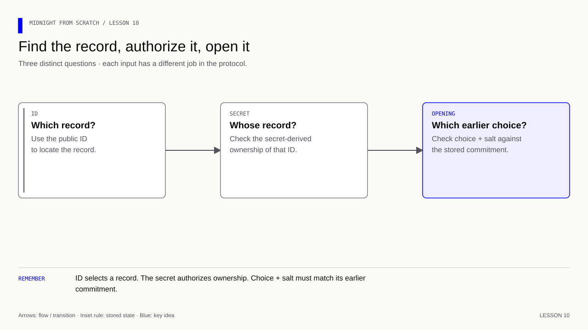
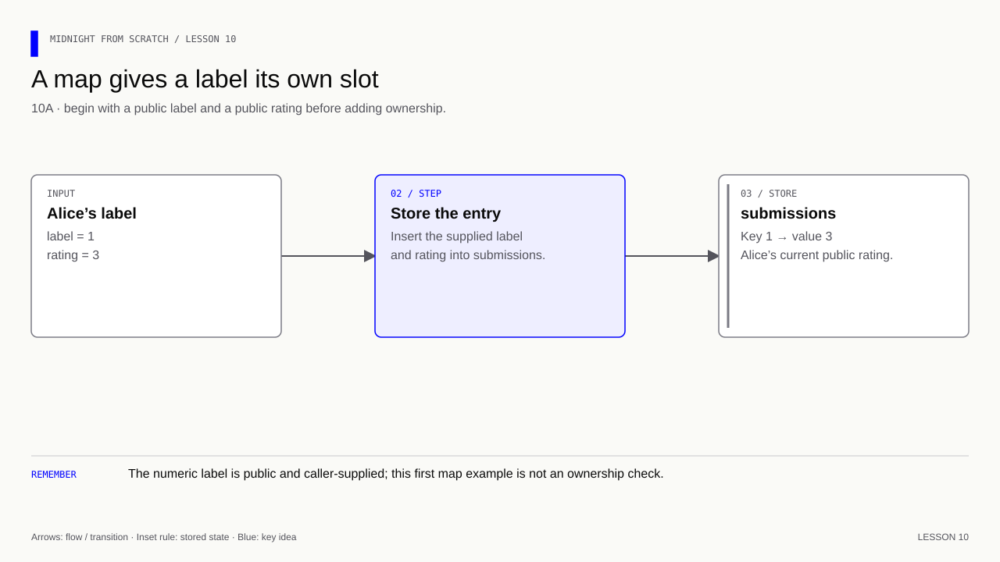
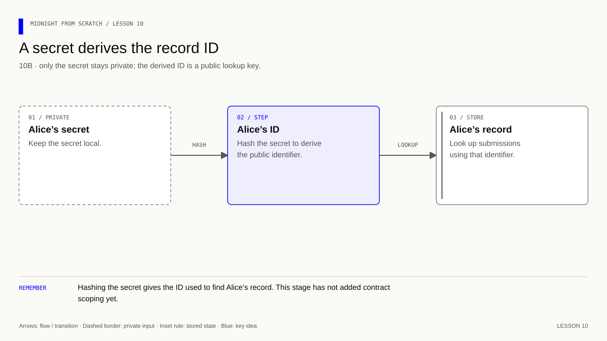
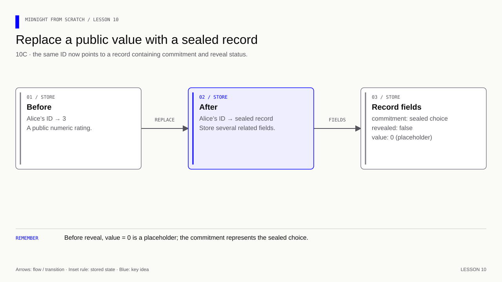
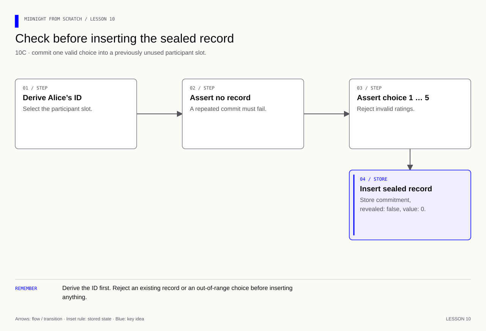
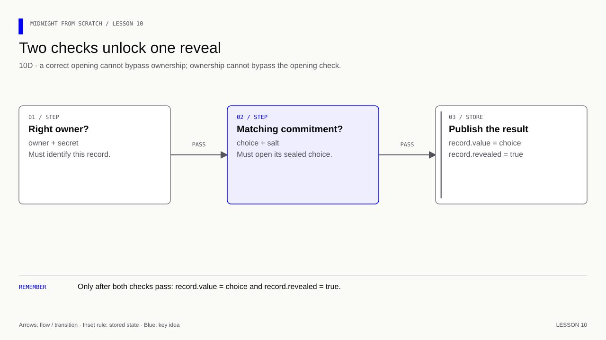
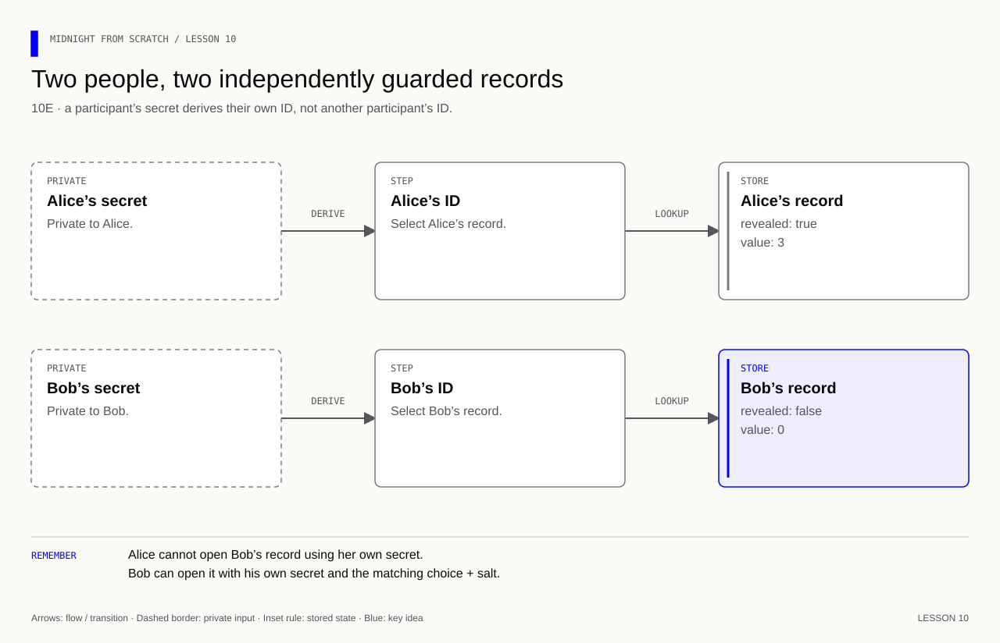
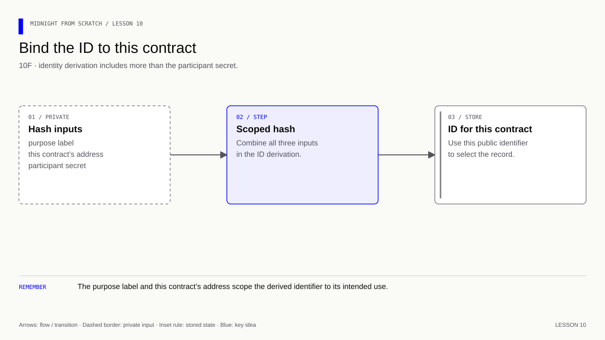

# Lesson 10 — One record, then two people

[Course overview](../../../README.md) · [Exercise index](../../README.md) · [Previous](../../Lesson%2009/Exercise/README.md) · [Next](../../Lesson%2011/Exercise/README.md)

## Grow a record without changing every idea at once

**Learning goal:** separate three jobs: a map locates a record, an authorization
secret controls it, and a commitment binds its future opening.

At A, expect independent public ratings under labels 1 and 2. At B, replace the
label with a derived ID. At C, replace the map's rating value with a sealed record
and remove the warm-up `storeRating` circuit. At D, open Alice's record; at E,
reject Bob's secret for Alice and still allow Bob's own reveal. Only then add
contract scope at F. Recompile after each Compact change and replace the runner
fragment explicitly named by that step.

Expect final ratings Alice 3 and Bob 5 in two records. The wrong-secret test
protects ownership even when the opening is known; wrong-choice/salt tests from
lesson 9 protect the opening even when the owner is correct. A map entry does
not establish a unique human, wallet ownership or eligibility to participate.

## Your exercise workspace

Edit the starter files **in this folder**. They already contain the previous
lesson's prerequisite concepts; TODO comments identify the new work. Keep building
these same files through the lettered stages. The [reference answer](../../Lesson%2010/Solution/README.md)
is separate and is not used as your submitted implementation.

Run grading commands below **from the repository root**, or run `node check.mjs A`
inside this folder to check stage 10A. With no letter, `node check.mjs` lists the
stages. The guide's ordinary file/compile/run commands use this folder as their
working directory; a mention of the project root in the original walkthrough
means this exercise's working folder. Keep your implementation in this folder.

| Stage | Work checked | Command from repository root |
|---|---|---|
| 10A | Store independent public map entries | `npm run check -- 10A` |
| 10B | Derive the record ID from a secret | `npm run check -- 10B` |
| 10C | Store a sealed record | `npm run check -- 10C` |
| 10D | Authorize and verify reveal | `npm run check -- 10D` |
| 10E | Complete Alice and Bob’s records | `npm run check -- 10E` |
| 10F | Scope IDs to this contract | `npm run check -- 10F` |

A failed check reports the first unmet requirement. Fix it and rerun the same
stage. A pass records the checked revision and suggests the next stage.
`npm run progress` distinguishes current passes from stages passed before later
edits. This history is local and ignored by Git; nothing is uploaded or submitted
to an external service.

---

[Course map](../../../README.md#course-map) · [Previous](../../Lesson%2009/Exercise/README.md) · [Next: lesson 11](../../Lesson%2011/Exercise/README.md)


The snippets build the files in this exercise folder. The reference folder contains the completed version.

We will build this slowly. Start with **10A only**. Run it, explain the result,
then move to the next part. Each part adds one idea to the same two files.
There is no need to understand the final contract before starting.

| Part | One question to answer | What you add |
|---|---|---|
| [10A](#10a--one-person-one-public-rating) | Where do we keep each person's rating? | A map |
| [10B](#10b--a-secret-chooses-the-record) | How does a secret select a record? | A derived ID |
| [10C](#10c--keep-a-sealed-rating-in-that-record) | What do we store before revealing? | A record and a commitment |
| [10D](#10d--open-alices-record) | What makes a reveal acceptable? | Checks, then an update |
| [10E](#10e--add-bob-then-test-one-wrong-secret) | Can someone else open this record? | A second participant and one rejected call |
| [10F](#10f--keep-the-id-specific-to-this-contract) | Should an ID be reused everywhere? | Contract-specific identity |

**Memory cue:** the ID finds the record; the secret authorizes its owner;
the opening proves the earlier choice.

[](../../../assets/diagrams/lesson-10-three-questions.html)

All calls here execute locally. Keep compiler 0.31.1, language 0.23 and the
existing runtime dependency. Your lesson 9 files stay available for revision.

If you already started feedback.compact or run-feedback.js, save your attempt
before using the staged examples. Make the changes yourself as you follow along;
rewriting this guide does not replace your working files.

## 10A — One person, one public rating

**New idea: a map is a collection of named slots.** For this first experiment,
Alice's label is simply `1`. It is a public label anyone could supply, not an
ownership check. We will address that in the following parts.

[](../../../assets/diagrams/lesson-10a-public-map.html)

### A1. Write this small contract

Create `feedback.compact` at the project root:

```compact
// Pin the language understood by the course's compiler version.
pragma language_version 0.23;
// Use the compiler's standard library without adding an npm dependency.
import CompactStandardLibrary;

// Keep a separate public map entry for each identifier.
export ledger submissions: Map<Uint<8>, Uint<8>>;

// Write one map entry so the warm-up demonstrates separate participant slots.
export circuit storeRating(owner: Uint<8>, choice: Uint<8>): [] {
    // Write the validated record to the public map under this identifier.
    submissions.insert(disclose(owner), disclose(choice));
}
```

Read just these three operations:

- `Map<Uint<8>, Uint<8>>`: numeric label → numeric rating.
- `insert(label, rating)`: store a rating under that label.
- `disclose(...)`: these inputs are deliberately becoming public.

This warm-up is public and permits replacement. It does not yet enforce the
1–5 rule. Those are circuit rules we will add, not features supplied by a map.

### A2. Set up the familiar local runner once

Create `run-feedback.js`. Its first section sets up the same local execution
environment used in earlier lessons. Open the block below, add it once, and
keep it at the top through every part of this lesson.

<details>
<summary>Runner setup — reused from earlier lessons</summary>

```js
// Use the runtime compatible with the generated contract.
import * as runtime from '@midnight-ntwrk/compact-runtime';
// Load the contract compiled for this example, rather than a learner's stale build.
import { Contract, ledger } from './managed/feedback/contract/index.js';

// Instantiate the generated contract with the callbacks it requires.
const contract = new Contract({});
// Provide the local runner's identity placeholder; it is not proof of record ownership.
const coinPublicKey = '0'.repeat(64);
// Construct fresh local contract state for this independent run.
const initial = contract.initialState(
  runtime.createConstructorContext({}, coinPublicKey),
);
// Carry address, identity and current state into the generated circuit wrapper.
let context = runtime.createCircuitContext(
  runtime.sampleContractAddress(),
  coinPublicKey,
  initial.currentContractState,
  {},
);
```

`new Contract({})` needs no witness callbacks. `context` carries our local state.
It uses `let` because each successful call supplies the context for the next call.
The all-zero key and sample address are local placeholders. We use the generated
`contract.circuits` group throughout: each call takes a context and returns
`.result` plus `.context`, including calls that only compute a value.

</details>

Append this small experiment **below the setup**:

```js
// Keep the call's answer and returned context for the next observation or operation.
const saved = contract.circuits.storeRating(context, 1n, 3n);
// Carry the successful call's state forward instead of restarting from an old context.
context = saved.context;

// Decode the current public state before inspecting its fields.
const publicState = ledger(context.currentQueryContext.state);
// Display the observed value at this stage of the example.
console.log('Alice:', publicState.submissions.lookup(1n).toString());
```

`lookup(1n)` reads the rating under Alice's label. The `n` makes a JS bigint,
which corresponds to the Compact unsigned-integer arguments here.

### A3. Run and observe

From the project root:

```bash
compact compile +0.31.1 --skip-zk feedback.compact managed/feedback
node run-feedback.js
```

Expected: `Alice: 3`.

Use those same two commands after each Compact change below. A JS-only change
needs only `node run-feedback.js`. Each run starts with a fresh empty map.

**Mini exercise:** before the final ledger read, add Bob under label `2` with
rating `5`. Does Alice's rating change?

<details>
<summary>Answer — 10A</summary>

Insert after `context = saved.context;`:

```js
// Keep the call's answer and returned context for the next observation or operation.
const bobSaved = contract.circuits.storeRating(context, 2n, 5n);
// Carry the successful call's state forward instead of restarting from an old context.
context = bobSaved.context;
```

Then, after `publicState` is decoded, add:

```js
// Display the observed value at this stage of the example.
console.log('Bob:', publicState.submissions.lookup(2n).toString());
```

Alice remains 3, Bob is 5. Different keys select different slots. Remove the
optional Bob lines before continuing; we will return to two people in 10E.

</details>

**Stop here until this is clear:** a map keeps several separate values.

## 10B — A secret chooses the record

**New idea: derive the public label from a secret.** Alice keeps 32 random bytes
locally. We hash them to get her public ID. Do not try to memorize the ID.

[](../../../assets/diagrams/lesson-10b-secret-id.html)

The secret is not a wallet address or the commitment salt. It is a separate
application secret. Knowing someone's public ID should not reveal their secret.
Use random bytes, not a name or PIN that can be guessed.

### B1. Change only the map's key type

Replace the existing ledger line with:

```compact
// Keep a separate public map entry for each identifier.
export ledger submissions: Map<Bytes<32>, Uint<8>>;
```

The keys are now 32-byte IDs. Values are still ordinary public ratings.

### B2. Add two tiny circuits

Add these outside `storeRating`:

```compact
// Derive the record identifier from the private authorization secret.
circuit keyFor(secret: Bytes<32>): Bytes<32> {
    // Compute a deterministic identifier without revealing the underlying secret.
    return persistentHash<Bytes<32>>(secret);
}
```

`keyFor` computes an ID. It has no `export`, so it is an internal helper.
`<Bytes<32>>` tells the hash function what type of value it receives.

```compact
// Let the caller obtain the public identifier using the contract's own derivation.
export circuit participantId(secret: Bytes<32>): Bytes<32> {
    // Return the public identifier while keeping its secret input private.
    return disclose(keyFor(secret));
}
```

`participantId` lets our JS runner ask for that ID. It deliberately returns the
public hash; it does not return the secret. As in lesson 6, JS reads the returned
value through `.result`.

### B3. Replace storeRating

Replace only that circuit with:

```compact
// Write one map entry so the warm-up demonstrates separate participant slots.
export circuit storeRating(secret: Bytes<32>, choice: Uint<8>): [] {
    // Permit this value to become public at this deliberate disclosure point.
    const owner = disclose(keyFor(secret));
    // Write the validated record to the public map under this identifier.
    submissions.insert(owner, disclose(choice));
}
```

The caller now supplies a secret, and the circuit derives the record's key.
There is no caller-provided `owner` argument to pick an arbitrary slot. This
intermediate circuit still publishes the rating and allows repeated updates.

### B4. Change the small runner experiment

Add this import at the top of `run-feedback.js`:

```js
// Generate unpredictable secrets and salts with Node's cryptographic RNG.
import { randomBytes } from 'node:crypto';
```

Keep the setup unchanged. Replace **everything below the setup** with:

```js
// Keep a fresh authorization secret local to this participant.
const aliceSecret = new Uint8Array(randomBytes(32));
// Ask the contract to derive the identifier from the same rule it enforces.
const aliceId = contract.circuits.participantId(context, aliceSecret);
// Carry the successful call's state forward instead of restarting from an old context.
context = aliceId.context;

// Keep the call's answer and returned context for the next observation or operation.
const saved = contract.circuits.storeRating(context, aliceSecret, 3n);
// Carry the successful call's state forward instead of restarting from an old context.
context = saved.context;

// Decode the current public state before inspecting its fields.
const publicState = ledger(context.currentQueryContext.state);
// Display the observed value at this stage of the example.
console.log('Alice:', publicState.submissions.lookup(aliceId.result).toString());
```

There are only two calls: obtain Alice's ID, then store Alice's rating.
After each successful call, carry forward its `.context`.

Compile and run. Expected: `Alice: 3`, just as before. The key has changed from
`1` to derived bytes; the visible rating has not changed.

**Mini exercise:** what is the difference between `aliceId.result` and
`aliceId.context`? Does one secret necessarily mean one human?

<details>
<summary>Answer — 10B</summary>

`.result` is the public 32-byte ID returned by participantId. `.context` is the
execution state for the next call. One person can generate many secrets: this
pattern identifies records, not unique humans. Admission comes in lesson 15.

</details>

## 10C — Keep a sealed rating in that record

**New idea: one slot can contain a small record instead of one number.**
We reuse lesson 9's commitment; the new part is storing it under Alice's ID.

[](../../../assets/diagrams/lesson-10c-record-shape.html)

### C1. Replace the single ledger declaration with this block

```compact
// Define the fields grouped into one participant record.
export struct Submission {
    // Retain the public commitment that binds this record to its private opening.
    commitment: Bytes<32>;
    // Track whether this record has already been opened.
    revealed: Boolean;
    // Store the placeholder or the deliberately disclosed rating for this record.
    value: Uint<8>;
}

// Keep a separate public map entry for each identifier.
export ledger submissions: Map<Bytes<32>, Submission>;
```

`Submission` describes the shape of one record. `submissions` is the actual
public map. Do not keep the old numeric map declaration as well.

- `commitment` stores the sealed choice.
- `revealed` records whether it has been opened.
- `value` is 0 until reveal; then it holds the published rating.

The struct declaration itself creates no participant records.

### C2. Remove storeRating and add commitFor

Keep `keyFor` and `participantId`. Remove the old `storeRating` circuit entirely;
its numeric insertion no longer fits the new record type. Add:

```compact
// Create one hidden submission for the owner derived from this secret.
export circuit commitFor(secret: Bytes<32>, choice: Uint<8>, salt: Bytes<32>): [] {
    // Permit this value to become public at this deliberate disclosure point.
    const owner = disclose(keyFor(secret));
    // Prevent replacing a commitment after a participant has submitted.
    assert(!submissions.member(owner), "Already submitted");
    // Reject values that fit the numeric type but violate the application rule.
    assert(choice >= 1 && choice <= 5, "Rating must be 1 to 5");
    // Write the validated record to the public map under this identifier.
    submissions.insert(owner, Submission {
        // Retain the public commitment that binds this record to its private opening.
        commitment: persistentCommit<Uint<8>>(choice, salt),
        // Track whether this record has already been opened.
        revealed: false,
        // Store the placeholder or the deliberately disclosed rating for this record.
        value: 0
    });
}
```

Read it in order:

[](../../../assets/diagrams/lesson-10c-commit-guards.html)

`member(owner)` asks whether a record exists. `!` means NOT. The first assertion
prevents overwriting an earlier commitment. `Submission { ... }` constructs a
record of the type we just declared. The commitment expression is the same one
used in lesson 9.

### C3. Replace the runner experiment below the setup

Keep both imports and the setup. Replace the experiment after it with:

```js
// Keep a fresh authorization secret local to this participant.
const aliceSecret = new Uint8Array(randomBytes(32));
// Ask the contract to derive the identifier from the same rule it enforces.
const aliceId = contract.circuits.participantId(context, aliceSecret);
// Carry the successful call's state forward instead of restarting from an old context.
context = aliceId.context;

// Name the intended rating so subsequent calls reuse the same choice.
const aliceChoice = 3n;
// Retain secret randomness so the committed choice can be opened later.
const aliceSalt = new Uint8Array(randomBytes(32));
// Keep the call's answer and returned context for the next observation or operation.
const aliceCommit = contract.circuits.commitFor(
  context, aliceSecret, aliceChoice, aliceSalt,
);
// Carry the successful call's state forward instead of restarting from an old context.
context = aliceCommit.context;

// Decode the current public state before inspecting its fields.
const sealed = ledger(context.currentQueryContext.state).submissions.lookup(aliceId.result);
// Display the observed value at this stage of the example.
console.log('Revealed:', sealed.revealed);
// Display the observed value at this stage of the example.
console.log('Stored value:', sealed.value.toString());
```

There are now two different secrets in local memory:

| Value | Purpose |
|---|---|
| `aliceSecret` | Controls Alice's record |
| `aliceSalt` | Hides the chosen rating in its commitment |

Compile and run. Expected:

```text
Revealed: false
Stored value: 0
```

The committed choice is 3, but the public record does not yet store that 3.
The 0 is a placeholder, not a zero-star submission.

**Mini exercise:** why do we check `member(owner)` before inserting? Does storing
a struct make its fields private?

<details>
<summary>Answer — 10C</summary>

`insert` can replace an existing record, so the assertion prevents changing a
previous commitment. A struct only groups fields; it does not hide them. The
commitment protects the choice while the public flags and placeholder remain visible.

</details>

## 10D — Open Alice's record

**New idea: check ownership and the opening before updating the record.**

[](../../../assets/diagrams/lesson-10d-reveal-guards.html)

### D1. Add revealFor below commitFor

```compact
// Require both record ownership and a matching opening before publishing a rating.
export circuit revealFor(owner: Bytes<32>, secret: Bytes<32>, choice: Uint<8>, salt: Bytes<32>): [] {
    // Reject callers who do not know the secret corresponding to this record ID.
    assert(owner == keyFor(secret), "Not the owner");
    // Permit this value to become public at this deliberate disclosure point.
    const publicOwner = disclose(owner);
    // Check existence before reading a map entry that may be absent.
    assert(submissions.member(publicOwner), "No submission");
    // Read the existing record only after its existence has been checked.
    const previous = submissions.lookup(publicOwner);
    // Prevent repeated reveals from reusing the same submission.
    assert(!previous.revealed, "Already revealed");
    // Bind the reveal to the original choice and salt, rather than trusting the caller.
    assert(previous.commitment == persistentCommit<Uint<8>>(choice, salt), "Wrong opening");
    // Write the validated record to the public map under this identifier.
    submissions.insert(publicOwner, Submission {
        // Retain the public commitment that binds this record to its private opening.
        commitment: previous.commitment,
        // Track whether this record has already been opened.
        revealed: true,
        // Store the placeholder or the deliberately disclosed rating for this record.
        value: disclose(choice)
    });
}
```

This is the longest circuit in the lesson. Read it as three small jobs:

1. **Locate safely:** verify the secret belongs to `owner`, then check that the
   map contains that public ID before looking it up.
2. **Validate:** require an unopened record and an opening that matches.
3. **Update:** preserve the commitment, mark the record revealed, and publish
   the raw rating with `disclose(choice)`.

`previous` is a local name for the record read from the map. The final `insert`
replaces that record; it does not create another Alice.

### D2. Append one successful reveal

Keep all of 10C's runner code. Append only:

```js
// Keep the call's answer and returned context for the next observation or operation.
const aliceReveal = contract.circuits.revealFor(
  context, aliceId.result, aliceSecret, aliceChoice, aliceSalt,
);
// Carry the successful call's state forward instead of restarting from an old context.
context = aliceReveal.context;

// Decode the current public state before inspecting its fields.
const aliceRecord = ledger(context.currentQueryContext.state).submissions.lookup(aliceId.result);
// Display the observed value at this stage of the example.
console.log('Alice:', aliceRecord.value.toString());
```

Compile and run. The last line should now be `Alice: 3`. Earlier lines still
show the record **before** reveal: false and 0. They describe different moments.

**Mini exercise:** identify the line that rejects a different choice, and the
line that prevents a second reveal. Do they enforce the same rule?

<details>
<summary>Answer — 10D</summary>

The commitment comparison rejects a different choice/salt. The
`assert(!previous.revealed, ...)` line rejects a repeated reveal. Consistency with
the original choice and permission to repeat an operation are separate rules.

</details>

## 10E — Add Bob, then test one wrong secret

**New idea: repeat the same flow for another independent record.** Keep Alice's
existing code. We will use meaningful variable names rather than a long sequence
of changing numeric inputs.

[](../../../assets/diagrams/lesson-10e-two-participants.html)

### E1. Append Bob's local data and ID

```js
// Keep a fresh authorization secret local to this participant.
const bobSecret = new Uint8Array(randomBytes(32));
// Retain secret randomness so the committed choice can be opened later.
const bobSalt = new Uint8Array(randomBytes(32));
// Name the intended rating so subsequent calls reuse the same choice.
const bobChoice = 5n;

// Ask the contract to derive the identifier from the same rule it enforces.
const bobId = contract.circuits.participantId(context, bobSecret);
// Carry the successful call's state forward instead of restarting from an old context.
context = bobId.context;
```

### E2. Append Bob's commitment

```js
// Keep the call's answer and returned context for the next observation or operation.
const bobCommit = contract.circuits.commitFor(
  context, bobSecret, bobChoice, bobSalt,
);
// Carry the successful call's state forward instead of restarting from an old context.
context = bobCommit.context;
```

Compile and run if you want to check this intermediate step. Alice's output
remains unchanged; Bob's record is now present but unopened.

### E3. Add one rejection check

Add this import at the top:

```js
// Make unexpected results fail the runner instead of merely printing them.
import assert from 'node:assert/strict';
```

Append this single test after Bob's commitment:

```js
// Verify rejection so an invalid operation cannot silently pass the example.
assert.throws(() => {
  // Invoke the circuit under test using the arguments of this experiment.
  contract.circuits.revealFor(
    context, bobId.result, aliceSecret, bobChoice, bobSalt,
  );
}, /Not the owner/);
// Display the observed value at this stage of the example.
console.log('Different secret rejected.');
```

The attempted call has **Bob's ID and Bob's correct opening**, but **Alice's
secret**. That isolates the ownership check. There is no wrong salt or out-of-range
rating to confuse the reason for rejection.

`assert.throws` expects the function inside it to throw an error containing
`Not the owner`. It fails the runner if the call succeeds or throws a different
error. The throwing call supplies no successful result, so `context` is unchanged.

### E4. Let Bob reveal normally

Append:

```js
// Keep the call's answer and returned context for the next observation or operation.
const bobReveal = contract.circuits.revealFor(
  context, bobId.result, bobSecret, bobChoice, bobSalt,
);
// Carry the successful call's state forward instead of restarting from an old context.
context = bobReveal.context;

// Decode the current public state before inspecting its fields.
const finalState = ledger(context.currentQueryContext.state);
// Display the observed value at this stage of the example.
console.log('Bob:', finalState.submissions.lookup(bobId.result).value.toString());
// Display the observed value at this stage of the example.
console.log('Participants:', finalState.submissions.size().toString());
```

Run the runner. Its final lines should be:

```text
Different secret rejected.
Bob: 5
Participants: 2
```

**Mini exercise:** which single argument differs between the rejected call and
Bob's successful call? Why keep `context` after Bob's commitment?

<details>
<summary>Answer — 10E</summary>

The secret changes from `aliceSecret` to `bobSecret`. The ID, choice and salt
remain Bob's. The current context includes Bob's commitment; an older context
might not contain his record. There is one shared state history containing both
participants, not a separate blockchain state for each person.

</details>

## 10F — Keep the ID specific to this contract

**New idea: give identity derivation a scope.** Until now, hashing the same secret
produced the same ID anywhere. We can include this contract's address and a
purpose label so that the same secret is not automatically the same public ID
in another contract.

[](../../../assets/diagrams/lesson-10f-scoped-id.html)

Replace **only** the body/definition of `keyFor` with:

```compact
// Derive the record identifier from the private authorization secret.
circuit keyFor(secret: Bytes<32>): Bytes<32> {
    // Compute a deterministic identifier without revealing the underlying secret.
    return persistentHash<Vector<3, Bytes<32>>>([
        // Bind this identifier to the application purpose, contract instance and private secret.
        pad(32, "feedback:user:v1"), kernel.self().bytes, secret
    ]);
}
```

Read the new pieces one at a time:

| Piece | Meaning |
|---|---|
| `pad(32, "feedback:user:v1")` | A purpose label encoded into 32 bytes |
| `kernel.self().bytes` | This contract's address as bytes |
| `secret` | The same private participant secret |
| `Vector<3, Bytes<32>>` | A fixed group of three 32-byte values |

No other code changes. The runner asks the contract to compute its IDs, so it
uses this new rule automatically. Recompile and run from fresh local state.
Do not apply a changed ID rule to an old deployed contract and expect existing
records to move automatically.

`keyFor` now reads the contract address, so it is not a pure helper. We have
not added a `pure` declaration to any version in this lesson.

**Mini exercise:** does this make every action anonymous? Does knowing a public
ID let someone pass the ownership assertion?

<details>
<summary>Answer — 10F</summary>

No. This contract still publishes the ID and links it to its commitment and
revealed rating. External information might identify its owner. The ID alone
does not supply a secret hashing to that ID. We rely on a random secret and the
hash's security properties; this does not establish a unique person or eligibility.

</details>

## The complete code we have built

Only open these after finishing the small steps, or use them to locate a missing
piece. The contract interface matches the later course lessons. The complete
reference files are also available at [feedback.compact](../../Lesson%2010/Solution/feedback.compact)
and [run-feedback.js](../../Lesson%2010/Solution/run-feedback.js).

The [lesson 10 reference folder](../../Lesson%2010/Solution/README.md) is the assembled
answer. Read its commented source and run `npm run lesson10` from the repository
root. Keep practicing in your own files; changes there do not alter this reference.

Final expected output:

```text
Revealed: false
Stored value: 0
Alice: 3
Different secret rejected.
Bob: 5
Participants: 2
```

**Checkpoint:** explain map → ID → record → commit → reveal in your own words.
You have checked one successful flow and one targeted ownership failure. Additional
wrong-opening and duplicate tests can be added later; you do not need a large test
suite to learn these concepts at once. Lesson 11 adds command shortcuts for the
same final files. Lesson 15 adds admission and phases.

**Verification:** see the [toolchain and verification guide](../../../docs/knowledge-audit.md) for supported checks and their scope.
