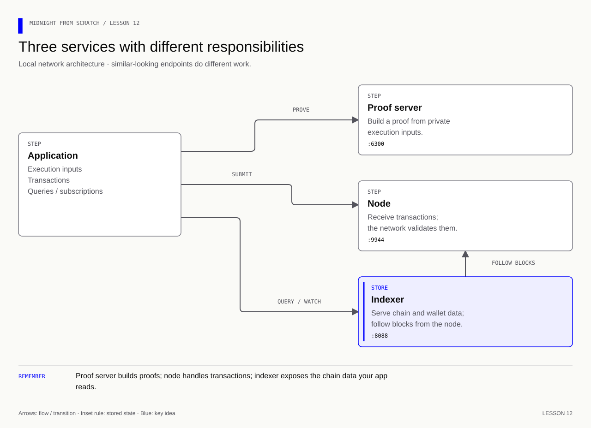

# Lesson 12 — Start the supplied Midnight environment

[Course overview](../../../README.md) · [Exercise index](../../README.md) · [Previous](../../Lesson%2011/Exercise/README.md) · [Next](../../Lesson%2013/Exercise/README.md)

**Goal:** start Midnight's supplied local stack with one command, then identify
which service is responsible for each observation. The ratings contract is still
the one from lesson 10; Docker does not turn your in-memory state into a deployment.

**Memory cue:** **Prover proves; node accepts; indexer explains accepted state.**

[](../../../assets/diagrams/lesson-12-services.html)

All commands below run from the **repository root**. This lesson reads the
provided [network bundle](../../../network/README.md); do not assemble another stack.
Its `network/compose.yaml` compatibility entry point includes the shared bundle.
Edit this lesson's `answers.json` for the concept checks.

| Stage | Work checked | Command |
|---|---|---|
| 12A | Explain and validate the supplied configuration | `npm run check -- 12A` |
| 12B | Observe the running local services | `npm run check -- 12B` |
| 12C | Explain responsibilities and safe stopping | `npm run check -- 12C` |

The checker never starts Docker for you. A missing service is a blocked
prerequisite; a wrong answer is work to correct. `npm run progress` records the
revision checked, without uploading work or resetting starter files.

## 12A — Read a supplied stack before changing it

The maintained `midnight-examples` repository provides a node, standalone indexer,
and proof server together. This course vendors that exact Compose service file
with attribution so startup needs no second checkout or handwritten service setup.
The archived `midnight-local-dev` project now points to these maintained examples.

| Component | What you ask it | Local host endpoint |
|---|---|---|
| Node | Accept a transaction; report chain progress | `http://127.0.0.1:9944` / `ws://127.0.0.1:9944` |
| Indexer | Query and subscribe to indexed public data | `http://127.0.0.1:8088/api/v4/graphql` |
| Proof server | Construct a proof from the proving inputs | `http://127.0.0.1:6300` |

The indexer's WS endpoint adds `/ws` and uses `ws://`. Inside Compose the indexer
uses service DNS such as `node:9944`; host applications use loopback. The network
ID is `undeployed`. There is **no explorer service** in this bundle. Use indexed
queries locally and a public explorer on the appropriate public network later.

**Try:** read the supplied YAML; locate its three image pins and loopback ports.
In `answers.json`, fill stage `12A`: `suppliedStack`, `localNetwork`, and
`explorerIncluded`. Validate without starting containers:

```bash
npm run network:check
npm run check -- 12A
```

<details><summary>Answers — 12A</summary>

```json
"12A": {
  "suppliedStack": "midnight-examples",
  "localNetwork": "undeployed",
  "explorerIncluded": false
}
```

This JSON fragment belongs inside the existing object. The supplied local pins
are node `1.0.0`, indexer `4.3.3`, and prover `8.1.0`; do not substitute `latest`
independently. Configuration validation checks YAML, not live availability.

</details>

## 12B — One startup, three observations

With Docker Desktop running:

```bash
# Start the entire supplied bundle; first use may download images.
npm run network:up
# Inspect all containers and probe the node, indexer, and prover independently.
npm run network:status
npm run check -- 12B
```

Expected: a node block beyond genesis, an answered GraphQL query, and a running
proof service. Repeat the node observation to see progress. The checker observes
running services; lesson 14's real transaction supplies proving evidence.

**Analogy:** an open restaurant has a kitchen, a cashier, and a receipt system.
Seeing the cashier does not establish that the kitchen can cook your order.
Likewise, a healthy prover endpoint does not establish a successful contract proof.

If readiness fails, `npm run network:logs` identifies which component failed.
Check Docker resources and port conflicts before changing code or submitting a
transaction. The [deployment guide](../../../docs/deployment.md) carries this same
stack into the wallet and transaction lessons.

## 12C — Stop and resume deliberately

```bash
# Preserve the existing containers and their current data.
npm run network:stop
# Resume/start the same configured project.
npm run network:up
```

Removing/recreating containers can reset this disposable chain. An old address
file does not recreate a contract. Preserve original openings and private stores,
and verify that an address exists on the chain currently running.

**Exercise:** temporarily stop only the indexer. Does the node still answer?
Which component must catch up afterward? Run this only against your course stack:

```bash
docker compose -p midnight-course -f network/compose.yaml stop indexer
# Observe the node separately, then resume the indexer.
docker compose -p midnight-course -f network/compose.yaml start indexer
npm run network:status
```

Fill stage `12C`: `transactionService`, `queryService`, `stopDeletesVolumes`.

<details><summary>Answers — 12C</summary>

The node can continue while the indexer is stopped; the indexer must resume
indexing. Proving is separate from wallet keys and public data queries.

```json
"12C": {
  "transactionService": "node",
  "queryService": "indexer",
  "stopDeletesVolumes": false
}
```

`stop` requests process stopping, not volume deletion. `down` removes containers;
`down -v` also requests volume removal. Neither is the course's resume command.

</details>

Run `npm run check -- 12C`, then continue to the wallet lesson. You have service
readiness evidence; you have not yet deployed ratings.

**Source check:** [bundle provenance](../../../network/README.md),
[Midnight expert devnet skill](https://github.com/midnightntwrk/midnight-expert/blob/7853915a82a605e3b74dd3b7ab7a241de8a9d136/plugins/midnight-tooling/skills/devnet/SKILL.md), and
[knowledge audit](../../../docs/knowledge-audit.md).
