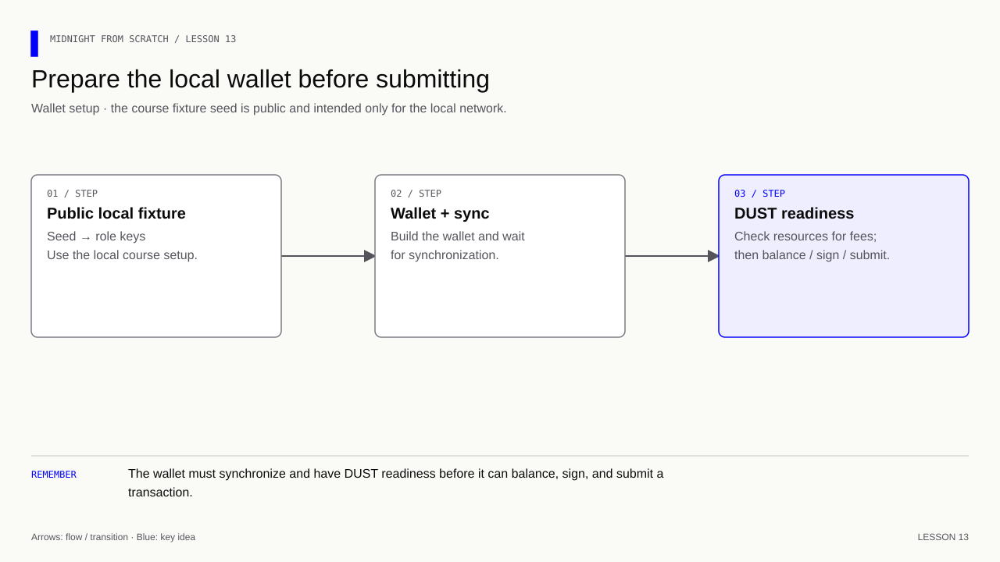
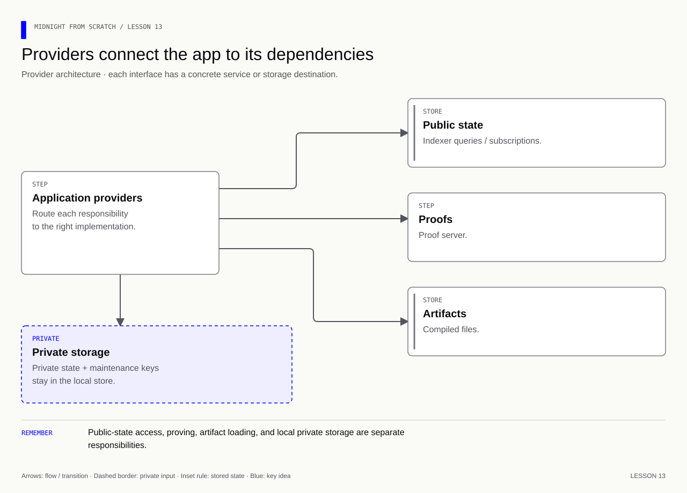

# Lesson 13 — Build a local wallet and connect providers

[Course overview](../../../README.md) · [Exercise index](../../README.md) · [Previous](../../Lesson%2012/Exercise/README.md) · [Next](../../Lesson%2014/Exercise/README.md)

**Before this lesson:** start the supplied stack from the course root with
`npm run network:up`, then inspect `npm run network:status`. There is one shared
stack across lessons 12–15; do not create another node or indexer. This lesson's
hand-built adapters teach responsibilities. The [deployment walkthrough](../../../docs/deployment.md)
then reuses the completed adapters for local, preview, preprod, and mainnet sessions.
The introductory `openLocalWallet` runner remains restricted to the local fixture.

## Your exercise workspace

Edit the starter files **in this folder**. They already contain the previous
lesson's prerequisite concepts; TODO comments identify the new work. Keep building
these same files through the lettered stages. The [reference answer](../../Lesson%2013/Solution/README.md)
is separate and is not used as your submitted implementation.

Run grading commands below **from the repository root**, or run `node check.mjs A`
inside this folder to check stage 13A. With no letter, `node check.mjs` lists the
stages. The guide's ordinary file/compile/run commands use this folder as their
working directory; a mention of the project root in the original walkthrough
means this exercise's working folder. Keep your implementation in this folder.

| Stage | Work checked | Command from repository root |
|---|---|---|
| 13A | Configure and build the SDK workspace | `npm run check -- 13A` |
| 13B | Implement wallet key roles and adapters | `npm run check -- 13B` |
| 13C | Observe synchronization and DUST | `npm run check -- 13C` |
| 13D | Assemble the provider bundle | `npm run check -- 13D` |

A failed check reports the first unmet requirement. Fix it and rerun the same
stage. A pass records the checked revision and suggests the next stage.
`npm run progress` distinguishes current passes from stages passed before later
edits. This history is local and ignored by Git; nothing is uploaded or submitted
to an external service.

Network checks require their documented tools/services. They inspect state or
build code; they do not start Docker or submit deployment transactions. Run the
guide's deployment steps yourself before a confirmed-state checkpoint.

---

[Course map](../../../README.md#course-map) · [Previous](../../Lesson%2012/Exercise/README.md) · [Next](../../Lesson%2014/Exercise/README.md)


The snippets build the files in this exercise folder. The reference folder contains the completed version.

**Goal:** understand keys, wallet synchronization, DUST readiness and the adapter
object Midnight.js needs. Build the plumbing explicitly before deploying anything.
Prerequisites: lesson 12's local services and Node 22.23.2.

**Memory cue:** the wallet supplies capabilities; providers connect each capability
to the service or storage that implements it.

[](../../../assets/diagrams/lesson-13-wallet-readiness.html)

[](../../../assets/diagrams/lesson-13-provider-routing.html)

## 13A — Prepare the SDK workspace

### Separate application secrets from wallet keys

Lesson 10's participant secret authorizes a feedback record. A wallet's keys
serve different roles: shielded operations, unshielded signatures and DUST.
Paying for a call does not prove ownership of a feedback record. Our network
experiment can use one wallet to pay for several independent application secrets.

This course fixture deliberately uses the **public local genesis seed**, whose
wallet is funded by the dev preset. This avoids introducing a faucet or token
transfer before the first deployment. It is not a private seed and is suitable
only for this disposable `undeployed` network. The fixed loopback configuration
is part of that boundary. Do not adapt it to mainnet by changing a URL.

DUST is the shielded resource used for fees; a positive balance is not a promise
that any-sized transaction is affordable. Generation requires appropriate
registered NIGHT. The local preset is the funding fixture; if a different
preset does not fund it, diagnose funding rather than inventing a balance.
See [Managing DUST](https://docs.midnight.network/guides/manage-dust).

### Create a separate dependency workspace

Keep root lesson 9/10 commands and lockfile intact. Create `network/package.json`
with the manifest below. Its generated contracts will be placed inside
`network/managed/` so they resolve this workspace's runtime installation.

```json
{
  "name": "midnight-course-network",
  "private": true,
  "type": "module",
  "scripts": {
    "build": "tsc -p tsconfig.json",
    "status": "node --env-file=.env.local build/status.js",
    "compile": "compact compile +0.31.1 ../feedback.compact managed/feedback",
    "deploy": "node --env-file=.env.local build/deploy.js",
    "call": "node --env-file=.env.local build/call.js",
    "compile:round": "compact compile +0.31.1 ../round.compact managed/round",
    "round": "node --env-file=.env.local build/round-demo.js"
  },
  "dependencies": {
    "@midnight-ntwrk/compact-runtime": "0.16.0",
    "@midnight-ntwrk/midnight-js-contracts": "4.1.1",
    "@midnight-ntwrk/midnight-js-http-client-proof-provider": "4.1.1",
    "@midnight-ntwrk/midnight-js-indexer-public-data-provider": "4.1.1",
    "@midnight-ntwrk/midnight-js-level-private-state-provider": "4.1.1",
    "@midnight-ntwrk/midnight-js-network-id": "4.1.1",
    "@midnight-ntwrk/midnight-js-node-zk-config-provider": "4.1.1",
    "@midnight-ntwrk/midnight-js-protocol": "4.1.1",
    "@midnight-ntwrk/midnight-js-types": "4.1.1",
    "@midnight-ntwrk/wallet-sdk": "1.2.0",
    "rxjs": "7.8.2"
  },
  "devDependencies": {
    "@types/node": "22.19.0",
    "typescript": "5.9.3"
  },
  "overrides": {
    "@midnight-ntwrk/onchain-runtime-v3": "3.0.0"
  }
}
```

Every direct dependency has a job:

| Package/group | Why it is here |
|---|---|
| compact-runtime | Generated Compact JavaScript executes against it |
| wallet-sdk 1.2.0 | Key derivation, sub-wallets, balancing and submission |
| midnight-js-contracts | Deployment and contract-call orchestration in lesson 14 |
| midnight-js-types | Compile-time interfaces for the provider bridge |
| midnight-js-protocol | Compatible ledger/runtime/CompiledContract imports |
| midnight-js-network-id | Select local address/network interpretation |
| indexer-public-data-provider | Read and observe chain state |
| http-client-proof-provider | Send proving requests to the local prover |
| node-zk-config-provider | Load generated circuit artifacts from disk |
| level-private-state-provider | Store private state and deployment maintenance keys |
| rxjs | Consume the wallet's changing state with a bounded wait |
| typescript + @types/node | Check the glue code and compile it to JS |

The `@midnight-ntwrk/wallet-sdk` spelling here is the published package used by
this reference set. Read the manifest literally; do not mix scopes from another
tutorial without checking their versions and exports.

The `overrides` pin forces one onchain-runtime-v3 version across the graph.
Generated code and SDK code must share compatible runtime classes. Keeping
matching version numbers without checking duplicate runtime installations can
still lead to `expected instance of StateValue` errors. See the [compatibility
matrix](https://docs.midnight.network/relnotes/support-matrix).

```bash
cd network
npm install
npm ls @midnight-ntwrk/compact-runtime @midnight-ntwrk/onchain-runtime-v3
```

Expect runtime 0.16.0 and onchain-runtime-v3 3.0.0, with repeated references
deduplicated. Commit this workspace's package-lock.json when completing the lesson.
Afterward use `npm ci` for repeatable installs. A reference lockfile, when supplied
beside the reference manifest, is another way to reproduce the checked resolution.
All commands in the rest of this lesson run from `network/`.

### Protect local output and configure TypeScript

Create `network/.gitignore` (or `.gitignore` while inside network):

```text
node_modules/
managed/
build/
.env.local
.private-state/
*.json.tmp
deployment.json
round-deployment.json
opening.json
```

Create `tsconfig.json`:

```json
{
  "compilerOptions": {
    "target": "ES2022",
    "module": "NodeNext",
    "moduleResolution": "NodeNext",
    "strict": true,
    "skipLibCheck": true,
    "types": ["node"],
    "rootDir": "src",
    "outDir": "build"
  },
  "include": ["src/**/*.ts"]
}
```

We introduce TypeScript only for SDK glue. It is JavaScript plus checked type
annotations. `src/` contains source; `build/` receives executable JS. `NodeNext`
uses Node's ESM resolution; `.js` suffixes in TS imports name the emitted files.
Types are checked at build time and are not a replacement for contract assertions.

Create a local storage password without printing it:

```bash
node --input-type=module -e 'import { randomBytes } from "node:crypto"; import { writeFileSync } from "node:fs"; writeFileSync(".env.local", "PRIVATE_STATE_PASSWORD=Course1!" + randomBytes(32).toString("hex") + "\n", { mode: 0o600, flag: "wx" });'
mkdir -p src
```

`Course1!` ensures the provider's required character classes; the random suffix
supplies unpredictability. A hex-only password would fail that provider policy.
`wx` refuses to overwrite an existing file. Retain this password with the store;
regenerating it does not decrypt previously stored data. It is a storage password,
not a wallet seed or participant secret. `.env.local` stays out of Git.

### Name the network before constructing SDK objects

Create `src/config.ts`:

```ts
// Select the network used by SDK serialization and operations.
import { setNetworkId } from '@midnight-ntwrk/midnight-js-network-id';

// This fixture uses a PUBLIC genesis seed and must stay on a local devnet.
export const networkId = 'undeployed';
// Select the network before constructing SDK objects that depend on it.
setNetworkId(networkId);
// Keep the local service addresses together so providers agree on their destinations.
export const endpoints = {
  // Query confirmed public data through the indexer's HTTP endpoint.
  indexer: 'http://127.0.0.1:8088/api/v4/graphql',
  // Subscribe to indexed updates through the WebSocket endpoint.
  indexerWS: 'ws://127.0.0.1:8088/api/v4/graphql/ws',
  // Connect transaction submission to the local node.
  nodeWS: 'ws://127.0.0.1:9944',
  // Point proof requests at the local proof server.
  proof: 'http://127.0.0.1:6300',
};
```

Importing this module selects `undeployed` and exposes the host URLs. A network
ID must agree with the node/indexer and wallet configuration. No endpoint in this
fixture is chosen from an environment variable; that helps prevent accidentally
using the public test seed against a different network.

## 13B — Implement the wallet and providers

### Derive keys, start and adapt the wallet

Create `src/wallet.ts`:

```ts
// Use the shared local network identity and service endpoints.
import { endpoints, networkId } from './config.js';
// Import the wallet facade, key derivation and sub-wallet implementations.
import {
  WalletFacade, ShieldedWallet, DustWallet, UnshieldedWallet,
  PublicKey, HDWallet, Roles, createKeystore, InMemoryTransactionHistoryStorage,
  WalletEntrySchema, mergeWalletEntries,
} from '@midnight-ntwrk/wallet-sdk';
// Construct wallet key roles using the SDK's matching ledger implementation.
import { DustSecretKey, ZswapSecretKeys, LedgerParameters } from '@midnight-ntwrk/midnight-js-protocol/ledger';
// Check that the adapter satisfies the SDK's provider interfaces.
import type { WalletProvider, MidnightProvider } from '@midnight-ntwrk/midnight-js-types';
// Observe wallet readiness with a condition and a bounded wait.
import { firstValueFrom, filter, timeout } from 'rxjs';

// Prepare one synchronized local wallet and the adapters needed by contract calls.
export async function openLocalWallet() {
  // Public test fixture: everyone knows this seed. Never use it for real funds.
  const seed = Buffer.from('0'.repeat(63) + '1', 'hex');
  // Initialize deterministic key derivation from the chosen wallet seed.
  const hd = HDWallet.fromSeed(seed);
  // Stop if the seed cannot initialize deterministic key derivation.
  if (hd.type !== 'seedOk') throw new Error('Invalid local seed');
  // Derive the distinct key roles used by the three sub-wallets.
  const derived = hd.hdWallet.selectAccount(0)
    .selectRoles([Roles.Zswap, Roles.NightExternal, Roles.Dust]).deriveKeysAt(0);
  // Stop before using keys when role derivation failed.
  if (derived.type !== 'keysDerived') throw new Error('Could not derive local keys');
  // Clear the derivation object after obtaining the role keys needed by the wallet.
  hd.hdWallet.clear();
  // Build the key object used to authorize shielded wallet operations.
  const shieldedSecretKeys = ZswapSecretKeys.fromSeed(derived.keys[Roles.Zswap]);
  // Build the separate key object used to authorize fee spends.
  const dustSecretKey = DustSecretKey.fromSeed(derived.keys[Roles.Dust]);
  // Keep unshielded signing capability behind the wallet keystore interface.
  const keystore = createKeystore(derived.keys[Roles.NightExternal], networkId);
  // Construct the wallet with one consistent network and set of key roles.
  const wallet = await WalletFacade.init({
    // Give every sub-wallet the same network services and transaction settings.
    configuration: {
      // Use the local network identifier selected by config.ts.
      networkId,
      // Connect wallet queries and subscriptions to the same indexer.
      indexerClientConnection: { indexerHttpUrl: endpoints.indexer, indexerWsUrl: endpoints.indexerWS },
      // Send wallet proving requests to the local proof service.
      provingServerUrl: new URL(endpoints.proof),
      // Submit transactions through the local node connection.
      relayURL: new URL(endpoints.nodeWS),
      // Keep this demo's transaction history in memory for the current process.
      txHistoryStorage: new InMemoryTransactionHistoryStorage(WalletEntrySchema, mergeWalletEntries),
      // Reserve fee overhead and a block margin for the demo transactions.
      costParameters: { additionalFeeOverhead: 300_000_000_000_000n, feeBlocksMargin: 5 },
    },
    // Initialize the sub-wallet that tracks shielded state.
    shielded: cfg => ShieldedWallet(cfg).startWithSecretKeys(shieldedSecretKeys),
    // Initialize the sub-wallet that tracks public token state.
    unshielded: cfg => UnshieldedWallet(cfg).startWithPublicKey(PublicKey.fromKeyStore(keystore)),
    // Initialize the sub-wallet responsible for fee resources.
    dust: cfg => DustWallet(cfg).startWithSecretKey(dustSecretKey, LedgerParameters.initialParameters().dust),
  });
  // Keep cleanup or expected-error handling active if the operation throws.
  try {
    // Begin wallet synchronization using the appropriate private keys.
    await wallet.start(shieldedSecretKeys, dustSecretKey);
    // Wait for synchronization and fail after three minutes instead of waiting forever.
    await firstValueFrom(wallet.state().pipe(filter(s => s.isSynced), timeout({ first: 180_000 })));
  } catch (error) {
    // Close wallet connections and subscriptions even when the operation fails.
    await wallet.stop();
    // Propagate the original failure after completing cleanup.
    throw error;
  }
  // Adapt wallet capabilities to the interfaces expected by Midnight.js.
  const bridge: WalletProvider & MidnightProvider = {
    // Expose the public shielded identity required by the SDK.
    getCoinPublicKey: () => shieldedSecretKeys.coinPublicKey,
    // Expose the public encryption key without returning secret key material.
    getEncryptionPublicKey: () => shieldedSecretKeys.encryptionPublicKey,
    // Let the wallet add the funding and fee material required by this transaction.
    balanceTx: async tx => {
      // Ask the wallet to assemble the balancing material for this transaction.
      const recipe = await wallet.balanceUnboundTransaction(tx, { shieldedSecretKeys, dustSecretKey }, {
        // Limit how long the prepared transaction may remain valid.
        ttl: new Date(Date.now() + 30 * 60_000),
      });
      // Add the required unshielded signatures before finalizing the recipe.
      const signed = await wallet.signRecipe(recipe, bytes => keystore.signData(bytes));
      // Finalize the balanced, signed material before network submission.
      return wallet.finalizeRecipe(signed);
    },
    // Submit the finalized transaction through the wallet's node connection.
    submitTx: tx => wallet.submitTransaction(tx),
  };
  // Expose lifecycle control, contract adapters and the public-address accessor.
  return { wallet, bridge, keystore };
}

// Wait until the wallet has synchronized and has the demo fee allowance.
export async function waitForDust(wallet: WalletFacade) {
  // A readiness check, not a promise that every possible transaction is affordable.
  return firstValueFrom(wallet.state().pipe(
    // Select synchronized wallet states with enough DUST for this demo's readiness threshold.
    filter(s => s.isSynced && s.dust.balance(new Date()) >= 1_000_000_000_000_000n),
    // Report stalled readiness instead of keeping the process waiting indefinitely.
    timeout({ first: 180_000 }),
  ));
}
```

Read it in four passes:

1. **Derive:** select account 0 and three key roles. Construct the SDK's key
   objects, then clear the HD helper. Clearing a helper is not a complete memory
   erasure guarantee for JavaScript.
2. **Initialize:** build the shielded, unshielded and DUST sub-wallets with the
   same network configuration. The unshielded wallet starts from its public key;
   signing uses its keystore later.
3. **Synchronize:** start, observe `wallet.state()` and wait for `isSynced`.
   RxJS `filter` selects ready states; `firstValueFrom` resolves once; `timeout`
   prevents waiting forever when services are wrong. Errors stop the wallet.
4. **Adapt:** the `bridge` implements the WalletProvider and MidnightProvider
   interfaces. It supplies public keys, balances a transaction, signs where needed,
   finalizes it and submits it. Lesson 14's orchestration calls these methods.

`waitForDust` waits for at least one DUST (in atomic SPECK units). It is a small
readiness gate, not fee estimation for every possible circuit. The configurable
overhead is a fee allowance, not a fixed price of every call. If a transaction
needs more DUST, inspect the wallet balance and actual error before retrying.

This first wallet resynchronizes when restarted. Durable wallet snapshots and
application opening recovery are separate improvements reserved for lesson 17.

## 13C — Observe wallet readiness

### Establish fee readiness, then observe without deploying

The local genesis wallet has test NIGHT, but service startup alone does not
establish its DUST readiness. If the status command remains at zero, use the
explicit local registration procedure in [deployment section 4](../../../docs/deployment.md).
Its reference `session` command estimates the registration fee, registers
eligible NIGHT, then lets you observe accrued DUST. This is a transaction; the
status and exercise-check commands remain observations and do not fund/register
silently. Build/install the reference workspace as that walkthrough describes
before using its session commands.

### Observe readiness without deploying

Create `src/status.ts`:

```ts
// Reuse the local wallet setup and DUST readiness check.
import { openLocalWallet, waitForDust } from './wallet.js';
// Open the local wallet and retain the capabilities this script uses.
const { wallet, keystore } = await openLocalWallet();
// Keep cleanup or expected-error handling active if the operation throws.
try {
  // Display the observed value at this stage of the example.
  console.log('Local unshielded address:', keystore.getBech32Address().toString());
  // Retain the result needed for the following checks.
  const state = await waitForDust(wallet);
  // Display the observed value at this stage of the example.
  console.log('Synchronized:', state.isSynced);
  // Display the observed value at this stage of the example.
  console.log('DUST (SPECK):', state.dust.balance(new Date()).toString());
} finally {
  // Close wallet connections and subscriptions even when the operation fails.
  await wallet.stop();
}
```

```bash
npm run build
npm run status
```

Expected shape (the actual DUST balance depends on chain time):

```text
Local unshielded address: mn_addr_undeployed1...
Synchronized: true
DUST (SPECK): <at least 1000000000000000>
```

Do not continue if this times out. Check node/indexer progress, that the dev
preset owns the expected genesis funds, DUST readiness and both WS/HTTP URLs.
`finally` stops subscriptions/connections even when the body fails.

## 13D — Check the assembled providers

### Assemble providers, one responsibility each

Create `src/providers.ts`:

```ts
// Use the shared local network identity and service endpoints.
import { endpoints } from './config.js';
// Read confirmed state through the indexer provider.
import { indexerPublicDataProvider } from '@midnight-ntwrk/midnight-js-indexer-public-data-provider';
// Load generated circuit artifacts from the local filesystem.
import { NodeZkConfigProvider } from '@midnight-ntwrk/midnight-js-node-zk-config-provider';
// Request proofs from the configured HTTP proof server.
import { httpClientProofProvider } from '@midnight-ntwrk/midnight-js-http-client-proof-provider';
// Persist encrypted application state and deployment signing keys locally.
import { levelPrivateStateProvider } from '@midnight-ntwrk/midnight-js-level-private-state-provider';
// Check that the adapter satisfies the SDK's provider interfaces.
import type { WalletProvider, MidnightProvider } from '@midnight-ntwrk/midnight-js-types';

// Assemble the independent services required to execute this contract over the network.
export function providersFor<Circuit extends string>(bridge: WalletProvider & MidnightProvider, assets: string) {
  // Read the private-store password without placing it in tracked source.
  const password = process.env.PRIVATE_STATE_PASSWORD;
  // Require a configured storage password before constructing the private-state provider.
  if (!password || password.length < 32) throw new Error('Set PRIVATE_STATE_PASSWORD to at least 32 characters');
  // Load the matching circuit and key files from the generated artifact directory.
  const zkConfigProvider = new NodeZkConfigProvider<Circuit>(assets);
  // Create durable encrypted local storage for the contract's private-state namespace.
  const privateStateProvider = levelPrivateStateProvider<'course', Record<string, never>>({
    // Use a stable store name so a later process can find the same data.
    privateStateStoreName: '.private-state/data',
    // Keep deployment maintenance keys separate from application entries.
    signingKeyStoreName: '.private-state/signing',
    // Supply the password used by the provider's encryption facility.
    privateStoragePasswordProvider: () => password,
    // Separate stored data belonging to different wallet identities.
    accountId: bridge.getCoinPublicKey(),
  });
  // Return the provider bundle used by deployment and transaction helpers.
  return {
    // Include the private-store adapter in the provider bundle.
    privateStateProvider,
    // Read confirmed state through the indexer rather than local guesses.
    publicDataProvider: indexerPublicDataProvider(endpoints.indexer, endpoints.indexerWS),
    // Reuse the same circuit artifacts when the SDK requests proving configuration.
    zkConfigProvider,
    // Send proving requests to the configured local proof server.
    proofProvider: httpClientProofProvider(endpoints.proof, zkConfigProvider),
    // Provide key access and transaction balancing through the wallet adapter.
    walletProvider: bridge,
    // Provide network submission through the same wallet adapter.
    midnightProvider: bridge,
  };
}
```

The type parameter `Circuit extends string` limits artifact names when called
with the specific contract's circuit names. It adds compile-time checking.
The private store is account-scoped and has stable names so a new process can
find it. Midnight.js stores deployment maintenance keys there too; deleting it
is different from deleting generated code. The storage password callback is used
by the provider's encryption facility. This does not encrypt arbitrary JS objects
or every file the application writes.

```bash
npm run build
```

There are no deployment or circuit imports in these first four source files,
so no full proving build is needed yet. The complete reference directory also
contains files for later lessons: add those only at their documented step.

### Exercise

1. Identify which secret owns a feedback record and which key pays DUST.
2. Point the indexer WS endpoint at a wrong port temporarily. What should fail?
3. Explain why neither `isSynced` nor a printed address proves a contract exists.
4. Explain what replacing `.env.local` would do to an existing private store.

<details>
<summary>Answers — lesson 13</summary>

The participant's random application secret is checked by `keyFor` in the
contract. The wallet's DUST secret key authorizes its fee spend. They can belong
to different actors; sponsorship is one example of that separation.

A wrong WS endpoint prevents reliable wallet subscriptions/synchronization and
should produce an error or bounded timeout. Restore it afterward. Sync means
the wallet has caught up, and an address identifies keys; deployment is a separate
network action. A new password cannot open data encrypted with the old one. Keep
the old password and store together; do not “fix” decryption failures by deleting
maintenance keys or openings.

</details>

**Checkpoint:** a clean TS build, one compatible runtime graph, and a synchronized
local wallet with DUST. API/type checks for these files are performed separately
from live-network validation; complete the status check yourself before lesson 14.
