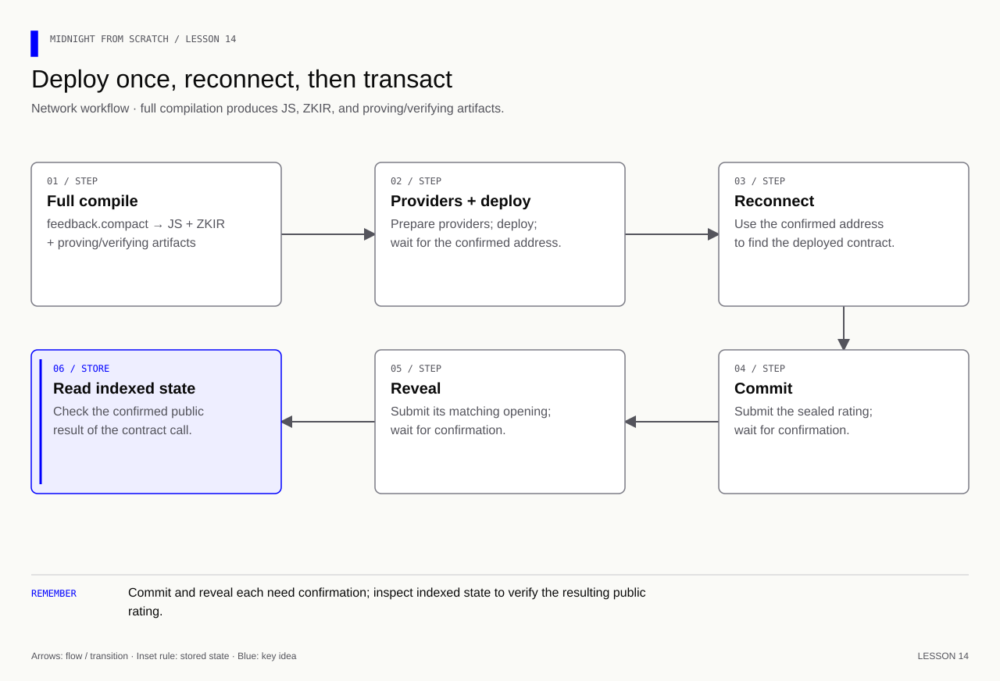
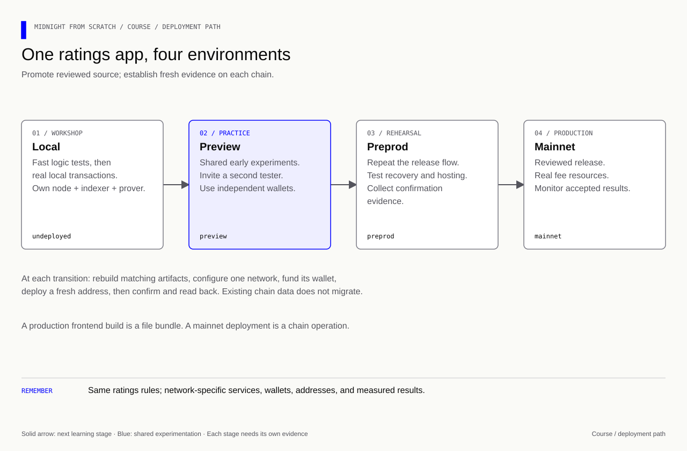

# Lesson 14 — Deploy, call, confirm and read back

[Course overview](../../../README.md) · [Exercise index](../../README.md) · [Previous](../../Lesson%2013/Exercise/README.md) · [Next](../../Lesson%2015/Exercise/README.md)

## Your exercise workspace

Edit the starter files **in this folder**. They already contain the previous
lesson's prerequisite concepts; TODO comments identify the new work. Keep building
these same files through the lettered stages. The [reference answer](../../Lesson%2014/Solution/README.md)
is separate and is not used as your submitted implementation.

Run grading commands below **from the repository root**, or run `node check.mjs A`
inside this folder to check stage 14A. With no letter, `node check.mjs` lists the
stages. The guide's ordinary file/compile/run commands use this folder as their
working directory; a mention of the project root in the original walkthrough
means this exercise's working folder. Keep your implementation in this folder.

| Stage | Work checked | Command from repository root |
|---|---|---|
| 14A | Compile proving artifacts and the interface | `npm run check -- 14A` |
| 14B | Verify the confirmed deployment | `npm run check -- 14B` |
| 14C | Verify the revealed record on chain | `npm run check -- 14C` |
| 14D | Explain recovery and confirmation | `npm run check -- 14D` |
| 14E | Choose preview and preprod | `npm run check -- 14E` |
| 14F | Plan and perform a shared test | `npm run check -- 14F` |
| 14G | Explain production release gates | `npm run check -- 14G` |

A failed check reports the first unmet requirement. Fix it and rerun the same
stage. A pass records the checked revision and suggests the next stage.
`npm run progress` distinguishes current passes from stages passed before later
edits. This history is local and ignored by Git; nothing is uploaded or submitted
to an external service.

Network checks require their documented tools/services. They inspect state or
build code; they do not start Docker or submit deployment transactions. Run the
guide's deployment steps yourself before a confirmed-state checkpoint.

### Short concept checks

Fill the named fields in `answers.json` when you reach that stage. Use JSON
booleans/numbers where appropriate; `null` means unanswered. These checks grade
the specific questions below, not arbitrary prose.

**14D:**

- `submittedMeansConfirmed`: Does submitting alone establish confirmation?
- `retryWithNewSalt`: Should a missing response cause the app to replace the saved salt?
- `readBackRequired`: Should the app check the confirmed contract state?

<details>
<summary>Check these concept answers after trying them</summary>

```json
{
  "submittedMeansConfirmed": false,
  "retryWithNewSalt": false,
  "readBackRequired": true
}
```

</details>


---

[Course map](../../../README.md#course-map) · [Previous](../../Lesson%2013/Exercise/README.md) · [Next](../../Lesson%2015/Exercise/README.md)


The snippets build the files in this exercise folder. The reference folder contains the completed version.

**Goal:** put lesson 10's contract on the local devnet, save its address, reconnect,
and verify a committed and revealed rating from indexed chain state.

**Memory cue:** execution produces a proposal; confirmation and read-back establish
the accepted result.

[](../../../assets/diagrams/lesson-14-deployment.html)

## 14A — Build proving artifacts and the interface

### Generate proving artifacts

From `network/`, with `../feedback.compact` already completed in lesson 10:

```bash
npm run compile
```

This command omits `--skip-zk` and writes to `network/managed/feedback`, not the
root's local-only build. Full compilation can take considerably longer and use
more memory. Do not reuse the root's generated module through an absolute import;
that can resolve a different runtime installation.

Inspect the generated directory for its contract code, ZKIR and key material.
The NodeZkConfigProvider must point to this whole output directory, not just
`contract/index.js`. Do not edit generated code to bypass an error.

### Connect the generated class and its artifact directory

Create `network/src/feedback.ts`:

```ts
// Use the shared local network identity and service endpoints.
import './config.js';
// Resolve generated artifact directories relative to this module's file location.
import { fileURLToPath } from 'node:url';
// Associate the generated contract class with the artifacts used for proving.
import { CompiledContract } from '@midnight-ntwrk/midnight-js-protocol/compact-js';
// Load the contract compiled for this example, rather than a learner's stale build.
import { Contract } from '../managed/feedback/contract/index.js';
// Expose the generated decoder and class to the deployment and call scripts.
export { ledger, Contract } from '../managed/feedback/contract/index.js';
export type Circuit = 'participantId' | 'commitFor' | 'revealFor';
// Locate proving artifacts relative to this module rather than the shell directory.
export const assets = fileURLToPath(new URL('../managed/feedback', import.meta.url));
// Associate the generated contract with the witnesses and artifacts used for proving.
export const compiled = CompiledContract.withCompiledFileAssets(
  // Declare that this contract needs no witness callbacks and attach its compiled artifacts.
  CompiledContract.withVacantWitnesses(CompiledContract.make('feedback', Contract)), assets,
);
```

`CompiledContract.make` wraps the generated class. `withVacantWitnesses` is
appropriate because lesson 10 uses explicit arguments; a witness contract would
need actual callbacks. `withCompiledFileAssets` associates the on-disk artifacts.
`fileURLToPath(new URL(..., import.meta.url))` resolves relative to the module,
so the emitted file in `build/` still locates sibling `managed/`.

## 14B — Deploy and verify the saved address

### Deploy and record the confirmed address

Create `network/src/deploy.ts`:

```ts
// Read or persist deployment and opening records across process runs.
import { writeFile } from 'node:fs/promises';
// Use the SDK helpers that deploy or reconnect to compiled contracts.
import { deployContract } from '@midnight-ntwrk/midnight-js-contracts';
// Reuse the local wallet setup and DUST readiness check.
import { openLocalWallet, waitForDust } from './wallet.js';
// Connect the contract to public data, proving, private storage and wallet services.
import { providersFor } from './providers.js';
// Use the feedback contract's generated interface and matching artifacts.
import { compiled, assets, type Circuit } from './feedback.js';
// Open the local wallet and retain the capabilities this script uses.
const { wallet, bridge } = await openLocalWallet();
// Connect this contract to its wallet, indexer, prover and private storage.
const providers = providersFor<Circuit>(bridge, assets);
// Keep cleanup or expected-error handling active if the operation throws.
try {
  // Wait for fee resources before requesting a transaction.
  await waitForDust(wallet);
  // Deploy the compiled contract and wait for its confirmed deployment record.
  const deployed = await deployContract(providers, {
    // Choose the compiled interface and start its application private state empty.
    compiledContract: compiled, privateStateId: 'course', initialPrivateState: {},
  });
  // Retain the real confirmed address for subsequent calls and read-back.
  const address = deployed.deployTxData.public.contractAddress;
  // Preserve the record needed to recover or reconnect after this process exits.
  await writeFile('deployment.json', JSON.stringify({ address, network: 'undeployed' }, null, 2));
  // Display the observed value at this stage of the example.
  console.log('Confirmed deployment:', address);
} finally {
  // Close wallet connections and subscriptions even when the operation fails.
  await wallet.stop();
}
```

`deployContract` orchestrates the providers. Its result contains the deployed
address in `deployTxData.public.contractAddress`. The stable private-state ID
names the app's private-state entry; it is neither a wallet address nor a circuit
argument. The empty object is appropriate for this explicit-argument contract.

The SDK also manages deployment maintenance keys through the private provider.
The password and store must be preserved. This course's commitment authorization
secret and a deployment maintenance key have different roles.

```bash
npm run build
npm run deploy
```

Expected: `Confirmed deployment: <contract address>` and a `deployment.json` file.
The address is public. A successful compile or a wallet sync is not this checkpoint.
See [Deploying and operating a contract](https://docs.midnight.network/guides/deploy-and-operate)
for the SDK's deployment/call lifecycle.

## 14C — Commit, reveal and verify chain state

### Reconnect, save an opening, commit and reveal

Create `network/src/call.ts`:

```ts
// Make unexpected results fail the runner instead of merely printing them.
import assert from 'node:assert/strict';
// Generate unpredictable secrets and salts with Node's cryptographic RNG.
import { randomBytes } from 'node:crypto';
// Read or persist deployment and opening records across process runs.
import { readFile, writeFile } from 'node:fs/promises';
// Use the SDK helpers that deploy or reconnect to compiled contracts.
import { findDeployedContract } from '@midnight-ntwrk/midnight-js-contracts';
// Use the runtime compatible with the generated contract.
import * as runtime from '@midnight-ntwrk/midnight-js-protocol/compact-runtime';
// Reuse the local wallet setup and DUST readiness check.
import { openLocalWallet, waitForDust } from './wallet.js';
// Connect the contract to public data, proving, private storage and wallet services.
import { providersFor } from './providers.js';
// Use the feedback contract's generated interface and matching artifacts.
import { compiled, assets, Contract, ledger, type Circuit } from './feedback.js';

// Recover the previously confirmed deployment address from the local record.
const saved = JSON.parse(await readFile('deployment.json', 'utf8'));
// Reject a deployment record for another network or a malformed contract address.
if (saved.network !== 'undeployed' || !/^[a-f0-9]{64}$/i.test(saved.address)) throw new Error('Invalid local deployment record');
// Open the local wallet and retain the capabilities this script uses.
const { wallet, bridge } = await openLocalWallet();
// Connect this contract to its wallet, indexer, prover and private storage.
const providers = providersFor<Circuit>(bridge, assets);
// Keep cleanup or expected-error handling active if the operation throws.
try {
  // Wait for fee resources before requesting a transaction.
  await waitForDust(wallet);
  // Reconnect to the saved deployment through the configured providers.
  const deployed = await findDeployedContract(providers, {
    // Pair the compiled interface with the existing deployment address.
    compiledContract: compiled, contractAddress: saved.address,
    // Use the same private-state namespace when reconnecting to this contract.
    privateStateId: 'course', initialPrivateState: {},
  });
  // Keep a fresh authorization secret local to this participant.
  const secret = new Uint8Array(randomBytes(32));
  // Retain secret randomness so the committed choice can be opened later.
  const salt = new Uint8Array(randomBytes(32));
  // Keep the chosen rating available for both commit and reveal.
  const choice = 3n;
  // Fail if a previous opening exists: inspect/recover it before another attempt.
  await writeFile('opening.json', JSON.stringify({
    // Store the original secret, salt and choice with the deployment they belong to.
    address: saved.address, secret: Array.from(secret), salt: Array.from(salt), choice: choice.toString(),
  }), { mode: 0o600, flag: 'wx' });
  // Derive the ID locally using the ACTUAL deployment address and queried state.
  const before = await providers.publicDataProvider.queryContractState(saved.address);
  // Stop if the indexer cannot supply the contract state needed for this check.
  if (!before) throw new Error('Contract not found');
  // Carry address, identity and current state into the generated circuit wrapper.
  const context = runtime.createCircuitContext(saved.address, bridge.getCoinPublicKey(), before, {});
  // Ask the contract to derive the identifier from the same rule it enforces.
  const id = new Contract({}).impureCircuits.participantId(context, secret).result;
  // Submit the commitment and wait for the confirmed call result.
  const committed = await deployed.callTx.commitFor(secret, choice, salt);
  // Display the observed value at this stage of the example.
  console.log('Commit confirmed:', committed.public.txId, committed.public.blockHeight);
  // Read indexed contract state to check what the network actually recorded.
  const sealed = await providers.publicDataProvider.queryContractState(saved.address);
  // Stop if the indexer cannot supply the contract state needed for this check.
  if (!sealed) throw new Error('Contract not found after commit');
  // Check the observed result so a regression fails this example.
  assert.equal(ledger(sealed.data).submissions.lookup(id).revealed, false);
  // Submit the original opening and wait for the confirmed reveal result.
  const revealed = await deployed.callTx.revealFor(id, secret, choice, salt);
  // Display the observed value at this stage of the example.
  console.log('Reveal confirmed:', revealed.public.txId, revealed.public.blockHeight);
  // Read indexed contract state to check what the network actually recorded.
  const after = await providers.publicDataProvider.queryContractState(saved.address);
  // Stop if the indexer cannot supply the contract state needed for this check.
  if (!after) throw new Error('Contract not found after reveal');
  // Check the observed result so a regression fails this example.
  assert.equal(ledger(after.data).submissions.lookup(id).value, 3n);
  // Display the observed value at this stage of the example.
  console.log('Confirmed revealed rating: 3');
} finally {
  // Close wallet connections and subscriptions even when the operation fails.
  await wallet.stop();
}
```

This example introduces several details worth reading before running:

- `findDeployedContract` connects a compiled interface to a saved real address.
- The opening and participant secret are saved **before** submitting a commitment.
  The local teaching file has restrictive permissions, but is plaintext. It is
  gitignored; do not mistake file permissions for encryption. Lesson 17 replaces
  this minimal persistence with deliberate recovery behavior.
- `flag: 'wx'` refuses to overwrite an existing opening. After an interrupted run,
  inspect the recorded address and chain state; do not generate a replacement salt
  and assume the old commitment can be opened with it.
- The participant ID is computed locally using the **actual** contract address
  and its queried state. A fresh sample address would derive a different ID.
- Calls through `callTx` go through proving and submission. They are different
  from the early `impureCircuits` calls, which only execute locally.
- Returned transaction IDs/block heights provide confirmation evidence. The final
  query and assertion verify the actual stored rating, not a remembered UI value.

```bash
npm run build
npm run call
```

Expected shape:

```text
Commit confirmed: <transaction ID> <block height>
Reveal confirmed: <transaction ID> <block height>
Confirmed revealed rating: 3
```

The exact IDs and heights change. No such transactions have been run merely by
reading this guide. The supplied TypeScript has been checked against the pinned
APIs; a full compile and this live sequence are the network validation checkpoint.

## 14D — Explain failures and recovery

### Failure handling and safe observation

| Failure | What it means / what to check |
|---|---|
| Missing proving key | Rebuild without `--skip-zk`; check the artifact path |
| Runtime StateValue/class mismatch | Check the nested workspace's dependency graph and generated import location |
| Insufficient DUST | Inspect synchronized balance and funding/fees; do not replace keys blindly |
| Missing contract | Wrong address/network, indexer lag or a recreated local chain |
| `opening.json` already exists | A previous attempt exists; inspect/recover instead of overwriting |
| Timeout after submission | Outcome may be uncertain; query chain state/transaction status before sending a new action |
| Wrong-opening assertion | Inspect the stored original secret/choice/salt and correct deployment address |

A rejected local proof attempt and a transaction that reached the network are
different failure stages. Some network outcomes can consume fees even if the
intended application operation did not complete. Use the actual confirmation and
state; a generic caught exception is not a full transaction receipt.

If the indexer is temporarily behind, retry a read with a bounded wait. Never
replace a null state with a fabricated success. If the local chain was recreated,
deploy again deliberately and keep old secret records distinguishable by address.

### Exercise

1. Explain why the ID calculation uses the real contract address.
2. Query the contract after commit but before reveal. Which values are visible?
3. Try a wrong reveal before the valid one, using the same saved salt and a
   different rating. Confirm it fails and the entry stays unopened.
4. After success, attempt the same reveal again. Explain why fee payer identity
   is not what stops it.
5. Restart the deploy script. Does it reconnect to the old contract?

<details>
<summary>Answers — lesson 14</summary>

The address is part of `keyFor`, so a sample address derives another identity.
Before reveal the map holds the public ID, commitment, false flag and placeholder
0. The stored opening is separate local data; DUST does not hide public map fields.

Immediately before the valid reveal in `call.ts`, insert:

```ts
// Verify rejection so an invalid operation cannot silently pass the example.
await assert.rejects(
  () => deployed.callTx.revealFor(id, secret, 5n, salt),
  /Wrong opening/,
);
const stillSealed = await providers.publicDataProvider.queryContractState(saved.address);
// Check the observed result so a regression fails this example.
assert.ok(stillSealed);
// Check the observed result so a regression fails this example.
assert.equal(ledger(stillSealed.data).submissions.lookup(id).revealed, false);
```

After the valid reveal, insert:

```ts
// Verify rejection so an invalid operation cannot silently pass the example.
await assert.rejects(
  () => deployed.callTx.revealFor(id, secret, choice, salt),
  /Already revealed/,
);
```

These validate the application's rules. The ID/secret check enforces record
ownership; the revealed flag prevents repetition. A wallet paying the fee cannot
make those assertions true for arbitrary inputs.

Running `deploy` again creates another contract and overwrites the address record
in this simple script. Reconnecting uses `findDeployedContract` with the original
address, as the call script does. Treat deployment as an intentional separate step.

</details>

**Checkpoint:** retain the address, transaction IDs and confirmed map values. Explain
which operations were local calculations and which were network transactions. Next,
write an independent project specification and implementation before opening its answer.

## 14E — Select preview, then preprod

[](../../../assets/diagrams/course-four-environments.html)

The local transaction above is your first network integration. Now follow the
[complete deployment walkthrough](../../../docs/deployment.md) sections 3–7. It gives
copyable build, wallet setup, funding, commit/reveal, and independent read-back
commands. `preview` is early public experimentation; `preprod` is the public
release rehearsal. Both are test networks. Keep the prover local and select the
correct node, indexer, wallet, and network ID together.

**Try:** create a preview participant profile, fund its displayed address,
register DUST, deploy ratings, and record a confirmed address. Repeat on preprod
with its matching Blockfrost token. Preserve each network's separate records.

For checkpoint `14E`, fill `localId`, `previewId`, `testnetId`, `productionId`,
and `vitePreviewSelectsNetwork` in `answers.json`. This checkpoint checks network
selection concepts; transaction evidence remains a separate practical deliverable.

<details><summary>Answers — 14E</summary>

```json
"14E": {
  "localId": "undeployed",
  "previewId": "preview",
  "testnetId": "preprod",
  "productionId": "mainnet",
  "vitePreviewSelectsNetwork": false
}
```

Vite preview serves a built website; Midnight Preview is a chain environment.
Changing one does not select the other.

</details>

## 14F — Share one ratings contract with another person

Follow the walkthrough's [two-participant exercise](../../../docs/deployment.md#sharing).
Alice shares network + confirmed address + source/build revision. Bob uses his
own wallet and opening, joins that same address, and confirms his result through
his indexer. Check both sealed and revealed states. The course's session commands
provide the working CLI path; the browser section explains wallet integration and
hosting separately from lesson 18's simulation.

**Try:** Alice commits 3, Bob commits 5; reveal Alice first and check that Bob's
record remains sealed. Reveal Bob and check both independent results. Record the
network, build revision, transaction IDs/heights, and public values you observed.

<details><summary>Answers — 14F concept check</summary>

```json
"14F": {
  "shareSeeds": false,
  "deployForEachTester": false,
  "readBackRequired": true
}
```

Separate wallets use shared contract state. Sharing seeds/openings removes that
independence; separate deployments would not test one shared application.

</details>

Run `npm run check -- 14F`. Keep your practical evidence privately redacted for
review; the quiz does not verify that another person actually tested the app.

## 14G — Distinguish a production build from a production release

Follow the walkthrough's browser-build and mainnet sections. A frontend build
creates files for hosting; a contract deployment creates a chain address.
Production requires both to agree on network, contract, and artifacts. Rehearse
funding, confirmation, backup/recovery, privacy, and published-origin behavior on
preprod before enabling a mainnet transaction. Mainnet uses real resources and
has no faucet. The course command requires explicit production submission opt-in.

**Try:** write a short release note with source revision, supported versions,
network/address, artifact build, test results, remaining privacy/storage limits,
and the procedure for an uncertain transaction. A production plan is a useful
course deliverable even when you choose not to send a mainnet transaction.

<details><summary>Answers — 14G</summary>

```json
"14G": {
  "productionBuildSelectsMainnet": false,
  "faucetAvailable": false,
  "localEvidenceProvesMainnet": false
}
```

</details>

Run `npm run check -- 14G`. These final stages check specified concepts; a human
reviews your release note and actual deployment evidence. No public transaction
is submitted by a stage check.

**Memory cue:** **Same source, same network, same address; separate wallets and openings.**
