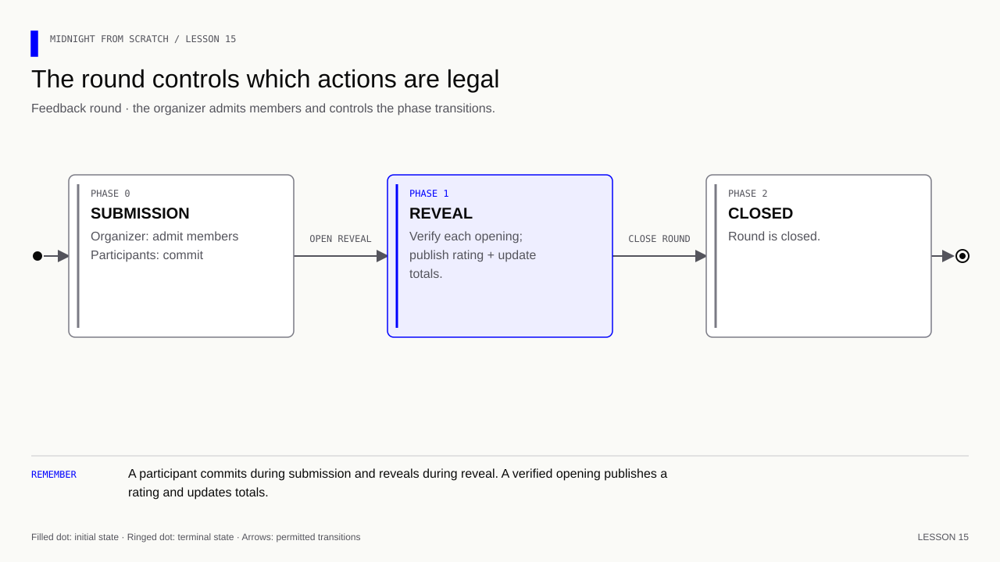

# Lesson 15 — Build a sealed feedback round independently

[Course overview](../../../README.md) · [Exercise index](../../README.md) · [Previous](../../Lesson%2014/Exercise/README.md) · [Next](../../Lesson%2016/Exercise/README.md)

## Your exercise workspace

Edit the starter files **in this folder**. They already contain the previous
lesson's prerequisite concepts; TODO comments identify the new work. Keep building
these same files through the lettered stages. The [reference answer](../../Lesson%2015/Solution/README.md)
is separate and is not used as your submitted implementation.

Run grading commands below **from the repository root**, or run `node check.mjs A`
inside this folder to check stage 15A. With no letter, `node check.mjs` lists the
stages. Commands in the stage table run from the repository root. Other blocks state
their working directory explicitly; file names without a path refer to this
exercise folder. Keep your implementation here and use solutions only to compare.

| Stage | Work checked | Command from repository root |
|---|---|---|
| 15A | Specify admission and phases | `npm run check -- 15A` |
| 15B | Initialize round state | `npm run check -- 15B` |
| 15C | Enforce admission and submission | `npm run check -- 15C` |
| 15D | Enforce reveal, closure and replay | `npm run check -- 15D` |
| 15E | Run the two-participant demonstration | `npm run check -- 15E` |

A failed check reports the first unmet requirement. Fix it and rerun the same
stage. A pass records the checked revision and suggests the next stage.
`npm run progress` distinguishes current passes from stages passed before later
edits. This history is local and ignored by Git; nothing is uploaded or submitted
to an external service.

### Short concept checks

Fill the named fields in `answers.json` when you reach that stage. Use JSON
booleans/numbers where appropriate; `null` means unanswered. These checks grade
the specific questions below, not arbitrary prose.

**15A:**

- `phaseOrder`: Write the round’s phase order separated by hyphens.
- `admissionAuthority`: Who may admit participants?
- `countNonReveals`: Should an unopened rating contribute to the revealed average?

<details>
<summary>Check these concept answers after trying them</summary>

```json
{
  "phaseOrder": "submit-reveal-closed",
  "admissionAuthority": "organizer",
  "countNonReveals": false
}
```

</details>


---

[Course map](../../../README.md#course-map) · [Previous](../../Lesson%2014/Exercise/README.md) · [Next: lesson 16](../../Lesson%2016/Exercise/README.md)


The snippets build the files in this exercise folder. The reference folder contains the completed version.

## Start with what you already know

**Build one rule at a time.** Before opening the answer, sketch three boxes: submit, reveal, closed. Put admission and commitment creation in the first; matching an opening in the second. Which actor moves the arrows?

<details>
<summary>Recall answer</summary>

The organizer advances phases; admitted participants submit, and the matching owner reveals. Start with state initialization, then one admitted participant, then a second participant and rejection cases.

</details>

**Memory picture:** A theatre ticket determines who may enter; the timetable determines when. Neither proves which sealed rating that person submitted.

Take one lettered stage at a time: predict the result, implement it, run its
check, and explain the result before continuing. Return tomorrow and explain
the rule without opening the answer. Ask your tutor about a step you cannot yet
explain using the failing check and your own prediction.

**Goal:** solve a small group-feedback problem from a specification. Use the
language and network skills already learned, then compare against the reference
answer and present evidence for review. This project introduces a constructor,
organizer authority, admission and a three-phase lifecycle.

**Memory cue:** eligibility answers who; phase answers when; a commitment answers
which earlier choice; replay rules answer how many times.

[](../../../assets/diagrams/lesson-15-round-phases.html)

## 15A — Specify the feedback round

### The problem and the chosen scope

A workshop organizer wants participants to submit ratings before they see other
participants' answers. The organizer admits application identities. During the
submission phase, ratings are hidden in commitments; during reveal, each owner
publishes the matching rating. The closed result reports only revealed submissions.

We choose **one round per contract deployment** and **public individual reveals**.
The design is pseudonymous: application identifiers and their ratings are linked.
It does not claim that every ID is a unique person or that a running total hides
individual ratings. The organizer is trusted to admit the intended people and
advance phases fairly. Those assumptions belong in the specification.

There are no payments, automatic deadlines, penalties, identity credentials or
forced reveals. A participant may never reveal. The final count excludes that
participant, so the result is not necessarily representative of all submissions.
State that limitation in the project demo instead of silently treating missing
ratings as zero.

### Acceptance criteria: implement these rules

1. A constructor stores a public hash identifying the organizer's secret. The
   secret itself is supplied privately to organizer-only operations later.
2. Phase begins at 0 (submission), advances to 1 (reveal), then 2 (closed).
   Only the organizer can advance, and phases never move backward.
3. Only the organizer can admit a participant ID, and only during submission.
   A participant's ID is derived from their secret, a purpose label and this
   contract address, following lesson 10's pattern.
4. Only admitted IDs can submit. Accept one commitment per participant, with
   a private choice from 1 through 5. Replacement is forbidden.
5. Reveal requires phase 1, ownership, an existing entry, an unused reveal,
   and an opening matching the original commitment.
6. A successful reveal publishes the choice, increases a total by that choice
   and increases the revealed count by one. A failed reveal changes none of these.
7. Closed rounds accept no new submissions, admissions or reveals. All public
   records remain readable.
8. A fresh deployment is a new round; records and derived participant IDs do not
   carry over automatically. Do not add a reset operation in this project.

Before coding, draw the public-state fields and list the secret values. Design
what each circuit takes and which assertions must precede writes. You may inspect
lesson 10 for syntax; attempt your own contract before opening the answer below.

## 15B — Declare the round state

### The language additions you need

A constructor runs when initial contract state is created:

```compact
// Initialize the accepted public authority when this contract instance is created.
constructor(organizerId: Bytes<32>) {
    // Permit this value to become public at this deliberate disclosure point.
    organizer = disclose(organizerId);
}
```

Declare `organizer` as a public `Bytes<32>` ledger field first. The constructor
argument is the public identifier, not the secret. The local `initialState`
call takes this argument after its constructor context; network `deployContract`
passes constructor inputs in its `args` array.

An organizer check computes `persistentHash<Bytes<32>>(secret)` and compares it
with the stored identifier. This secret is 32 random bytes, not a guessable PIN.
We deliberately keep the helper small. A production protocol may need a different
authority/rotation policy; this project has one fixed organizer per deployment.

`phase: Uint<8>` represents 0/1/2 by convention, enforced by the circuits.
This is an opportunity to distinguish a broad type range from a narrow state
machine. An enum is an alternative later; do not add new syntax merely to rename
three already-explained integers.

`Counter.increment(disclose(choice))` adds a revealed private-derived rating to
a public total. Its disclosure is intentional. The count increments by a public
constant, 1. The average can be displayed in JS after checking count > 0; no
floating-point arithmetic belongs in this Compact example.

## 15C — Enforce admission and submission

### Build and exercise locally

Complete the starter `round.compact` and `run-round.js` in this folder. The
runner should create two admitted participants, one outsider and an organizer.
Retain every private opening. Chain successful contexts exactly as in lesson 10.

```bash
# Run from Lessons/Lesson 15/Exercise.
compact compile +0.31.1 --skip-zk round.compact managed/round
node run-round.js
```

For ratings 3 and 5, after both reveals and closure expect:

```text
Closed phase: 2
Revealed: 2
Total: 8
Average: 4
```

Your runner should also assert rejections, not merely print caught exceptions.
Use the test table below as the project exercise.

## 15D — Enforce reveal, closure and replay rules

### Exercise — implement and demonstrate the specification

| Attempt | Expected result |
|---|---|
| Outsider admits a member or advances a phase | Rejected: organizer check |
| Unadmitted secret submits | Rejected: admission check |
| Admitted participant submits 6 | Rejected: rating rule |
| Participant submits 256 | Rejected: argument type/range |
| Participant replaces a commitment | Rejected: duplicate submission |
| Owner reveals during submission | Rejected: phase |
| Admission/submission after reveal starts | Rejected: phase |
| Bob uses Alice's ID, choice and salt with Bob's secret | Rejected: ownership |
| Correct owner uses wrong rating or salt | Rejected: opening |
| Correct opening in reveal phase | Accepted exactly once |
| Duplicate reveal | Rejected without increasing count/total |
| Reveal after closure | Rejected: phase |
| One participant never reveals | Count and total include only actual reveals |
| Valid ID from another deployment is reused | Cannot access an existing record in this deployment |

Also demonstrate that a failed opening leaves the record unopened and totals
unchanged. Explain which checks prove consistency, authorization and timing.
Then compare with the worked answer below.

<details>
<summary>Worked answer — lesson 15 contract and local runner</summary>

The complete commented answer lives in [round.compact](../../Lesson%2015/Solution/round.compact)
and [run-round.js](../../Lesson%2015/Solution/run-round.js). The runner includes the
successful flow and the rejection checks; `test.js` starts that same runner.
Run `npm run lesson15` from the repository root to compile and execute it.

The JS `persistentHash` call takes a runtime type descriptor first. It mirrors
Compact's `persistentHash<Bytes<32>>`, including its typed encoding; it is not a
plain Node hash of an arbitrary string. The constructor receives only the hash.
The runner keeps the admin secret local and uses it for privileged calls.

The runner checks most table rows directly. For non-reveal, make a separate
experiment: omit Bob's valid reveal, then close. Expect `revealedCount == 1n`,
`total == 3n`, Bob's record still unrevealed and the displayed mean 3. Guard
against division by zero when no one reveals:

```js
// Check the number of revealed entries before computing an average.
const count = state().revealedCount;
// Display the observed value at this stage of the example.
console.log('Average:', count === 0n ? 'No revealed ratings' : Number(state().total) / Number(count));
```

Number conversion is for this tiny demo. For large totals/counts, define rounding
and precision deliberately instead of assuming all bigints convert exactly.

For cross-deployment scope, construct a second initial state with a different
`sampleContractAddress()` and derive the same participant secret there. Compare
the two byte IDs with `Buffer.from(idA).equals(Buffer.from(idB))`: expect false.
An ID alone is never the authorization proof; the secret and this deployment's
state must still satisfy the checks.

</details>

## 15E — Assemble and demonstrate the local runner

Complete run-round.js with Alice 3 and Bob 5: admit, submit, start reveal,
reveal both, then close. Keep a local `state()` function that returns the decoded
current ledger. Assert phase 2n, total 8n and revealedCount 2n. Run the 15E check;
it inspects your actual runner's state and repeats the independent contract checks.

<details><summary>Answer — 15E</summary>

See the [commented runner](../../Lesson%2015/Solution/run-round.js) after your
attempt. It carries context forward and checks rejected operations as well as
the two successful reveals.

</details>

## Optional network extension

Complete the local 15A–15E checkpoints first. Follow the
[deployment guide](../../../docs/deployment.md) for service setup, pinned SDK
installation, full compilation, wallet readiness and confirmed state read-back.
Keep the public-network instructions separate from the local `undeployed` fixture.

The completed [network round runner](../../Lesson%2013/Solution/network/src/round-demo.ts)
is the reference for this extension. Read it in four small sections:

1. Build `CompiledContract` from the generated round contract and its full proving
   artifacts. This contract has explicit secret arguments and no witness callbacks.
2. Save the fresh opening and organizer secret before sending transactions. Deploy
   with `args: [organizer]`, where organizer is the typed hash of the admin secret.
3. Derive the participant ID using the real deployment address and queried state.
   Admit, submit 3, start reveal, reveal and close through confirmed `callTx` calls.
4. Query indexed state and assert phase 2, count 1 and total 3. Stop the wallet in
   `finally`, even if a call fails.

The runner uses one local fixture wallet to pay for all actions. Separate
application-role secrets demonstrate organizer/participant authorization; this is
not a demonstration of independently operated wallets or anonymous participation.
Its opening record is plaintext with restrictive permissions. If a process stops
after confirmation but before saving an address, reconcile the network before
retrying. Do not overwrite an existing opening to bypass this problem.

Local assertions and TypeScript checks are not evidence of live deployment.
Capture actual confirmation and state read-back only when you perform this
optional extension; do not invent a transaction ID for a review.

### Submit for review

Provide:

- Your contract and runner, plus any network glue you changed.
- A diagram of phases and public/private data, with the organizer trust assumption.
- The success output and rejection evidence, including retained state after failure.
- If you attempted the network extension: its actual confirmed deployment address,
  transaction IDs and indexed state. Otherwise state that it was not performed.
- A short explanation of non-reveals, public ID-to-rating linkage and recovery limits.

The review evaluates correctness, authorization, privacy claims, failure handling,
reproducibility and your ability to explain a small change. It can return findings
for you to fix; passing a sample output is not the only completion criterion.

As an explain-back exercise: why would replacing the organizer hash check with a
witness returning `true` break authorization? Why does publishing only the running
total still reveal individual contributions when an observer can compare each update?

<details>
<summary>Explain-back answers</summary>

The caller supplies a witness result, so a Boolean alone authenticates nothing.
The existing check binds the action to knowledge of a secret corresponding to an
accepted public organizer identifier. A running total exposes each increment
through subtraction; it is not aggregate-only confidentiality. A true aggregate-only
protocol requires a different publication design and assumptions.

</details>

**Checkpoint:** local stages passed and an independent project ready for human
review, with explicit limitations. A green stage does not perform that review. Lesson 16
then turns the scenarios into a systematic adversarial suite; lessons 17–20 add
recovery, a frontend, a privacy review and a separate capstone.
