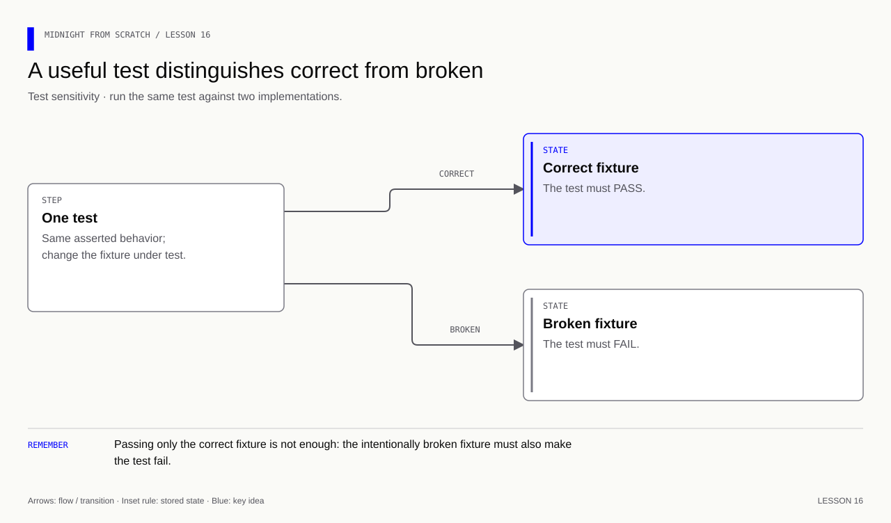
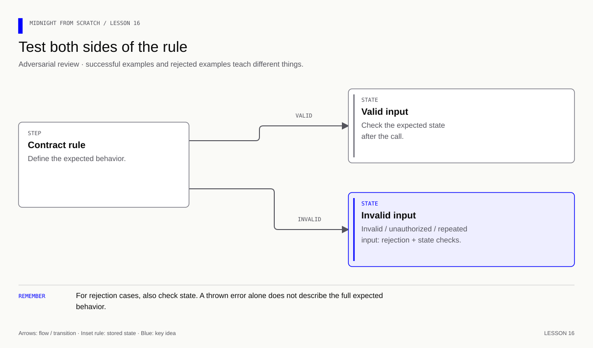

# Lesson 16 — Write tests that catch broken behavior

[Course overview](../../../README.md) · [Exercise index](../../README.md) · [Previous](../../Lesson%2015/Exercise/README.md) · [Next](../../Lesson%2017/Exercise/README.md)

## Your exercise workspace

Edit the starter files **in this folder**. They already contain the previous
lesson's prerequisite concepts; TODO comments identify the new work. Keep building
these same files through the lettered stages. The [reference answer](../../Lesson%2016/Solution/README.md)
is separate and is not used as your submitted implementation.

Run grading commands below **from the repository root**, or run `node check.mjs A`
inside this folder to check stage 16A. With no letter, `node check.mjs` lists the
stages. Commands in the stage table run from the repository root. Other blocks state
their working directory explicitly; file names without a path refer to this
exercise folder. Keep your implementation here and use solutions only to compare.

| Stage | Work checked | Command from repository root |
|---|---|---|
| 16A | Test the valid flow | `npm run check -- 16A` |
| 16B | Catch wrong openings | `npm run check -- 16B` |
| 16C | Catch replay and state corruption | `npm run check -- 16C` |

A failed check reports the first unmet requirement. Fix it and rerun the same
stage. A pass records the checked revision and suggests the next stage.
`npm run progress` distinguishes current passes from stages passed before later
edits. This history is local and ignored by Git; nothing is uploaded or submitted
to an external service.

---

## Start with what you already know

**Make a broken implementation fail.** Recall the two inputs needed to reopen a commitment. Which two separate negative tests follow?

<details>
<summary>Recall answer</summary>

Change the rating while preserving the salt; change the salt while preserving the rating. A positive case alone does not show that either tampering attempt is rejected.

</details>

**Memory picture:** A smoke alarm needs both a quiet-room test and a smoke test. A test suite that accepts every implementation is like an alarm that never sounds.

Take one lettered stage at a time: predict the result, implement it, run its
check, and explain the result before continuing. Return tomorrow and explain
the rule without opening the answer. Ask your tutor about a step you cannot yet
explain using the failing check and your own prediction.

**Goal:** write three small test functions against the completed round contract.
The supplied `round.compact` is the prerequisite. Edit `tests.mjs`; you do not
need to rebuild the application to learn testing.

[](../../../assets/diagrams/lesson-16-test-the-test.html)

## 16A — Check the valid flow

Implement `testHappyPath(makeRound)`. Calling `makeRound()` supplies a fresh
fixture with `call`, `state`, `admin`, `alice`, `bob`, and `outsider`.
Alice and Bob are already admitted; neither has submitted. Their objects contain
`id`, `secret`, `salt`, and `choice` (Alice 3n, Bob 5n).

Start with one operation:

```js
// Obtain fresh state so this test cannot depend on a previous test's mutations.
const { call, state, admin, alice, bob } = makeRound();
// Submit Alice's original choice and salt before entering reveal phase.
call('submit', alice.secret, alice.choice, alice.salt);
```

Add Bob's submission, call `startReveal` with `admin`, reveal both original
openings, then call `close`. `call(name, ...args)` advances the current context
only after a successful circuit call. `state()` decodes that current ledger.

**Exercise:** assert phase 2n, total 8n and revealedCount 2n. Run the 16A check.
It also tries a fixture with an incorrect total; your test must catch it.

<details><summary>Answer — 16A</summary>

Use `assert.equal(state().total, 8n)` and corresponding assertions for phase and
count after the calls. A print is not an assertion. See
[the complete tests](../../Lesson%2016/Solution/tests.mjs) after trying the exercise.

</details>

## 16B — Test two different wrong openings

Implement `testWrongOpenings(makeRound)` using a new fixture. Submit Alice,
start reveal, then test two attempts: choice 5 with her original salt, and
choice 3 with a changed copy of her salt.

```js
// Copy first so the valid opening remains available after the negative test.
const wrongSalt = new Uint8Array(alice.salt);
// Change one definite bit instead of hoping two random salts differ.
wrongSalt[0] ^= 1;
```

Use a fresh fixture for this function; retain the original opening until the
final positive check. Each mutation tests one rule at a time.

**Exercise:** use `assert.throws` for each attempt, verify that the entry remains
unrevealed and total stays 0n, then reveal the original opening successfully.
The checker separately tries acceptance of a wrong choice and of a wrong salt.

<details><summary>Answer — 16B</summary>

Wrap only the circuit call inside `assert.throws`. Inspect
`state().entries.lookup(alice.id).revealed` and `state().total` after rejection.
Finish with the unchanged opening and expect total 3n. Catching one invalid
input does not establish that the other is checked.

</details>

## 16C — Test replay and retained state

Implement `testReplayAndState(makeRound)`. Try a reveal before reveal phase,
then a wrong opening during reveal, then one valid opening and one duplicate.
Check state after failures, not only the existence of an exception.

**Exercise:** catch both replay acceptance and a fixture that changes the total
while throwing an error. Run 16C, then revisit all three stages.

<details><summary>Answer — 16C</summary>

The total must remain 0n after each rejected early/wrong opening, then 3n after
one accepted reveal and its rejected replay. The count must remain 1n after
replay. These are local execution tests; network transaction outcomes need
separate confirmation and read-back checks.

</details>

<details>
<summary>Further practice — beyond the automated checkpoints</summary>

**Memory cue:** Every important rule needs a success case and a rejection case.

[](../../../assets/diagrams/lesson-16-adversarial-cases.html)

Extend the feedback project with a repeatable test suite. Cover boundaries,
wrong openings, unauthorized callers, invalid phase transitions, duplicate
operations and replay. Separate fast local checks from network integration
checks. Inspect state after rejected operations instead of only matching an
error message. Learn which execution/transaction failure semantics apply.

Deliverables: named tests tied to the specification, reproducible commands,
and a short explanation of what local tests establish versus what requires
network verification. A printed “success” line alone is not an assertion.

Exercise: does a successful reveal test show that changing the salt is rejected?
What should a rejection test examine besides the thrown error?

<details>
<summary>Answers — lesson 16 further practice</summary>

No. Add a separate wrong-salt attempt from a known valid committed state. Check
the expected failure and the relevant retained state: unopened status, unchanged
commitment and no published rating. Test wrong choice separately. Where network
transactions can have different failure outcomes, check the actual confirmation
and state rather than assuming that local execution proves rollback behavior.

</details>

</details>

For deployment and confirmation evidence, use the [deployment guide](../../../docs/deployment.md). Do not infer network rejection behavior solely from a local thrown exception.
