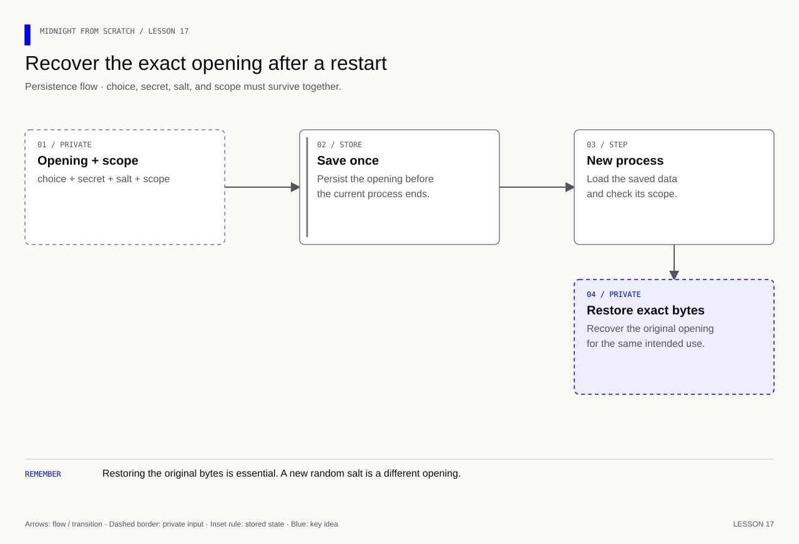
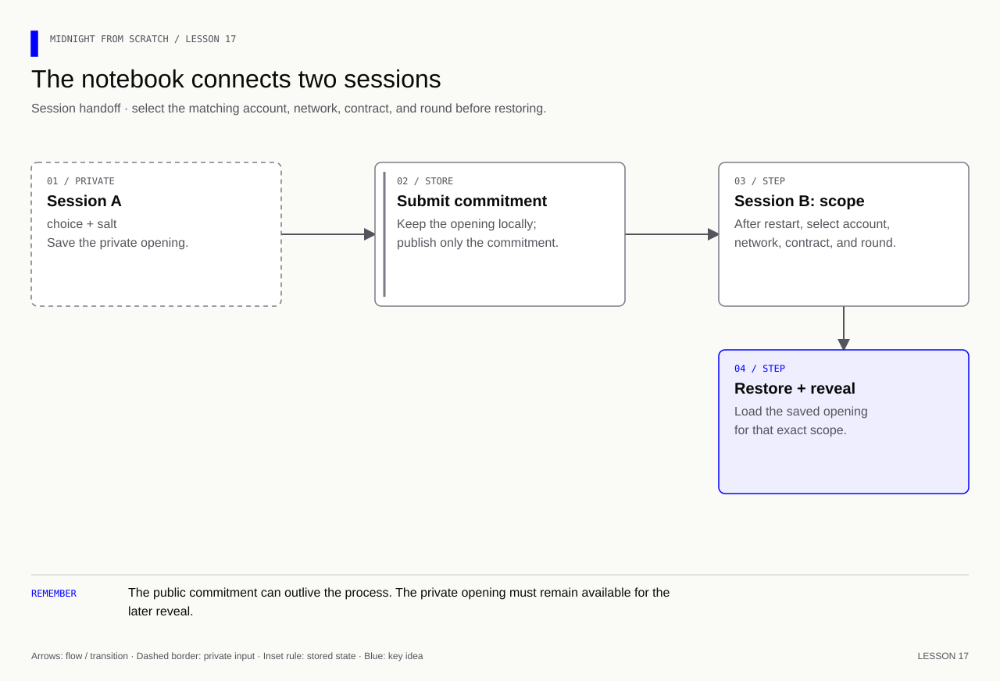

# Lesson 17 — Save and restore the original opening

[Course overview](../../../README.md) · [Exercise index](../../README.md) · [Previous](../../Lesson%2016/Exercise/README.md) · [Next](../../Lesson%2018/Exercise/README.md)

## Your exercise workspace

Edit the starter files **in this folder**. They already contain the previous
lesson's prerequisite concepts; TODO comments identify the new work. Keep building
these same files through the lettered stages. The [reference answer](../../Lesson%2017/Solution/README.md)
is separate and is not used as your submitted implementation.

Run grading commands below **from the repository root**, or run `node check.mjs A`
inside this folder to check stage 17A. With no letter, `node check.mjs` lists the
stages. Commands in the stage table run from the repository root. Other blocks state
their working directory explicitly; file names without a path refer to this
exercise folder. Keep your implementation here and use solutions only to compare.

| Stage | Work checked | Command from repository root |
|---|---|---|
| 17A | Save an opening safely | `npm run check -- 17A` |
| 17B | Restore it across processes | `npm run check -- 17B` |
| 17C | Reject missing and mismatched records | `npm run check -- 17C` |

A failed check reports the first unmet requirement. Fix it and rerun the same
stage. A pass records the checked revision and suggests the next stage.
`npm run progress` distinguishes current passes from stages passed before later
edits. This history is local and ignored by Git; nothing is uploaded or submitted
to an external service.

---

## Start with what you already know

**Keep the opening beyond one process.** Without looking at the code, name the data needed after a restart and the four fields identifying where it belongs.

<details>
<summary>Recall answer</summary>

Retain the secret, original salt and choice; bind the record to account, network, contract and round. A new salt is a new opening, not a recovered one.

</details>

**Memory picture:** The commitment is a locked box; the notebook is where you retain the matching key and the box label. A public box cannot replace a lost key.

Take one lettered stage at a time: predict the result, implement it, run its
check, and explain the result before continuing. Return tomorrow and explain
the rule without opening the answer. Ask your tutor about a step you cannot yet
explain using the failing check and your own prediction.

**Goal:** implement a small persistent notebook in `notebook.mjs`.
The checker uses temporary files and a separate Node process. This teaching
format is **plaintext with restrictive file permissions**, not encrypted storage.
Use test secrets only. The privacy review will make that limit explicit.

[](../../../assets/diagrams/lesson-17-opening-recovery.html)

## 17A — Save before committing

Implement `saveOpening(file, scope, opening)`. The caller passes:

```js
// Scope binds the saved data to the account and deployment that will use it.
const scope = { account: 'alice', network: 'undeployed', contract: 'address', round: 'one' };
// Opening values arrive as typed data, not already serialized JSON.
const opening = { secret: new Uint8Array(32), salt: new Uint8Array(32), choice: 3n };
```

The all-zero arrays above illustrate types only; use cryptographic randomness
for actual commitments. Require all four scope fields to be nonempty strings,
secret and salt to be 32-byte Uint8Arrays, and choice to be a bigint from 1 to 5.

Write this JSON shape: `{ version: 1, scope, opening: { secret, salt, choice } }`.
Inside the stored `opening`, secret and salt are arrays of integer bytes and
choice is a decimal string. Bigints cannot be passed directly to JSON.stringify.

**Exercise:** validate, convert, then use `writeFile` with `flag: 'wx'` and
`mode: 0o600`. Save successfully without logging the secret data.

<details><summary>Answer — 17A</summary>

`[...opening.salt]` preserves the bytes as JSON numbers and
`opening.choice.toString()` preserves the integer. `wx` refuses replacement;
0600 restricts ordinary file permissions to the creating account. Neither option
encrypts the contents. The [reference notebook](../../Lesson%2017/Solution/notebook.mjs)
shows the complete implementation.

</details>

## 17B — Restore in another process

Implement `loadOpening(file, scope)`. Read and parse the record, check version 1,
and compare each saved scope field with the requested scope before returning
`{ secret: Uint8Array, salt: Uint8Array, choice: bigint }`.

**Exercise:** restore the original choice and exact bytes. Run 17B: the checker
starts another Node process so an in-memory cache cannot pass as persistence.

<details><summary>Answer — 17B</summary>

Use `new Uint8Array(savedBytes)` and `BigInt(savedChoice)` only after validation.
Use the caller's requested scope to reject another account, network, contract
or round. An unchanged opening can be used with the original commitment; a new
salt would produce a different opening.

</details>

## 17C — Fail clearly when recovery is impossible

Reject missing files, invalid JSON, unknown format versions, mismatched scope,
malformed byte arrays and out-of-range choices. Validate raw JSON byte values
as integers 0–255 before constructing Uint8Array; its conversion can otherwise
silently coerce bad data.

**Exercise:** preserve the original file if another save is attempted. Report a
missing or mismatched opening instead of generating replacement randomness.

<details><summary>Answer — 17C</summary>

Let exclusive creation fail on an existing file. Throw on a mismatched scope or
invalid record. Propagate missing-file errors with useful context. Recovery
needs the original opening; there is no contract backdoor in this design.

</details>

**Integration checkpoint:** in your own network app, save before calling commit,
restore after restart, then compare confirmed state before retrying anything.
Use the [deployment guide](../../../docs/deployment.md) for the confirmed-call
part of that integration. The local checker verifies storage behavior; it does
not claim a confirmed network reveal or an encrypted backup design. The SDK
private-state provider and this plaintext teaching notebook are different storage
components; completing this lesson does not replace or configure that provider.

<details>
<summary>Further practice — beyond the automated checkpoints</summary>

**Memory cue:** A persistent commitment needs a recoverable private opening.

[](../../../assets/diagrams/lesson-17-two-sessions.html)

Mini-project: build a commitment notebook for the feedback application. Replace
disposable in-memory openings with deliberate private storage. Associate each
opening with the correct account, network, contract and round. Plan how storage
is protected, backed up and restored; do not treat a plain file as encrypted.

Handle missing secrets, an account switch, a pending transaction and a crash
between submission and confirmation. Save the opening before risking a confirmed
commitment that cannot be opened. On restart, reconcile saved status with chain
state rather than blindly submitting again.

Deliverables: commit in one session and reveal after restarting, demonstrate
missing-opening handling, and explain recovery limitations. The local stages above cover storage; network integration uses the
[deployment guide](../../../docs/deployment.md).

Exercise: if a reveal fails after restarting, should the app generate a new salt?
How can it avoid using a valid opening for the wrong contract?

<details>
<summary>Answers — lesson 17 further practice</summary>

A new salt does not recover the original commitment. Restore the exact opening;
if it is unavailable, report that limitation. Index private records by the
necessary account/network/contract/round context and verify the selected record
against the intended commitment. Reconcile pending and confirmed operations
before retrying; a lost UI response does not establish that submission failed.

</details>

</details>
