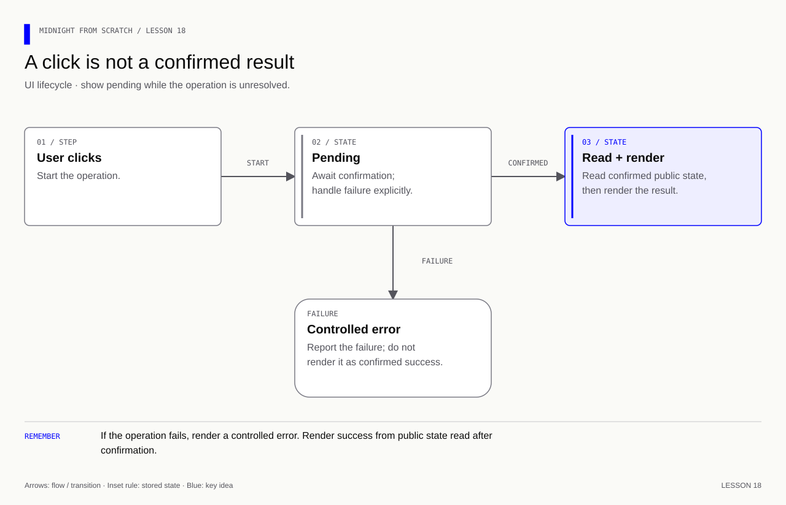
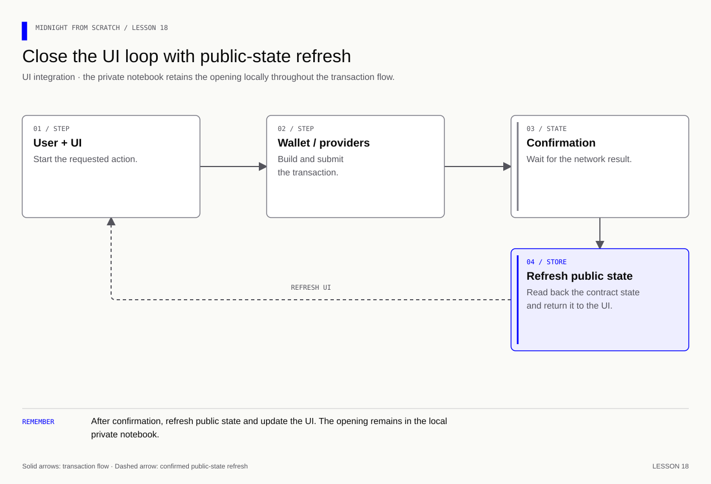

# Lesson 18 — Build a feedback interface with honest status

[Course overview](../../../README.md) · [Exercise index](../../README.md) · [Previous](../../Lesson%2017/Exercise/README.md) · [Next](../../Lesson%2019/Exercise/README.md)

## Your exercise workspace

Edit the starter files **in this folder**. They already contain the previous
lesson's prerequisite concepts; TODO comments identify the new work. Keep building
these same files through the lettered stages. The [reference answer](../../Lesson%2018/Solution/README.md)
is separate and is not used as your submitted implementation.

Run grading commands below **from the repository root**, or run `node check.mjs A`
inside this folder to check stage 18A. With no letter, `node check.mjs` lists the
stages. Commands in the stage table run from the repository root. Other blocks state
their working directory explicitly; file names without a path refer to this
exercise folder. Keep your implementation here and use solutions only to compare.

| Stage | Work checked | Command from repository root |
|---|---|---|
| 18A | Derive button and status state | `npm run check -- 18A` |
| 18B | Handle asynchronous confirmation | `npm run check -- 18B` |
| 18C | Render the accessible interface | `npm run check -- 18C` |

A failed check reports the first unmet requirement. Fix it and rerun the same
stage. A pass records the checked revision and suggests the next stage.
`npm run progress` distinguishes current passes from stages passed before later
edits. This history is local and ignored by Git; nothing is uploaded or submitted
to an external service.

---

## Start with what you already know

**Separate the screen from the contract.** Recall what a disabled button prevents, and what it cannot prevent.

<details>
<summary>Recall answer</summary>

It prevents an ordinary repeated click in this UI. It cannot stop a caller using another client; the contract must enforce authorization, phases and replay rules.

</details>

**Memory picture:** A departure board reports the train status. Updating the board does not move the train: the UI must learn the confirmed result before displaying it.

Take one lettered stage at a time: predict the result, implement it, run its
check, and explain the result before continuing. Return tomorrow and explain
the rule without opening the answer. Ask your tutor about a step you cannot yet
explain using the failing check and your own prediction.

**Goal:** implement three small functions across `workflow.mjs` and `view.mjs`.
The provided HTML, CSS and `app.mjs` form a runnable browser shell. Its adapter
is explicitly a **local simulation**; no wallet or chain transaction occurs.
The functions are designed so confirmed provider calls from lesson 14 can later
replace that adapter without changing the rendering rules.

[](../../../assets/diagrams/lesson-18-ui-states.html)

## 18A — Derive available actions

Implement `viewModel(state)` returning exactly the public display fields
`canCommit`, `canReveal`, `status`, and `error`.

The input contains `connected`, `pending`, `phase` (`submit`, `reveal`, `closed`),
`committed`, `revealed`, `hasOpening`, and `error`.

| Action | Required conditions |
|---|---|
| Commit | Connected, not pending, submit phase, not committed |
| Reveal | Connected, not pending, reveal phase, committed, has opening, not revealed |

**Exercise:** compute the Boolean permissions and status strings
`Pending confirmation`, `Revealed`, `Committed`, or `Not submitted` in that
priority order. Return an empty error string when no error exists.

<details><summary>Answer — 18A</summary>

Start with `const ready = state.connected && !state.pending`. Combine it with
the per-action conditions. These buttons help the user; the contract still
must enforce the same authorization and phase rules if the UI is bypassed.

</details>

## 18B — Separate pending from confirmed

Implement `submitAction(state, action, client, notify)`. `action` is `commit`
or `reveal`; `client[action]()` is required by this adapter interface to resolve after
confirmation, and
`client.readState()` supplies `{ committed, revealed, phase }`.

Build the function one step at a time:

1. Reject unavailable actions using viewModel before contacting the client.
2. Set `pending = true`, clear the previous error, and notify the view model.
3. Await the action, then read confirmed public state.
4. Copy only committed, revealed and phase into the UI state.
5. On failure, set a controlled error message rather than copying raw exceptions.
6. Always clear pending and notify again.

**Exercise:** make a second click fail while the first is pending. Do not mark a
submission committed before confirmation and read-back. Keep the previous
confirmed state when an operation fails.

<details><summary>Answer — 18B</summary>

Use `try/catch/finally`; clear pending in finally. A lost response does not prove
that the transaction failed on chain. The user-facing failure message should
ask for state inspection before retrying, rather than claiming the contract
rolled back. See [workflow.mjs](../../Lesson%2018/Solution/workflow.mjs).

</details>

## 18C — Render and try the browser shell

Implement `render(root, model)` with `root.querySelector`. Set disabled on
`#commit` and `#reveal`, and textContent on `#status` and `#error`.
Keep secret objects out of DOM text, attributes and routine logging.

```js
// Set text rather than treating an error message as HTML markup.
root.querySelector('#error').textContent = model.error;
```

**Exercise:** run 18C, then serve this exercise directory locally:

```bash
# Run from this lesson folder; stop the server with Ctrl-C when finished.
python3 -m http.server 8018 --bind 127.0.0.1
```

Open http://127.0.0.1:8018. Commit the sample rating, observe pending, then reveal.
Use the Tab and Enter keys as well as the mouse. The status live region announces
updates and the error area has role alert.

<details><summary>Answer — 18C</summary>

Use `disabled = !model.canCommit` and `disabled = !model.canReveal`, then assign
the two textContent properties. The checker verifies rendering through a small
DOM adapter and the required HTML controls. Keyboard behavior and the browser
experience are explicit manual checks. See [view.mjs](../../Lesson%2018/Solution/view.mjs).

</details>

### What is actually running?

| What you run | What it establishes | What remains to build |
|---|---|---|
| `npm run check -- 18A` through `18C` | Local view/workflow behavior against test adapters | A real wallet and network adapter |
| This page at `127.0.0.1:8018` | Browser behavior with an in-memory simulation | Persistence, chain confirmation and recovery |
| A hosted copy of this page | Other people can load the same UI files | Shared contract state and an actual network connection |

Each browser session currently owns a separate simulated state. Sending someone
the page or deploying its static files does not make a shared Midnight application.
Do not serve the repository root or a folder containing opening records, `.env`
files or wallet data.

**Network extension:** follow the [deployment guide](../../../docs/deployment.md),
then adapt client.commit/reveal to real confirmed calls and
client.readState to indexed public state. Add wallet/account switching, a saved
opening from lesson 17, and reload recovery before claiming an end-to-end network
interface. The simulation and automated UI checkpoints do not establish that integration.

<details>
<summary>Further practice — beyond the automated checkpoints</summary>

**Memory cue:** Display confirmed state and make pending work visible.

[](../../../assets/diagrams/lesson-18-ui-network.html)

Turn the runner's workflow into a small interface. Show the active account,
network and round; let an eligible participant commit and later reveal; make
pending, confirmed and failed operations understandable. Reuse the commitment
notebook from lesson 17. Explain each frontend dependency before installing it.

The contract must enforce rules even when someone bypasses the UI. Prevent
accidental repeated clicks for usability, while retaining contract checks for
correctness. Include account switching, reloads and unavailable services in the
manual checks. Keep secrets out of public pages and routine logs.

Extension deliverables: an actual network demo from a fresh browser session, an understandable
failure state and a reload that restores the right workflow status.

Exercise: is disabling the reveal button enough to enforce the reveal phase?
When should the interface label a submission as confirmed?

<details>
<summary>Answers — lesson 18 further practice</summary>

No. A caller can bypass the browser, so the circuit must check the phase.
A submitted transaction remains pending until the required confirmation is
observed. Read back the relevant chain state and distinguish network failures
from missing local opening data. Button state supports the user; it does not
supply authorization or transaction confirmation.

</details>

</details>
