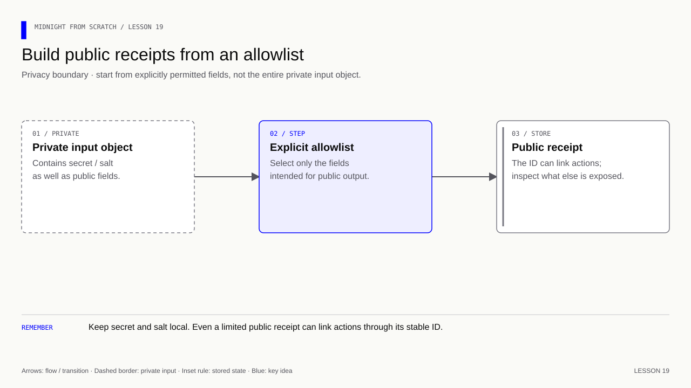
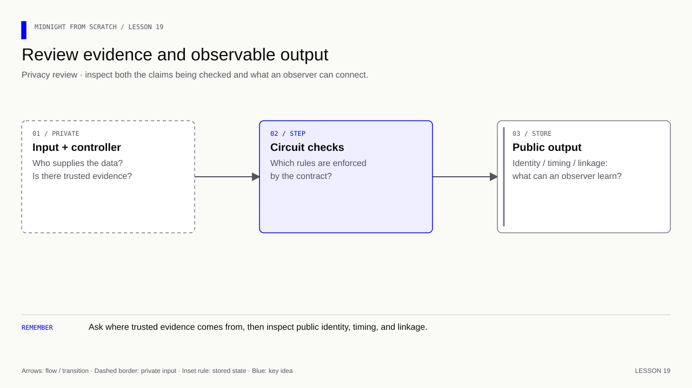

# Lesson 19 — Audit what the application exposes

[Course overview](../../../README.md) · [Exercise index](../../README.md) · [Previous](../../Lesson%2018/Exercise/README.md) · [Next](../../Lesson%2020/Exercise/README.md)

## Your exercise workspace

Edit the starter files **in this folder**. They already contain the previous
lesson's prerequisite concepts; TODO comments identify the new work. Keep building
these same files through the lettered stages. The [reference answer](../../Lesson%2019/Solution/README.md)
is separate and is not used as your submitted implementation.

Run grading commands below **from the repository root**, or run `node check.mjs A`
inside this folder to check stage 19A. With no letter, `node check.mjs` lists the
stages. Commands in the stage table run from the repository root. Other blocks state
their working directory explicitly; file names without a path refer to this
exercise folder. Keep your implementation here and use solutions only to compare.

| Stage | Work checked | Command from repository root |
|---|---|---|
| 19A | Classify public and private data | `npm run check -- 19A` |
| 19B | Produce a safe public receipt | `npm run check -- 19B` |
| 19C | State accurate privacy claims | `npm run check -- 19C` |

A failed check reports the first unmet requirement. Fix it and rerun the same
stage. A pass records the checked revision and suggests the next stage.
`npm run progress` distinguishes current passes from stages passed before later
edits. This history is local and ignored by Git; nothing is uploaded or submitted
to an external service.

### Short concept checks

Fill the named fields in `answers.json` when you reach that stage. Use JSON
booleans/numbers where appropriate; `null` means unanswered. These checks grade
the specific questions below, not arbitrary prose.

**19A:**

- `commitment`: Classify the on-ledger commitment: public or private.
- `participantId`: Classify the on-ledger participant identifier.
- `salt`: Classify the retained secret salt.
- `revealedRating`: Classify a deliberately revealed rating.

<details>
<summary>Check these concept answers after trying them</summary>

```json
{
  "commitment": "public",
  "participantId": "public",
  "salt": "private",
  "revealedRating": "public"
}
```

</details>

**19C:**

- `anonymousGuaranteed`: Does a hashed record ID guarantee anonymity?
- `dustHidesPublishedFields`: Does DUST hide an explicitly published wallet-to-rating mapping?
- `linkedWithinContract`: Can actions using the same public ID be linked within that contract?

<details>
<summary>Check these concept answers after trying them</summary>

```json
{
  "anonymousGuaranteed": false,
  "dustHidesPublishedFields": false,
  "linkedWithinContract": true
}
```

</details>


---

## Start with what you already know

**Review the entire path of a value.** Recall one value that is public before reveal, one that becomes public at reveal, and one that should remain private.

<details>
<summary>Recall answer</summary>

A commitment is public before reveal; the accepted rating becomes public at reveal; the original salt remains private in this application. Public identifiers can link actions.

</details>

**Memory picture:** An envelope hides its letter, but the address label and delivery time are still visible. Review the labels and delivery path as well as the envelope.

Take one lettered stage at a time: predict the result, implement it, run its
check, and explain the result before continuing. Return tomorrow and explain
the rule without opening the answer. Ask your tutor about a step you cannot yet
explain using the failing check and your own prediction.

**Goal:** classify the known feedback data, implement a public receipt, and write
a small review. Edit `answers.json`, `receipt.mjs`, and `REVIEW.md`.

[](../../../assets/diagrams/lesson-19-public-receipt.html)

## 19A — Inventory visibility

Complete the 19A answers in answers.json for a public ledger commitment, public
participant ID, private salt and deliberately revealed rating.

**Exercise:** classify each as `public` or `private` in this course design.

<details><summary>Answer — 19A</summary>

Commitment, participantId and revealedRating are public. Salt remains private.
A hiding commitment is itself public even when its underlying choice is hidden.

</details>

## 19B — Build a public receipt

Implement `publicReceipt(record)`. The caller's object may contain id,
commitment, revealed, value, secret, salt and arbitrary nested privateState.
Return a new object containing only id, commitment and revealed. Include value
only when revealed is true. Do not mutate the private input object.

**Exercise:** make the function safe when new private fields are added to the
input later. Do not spread the full input and then try to delete known secrets.

<details><summary>Answer — 19B</summary>

Create `{ id: record.id, commitment: record.commitment, revealed: record.revealed }`,
then conditionally add value. An explicit allowlist keeps newly added private
fields out automatically. See [receipt.mjs](../../Lesson%2019/Solution/receipt.mjs).

</details>

## 19C — State a defensible privacy claim

Complete the remaining concept questions and REVIEW.md's four sections:
Observers, Public linkage, Recovery, and Limits. Trace the frontend, notebook,
contract and provider boundary rather than looking only at Compact arguments.

**Exercise:** explain what a chain observer sees, what the operator may know,
what someone with local file access can read, and which claims remain unverified.

<details><summary>Answer — 19C</summary>

A public stable ID links that record's actions; external information may identify
its owner. DUST does not hide an association explicitly published by application
code. The lesson 17 notebook is plaintext. See the
[reference review](../../Lesson%2019/Solution/REVIEW.md) for one scoped explanation.

</details>

The checker grades the known data classification and receipt behavior, and checks
that the review template is filled in. It cannot decide that arbitrary prose is
correct or certify application privacy. Submit REVIEW.md and the relevant code
for a human review; a green automated checkpoint is not that review.

<details>
<summary>Further practice — beyond the automated checkpoints</summary>

**Memory cue:** Ask who can see each value and who can control each input.

[](../../../assets/diagrams/lesson-19-review-boundaries.html)

Review the feedback contract, notebook and frontend together. Inventory public
ledger fields, stable identifiers, private openings, logs, provider requests and
transaction metadata. Separate what a chain observer can see from what the app
operator or another service may know. Check whether the application's privacy
claims match the data it exposes.

Examine fee-payment privacy and contract-level disclosure separately. A shielded
fee path cannot hide a wallet identifier that the application itself publishes.
Review authorization and replay assumptions again, then fix the findings and
repeat the affected tests.

Deliverables: a data-visibility table, a short threat model stating observers and
assumptions, and evidence for each corrected issue. Choose realistic privacy
claims instead of describing every use of commitments as anonymous.

Exercise: if public state stores `walletAddress → revealedRating`, do private
circuit inputs make the published association private? Is an opaque stable
participant identifier automatically unlinkable across actions?

<details>
<summary>Answers — lesson 19 further practice</summary>

No. The explicit wallet-to-rating association is public. An opaque identifier
can hide the underlying identity while still linking every action that reuses
it. External knowledge may identify its owner. Review metadata and off-chain
observations too; protecting an input does not erase links in published output.

</details>

</details>

For a network version, repeat this inventory against the actual providers and hosting arrangement in the [deployment guide](../../../docs/deployment.md). A review of a simulated UI does not establish the deployed application’s privacy.
