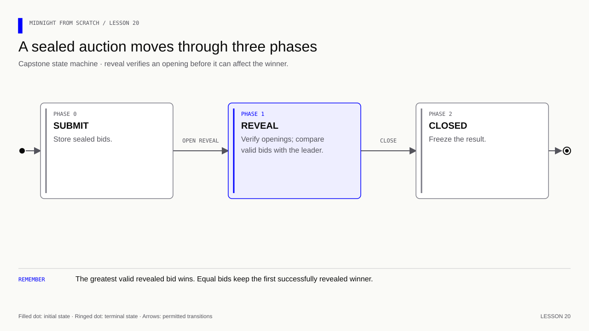
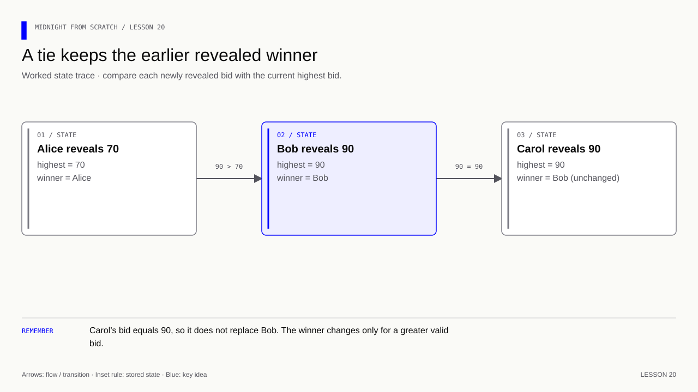
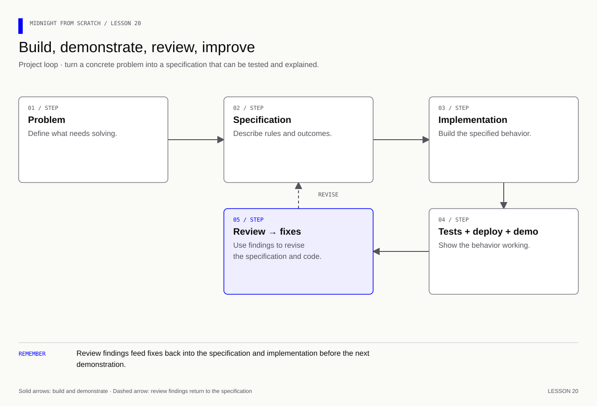

# Lesson 20 — Build a sealed-bidding capstone

[Course overview](../../../README.md) · [Exercise index](../../README.md) · [Previous](../../Lesson%2019/Exercise/README.md) · [Bonus: AI-assisted development](../../Lesson%2021/Exercise/README.md)

## Your exercise workspace

Edit the starter files **in this folder**. They already contain the previous
lesson's prerequisite concepts; TODO comments identify the new work. Keep building
these same files through the lettered stages. The [reference answer](../../Lesson%2020/Solution/README.md)
is separate and is not used as your submitted implementation.

Run grading commands below **from the repository root**, or run `node check.mjs A`
inside this folder to check stage 20A. With no letter, `node check.mjs` lists the
stages. Commands in the stage table run from the repository root. Other blocks state
their working directory explicitly; file names without a path refer to this
exercise folder. Keep your implementation here and use solutions only to compare.

| Stage | Work checked | Command from repository root |
|---|---|---|
| 20A | Commit a bid once | `npm run check -- 20A` |
| 20B | Authorize phase changes | `npm run check -- 20B` |
| 20C | Reveal and select the winner | `npm run check -- 20C` |
| 20D | Demonstrate results and document the design | `npm run check -- 20D` |

A failed check reports the first unmet requirement. Fix it and rerun the same
stage. A pass records the checked revision and suggests the next stage.
`npm run progress` distinguishes current passes from stages passed before later
edits. This history is local and ignored by Git; nothing is uploaded or submitted
to an external service.

---

## Start with what you already know

**Transfer the pattern to a new problem.** From memory, list what carries over from the feedback round and what changes for bidding.

Recall answer

Keep scoped IDs, commitments, ownership, phases and replay checks. Change the value range and result rule: select the greatest revealed bid, retaining the earlier reveal on a tie.

**Memory picture:** This is a sealed offer box with an opening session. The selection rule chooses an offer; it does not collect payment or force a winner to pay.

Take one lettered stage at a time: predict the result, implement it, run its
check, and explain the result before continuing. Return tomorrow and explain
the rule without opening the answer. Ask your tutor about a step you cannot yet
explain using the failing check and your own prediction.

**Goal:** implement a bounded sealed auction from its specification, starting with
`auction.compact`. Add `run-auction.mjs` and finish DESIGN.md. This project has no
payments, refunds or claim of one bid per human; each secret selects one record.

## 20A — Commit bounded bids

Define exported struct `Bid` with commitment Bytes<32>, revealed Boolean, and
value Uint<16>. Declare exported ledgers:

| Name | Type | Purpose |
|---|---|---|
| organizer | Bytes<32> | Hash of the organizer secret |
| phase | Uint<8> | 0 submit, 1 reveal, 2 closed |
| bids | Map<Bytes<32>, Bid> | Independent sealed records |
| highest | Uint<16> | Greatest accepted revealed bid; initially zero |
| winner | Bytes<32> | Winning record ID; unused when count is zero |
| revealedCount | Counter | Number of accepted reveals |

The constructor accepts `organizerId: Bytes<32>`. Implement
`participantId(secret: Bytes<32>): Bytes<32>` with a purpose-specific hash
including this contract's address, as in 10F.

Implement `commitBid(secret: Bytes<32>, bid: Uint<16>, salt: Bytes<32>): []`.
Require phase 0, range 1–1000 and no existing entry. Store the typed commitment,
revealed false, and placeholder value 0.

**Exercise:** compile and check 20A before adding phase transitions.

Answer — 20A

Follow the map and scoped-ID pattern from lesson 10. Commit with
`persistentCommit<Uint<16>>(bid, salt)`; the choice type must match at reveal.
Do not disclose the bid during commit. The
[completed contract](../../Lesson%2020/Solution/auction.compact) is a reference after your attempt.

## 20B — Authorize the phase transitions

Implement `startReveal(admin: Bytes<32>): []` for 0 → 1, and
`close(admin: Bytes<32>): []` for 1 → 2. Require the hash of admin to match
organizer. Reject wrong callers, skipped phases, repeated transitions and late
submissions. An empty reveal phase may be closed with count zero.

**Exercise:** run 20B and explain why a UI button cannot supply this authorization.

Answer — 20B

Check authority and current phase inside each circuit before updating phase.
A caller can bypass the UI. Closing freezes the result; it does not manufacture
a winner when nobody revealed.

## 20C — Verify openings and select the winner

Implement `revealBid(secret: Bytes<32>, bid: Uint<16>, salt: Bytes<32>): []`.
Require phase 1, an existing record for this secret, an unrevealed flag, and an
exact commitment match. Publish the accepted bid, mark it revealed and increment
revealedCount. Update highest and winner only when the accepted bid is strictly
greater than highest.

**Exercise:** reject changed values/salts, another secret's opening and replay.
Use strict `>` rather than `>=` to implement the specified tie rule.

Answer — 20C

Complete all assertions before public writes. After matching, disclose the bid
into a public local value, update the record and count, then compare with highest.
Only revealed bids participate. This design makes revealed bids public and lets
the organizer decide when phases advance; record those limits in DESIGN.md.

## 20D — Demonstrate and submit for review

Write a local runner using the familiar generated Contract, context and ledger
pattern. Construct with the hash of a fresh organizer secret. Commit bids 70 and
90, start reveal, reveal both, close, and assert highest 90n and count 2n.
Expose a local `state()` function returning the decoded final ledger so the
checker can inspect it independently of printed output.

Complete DESIGN.md's scope, rules, diagram and evidence sections. Run 20D and
repeat any affected checkpoints after fixes.

Answer — 20D

The [reference runner](../../Lesson%2020/Solution/run-auction.mjs) carries each
successful context forward and prints only public results. The
[reference design](../../Lesson%2020/Solution/DESIGN.md) separates local checks from
unperformed network work. Do not describe a successful local runner as deployment.

**Human evaluation:** submit your source, test results and DESIGN.md for review.
Be prepared to change the tie rule and explain the affected tests. For a full
application, add persistent openings, a frontend, provider integration and actual
confirmed deployment/call evidence using lessons 12–19 and the
[deployment guide](../../../docs/deployment.md). Those integration items
remain explicit review criteria; this automated capstone verifies the bounded
local auction implementation, not payments, production security or live deployment.

Further practice — beyond the automated checkpoints

**Memory cue:** Start with a problem; finish with evidence that the solution works.

Choose one fresh project brief:

- **Private eligibility check:** prove an eligibility condition using evidence
  from an accepted issuer, while revealing only the required outcome. Define
  issuer trust and verify the evidence; a caller-supplied Boolean is insufficient.
- **Sealed bidding round:** accept hidden bids, enforce phases, verify openings
  and determine a result. Start without payments and specify non-reveal behavior.
- **Confidential group decision:** control participation, collect committed
  choices and publish a specified result. Explicitly choose individual reveal
  or a more advanced aggregate-only design and justify its disclosure boundary.

Agree on a bounded specification and acceptance criteria before implementation.
Build the contract, runner, tests, private storage, UI and deployment instructions
from a fresh project. Reuse understood libraries and documented patterns, while
explaining the code and decisions. The course does not require all three briefs.

Extension deliverables: reproducible setup, a state/data-flow diagram, test output,
confirmed deployment and call evidence, a short demo and a design explanation.
Review findings become a final correction exercise. A small change to the
specification checks understanding beyond reproducing a sample.

Exercise: what evidence would distinguish a finished application from a happy-path
demo? What must an eligibility app check beyond a numeric age or Boolean flag?

Answers — lesson 20 further practice

Show successful operations, rejected unauthorized/invalid/replayed attempts,
state checks, restart recovery, understandable failure handling and a setup
another person can follow. Explain privacy boundaries and unresolved limitations.

Eligibility needs evidence from an accepted source, verification of its
integrity/authenticity, and binding to the intended holder/action/context as
required by the specification. Also enforce applicable validity and reuse rules.
The circuit cannot establish those facts merely by trusting a witness's claim.

Continue with [bonus lesson 21 — AI-enabled Midnight development](../../Lesson%2021/Exercise/README.md).
