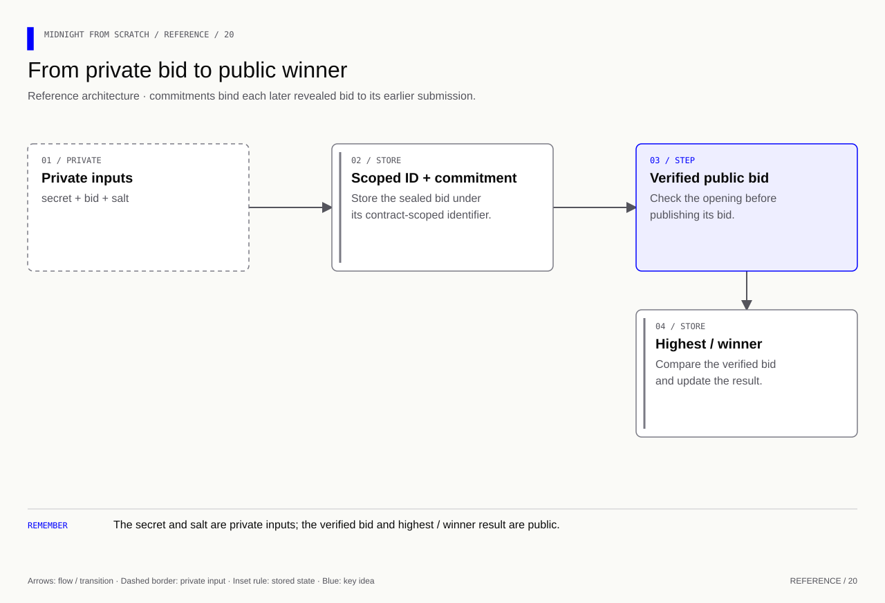

# Sealed-bidding design

## Scope

Bids are integers 1–1000. Phases are submit, reveal and closed. Revealed bid values and the winner ID are public. This learning auction transfers no assets and makes no one-person-one-bid claim.

## Rules

The organizer controls phase changes. Each secret selects one contract-scoped record. Reveals must match its original commitment and occur once in reveal phase. Only successfully revealed bids count. Equal highest bids retain the first successfully revealed winner. No reveals means count zero and no winning bid.

## Data flow

## Evidence and limits

Local checks exercise bounds, duplicate submission, authorization, phase order, wrong openings, replay and ties. The runner shows 90 winning over 70. No live deployment or payment handling is claimed. Add persistent opening storage and real provider integration before attempting a network demonstration.
