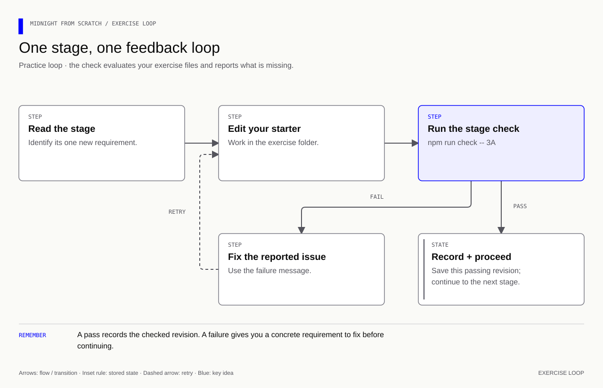

# Bonus lesson 21 — Develop with AI and Midnight expert

[Course overview](../../../README.md) · [Exercise index](../../README.md) · [Previous](../../Lesson%2020/Exercise/README.md) · [Next](../../Lesson%2022/Exercise/README.md) · [Reference](../Solution/README.md)

**Goal:** turn a ratings requirement into a bounded AI request, then distinguish
suggested code from verified behavior. You remain responsible for the requirement,
review, and interpretation of evidence. Midnight expert supplies domain workflows
and knowledge; its verification tools test claims rather than making them true.

**Memory cue:** **Specify → ask with context → inspect → test → record evidence.**

[](../../../assets/diagrams/exercise-feedback-loop.html)

Edit `review.json` in this folder. It is a worksheet, not an agent configuration
that runs commands automatically. Run all stage commands from the repository root:

| Stage | Deliverable | Check |
|---|---|---|
| 21A | A precise feature and disclosure specification | `npm run check -- 21A` |
| 21B | A grounded request with version and source context | `npm run check -- 21B` |
| 21C | A verification plan, honest observations, and limits | `npm run check -- 21C` |

A green result checks the named fields and known concepts. It does not assess all
free-form prose, prove that claimed tests ran, or certify security. Ask for a
human/code review of the actual changes and outputs after completing the stages.

## 21A — Specify before asking for code

Use the sealed-feedback round from lesson 15. Your request is to **review and
preserve the 1–5 rating rule and the opening/owner/phase checks**, not rewrite the
whole application without a reason. A precise invariant is easier to verify than
“make it secure.”

```compact
// A numeric representation permits more values than the feedback policy.
assert(choice >= 1 && choice <= 5, "Rating must be 1 to 5");
```

This is an excerpt from inside a circuit, not a complete contract. Keeping the
range assertion alone does not authenticate the owner or verify a commitment.

Fill `feature.goal`, `ratingMin`, `ratingMax`, `publicAtCommit`, `publicAtReveal`,
and `private`. Think from the perspective of a public observer; a configured
prover still receives the inputs needed for its work.

<details><summary>Answer — 21A</summary>

```json
"feature": {
  "goal": "Review bounded sealed ratings while preserving owner, phase, and opening checks.",
  "ratingMin": 1,
  "ratingMax": 5,
  "publicAtCommit": ["participantId", "commitment"],
  "publicAtReveal": ["rating"],
  "private": ["secret", "salt"]
}
```

Other public state, including phase and aggregate counters, also exists in the
round. This small worksheet tracks the fields relevant to the requested feature.

</details>

## 21B — Give the AI the right context

A useful request contains a small goal, editable paths, pinned versions, relevant
source, expected tests, and the source of domain guidance. Do not paste wallet
seeds, private-store passwords, access tokens, or real opening files into a prompt.

Example prompt:

> Use Midnight expert to review the 1–5 rating rule in
> `Lessons/Lesson 15/Exercise/round.compact`. Preserve the owner, admission, phase,
> commitment, and replay checks. This course uses compiler 0.31.1, language 0.23,
> runtime 0.16.0, and Midnight.js 4.1.1. Read the completed round and adversarial
> test interfaces for context. Explain any proposed change before making it.
> Make the smallest necessary edit, run relevant positive and negative local
> tests, and report tested results separately from source interpretation and
> untested network behavior. Do not reset other exercise files or expose secrets.

Record that context under `request`: the four version fields, editable `target`,
`prompt`, `sourceFiles`, and `expertSkills`. Use the Compact review and verification
skill identifiers below when those plugins are installed. A host may expose them
through different command syntax; skill names in this worksheet are references,
not a claim that every editor accepts a particular slash command.

<details><summary>Answer — 21B fields</summary>

```json
"compiler": "0.31.1",
"language": "0.23",
"runtime": "0.16.0",
"sdk": "4.1.1",
"target": "Lessons/Lesson 15/Exercise/round.compact",
"expertSkills": ["compact-core:compact-review", "midnight-verify:verify-compact"],
"sourceFiles": ["Lessons/Lesson 15/Solution/round.compact", "Lessons/Lesson 16/Solution/tests.mjs"]
```

These properties belong inside `request` alongside your full `prompt`. If a skill
is unavailable, the AI should say so and use the installed source/verification
workflow; it should not pretend to have called a missing tool.

</details>

**Try:** compare “make ratings private” with the bounded prompt above. Which one
lets you decide whether the proposed diff is relevant? Review the actual diff
before accepting a claim such as “the contract is now anonymous.”

## 21C — Verify the claim and record its limits

List these seven cases in `verification.cases`:

| ID | Expected observation |
|---|---|
| `valid-opening` | Original choice/salt opens once during reveal phase |
| `wrong-rating` | A different valid rating cannot open the commitment |
| `wrong-salt` | A changed salt is rejected |
| `unauthorized-owner` | A different participant secret is rejected |
| `replay` | A second reveal is rejected without counting twice |
| `phase` | Submit/reveal calls outside their permitted phases are rejected |
| `unchanged-state` | A failed call does not alter the previously accepted result |

For each case fill `expected`, `evidenceStatus`, and `evidence`. Until you have run
it, use `not-run` and explain what remains. After running it, record the command,
source revision, and observed result; use `failed` when it failed. A reference
worksheet with `not-run` entries is a valid **plan**, not completed test evidence.

Start with the existing tests rather than inventing a duplicate suite:

```bash
# Exercise checks test your implementation at the relevant stage.
npm run check -- 15C
npm run check -- 15D
# Compare with the independently completed round/adversarial-test references.
npm run lesson15
npm run lesson16
```

For a network claim, follow the [deployment walkthrough](../../../docs/deployment.md)
and collect that network's confirmed transaction and indexed state. Compile
success, a type check, and a local exception do not demonstrate mainnet behavior.

Fill `verification.privacy`, `limitations`, and `humanReview`. Keep human review
`pending` until an actual review takes place. The checker validates the label;
it cannot independently verify that a person reviewed the code.

<details><summary>Answer — 21C privacy boundaries</summary>

```json
"privacy": {
  "noSecretInPublicReceipt": true,
  "stableIdCanLinkActions": true,
  "localTestsProveNetworkDeployment": false
}
```

A stable public identifier can link actions within the contract. A correct
commitment prevents a different opening under the construction's assumptions;
it does not establish an honest opinion, a unique person, or complete anonymity.
Describe any untested proof/network path under `limitations`.

</details>

**Practical deliverable:** your review worksheet, the relevant code diff, actual
redacted test outputs, and one paragraph explaining why the evidence supports the
claim. Ask the AI to identify what remains inconclusive. Then explain the changed
rule yourself without reading its answer.

The [reference worksheet](../../Lesson%2021/Solution/review.json) shows a completed
plan. Run `npm run lesson21` to validate its structure; this command makes no AI
request, sends no work externally, and submits no network transaction.

Sources: [Midnight expert Compact review](https://github.com/midnightntwrk/midnight-expert/blob/7853915a82a605e3b74dd3b7ab7a241de8a9d136/plugins/compact-core/skills/compact-review/SKILL.md),
[verification hub](https://github.com/midnightntwrk/midnight-expert/blob/7853915a82a605e3b74dd3b7ab7a241de8a9d136/plugins/midnight-verify/skills/verify-correctness/SKILL.md), and
[course knowledge audit](../../../docs/knowledge-audit.md).
