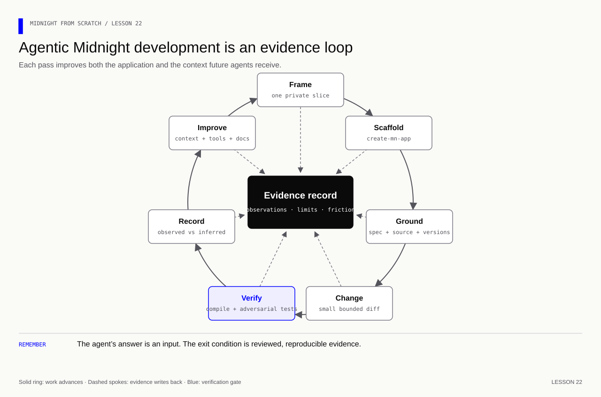

# Lesson 22 — Bootstrap and evaluate an agent-built Midnight project

[Course overview](../../../README.md) · [Lesson index](../../README.md) · [Previous](../../Lesson%2021/Exercise/README.md) · [Reference](../Solution/README.md)

**Goal:** start a separate Midnight project with the project generator, give an AI
agent bounded and current Midnight context, require evidence for its claims, and
turn failures into useful developer-experience feedback.

**Memory cue:** **Frame → scaffold → ground → change → verify → learn.**

[](../../../assets/diagrams/lesson-22-agentic-loop.html)

Edit `project-plan.json` in this folder. The checkpoint validates your plan; it
does not execute an AI service, create a wallet, or certify claimed evidence.

| Stage | Deliverable | Check |
|---|---|---|
| 22A | A small product slice and disclosure boundary | `npm run check -- 22A` |
| 22B | A reproducible project scaffold | `npm run check -- 22B` |
| 22C | A bounded Midnight Expert task | `npm run check -- 22C` |
| 22D | Positive and adversarial verification | `npm run check -- 22D` |
| 22E | A developer-experience evidence record | `npm run check -- 22E` |

## Before you begin

Midnight Expert is a set of AI development plugins and verification workflows.
It improves the agent's access to Midnight-specific context; it does not make a
generated answer correct by itself. A useful agentic workflow therefore has two
independent controls:

1. **Grounding:** versions, relevant source files, official docs, editable paths,
   privacy rules, and the requested behavior.
2. **Verification:** compilation, positive tests, adversarial tests, network
   confirmation/read-back when applicable, diff review, and an honest limits log.

For Claude Code on macOS or Linux, the current Midnight Expert installer is:

```bash
curl -fsSL midnightntwrk.expert/install.sh | bash
```

Restart Claude Code if a newly installed slash command is not visible, then run:

```text
/midnight-expert:doctor
```

The installer lets you select domain plugins such as Compact review, Midnight.js
DApp development, and verification. In another AI host, use the capabilities that
host actually exposes; never write that a plugin was called when it was unavailable.

## 22A — Frame one private-by-design slice

Do not begin with “build a complete anonymous feedback platform.” Begin with one
observable behavior:

> A participant commits a rating from 1 to 5. Before reveal, a public observer can
> see the participant identifier and commitment, but not the rating or opening
> salt. During the reveal phase, the original opening publishes the rating once.

That sentence gives the agent a user, a transition, a disclosure boundary, and a
testable end state. Fill `product` in `project-plan.json`.

<details><summary>Answer — 22A</summary>

```json
"product": {
  "name": "Sealed feedback lab",
  "user": "A Web2 engineer learning a privacy-preserving commit and reveal flow.",
  "problem": "Collect a bounded rating without publishing it before the reveal phase.",
  "firstSlice": "One participant commits, reveals once, and a public read confirms the rating.",
  "privateData": ["rating", "opening salt"],
  "publicData": ["participant identifier", "commitment", "revealed rating"]
}
```

</details>

**Memory check:** “private input” describes where a value starts. Trace every
`disclose`, ledger write, identifier, receipt, log, and UI field to describe what
an observer eventually learns.

## 22B — Scaffold a separate project

The tool you were remembering is **`create-mn-app`**. It is a Midnight Network
project generator. Keep this course repository clean by creating the new lab next
to it, not inside an exercise or solution folder:

```bash
cd ..
npx create-mn-app@latest sealed-feedback-lab --template hello-world
cd sealed-feedback-lab
npm run setup
```

The generated hello-world path gives you a contract, SDK plumbing, and a local
Docker network. `npm run setup` is the local starting path; Preview and Preprod
come after the local behavior is understood and tested. Record the scaffold in
`project-plan.json` with `initialNetwork` set to `undeployed`.

<details><summary>Answer — 22B</summary>

```json
"scaffold": {
  "tool": "create-mn-app",
  "command": "npx create-mn-app@latest sealed-feedback-lab --template hello-world",
  "setupCommand": "npm run setup",
  "initialNetwork": "undeployed",
  "source": "https://github.com/midnightntwrk/create-mn-app"
}
```

</details>

Before accepting generated output, inspect the generator version, dependency
pins, network selection, contract source, scripts, and README. “Latest” chooses a
release; your repository lockfile should make the resulting project reproducible.

## 22C — Give the agent a bounded working contract

Create two small context files in the new project:

```md
<!-- PROJECT_SPEC.md -->
# Sealed feedback slice
- Rating is 1–5.
- Commit publishes an identifier and commitment, not the rating or salt.
- Reveal requires the original opening and succeeds once in the reveal phase.
- Failed calls retain the last accepted state.
```

```md
<!-- AGENTS.md -->
# Working agreement
- Read PROJECT_SPEC.md before editing.
- Edit only contracts/ and tests/ for this task.
- Preserve generated and unrelated files.
- Never request or print seeds, passwords, salts, or private-state files.
- Compile and run focused positive and negative tests before claiming success.
- Separate observed results, source interpretation, and untested assumptions.
```

Then ask for a small change, not an autonomous rewrite:

```text
Use Midnight Expert's installed Compact review and verification capabilities.
Read PROJECT_SPEC.md, AGENTS.md, the current Compact contract, and focused tests.
Implement only the first sealed-feedback slice. Preserve unrelated generated files.
Before editing, state the public/private boundary and the smallest proposed diff.
After editing, compile and run the five named verification cases. Report observed
evidence separately from inference. Do not request or expose wallet seeds,
private-state passwords, or opening salts. Stop and identify any unavailable tool.
```

Fill `agent` with the exact health-check command, context/edit boundaries, forbidden
prompt data, and your complete task prompt.

<details><summary>Answer — 22C fields</summary>

```json
"expert": "midnight-expert",
"doctorCommand": "/midnight-expert:doctor",
"contextFiles": ["PROJECT_SPEC.md", "AGENTS.md"],
"editablePaths": ["contracts/", "tests/"],
"forbiddenPromptData": ["wallet seed", "private-state password", "opening salt"]
```

</details>

## 22D — Make evidence the exit condition

An agent finishing its edit is not the end of the task. Require this evidence
ladder:

```text
source inspection
      ↓
Compact compilation
      ↓
happy-path execution
      ↓
wrong opening + unauthorized caller + replay
      ↓
failed calls retain accepted state
      ↓
human diff/privacy review
      ↓
network deploy + indexed read-back (only for a network claim)
```

Record the commands from the generated project rather than inventing generic
ones. At minimum, your plan must include a compile/setup command and a test
command. Record these exact case IDs:

- `happy-path`
- `wrong-opening`
- `unauthorized-caller`
- `replay`
- `retained-state`

<details><summary>Answer — 22D</summary>

```json
"verification": {
  "commands": ["npm run setup", "npm test"],
  "cases": ["happy-path", "wrong-opening", "unauthorized-caller", "replay", "retained-state"],
  "evidencePolicy": {
    "separateObservedFromInferred": true,
    "networkClaimsNeedReadBack": true,
    "securityNeedsHumanReview": true
  }
}
```

</details>

Local execution can prove a local observation. It cannot prove that Preview,
Preprod, or Mainnet accepted a transaction. For those claims, record network ID,
contract address, confirmed transaction, and an independent indexed read-back.

## 22E — Turn failures into DevEx evidence

This is the step that changes “I used an AI coding agent” into developer-tools
engineering. For every meaningful run, record:

| Field | Question |
|---|---|
| Category | Retrieval, tooling, documentation, API, or verification? |
| Symptom | What did the human or agent get wrong or find difficult? |
| Evidence | Which prompt, diff, compiler output, test, or trace demonstrates it? |
| Improvement | What context, diagnostic, example, API, or test would prevent recurrence? |

Also record four binary outcomes: task success, Compact compilation, tests passing,
and whether the response contained an unsupported claim. A small repeated dataset
is more useful than an impression such as “the agent worked well.”

<details><summary>Answer — 22E example</summary>

```json
"feedback": {
  "observations": [{
    "category": "documentation",
    "symptom": "The first request did not distinguish a local simulation from a confirmed network transaction.",
    "evidence": "The response claimed deployment but showed only local compile and unit-test output.",
    "proposedImprovement": "Add an evidence template requiring network ID, transaction confirmation, and indexed read-back."
  }],
  "metrics": {
    "taskSuccess": false,
    "compactCompile": true,
    "testsPassed": true,
    "unsupportedClaims": true
  },
  "humanReview": "pending"
}
```

</details>

## Definition of done

You can explain the product boundary without the agent; the scaffold is pinned by
a lockfile; the diff is small and reviewed; Compact compiles; positive and
negative cases have observed output; secrets were not placed in prompts or logs;
network claims have network evidence; and at least one friction item is converted
into a concrete tooling or documentation improvement.

The [reference plan](../Solution/project-plan.json) is deliberately honest: it is
a completed planning artifact with no fabricated agent run. Validate it with
`npm run lesson22`.

Sources: [Midnight Expert](https://github.com/midnightntwrk/midnight-expert),
[create-mn-app](https://github.com/midnightntwrk/create-mn-app), and
[Midnight development guides](https://docs.midnight.network/guides).
