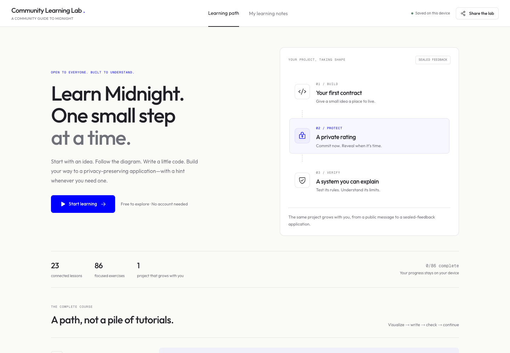
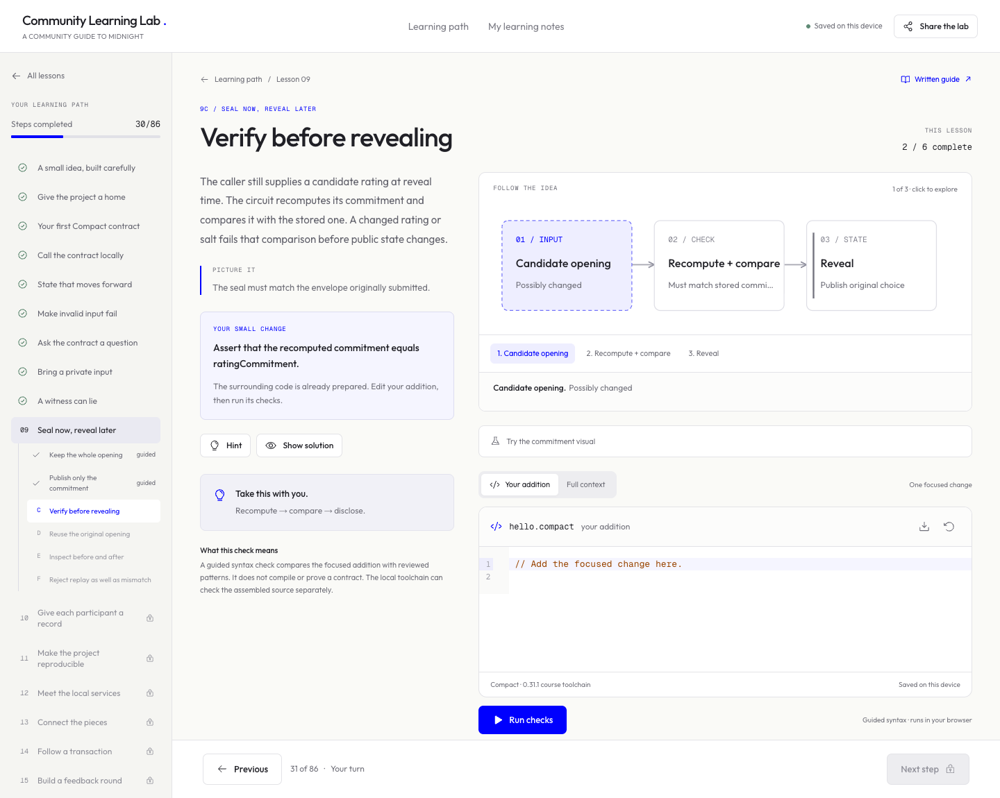
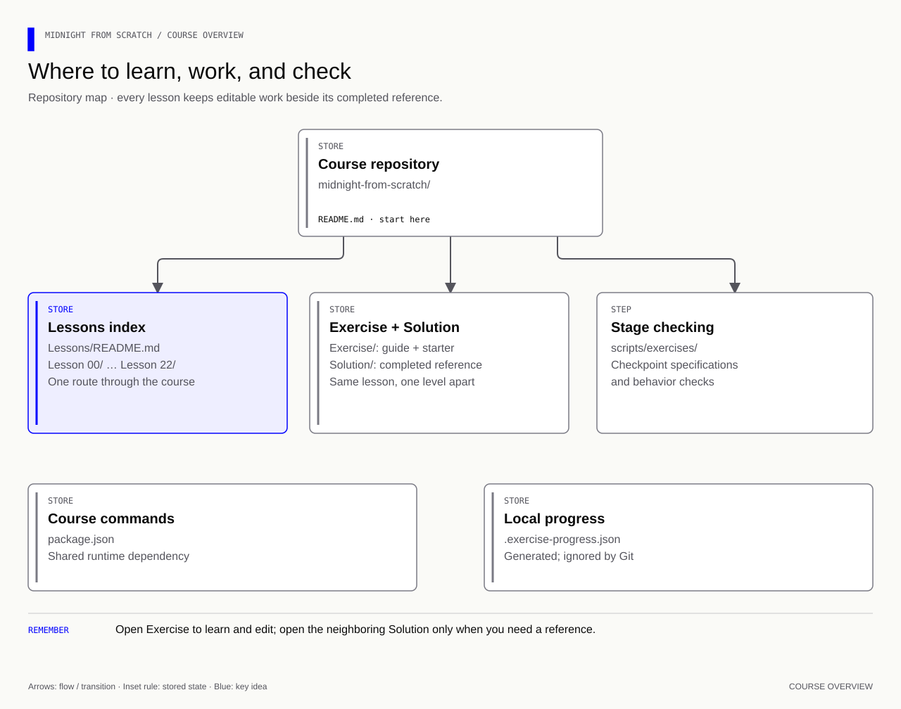
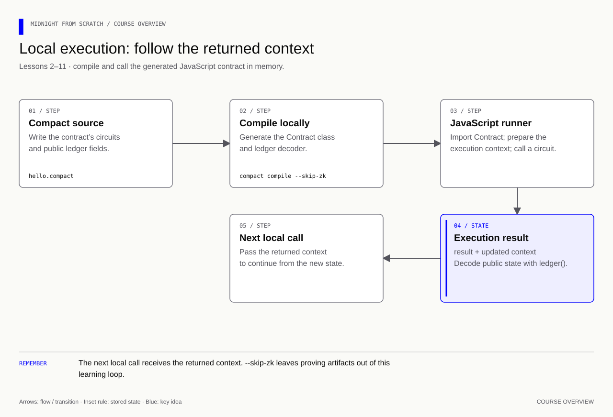
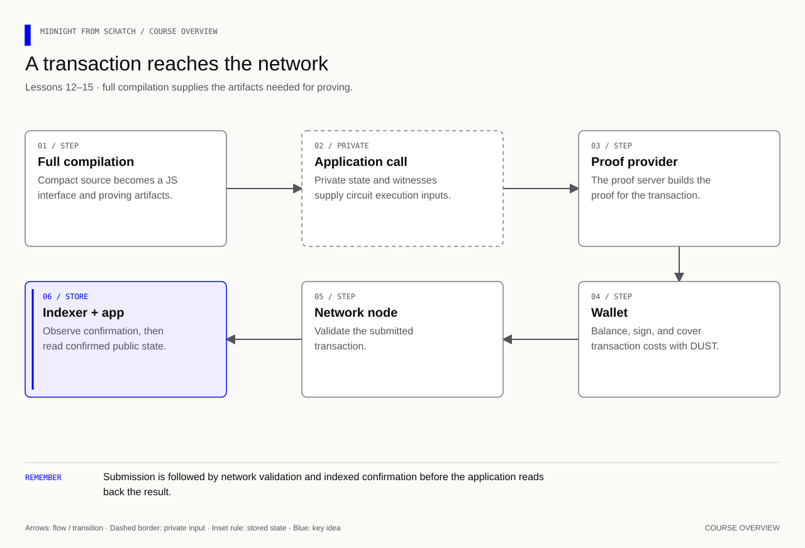
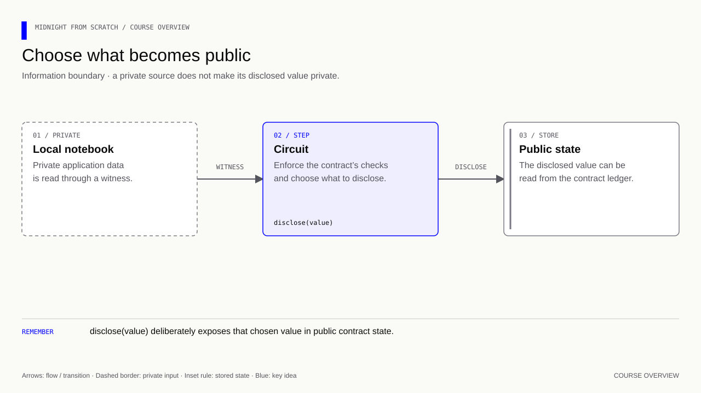
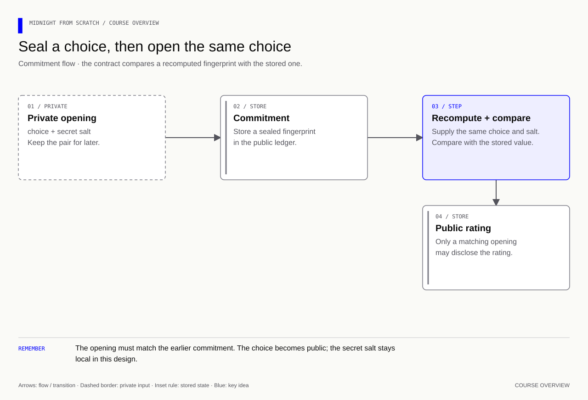
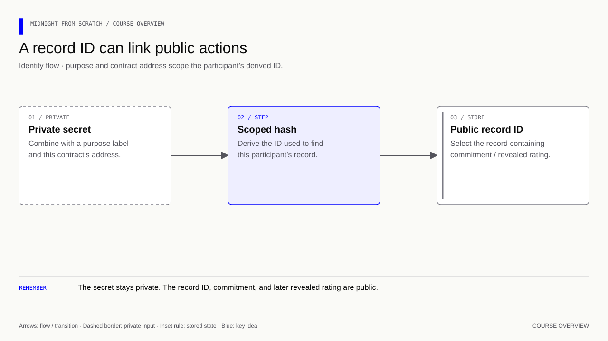
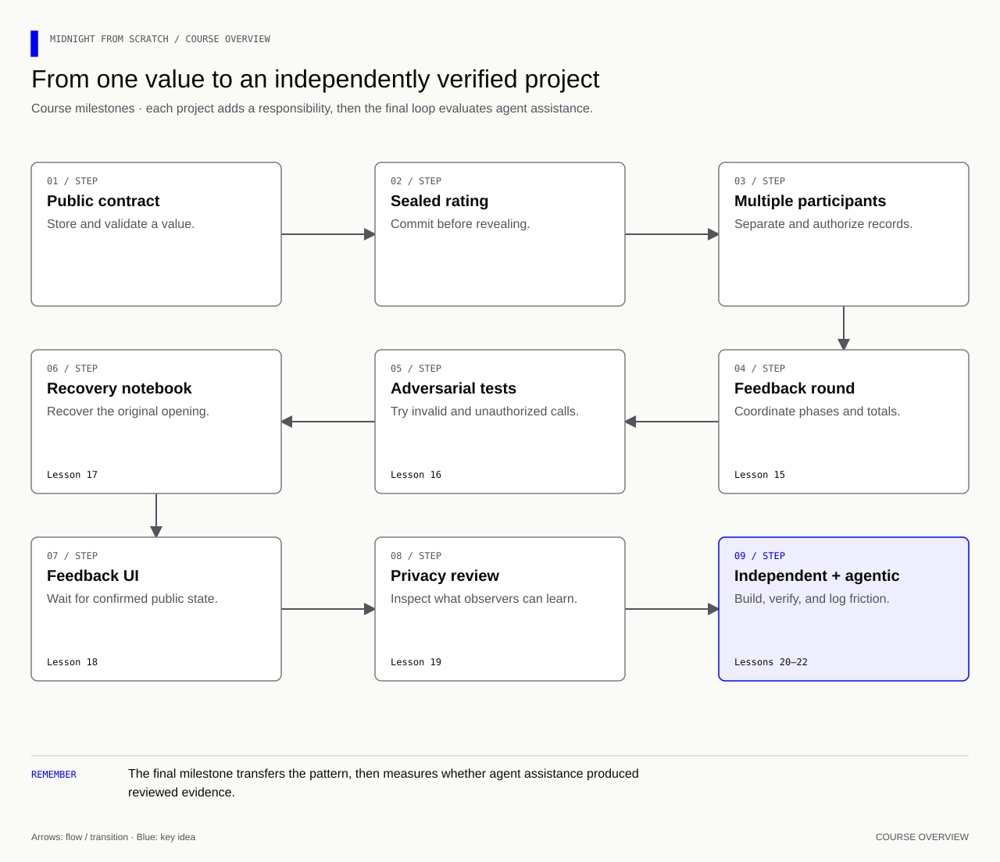

<div align="center">

# Midnight from Scratch

### Learn Midnight. One small step at a time.

A visual, hands-on course for software engineers learning Compact and privacy-preserving applications.

**23 lessons · Staged exercises · Runnable references**

[**Start the written course →**](Lessons/README.md) · [Complete guide](Learn%20Tot.md) · [Local setup](#start-here)

**[Open the interactive course →](https://community-learning-lab-midnight.ermiarch.chatgpt.site)**

</div>



An independent community learning project about Midnight. It does not use the
Midnight logo or imply an official course or certification.

## Learn by building one small idea at a time

Follow the concept diagram, read the explanation, make a focused code change,
and check one stage before moving forward. Each lesson pairs an editable
`Exercise/` folder with a completed `Solution/` reference. Hints, explanations,
examples and memory cues help you connect the code to the concept.

| Learn your way | What you get |
|---|---|
| **[Written exercises](Lessons/README.md)** | Detailed guides, starter code and stage-by-stage terminal feedback |
| **[Reference solutions](Lessons/README.md#reference-solutions)** | Completed examples to inspect and run when you get stuck |
| **[One complete guide](Learn%20Tot.md)** | All concepts in one document for reading and revision |
| **[Open the interactive course →](https://community-learning-lab-midnight.ermiarch.chatgpt.site)** | A separate interactive companion with visual steps, prepared code, hints and browser feedback |

## Interactive companion

[Open Community Learning Lab](https://community-learning-lab-midnight.ermiarch.chatgpt.site) for visual lessons, code exercises and
progressive hints. No login is required. The app is maintained separately; its
source and hosting configuration are not included in this course repository.



The companion is designed around **86 focused exercises across 23 lessons**.
It supplies surrounding code, unlocks the next step after a check or solution
reveal, and keeps assisted completion visible. Browser practice, native
compilation and confirmed network execution remain distinct forms of evidence.

## Start here

The written course and terminal exercises are ready to use. Begin with the
[exercise index](Lessons/README.md), then install the pinned tools below.

Install Node.js **22.23.2** and the Compact manager using the
[toolchain installation guide](https://docs.midnight.network/getting-started/installation).
With nvm, run these commands from your copy of this repository:

```bash
nvm install 22.23.2
nvm use 22.23.2
compact update 0.31.1
npm ci
npm run check -- 1
```

`nvm` is optional if another installation supplies the same Node version.
`compact update` requires the Compact manager to be installed first. The course
pins compiler **0.31.1**, source language **0.23**, and runtime **0.16.0**;
these are separate versions. Follow the pinned examples before upgrading components.
See [EDITOR.md](EDITOR.md) for optional editor assistance.

**Start exercising:** open [the exercise index](Lessons/README.md).
Each lesson has its own guide, starter files and stage commands. Keep your work
inside that lesson's `Exercise/` folder. Its completed implementation lives in
the neighboring `Solution/` folder.

```bash
# Read the guide, edit Lessons/Lesson 03/Exercise/, then check one stage.
npm run check -- 3A
# Show all recorded checkpoints.
npm run progress
# Show the stages for one lesson.
npm run check -- 10
```

A successful check says `✓ 3A successful` and `Proceed to 3B`. A failed check
names the missing requirement. Tools or unavailable local services are reported
as blocked prerequisites. Checks use **your exercise files**, not solution code.

**Revise:** scan the memory diagram, try the exercise, then open its answer.
The [solutions index](Lessons/README.md#reference-solutions) links the completed reference versions.
Running a reference never marks your exercise complete.

## Follow the whole path

Read [Learn Tot.md](Learn%20Tot.md) for the complete step-by-step course, or work
through the [individual exercises](Lessons/README.md). The
[deployment walkthrough](docs/deployment.md) covers **local → preview → preprod →
mainnet**, two-person ratings tests, browser hosting, and production release evidence.

[](assets/diagrams/course-four-environments.html)

```bash
# With Docker Desktop running, start Midnight's supplied local bundle.
npm run network:up
# Observe node, indexer, and prover independently.
npm run network:status
```

The bundle comes from the maintained official examples; you do not build an
indexer setup yourself. Its three services have no explorer container. Use local
indexed queries and the relevant explorer on a public network. Preview and preprod
are both test networks; preprod is the final release rehearsal. Publishing a
frontend and deploying its contract are separate steps.

A public test can use the completed session CLI: Alice and Bob join one address
on one network with separate wallets/openings. Follow the deployment walkthrough
for build, funding, commit/reveal and read-back commands. The lesson 18 browser
shell is a simulation until its adapter is connected to the real network.

The [verification guide](docs/knowledge-audit.md) explains the pinned toolchain,
checks and verification limits. [Lesson 21](Lessons/Lesson%2021/Exercise/README.md)
teaches bounded AI review; [lesson 22](Lessons/Lesson%2022/Exercise/README.md)
uses Midnight Expert and `create-mn-app` to bootstrap and evaluate a new project.

## Repository layout

[](assets/diagrams/course-repository.html)

Each lesson starts with the preceding concepts already in place. Add only the
new work described by its stages. Configuration lessons do not invent a contract
where none is needed. Generated `managed/`, build output, installed packages and
local opening data are ignored. JSON settings are explained in the guide because
JSON cannot contain comments.

## Developer-experience design

Want to help improve the next learning moment? Read the
[contribution guide](CONTRIBUTING.md).
The interactive companion adds prepared code, progressive hints and
visible assisted progress to the written course's stage-based workflow.

This repository is also a small developer-tools experiment: it asks what helps a
Web2 engineer become productive on Midnight without hiding important privacy and
deployment boundaries.

| Friction being reduced | Repository response | Evidence |
|---|---|---|
| “Where do I work, and where is the answer?” | Every `Lesson NN/` pairs `Exercise/` with `Solution/` | One navigable lesson index and link check |
| A large example introduces too many ideas at once | Lettered stages add one responsibility at a time | Per-stage terminal feedback and progress history |
| Compilation can be mistaken for correct behavior | References include positive, negative, and mutation-oriented checks | Grader regression suite and runnable solutions |
| Local simulation can be mistaken for deployment | Local, Preview, Preprod, and Mainnet have separate evidence gates | Deployment walkthrough and confirmed read-back requirements |
| “Private” can become a vague product claim | Lessons trace disclosures, identifiers, openings, prover trust, and metadata | Observer-focused privacy review |
| AI output can sound correct without being grounded | Agent tasks include context boundaries, verification cases, and failure metrics | Lessons 21–22 and honest not-run reference plans |

The [verification guide](docs/knowledge-audit.md) records source/version
decisions, available checks and their limits. This makes the
course maintainable as Midnight evolves and makes its limitations reviewable.

## Exercise checks and reference runs

| Command from the repository root | Purpose |
|---|---|
| `npm run check -- 3A` | Grade your stage 3A implementation |
| `npm run check -- 3` | List that lesson's checkpoints |
| `npm run progress` | Show pass/fail/block status and earlier completed revisions |
| `npm run lesson9` | Compile and run the completed lesson 9 reference |
| `npm run lesson -- 17` | Run the completed lesson 17 reference |
| `npm run solutions:check` | Check local reference lessons 1–11 and 15–22 |
| `npm run check:graders` | Check the grading system against completed and broken fixtures |
| `npm run check:links` | Verify local Markdown destinations after navigation changes |

Inside an exercise folder, `node check.mjs A` is equivalent to its root stage
command. With no letter it lists the lesson. A compile failure stops execution,
so stale generated code cannot silently pass a contract checkpoint.

Progress records the source revision that passed. `PASSED EARLIER` means later
edits changed the files; it preserves the historical milestone without claiming
that the current revision was retested. The history stays local. There is no
upload, automatic commit or external submission.

Lessons 12–14 require the documented Docker/SDK prerequisites for their network
stages. Exercise checks inspect configuration, builds or existing network state;
they never start services or deploy for you. Follow the explicit guide commands
before checking live state. The separate **reference** `npm run lesson14` does
perform its documented local deployment workflow, so it is outside the local suite.

Lessons 16–20 now have full coding exercises: adversarial tests, a plaintext
teaching notebook, a feedback UI with a simulation adapter, a scoped privacy
review and a local sealed-bidding capstone. Their guides clearly separate the
verified local behavior from encryption, real wallet integration, human design
review and confirmed network deployment.

Run a completed contract with `npm run lesson9` or `npm run lesson10`.
The former root practice files are preserved in commit `ba23950`; their current
reference implementations live in the corresponding solution folders.

## Architecture: from source to a state change

[](assets/diagrams/course-local-execution.html)

[](assets/diagrams/course-network-execution.html)

The compiler translates the source; npm installs libraries and names commands;
Node runs JavaScript. The wallet manages keys and transaction funding, the proof
server handles proving work, the node accepts valid transactions, and the indexer
makes chain data available to applications. Local execution checks contract logic;
it does not establish live proving, deployment or confirmation.

## Architecture: public and private information

[](assets/diagrams/course-selective-disclosure.html)

[](assets/diagrams/course-commitment.html)

[](assets/diagrams/course-scoped-identity.html)

A witness supplies data; circuit constraints determine which supplied data is
acceptable. A commitment binds a later opening to an earlier submission. An
ownership check requires the matching participant secret. These are different
checks, and none alone proves that someone is a unique person or gave an honest opinion.

| Item | Role and boundary |
|---|---|
| Public ledger | Observable contract fields, including any deliberately revealed ratings |
| Private state | Application-held data; persistence and recovery require deliberate work |
| Participant secret | Authorizes a feedback record in this course; separate from wallet keys |
| Commitment salt | Unpredictable secret randomness retained with the choice for later opening |
| Public participant ID | Links that record's commitment and reveal within the contract |
| Wallet keys | Authorize wallet operations; not interchangeable with the feedback secret |
| DUST | Transaction fee resource; it does not erase values or identifiers the application publishes |

Sealed feedback here publishes each revealed value under a public record ID.
That ID is not automatically a wallet address, but external information may link
it to a person or wallet. This design does not promise anonymous feedback.
The privacy review in lesson 19 examines that boundary explicitly.

## Course map

Lessons **1–22 have dedicated exercise folders and stage checks**. Lesson 0
introduces the tools. Every lesson keeps editable work and its reference together.

| Lesson | Topic | Concept to remember | Status |
|---|---|---|---|
| [0](Lessons/Lesson%2000/Exercise/README.md) | Tools and responsibilities | Compiler, Node, npm and Docker | Full |
| [1](Lessons/Lesson%2001/Exercise/README.md) | Project manifest | Metadata; configuration does not execute code | Full |
| [2](Lessons/Lesson%2002/Exercise/README.md) | First public contract | Ledger, circuit, disclosure and compilation | Full |
| [3](Lessons/Lesson%2003/Exercise/README.md) | Local execution and context | Generated JS, initial state and returned context | Full |
| [4](Lessons/Lesson%2004/Exercise/README.md) | State and counters | Carry successful state forward; count changes | Full |
| [5](Lessons/Lesson%2005/Exercise/README.md) | Types and validation | Type limits versus application assertions | Full |
| [6](Lessons/Lesson%2006/Exercise/README.md) | Return values and Boolean | Application result versus execution context | Full |
| [7](Lessons/Lesson%2007/Exercise/README.md) | Private state and witnesses | Local notebook → callback → constrained circuit | Full |
| [8](Lessons/Lesson%2008/Exercise/README.md) | Witness trust boundaries | A supplied value is not automatically a verified fact | Full |
| [9](Lessons/Lesson%2009/Exercise/README.md) | Commit and reveal | Salt, commitment, matching opening and replay checks | Full |
| [10](Lessons/Lesson%2010/Exercise/README.md) | Multiple participants | Map → secret-derived ID → record → ownership | Full |
| [11](Lessons/Lesson%2011/Exercise/README.md) | Reproducible commands | Scripts, lockfiles and compile-before-run | Full |
| [12](Lessons/Lesson%2012/Exercise/README.md) | Local network services | Node, indexer, proof server and health checks | Full |
| [13](Lessons/Lesson%2013/Exercise/README.md) | Wallet and providers | Key roles, provider responsibilities, synchronization and DUST | Full |
| [14](Lessons/Lesson%2014/Exercise/README.md) | Deploy, call and confirm | Proving artifacts, deployment address and confirmed read-back | Full |
| [15](Lessons/Lesson%2015/Exercise/README.md) | Sealed feedback mini-project | Admission, authorization, phases and aggregate results | Full |
| [16](Lessons/Lesson%2016/Exercise/README.md) | Adversarial testing | Invalid sequences, invariants and retained state | Full |
| [17](Lessons/Lesson%2017/Exercise/README.md) | Private-state recovery | Persist openings; restart, recover and handle missing secrets | Full |
| [18](Lessons/Lesson%2018/Exercise/README.md) | Feedback frontend | Model pending/confirmed UI state; separate simulation from real integration | Full |
| [19](Lessons/Lesson%2019/Exercise/README.md) | Privacy and trust review | Trace disclosures, linkage, metadata and assumptions | Full |
| [20](Lessons/Lesson%2020/Exercise/README.md) | Independent capstone | Build a bounded sealed auction and defend its rules | Full |
| [21](Lessons/Lesson%2021/Exercise/README.md) | Bonus: AI-enabled development | Ground requests in Midnight expert; verify claims and record limits | Full |
| [22](Lessons/Lesson%2022/Exercise/README.md) | Agentic project bootstrap | Scaffold, ground, verify, measure friction, improve context | Full |

## Objectives and project milestones

By the end of the full course, you should be able to explain and build a Compact
state transition, constrain private inputs, preserve private openings, connect
wallet and network providers, and distinguish a local result from a confirmed
transaction. You should also be able to show what your application reveals and
what its proofs actually establish.

[](assets/diagrams/course-learning-path.html)

- **Lesson 15: sealed feedback round.** Let admitted participants submit before
  seeing others' ratings, reveal in a later phase, and calculate results.
- **Lesson 17: opening notebook.** Preserve the secrets needed to reveal
  after an application restart, with explicit recovery behavior.
- **Lesson 18: feedback interface.** Make submission, reveal, confirmation
  and recovery understandable to an end user.
- **Lesson 20: sealed-bidding capstone.** Build a scoped application from an
  empty project and demonstrate it against written acceptance criteria.
- **Lesson 22: agentic project bootstrap.** Start a separate generated project,
  bound an AI task, demand evidence, and convert failure modes into DevEx input.

Evaluation checks correctness, rejection of invalid actions, state consistency,
privacy claims, recovery behavior, reproducible commands and an explanation of
tradeoffs. The course teaches application development; it does not replace a
production security review or implement a new cryptographic protocol.

## Quick revision card

| Remember | Meaning |
|---|---|
| `Boolean` / `Uint<8>` | JavaScript `boolean` / `bigint`; use `5n` for the latter |
| `()` / `{ ... }` | Argument list / body; no-argument circuits still use `()` |
| `[]` | No application return value |
| `.result` / `.context` | Answer / execution context for the next call |
| `ledger(...)` | Decode the public-state representation |
| `disclose(...)` | Explicitly permit a private-derived value to become public |
| Witness tuple | `[nextPrivateState, valueSuppliedToCompact]` |
| Local run / network transaction | In-memory execution / separately proved and accepted operation |

Each lesson has a runnable reference snapshot in its `Solution/` folder,
so you can revise without switching branches.

See the [solution index](Lessons/README.md#reference-solutions) for checks and their limits, and
[lesson 6's toolset reminder](Lessons/Lesson%2006/Exercise/README.md) for the preserved
`Bool` / missing-parentheses investigation.
