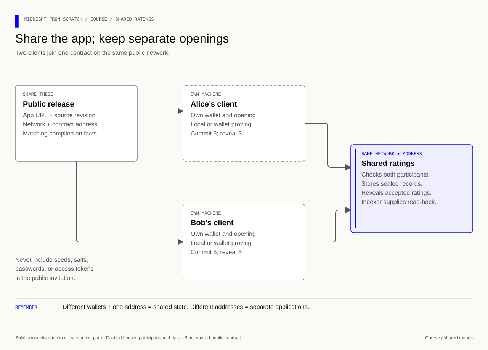

# Take the ratings app from your machine to other people

[Course overview](../README.md) · [Lesson 12](../Lessons/Lesson%2012/Exercise/README.md) · [Lesson 14](../Lessons/Lesson%2014/Exercise/README.md) · [Full guide](../Learn%20Tot.md)

The goal is for Alice and Bob to use **the same ratings contract** from separate
sessions. Start locally, share an experiment on preview, rehearse on preprod,
then release deliberately on mainnet. The contract's rating rules stay the same;
network services, wallets, funding, addresses, and release evidence change.

Commands on this page run from the **course root** unless a block explicitly
changes directory. The completed SDK implementation is `Lessons/Lesson 13/Solution/network/`.
Keep practicing in the lesson exercise folders; running this reference does not
mark their checkpoints complete.

## 1. The four stages

[](../assets/diagrams/course-four-environments.html)

| Stage | Exact network ID | Ratings example | What establishes progress |
|---|---|---|---|
| Local development | `undeployed` | Iterate quickly, then prove/deploy against the supplied Docker network | Local positive/negative tests, real local proof, confirmed deployment and read-back |
| Preview | `preview` | Invite another tester to the same publicly reachable contract | Two independent participants use one address and independently observe their records |
| Testnet rehearsal | `preprod` | Rehearse the intended release and recovery procedures | Repeatable end-to-end tests with the intended wallet, build, hosting, and access settings |
| Production | `mainnet` | Publish the reviewed ratings application for actual use | A reviewed release, funded production wallet, confirmed mainnet address, monitored operation |

Both preview and preprod are public **test networks**. Here “testnet stage” means
preprod, which is the final rehearsal. `testnet-02` is retired. A Vite command
named `preview` only serves a frontend build locally; it does not select Midnight
Preview. Likewise, `npm run build` optimizes/compiles application files; it does
not deploy a contract or select mainnet.

**Analogy:** local is your workshop, preview is an open practice room, preprod is
the dress rehearsal, and mainnet is the public performance. A successful workshop
experiment is useful evidence, but each venue still needs its own setup and check.

## 2. Start the supplied local environment with one command

Install Docker Desktop with Compose, start it, select the course Node version,
and install the course dependencies:

```bash
nvm use 22.23.2
npm ci
# Start the supplied node, indexer and prover together.
npm run network:up
# Inspect containers and independently probe the services.
npm run network:status
```

The course vendors the maintained Midnight example's [Compose bundle](../network/README.md).
You do not write a node configuration or assemble an indexer yourself. The
upstream three services are node `1.0.0`, indexer `4.3.3`, and prover `8.1.0`.
They bind to loopback ports 9944, 8088, and 6300. There is no explorer in this
bundle; the indexer provides local public queries. The public networks have
separate explorers.

`up` can download images on its first run. Wait for readiness before starting a
wallet. A health response establishes service availability; only a real contract
transaction establishes that this build can be proved and accepted.

```bash
# Read recent service logs if a readiness check fails.
npm run network:logs
# Stop processes while preserving their containers.
npm run network:stop
```

Do not run a second upstream stack on these same ports. Removing/recreating this
disposable network can reset chain state. Preserve openings and private stores;
reconcile old deployment records against the current chain before using them.

## 3. Prepare the ratings build once

```bash
# Install the separate, pinned network dependency graph.
npm ci --prefix 'Lessons/Lesson 13/Solution/network'
# Generate the feedback/round interfaces and type-check the network application.
npm run lesson13
# Generate the feedback contract's actual proving and verifying keys.
npm --prefix 'Lessons/Lesson 13/Solution/network' run compile
# Build the session CLI after full contract compilation.
npm --prefix 'Lessons/Lesson 13/Solution/network' run build
```

`--skip-zk` emits JavaScript and ZKIR but skips key generation. The full compile
above is required for network proving. A change to the contract requires a fresh
compile and a build that uses those matching artifacts.

This course uses compiler `0.31.1`, language `0.23`, runtime `0.16.0`,
Midnight.js `4.1.1`, and Wallet SDK `1.2.0`. The checked public support matrix
also pairs those compiler/runtime/SDK versions. Treat the dependency graph as a
set: newer compiler/runtime releases may target a different ledger. A bare
upgrade is not a deployment strategy. See the [verification record](knowledge-audit.md).

## 4. Try a complete local session

```bash
# Create a local participant configuration; refuses to replace an existing file.
npm run session:init -- undeployed alice
# Print the local fixture address and current fee resources without deploying.
npm run session -- undeployed alice info
# If this wallet has no DUST yet, register its funded NIGHT and wait for accrual.
npm run session -- undeployed alice register-dust
npm run session -- undeployed alice info
# Deploy the ratings contract and retain its confirmed address.
npm run session -- undeployed alice deploy
# Confirm that the saved address resolves on the selected network.
npm run session -- undeployed alice read
# Persist an opening, commit rating 3, then open that original rating.
npm run session -- undeployed alice commit 3
npm run session -- undeployed alice reveal
npm run session -- undeployed alice read
```

If the wallet already has sufficient DUST, skip the registration command. If it
reports no unregistered NIGHT, inspect existing registrations and wait for accrual
rather than repeatedly registering. Starting Docker does not itself establish
wallet fee readiness. Registration estimates its fee and waits for the eligible
NIGHT to cover it before submitting.

Expected final observation: the participant's record is revealed and its public
rating is `3`. The CLI waits for the SDK's confirmed call result, and `read`
queries indexed state independently. Local `alice` uses the public genesis
fixture; public profiles require a fresh private seed.

Configuration files live at `Lessons/Lesson 13/Solution/network/.env.<network>.<participant>.local`.
They contain secrets and are ignored by Git. Session receipts/openings live in
`Lessons/Lesson 13/Solution/network/.course-sessions/<network>/<participant>/`; encrypted provider
stores live under `.private-state/`. Back these up privately. A plaintext
teaching opening file is not a production secret-storage system.

The session CLI demonstrates lesson 10's **commit/reveal** contract. The
organizer/admission/phase rules added in lesson 15 are a different contract; use
its round implementation when those policies are required. Sharing a lesson 10
address does not create a collection deadline or admission policy.

## 5. Move the same experiment to preview

For preview, the node and indexer are public. Keep proving on your machine:

```bash
# Stop the local stack before another prover binds port 6300.
npm run network:stop
# Start only the local prover version listed by the checked public matrix.
npm run prover:up
# Create a distinct private preview wallet and private-store password.
npm run session:init -- preview alice
# Sync the wallet and display its public unshielded address.
npm run session -- preview alice info
```

Request test NIGHT for that address from the
[Preview faucet](https://midnight-tmnight-preview.nethermind.dev/). Then register
eligible NIGHT for DUST generation and wait for the wallet's indexed balance:

```bash
npm run session -- preview alice register-dust
npm run session -- preview alice info
# When DUST has accrued, deploy this build on preview.
npm run session -- preview alice deploy
npm run session -- preview alice read
```

Faucet delivery, synchronization, DUST registration, and DUST accrual are separate
steps. `info` can show a synchronized wallet with insufficient DUST. Registration
submits a transaction; its printed transaction ID alone is not a confirmation of
accrual. Recheck the indexed wallet state before deployment. A readiness threshold
does not guarantee that every possible transaction is affordable.

Preview configuration is built into [config.ts](../Lessons/Lesson%2013/Solution/network/src/config.ts):
`preview`, the Preview node WebSocket, Preview indexer HTTP/WS, and your local
prover. The CLI rejects the well-known local genesis seed on public networks.
Do not copy that seed into a preview or production configuration.

<a id="sharing"></a>
## 6. Invite Bob and test from a second session

Share **the network, confirmed contract address, and the exact source/build
revision**. Bob installs/builds the same source, creates his own configuration,
funds his own preview wallet, and supplies that public contract address:

```bash
# Bob runs these on his own machine with its local prover running.
npm run session:init -- preview bob
npm run session -- preview bob info
# After the faucet has funded Bob's displayed address:
npm run session -- preview bob register-dust
npm run session -- preview bob info
# Replace the example text with Alice's confirmed 64-hex-character address.
export CONTRACT_ADDRESS=PASTE_THE_CONFIRMED_ADDRESS_HERE
npm run session -- preview bob read
npm run session -- preview bob commit 5
npm run session -- preview bob reveal
npm run session -- preview bob read
```

Alice uses the same address and commits `3` in her own session. Each record is
owned by its own application secret. A new contract for every tester would test
separate databases rather than shared state. Each participant keeps the original
choice/salt/secret locally. Wallet seeds, passwords, opening files, and access
tokens are never part of the invitation.

For an additional independent observation, inspect the appropriate public
[Preview explorer](https://preview.midnightexplorer.com/) or query the indexer
with the contract address. Explorer support varies: an explorer's transaction
view does not necessarily decode this application's submission map. The CLI's
read-back uses this contract's actual generated ledger decoder.

**Test together:** Alice and Bob seal different values; check the pre-reveal
placeholder; reveal one record; confirm the other remains sealed; reject a
changed opening/repeated reveal; then reveal the other. Record transaction IDs,
block heights, expected public state, and failures at the tested source revision.
The existing local negative tests remain important; avoid spraying deliberate
invalid transactions across a public network when they can be rejected locally.

For a **local browser wallet**, the upstream examples also supply funding. In a
properly installed checkout of `midnight-examples`, with this local network
running, use the public addresses displayed by that browser wallet:

```bash
# Run in midnight-examples; substitute addresses belonging to the local network.
MIDNIGHT_NETWORK=local yarn fund:wallet YOUR_LOCAL_DUST_ADDRESS YOUR_LOCAL_NIGHT_ADDRESS
```

That helper is local-only. It uses sponsorship to direct generated DUST to the
browser wallet; DUST is not transferred as an ordinary token.

## 7. Rehearse on preprod

Preprod is the public test environment closest to the production release. Get a
**Midnight Preprod** Blockfrost project token, create a new participant profile,
and add the token to its private environment file:

```bash
npm run session:init -- preprod alice
# Edit Lessons/Lesson 13/Solution/network/.env.preprod.alice.local privately:
# BLOCKFROST_PROJECT_ID=<your Midnight Preprod project token>
npm run session -- preprod alice info
```

Use the [Preprod faucet](https://midnight-tmnight-preprod.nethermind.dev/), register
DUST, and repeat the deploy/read/commit/reveal/read workflow with `preprod` in
every command. Repeat Bob's join test on this new deployment. Keep the preview
address and opening records under preview; they do not migrate to preprod.

The checked configuration uses Blockfrost's `midnight-preprod` node and indexer
endpoints with a `project_id` query parameter. The old Midnight-hosted preprod
endpoints were retired. A missing/wrong-network token, HTTP 403, and an indexer
that has not caught up are different failures; investigate before resubmission.
The session CLI redacts token-bearing error URLs. Do not publish private URLs in
screenshots or browser configuration.

**Rehearsal deliverable:** a release note with network/build/contract address,
two-participant results, recovery after restarting a process, deployment/private
store backup verification, and a precise list of public disclosures. A stage quiz
can check your understanding; it cannot manufacture this evidence.

## 8. Build and share a browser app

[](../assets/diagrams/course-share-ratings.html)

The lesson 18 interface currently has a **simulation adapter**. Hosting its HTML
does not connect it to a chain. To turn it into a network app, keep the view and
replace the adapter with these responsibilities:

| Adapter operation | Real implementation |
|---|---|
| Connect | Discover/select the user's browser wallet; request the chosen network |
| Configure | Read node/indexer configuration from the connected wallet; reject a network mismatch |
| Join | `findDeployedContract` using the shared address and matching compiled interface |
| Commit | Preserve the original opening privately, call `commitFor`, wait, then read back |
| Reveal | Restore that opening, call `revealFor`, wait, then read back |
| Display | Derive pending/confirmed/error state from actual operations and indexed state |

Use the maintained
[Hello World browser reference](https://github.com/midnightntwrk/midnight-examples/blob/f0ae51ee42f5fd2be500fbc9e4cfe614bb91f820/examples/hello-world/ui/README.md)
and [browser DApp guide](https://docs.midnight.network/guides/browser-dapp) for
wallet discovery, connector APIs, WASM bundling, and artifact loading. They solve
the browser integration; the course's ratings rules provide the application.
In the upstream checkout the known working reference is:

```bash
# Compile its own demonstration contract before launching the browser example.
yarn workspace @midnight-ntwrk/example-hello-world run compile
cd examples/hello-world/ui
yarn dev
# After making and checking your ratings adaptation, create its distributable files.
yarn build
# Serve this dist/ folder through your chosen HTTPS static host.
```

Those commands launch/build **Hello World** until you adapt the generated
contract import, circuit types, and API methods to feedback. They do not
magically convert its `storeMessage` method into a ratings app. Keep the course
CLI as your working shared-network reference while building the browser adapter.
Copy the matching generated `keys/` and `zkir/` into the browser's public artifact
path during the build, as the upstream `copy:zk` script does. These proving
artifacts are distributable; wallet seeds and saved openings are not.

Share the HTTPS app URL plus its selected network and contract address. Each
visitor connects their own wallet on that network. Prefer wallet-provided
proving; if using the local HTTP prover, test the actual HTTPS-to-localhost,
CORS, and browser permissions behavior. Test the published origin in a second
browser profile; a development server's behavior alone does not establish that
hosting works. Configure Blockfrost access on a backend or use wallet-provided
endpoints; frontend environment variables are visible in built JavaScript.

**Two separate releases:** deploying a contract creates a chain address;
publishing a frontend creates a website URL. Both must refer to the same network
and compatible artifacts. A production frontend build can still target preview.

## 9. Release deliberately on mainnet

Mainnet is the production network and has no faucet. Use a production-owned
wallet funded with real NIGHT/DUST, a Midnight Mainnet Blockfrost token, and the
reviewed version set. Do not use repository test seeds. Keep the local prover or
the user's wallet-based proving arrangement under the intended trust model.

Before the first production transaction, complete the preprod rehearsal, review
privacy and authorization, test backups/recovery, review the deployed code/build,
and arrange monitoring/support for failed or uncertain calls. The course's
plaintext opening notebook and demonstration key handling require an explicit
production storage design.

```bash
# Prepare a distinct production profile; this creates secrets but sends no transaction.
npm run session:init -- mainnet production
# Add the correct production Blockfrost project token privately.
npm run session -- mainnet production info
# Only when the release and funding are ready, explicitly enable submission.
MAINNET_TRANSACTIONS=enabled npm run session -- mainnet production deploy
npm run session -- mainnet production read
```

The opt-in guards the course CLI; it is not a security audit or external approval
requirement. Record the confirmed production address and source/build revision;
publish only public configuration to users. Subsequent `commit`, `reveal`, and
`register-dust` commands also require the explicit production opt-in. This guide
prepares the workflow; no mainnet transaction was sent while writing it.

## 10. When a result is uncertain

A timeout or closed terminal does not cancel an already submitted transaction.
Preserve the original opening. Check the saved network/address, transaction ID,
and indexed state before deciding whether a retry is needed. The CLI refuses to
overwrite an opening or deployment receipt. If it saved an opening but never
submitted, inspect the state and recover that exact opening; do not generate a
new salt while trying to open an earlier commitment. Automatic retry/resume of
an uncertain commit is intentionally outside this short teaching CLI.

| Evidence | What it establishes |
|---|---|
| Compile success | Valid source for that compiler; generated artifacts |
| Type-check success | Compatibility of the checked TypeScript interfaces |
| Local execution/negative tests | Behavior observed in the local runtime |
| Prover health | Service availability |
| Real proof + accepted transaction | That proving/submission path worked for this operation |
| Confirmed call + indexed read-back | The accepted public state observed on this network |
| Two independent testers | Shared state works for the tested participants/build |
| Preprod rehearsal | Evidence for that rehearsal; mainnet still needs its own observation |

**Recall:** Bob's UI loads, but Alice cannot see Bob's rating. Name three checks.

<details><summary>Answer</summary>

Check that both clients selected the same network, joined the same contract
address, and observed the confirmed reveal through their configured indexers.
Then check the participant record and actual adapter: a simulated UI or an
unsubmitted/pending call cannot establish shared chain state.

</details>

**Memory cue:** **Same source, same network, same address; separate wallets and openings.**

## Sources and verification scope

This path follows Midnight expert's devnet, SDK, wallet, privacy, and verification
skills and checks their linked implementation evidence. Current upstream review:
expert `7853915`, examples `f0ae51e`, 27 October 2026. The expert's older local
node cap and some cached endpoint summaries conflict with the maintained examples
and current network reference; the investigation is recorded in
[knowledge-audit.md](knowledge-audit.md).

The local references, configuration, CLI validation, and SDK types are checked
separately from live proof generation and public-network transactions. See the
audit for the actual results. This page does not claim the examples were deployed
while the course was being edited.

Primary references: [network selection and endpoint reference](https://docs.midnight.network/guides/networks-and-environments),
[support matrix](https://docs.midnight.network/relnotes/support-matrix),
[funding](https://docs.midnight.network/guides/acquire-tokens),
[deploy and operate](https://docs.midnight.network/guides/deploy-and-operate), and
[Midnight expert verification hub](https://github.com/midnightntwrk/midnight-expert/blob/7853915a82a605e3b74dd3b7ab7a241de8a9d136/plugins/midnight-verify/skills/verify-correctness/SKILL.md).
